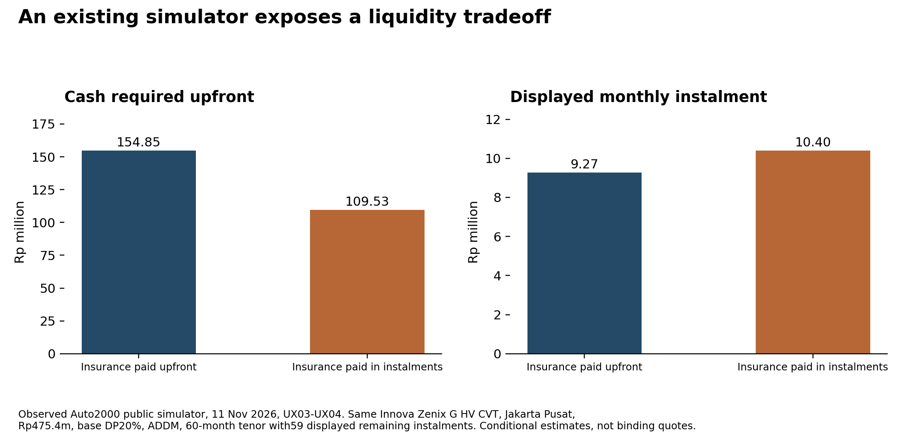
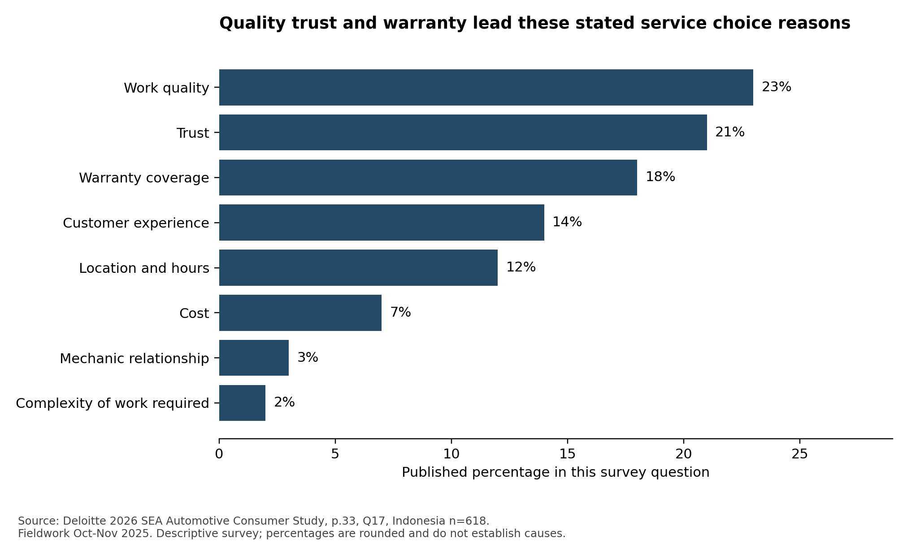
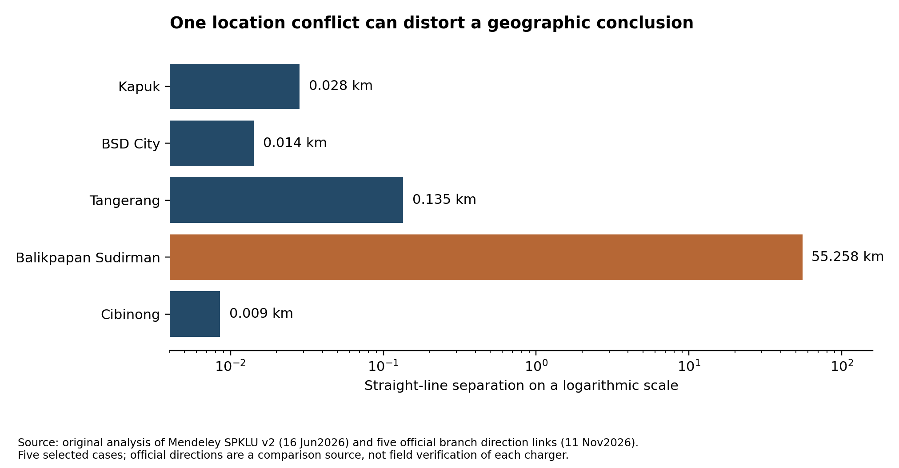
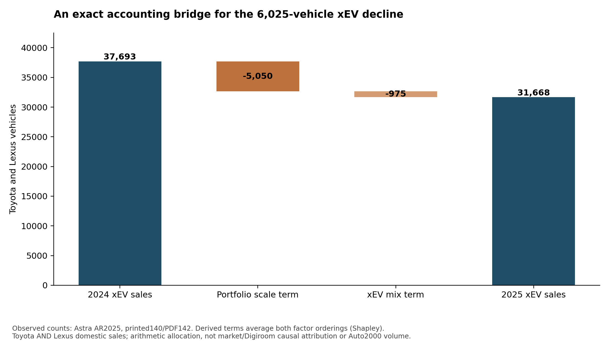
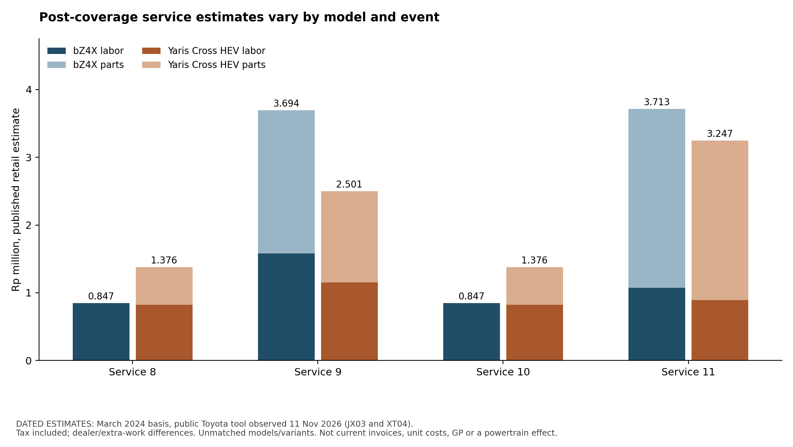

# Auto2000 Digiroom: updated master AI context

Built 2026-11-11T05:26:32.177118+00:00. Current English synthesis plus preserved historical input. Detailed evidence context, not an implementation or selected strategy.

## Contents

1. Current mandate, precedence and how to use this context
2. Decision history and scope changes preserved from this task
3. Latest PDF preference: a clear visual memo with full research retained
4. Current evidence ledger and freeze-sensitive status
5. Release variants, rights, backup and source privacy
6. Corrections that must survive every later summary
7. Current execution record and release boundaries
8. Main research report: complete current narrative
9. Friend-context challenge report: complete readable text
10. Sixteen cross-source insight cards
11. Twenty-seven consolidated solution alternatives
12. Independent review of all forty-five draft concepts
13. Original twenty-five hypothesis assessment
14. Numerical and economic audit
15. First-wave market evidence and competing interpretations
16. First-wave owner narratives and fresh-source challenge
17. First-wave app review findings
18. First-wave external datasets and original calculations
19. First-wave evaluator journeys
20. Focused friend-context journey checks
21. Corporate capability checks
22. Survey denominator and source audit
23. Insurance source interpretation
24. Deeper follow-up: current integrated synthesis
25. Visual memo mechanism briefs: presentation, not additional evidence
26. Visual memo page briefs: data_story
27. Visual memo page briefs: economic_story
28. Visual memo page briefs: review_story
29. Deeper follow-up: automotive review counterexamples
30. Deeper follow-up: geographic robustness
31. Deeper follow-up: independent geography challenge
32. Deeper follow-up: live website journeys
33. Deeper follow-up: economic mechanisms and obligations
34. Deeper follow-up: external mechanisms and accounting coverage
35. Deeper follow-up: independent source and accounting review
36. Deeper follow-up: independent lifecycle and menu challenge
37. Additional current extension record: extension_battery/BATTERY_TELEMETRY_REPORT
38. Additional current extension record: extension_stakeholders/MECE_STAKEHOLDER_REPORT
39. Additional current extension record: extension_stakeholders/README
40. Additional current extension record: extension_journeys/EXTENSION_JOURNEY_REPORT
41. Additional current extension record: extension_journeys/QA_REPORT
42. Additional current extension record: extension_journeys/report_source
43. Friend challenge: all forty analytical groups
44. Capability register: entity-specific checks
45. Insurance register: coverage, contracts and risk boundaries
46. Survey register: question-by-question denominators
47. Market register: all scoped external observations
48. Extension stakeholder register: new scoped observations
49. Lifecycle register: all twenty-six analytical job units
50. Stakeholder register: all decision-right and incentive lenses
51. Independent menu audit: all twenty-seven concept updates
52. Extension candidate: separate from the frozen menu
53. External mechanism register: seven studies or instruments
54. Detailed calculation and status receipts
55. Reproducibility, dependency and acquisition boundaries
56. Raw dataset rights and exact-byte/transformed distinctions
57. Data guide and source tracing
58. Named references for privately supplied historical documents
59. Historical appendix: original friend master context with private-storage links redacted
60. Build provenance and pending-artifact receipt


## Chapter 1. Current mandate, precedence and how to use this context

This is the current, detailed English master context for the Auto2000 Digiroom research project. It updates the supplied friend context with completed research, counterevidence, methodological limits, evidence registers, original figures and the deeper follow-up. Build time: **2026-11-11T05:26:32.177118+00:00**. It is a reusable record of this research task, not a claim to reproduce every message in a conversation transcript.

**Current instructions take precedence over the historical appendix.** The current endpoint is research diagnosis, critical evidence, hypotheses, distinctive insight cards and broad solution alternatives for the user to choose. Do not choose a winner, build an Auto2000 product, select a pilot, prescribe implementation or allocate the investment budget. Earlier historical suggestions about pilots, rollout, preferred channels or writing language are preserved as history and are not current authorization. The current requested language is English. The Indonesian historical document remains in its original language so its nuance is not silently rewritten.

The user asked for a much larger, sustained, parallel research effort, including datasets, social-media possibilities, GitHub discovery, hypotheses, new insights and stakeholder perspectives. They also asked to retain the earlier ZIPs and make a backup later. Their request for scale does not authorize fabricated customer rows, artificial duplication or counting features as people. The project uses actual acquired data and explicitly distinguishes observations from derived calculations and external study sizes.

The first-wave files remain an audit trail. Extension reports refine their interpretation rather than silently upgrading every old claim. The original 25 hypotheses remain unresolved as causal business mechanisms. The 40 friend analytical groups and 148 scoped clauses are coverage, not confirmed findings. The 16 insight cards and27-concept menu are preserved; a later independent candidate is separate, not retroactively selected or added to a frozen menu without a new label.

Public operator publications establish what the operator represents. They do not establish every branch's execution, user comprehension, authorized data access or incremental profit. Self-reports remain unverified. Evaluator browser observations are not recruited-customer tests. Statistical results from foreign studies remain tied to their samples, designs, dates and endpoints. Synthetic risk examples expose the meaning of a promise; they are not sales forecasts or actuarial data.

All source-grounded coding and project crosschecks were done by AI researchers. A second-AI review is useful error checking, not human validation, a blinded reliability experiment or independent verification of customer truth. Upstream published research retains its own methods. This project did not recruit human participants, conduct dealer fieldwork, access private customer records or observe verified Auto2000 deliveries or completed repair contributions.

Do not import unrelated user profile, memories, account identifiers or private source bodies into this context. No private ChatGPT Library links or IDs are included. The original user-supplied context remains unchanged outside the pack; this derivative changes only six private-storage URLs in its marked historical appendix. Original source SHA256: `e76c307877a47d89a3f47fd6cb71a30d448e4cdfd1aaebc625fdb980f13b9be3`. This hash identifies bytes, not a source document's truth or a person's identity.

Use the current report and extension chapters together. A repeated figure in two chapters is one finding discussed twice, not another observation. A study abstract, a survey instrument, a source file, a derived table, a chart and a source-check row have different units. Read their evidence boundaries before reusing a number.


## Chapter 2. Decision history and scope changes preserved from this task

The task began with a request to examine a research plan before execution. It expanded into a very large public-source Auto2000 research request, with datasets, social-media and GitHub discovery, hypothesis generation and challenge, strategic directions, stakeholder lenses and a large downloadable archive. Planning and execution were separated. The research endpoint was then clarified to exclude an Auto2000 implementation or rollout plan and a final winning strategy. The user chooses among possible solutions.

The run used a lead and six specialist slots, with work rotated across acquisition, customer narratives, market evidence, competitor/operator terms, datasets, live journeys, economics, independent checking and synthesis. Parallelism is an execution method, not seven independent confirmations of the same source. A configured eight-hour proposal and large crawl ceilings are not evidence that eight hours of active work or all planned collection occurred. The actual interrupted site queue and source-access limits remain explicit.

The user had not downloaded an earlier ZIP and asked for it inside the later archive. Both historical releases are preserved unchanged under previous_releases. They contain earlier plans, methods and initial outputs. Those inherited inventories or rows do not count as newly acquired observations merely because they are copied into a new archive.

The later friend-context upload became a new substantive challenge source. The team extracted its nuanced claims instead of rejecting a stronger strawman. R1 concerns driving/charging fit and ownership economics; an existing installment calculator does not settle it. R2 concerns model/job capability and credible fulfillment; an existing booking screen does not settle that either. M2 concerns useful evidence in appraisal; a certificate route alone does not prove acceptance or value, and its existence rules out a first-certificate novelty claim. Insurance, capped top-up, full floor and residual-risk transfer retain distinct counterparties and obligations.

The first release introduced16cross-source insights and 27 consolidated alternatives from 45 draft cards. The next user request authorized a deeper follow-up, with prespecified questions after substantial discovery. This is a disclosed extension, not blind preregistration before any evidence existed. Additional app reviews, geographic sensitivity, BEV journey controls, program/event comparisons, stakeholder lifecycle checks, foreign mechanism studies and battery signal data were collected/analyzed where accessible. New evidence changed or narrowed some interpretations without establishing causal Auto2000 commercial effects.

The latest request is for this long, detailed, updated master context, carrying every substantive new finding and decision boundary. The builder is dynamic: it reads current reports and registers, records input hashes and exposes missing final artifacts. Rerun it after final telemetry, mobile, QA or backup status changes. Earlier source text remains historical; current mandates and the latest scoped evidence control future use.


## Chapter 3. Latest PDF preference: a clear visual memo with full research retained

The user supplied **Audit_Kesesuaian_Umpan_Balik_Juri (2).pdf**, a four-page unrelated audit document, as a **visual reference only**. It supplies no IBSC case fact, business finding, judge feedback about this Auto2000 work, new study, sample or validation. Its relevance is presentation: short clear paragraphs, a prominent analytical point, large useful charts and evidence placed near the claim. Do not import its subject matter into the Auto2000 evidence base.

The current primary reading PDF is the shorter visual memo. Approximately 38 pages was the design target; the explicit final-PDF metadata below records the actual count when supplied. The intended pattern is one main finding per page, roughly 100–200 words where appropriate, readable figures and seven family pages for the 27 solution concepts. Full analysis remains in the archive, Markdown, evidence registers and this detailed context. This changes presentation density, not the scope of research or the unresolved causal status.

The mechanism page briefs in `story_assets/mechanism_story.json` and `.md` express three distinctions in plain English: completed jobs and their contribution; stated preference versus observed purchase; and the five analytical links between a battery measurement and a changed transaction. Their diagrams are conceptual or evidence-state displays, not invented effect-size charts. They contain no implementation choice or winner.

**Explicit final visual PDF supplied to this build:** {"filename": "Auto2000_Research_Findings.pdf", "bytes": 1156530, "sha256": "e46506c9ecce3bf316f844de0700f64b20e8a8605f97316d177a3dc9c94861d1", "pages": 41, "pdf_text_words_whitespace": 7359}

**Current final-version visual QA:** Three matching final-version AI visual QA receipts pass their assigned page ranges (1–16,17–28,29–41), with zero blocking defects. Changed pages were rechecked and unchanged coverage retained only as described in the receipts. Any nonblocking notes are limited to those explicitly recorded in the final receipts. This is visual/readability QA, not human or causal validation.

**Visual-reference metadata:** {"filename": "Audit_Kesesuaian_Umpan_Balik_Juri (2).pdf", "sha256": "1811dd36a2b873be8cd3deb693f3304e678786e1d9c31d1db3605963af74da8b", "role": "visual reference only, not IBSC evidence"}

The supplied original friend context remains a historical appendix. Its earlier delivery style does not override the latest English visual-memo preference. The final PDF can be read first, then this master context and the archive provide the depth and exact source boundaries.

### Visual-memo QA version receipt

The following entries describe the exact PDF versions inspected, not new research observations or human validation. Some frozen receipts can precede a later layout patch. Compare their hashes with the explicit final PDF; a mismatched old receipt does not automatically validate or invalidate a newer version. The original JSON retains page-specific scope and findings. A render-stage visual_review_pending flag records that stage; matching final page-range receipts supersede it once those inspections are complete.

```json
[
  {
    "file": "reports/STORY_DATA_CLAIM_QA.json",
    "checked_pdf_sha256": "7c1fc15d879afc59b217bb89d43b5625dfb5710e4b2c4acc2a8f127f84444034",
    "matches_explicit_final_pdf": false,
    "scope": "Source and numeric review of seven data-story pages plusIGAR. Separate from full-document visual QA. No new retrieval or analysis; only verification of existing source/derived tables.",
    "status": "PASS_WITH_MINOR_VISUAL_AND_COPY_QUALIFICATIONS",
    "passed": 43,
    "failed": 0,
    "blocking_issue_count": null,
    "visual_review_pending": null
  },
  {
    "file": "reports/STORY_ECONOMIC_CLAIM_QA.json",
    "checked_pdf_sha256": "7c1fc15d879afc59b217bb89d43b5625dfb5710e4b2c4acc2a8f127f84444034",
    "matches_explicit_final_pdf": false,
    "scope": "Independent frozen-input arithmetic, final PDF text, chart-generator inputs and AI inspection of the eight rendered pages. Not a repeat of old80-pageQA.",
    "status": "see original receipt",
    "passed": 40,
    "failed": 0,
    "blocking_issue_count": 0,
    "visual_review_pending": null
  },
  {
    "file": "reports/STORY_FINAL_QA.json",
    "checked_pdf_sha256": "e46506c9ecce3bf316f844de0700f64b20e8a8605f97316d177a3dc9c94861d1",
    "matches_explicit_final_pdf": true,
    "scope": "see original receipt",
    "status": "see original receipt",
    "passed": null,
    "failed": null,
    "blocking_issue_count": null,
    "visual_review_pending": null
  },
  {
    "file": "reports/STORY_FINAL_VISUAL_QA_01_16.json",
    "checked_pdf_sha256": "e46506c9ecce3bf316f844de0700f64b20e8a8605f97316d177a3dc9c94861d1",
    "matches_explicit_final_pdf": true,
    "scope": [
      1,
      16
    ],
    "status": "PASS carried forward to immutable final seal by16-page RGB identity proof",
    "passed": null,
    "failed": null,
    "blocking_issue_count": 0,
    "visual_review_pending": null
  },
  {
    "file": "reports/STORY_FINAL_VISUAL_QA_17_28.json",
    "checked_pdf_sha256": "e46506c9ecce3bf316f844de0700f64b20e8a8605f97316d177a3dc9c94861d1",
    "matches_explicit_final_pdf": true,
    "scope": "AI_visual_review_not_human_validation",
    "status": "passed",
    "passed": null,
    "failed": null,
    "blocking_issue_count": 0,
    "visual_review_pending": null
  },
  {
    "file": "reports/STORY_FINAL_VISUAL_QA_29_41.json",
    "checked_pdf_sha256": "e46506c9ecce3bf316f844de0700f64b20e8a8605f97316d177a3dc9c94861d1",
    "matches_explicit_final_pdf": true,
    "scope": "Final v4 AI visual inspection of full pages38/39; RGB pixel identity against the visually reviewed v3 render proved for other assigned pages29-37,40,41. All prior card identity, field completeness, family counts, exact paths and confidence-label checks remain supported by identical pixels.",
    "status": "PASS",
    "passed": null,
    "failed": null,
    "blocking_issue_count": 0,
    "visual_review_pending": null
  },
  {
    "file": "reports/STORY_FINAL_VISUAL_QA_29_41_3bc178b6.json",
    "checked_pdf_sha256": "3bc178b6d610f6783c9cc243197bcdb88b6e347fb0f1cdafa88edee2118ce5f6",
    "matches_explicit_final_pdf": false,
    "scope": "AI visual reinspection of current contacts08-11;current full pages29,36,39,41;all27 titles and81 field strings rechecked by PDF extraction. Prior full-page review of all13 pages belongs to the historical7c1fc15d hash and is retained separately.",
    "status": "PASS_LAYOUT_AND_CARD_COMPLETENESS",
    "passed": null,
    "failed": null,
    "blocking_issue_count": 0,
    "visual_review_pending": null
  },
  {
    "file": "reports/STORY_RENDER_QA.json",
    "checked_pdf_sha256": "e46506c9ecce3bf316f844de0700f64b20e8a8605f97316d177a3dc9c94861d1",
    "matches_explicit_final_pdf": true,
    "scope": "see original receipt",
    "status": "see original receipt",
    "passed": null,
    "failed": null,
    "blocking_issue_count": null,
    "visual_review_pending": false
  },
  {
    "file": "reports/STORY_VISUAL_QA_01_16.json",
    "checked_pdf_sha256": "7c1fc15d879afc59b217bb89d43b5625dfb5710e4b2c4acc2a8f127f84444034",
    "matches_explicit_final_pdf": false,
    "scope": "AI visual review only; not human review",
    "status": "passes visual readability/rendering checks with two minor polish observations",
    "passed": null,
    "failed": null,
    "blocking_issue_count": 0,
    "visual_review_pending": null
  },
  {
    "file": "reports/STORY_VISUAL_QA_17_28.json",
    "checked_pdf_sha256": "7c1fc15d879afc59b217bb89d43b5625dfb5710e4b2c4acc2a8f127f84444034",
    "matches_explicit_final_pdf": false,
    "scope": "AI_visual_review_not_human_validation",
    "status": "requires_axis_label_fix_before_approval",
    "passed": null,
    "failed": null,
    "blocking_issue_count": 1,
    "visual_review_pending": null
  },
  {
    "file": "reports/STORY_VISUAL_QA_29_41.json",
    "checked_pdf_sha256": "7c1fc15d879afc59b217bb89d43b5625dfb5710e4b2c4acc2a8f127f84444034",
    "matches_explicit_final_pdf": false,
    "scope": "AI visual inspection of contacts08-11 and every assigned page opened individually at96dpi. Exact card text/identity and confidence labels checked with PDF extraction as a supplement, not a substitute for visual inspection.",
    "status": "PASS_WITH_MINOR_TYPOGRAPHY_AND_REFERENCE_NOTES",
    "passed": null,
    "failed": null,
    "blocking_issue_count": 0,
    "visual_review_pending": null
  }
]
```


## Chapter 4. Current evidence ledger and freeze-sensitive status

| Family | Captured unit/count at this build | Meaning and limit |
|---|---|---|
| Initial public automotive reviews | 210 platform review IDs; six apps; twelve first-wave cohorts | Public-listing convenience evidence, not representative customers or completed jobs. |
| Follow-up reviews | 148 new unique IDs; 358 combined IDs across 21 cohorts | Original and new waves overlap only as documented; metadata/coding views add no reviews. Vehicle context, app role, source language, date and version differ. |
| Narrative discovery/follow-up | 95 annotations, 38 URLs | Not95independent people or incidents. Includes questions, advice, employee accounts and study findings. |
| Site sample | 345 requested records, 281 successful raw-HTML responses | Frozen interrupted queue, not completed crawl. Extracted structure is not rendered task success or SEO performance. |
| IGAR auxiliary raw | 617,722 rows in each of two label views; 617,703 composite keys; 19 duplicate excess rows per view | Same government-app corpus, not 1,235,444 independent reviews or Auto2000 data. |
| IGAR storage shape | Eight plus twelve raw column positions, including source index; 12,354,440 row×column slots | About 12.35 million cells, including repeated/shared/missing fields, not independent facts or people. |
| SPKLU | 2,454 station rows; 3,767 charger-box rows | Hierarchical source units, not customer visits, live uptime or usable capacity. |
| Derived geography | 6,019,662 directed pair distances | Computations; full matrix discarded, summary results retained. |
| BPS stock | 1,285 numerical province/year/type cells across seven yearly tables | All registered vehicles under changing boundaries; not Auto2000/BEV exposure. |
| Battery subset |5 downloaded MAT bundles;56,507,201 stored Curr/Volt/SoC/Temp values, excluding clocks/epoch | Purposeful windows from one Audi e-tron in California, not Toyota/Indonesia owners or independent physical measurements. |
| Battery public staging |5 MAT files presently staged under raw_licensed_data | Downloaded source files and public-release staging are different states; final privacy/license checks remain with their receipts. |
| Friend challenge |40 groups;148 scoped clauses | Analytical coverage, not independent studies or proven effects. |
| Lifecycle extension |26 analytical job units;260 owner-matrix cells | Includes institutional risk layer; not additive unmet needs or profit pools. |
| Economics extension |14 mechanism records;80 constructed unit states | Illustrations/identity checks, zero forecast or causal uplift. |

**Battery completion status:** Readable report present; inspect its final QA/manifest limits.

**Mobile status:** No completed mobile journey in the current summary. Device capability/launch restrictions are recorded; desktop results do not validate mobile. No mobile/native success is inferred from desktop observations. Check the latest journey report and capability receipt below; a failed launch is an environment limit, not a customer defect.

**Backup status:** Receipt supplied; review the explicitly recorded success/failure states:

{
  "started_utc": "2026-11-11T05:15:29.243524+00:00",
  "authorization": "User requested Filebin and alternative backup hosts. Public-safe variant only.",
  "primary_full_zip_is_separate": true,
  "omitted_from_anonymous_backup": [
    "IGAR_CC_BY_4_0/Rating_labeled.csv",
    "IGAR_CC_BY_4_0/VADER_labeled.csv"
  ],
  "layout": "Core plus five whole-MAT ZIP volumes; extract into the same directory. No binary concatenation.",
  "attempts": [
    {
      "host": "Filebin",
      "file": "Auto2000_Public_Backup_Core.zip",
      "http_status": 201,
      "curl_exit_code": 0,
      "at_utc": "2026-11-11T05:15:50.086707+00:00",
      "reason": "See private raw response; no success inferred from reachability"
    },
    {
      "host": "Filebin",
      "file": "Auto2000_Telemetry_Volume_01.zip",
      "http_status": 201,
      "curl_exit_code": 0,
      "at_utc": "2026-11-11T05:16:04.637409+00:00",
      "verified_server_checksum": true
    },
    {
      "host": "Filebin",
      "file": "Auto2000_Telemetry_Volume_02.zip",
      "http_status": 201,
      "curl_exit_code": 0,
      "at_utc": "2026-11-11T05:16:21.768491+00:00",
      "verified_server_checksum": true
    },
    {
      "host": "Filebin",
      "file": "Auto2000_Telemetry_Volume_03.zip",
      "http_status": 201,
      "curl_exit_code": 0,
      "verified_server_checksum": true,
      "at_utc": "2026-11-11T05:23:34.605631+00:00",
      "resumed_after_interruption": true
    },
    {
      "host": "Filebin",
      "file": "Auto2000_Telemetry_Volume_04.zip",
      "http_status": 201,
      "curl_exit_code": 0,
      "verified_server_checksum": true,
      "at_utc": "2026-11-11T05:23:43.553689+00:00",
      "resumed_after_interruption": true
    },
    {
      "host": "Filebin",
      "file": "Auto2000_Telemetry_Volume_05.zip",
      "http_status": 507,
      "curl_exit_code": 0,
      "verified_server_checksum": false,
      "at_utc": "2026-11-11T05:23:54.932833+00:00",
      "resumed_after_interruption": true
    },
    {
      "host": "TmpFiles",
      "file": "Auto2000_Telemetry_Volume_05.zip",
      "http_status": 200,
      "curl_exit_code": 0,
      "at_utc": "2026-11-11T05:24:38.277082+00:00"
    },
    {
      "host": "Catbox",
      "file": "Auto2000_Telemetry_Volume_05.zip",
      "http_status": 200,
      "curl_exit_code": 0,
      "at_utc": "2026-11-11T05:24:55.291271+00:00"
    }
  ],
  "files": [
    {
      "file": "Auto2000_Public_Backup_Core.zip",
      "bytes": 21158523,
      "sha256": "073bab0ae2da404c4ff6b26198508db0120bf3143672c6bf4195739d757ef58c",
      "host": "Filebin",
      "url": "https://filebin.net/auto2000-5abdf26a9e353ecfe7a2/Auto2000_Public_Backup_Core.zip",
      "verified": true,
      "verification": "Server201 metadata matched client SHA256 supplied in upload header",
      "expires_at": "2026-11-18T05:15:49.753141Z"
    },
    {
      "file": "Auto2000_Telemetry_Volume_01.zip",
      "bytes": 51229660,
      "sha256": "900b6c259ab012059e9418353613455e277be52f4ed30077459527a89c07f1d8",
      "host": "Filebin",
      "url": "https://filebin.net/auto2000-5abdf26a9e353ecfe7a2/Auto2000_Telemetry_Volume_01.zip",
      "verified": true,
      "verification": "Server201 SHA256 metadata match",
      "expires_at": "2026-11-18T05:16:04.35089Z"
    },
    {
      "file": "Auto2000_Telemetry_Volume_02.zip",
      "bytes": 87813472,
      "sha256": "fba3cde7a8196d3bcade636aa6cf33bbf5bbc893b33b9775f4963ef9a741b10e",
      "host": "Filebin",
      "url": "https://filebin.net/auto2000-5abdf26a9e353ecfe7a2/Auto2000_Telemetry_Volume_02.zip",
      "verified": true,
      "verification": "Server201 SHA256 metadata match",
      "expires_at": "2026-11-18T05:16:21.503834Z"
    },
    {
      "file": "Auto2000_Telemetry_Volume_03.zip",
      "bytes": 94664188,
      "sha256": "3de29b69820fb05f255845ea66a94642fe563b45892625cc09e721323bb2ba25",
      "host": "Filebin",
      "url": "https://filebin.net/auto2000-5abdf26a9e353ecfe7a2/Auto2000_Telemetry_Volume_03.zip",
      "verified": true,
      "verification": "Server201 SHA256 metadata match",
      "expires_at": "2026-11-18T05:23:34.199968Z"
    },
    {
      "file": "Auto2000_Telemetry_Volume_04.zip",
      "bytes": 32336528,
      "sha256": "976e11c2a9fbbd0d2d89ceb9218080b1be9b46f30dfb55748ad50959685f0d6f",
      "host": "Filebin",
      "url": "https://filebin.net/auto2000-5abdf26a9e353ecfe7a2/Auto2000_Telemetry_Volume_04.zip",
      "verified": true,
      "verification": "Server201 SHA256 metadata match",
      "expires_at": "2026-11-18T05:23:43.304419Z"
    },
    {
      "file": "Auto2000_Telemetry_Volume_05.zip",
      "bytes": 14238241,
      "sha256": "6ab92599557d1c28dacf7c5be14f371276b2e7421f62d49370cab8d0489ea237",
      "host": "TmpFiles",
      "url": "https://tmpfiles.org/wIA6Wi4e6kp4/auto2000_telemetry_volume_05.zip",
      "download_url": "https://tmpfiles.org/dl/wIA6Wi4e6kp4/auto2000_telemetry_volume_05.zip",
      "download_http_status": 200,
      "download_bytes": 2874,
      "download_sha256": "ef938af14ec00aa6d8d93b552d4397b9724cff10680f63137cad11d719bc248e",
      "verified": false,
      "verification": "Full downloaded bytes SHA256 and size comparison",
      "expiry_confirmed_by_response": false,
      "retention_seconds_requested": 172800
    },
    {
      "file": "Auto2000_Telemetry_Volume_05.zip",
      "bytes": 14238241,
      "sha256": "6ab92599557d1c28dacf7c5be14f371276b2e7421f62d49370cab8d0489ea237",
      "host": "Catbox",
      "url": "https://files.catbox.moe/naokdk.zip",
      "download_url": "https://files.catbox.moe/naokdk.zip",
      "download_http_status": 200,
      "download_bytes": 14238241,
      "download_sha256": "6ab92599557d1c28dacf7c5be14f371276b2e7421f62d49370cab8d0489ea237",
      "verified": true,
      "verification": "Full downloaded bytes SHA256 and size comparison",
      "expiry_confirmed_by_response": false
    }
  ],
  "complete_verified_public_backup": true,
  "preferred_host": "Filebin with alternative for remaining object",
  "bin_url": "https://filebin.net/auto2000-5abdf26a9e353ecfe7a2",
  "finished_utc": "2026-11-11T05:25:04.168210+00:00",
  "delivery_note": "Complete public-safe backup across Filebin (core and telemetry 01\u201304) and Catbox (telemetry 05). Filebin rejected the final object with HTTP507. TmpFiles returned a small page rather than matching archive bytes and is not a verified backup. The primary private download also includes the two IGAR originals omitted here.",
  "public_core_is_sealed_pre_upload_snapshot": true,
  "public_core_context_backup_status": "Pending at core sealing; this separate receipt and the primary release context give the actual final outcome."
}


The expanded sample is larger than the first wave, but no unit is silently recounted as another person. External studies' 3,181, 2,170, 1,490, 1,167 or 9 million figures describe those studies; their raw respondents/listings were not thereby acquired by this project. Their findings remain external mechanism evidence.


## Chapter 5. Release variants, rights, backup and source privacy

The intended primary user archive is **Auto2000_Research_Project_Full.zip**. It includes the two exact licensed IGAR text CSVs requested as raw data, separately attributed SPKLU/BPS material, project code, derived tables, reports, figures, context and earlier releases. Newly staged licensed telemetry requires its own recorded checks and manifest. Inclusion of licensed raw text does not turn it into current Auto2000 evidence or certify that every self-disclosure is absent.

The intended public backup variant is **Auto2000_Research_Public_Backup.zip**, which omits the two IGAR full-text CSVs. If a host's 100 MB limit requires split delivery, the intended **Auto2000_Public_Backup_Core.zip** excludes the five MAT binaries and the additional **Auto2000_Telemetry_Volume_01.zip** through **Auto2000_Telemetry_Volume_05.zip** each carry a whole telemetry source file in the common extraction layout. This is an explicit multi-archive distribution of complete files, not arbitrary binary truncation or a byte-for-byte mirror of the primary ZIP. Final receipts determine which variants were actually built and uploaded; names here do not assert successful upload.

Private caches are **always excluded**. There is no claimed authorization to bulk publish private_cache, captured current-review text, unlicensed publisher HTML/PDF bodies, source image archives, browser sessions, cookies, credentials, account receipts or installation dependencies. Current automotive reviews appear as derived/nontext source records and conservative paraphrase codes. The full private casebook and Statista dossiers are excluded. Only the user-provided context text and our own summaries of relevant source facts are included. A separately licensed dataset README, including the telemetry source README, has its own explicit source-manifest treatment; this exception does not include the full research paper. Private Library identifiers and account links are redacted even from the historical appendix.

The primary licensed raw appendix retains different rights: IGAR CC BY 4.0; SPKLU CC BY-NC 3.0; telemetry source CC BY-NC 3.0 as recorded; attributed factual BPS table payloads with no blanket unrestricted license claim. A source license applies to its material and conditions, not automatically to every report or web page in this project. Noncommercial restrictions are not commercial deployment permission. Data-set source manifests distinguish exact source bytes from transformed table objects and derived analysis.

Filebin and alternative-host backup success must be established by actual upload receipts. Earlier failure or 507 does not prove the later release is backed up. A backend Library receipt, if used to preserve deliverables, remains private; its IDs do not belong in this context. Final human-facing backup links may be recorded outside the exact archive to avoid checksum self-reference. A backup smaller than the primary archive must disclose omitted files and where licensed volumes can be obtained.

The unchanged earlier archives are `previous_releases/Auto2000_Public_Research_Initial_2026.zip` and `previous_releases/Auto2000_Expanded_Research_Plan_v2.zip`. They are retained for the user's continuity, not used to imply that all their plan ceilings were achieved. The newest source registers, actual request counts and release-status receipts control claims about work completed.


## Chapter 6. Corrections that must survive every later summary

1. Existing functionality is a baseline: the observed hybrid and BEV finance simulations work before contact; optional income can remain blank. HEV/ICE comparison, broad branch filtering, guest qualification, digital HHC certificate retrieval, BEV trade-in model selection and dated program-specific service estimates exist. This does not prove ideal comprehension or fulfillment, but it defeats universal absence claims.
2. Current versus historical evidence matters. Review dates, installed build, source capture, model year, estimate basis and entitlement cohort are different. Many first-wave selected reviews predate the relaunch. A March 2024 service estimate is not a 2026 personal invoice. New current records do not erase old records; they change the valid inference.
3. The first five-branch coordinate check exposed a material conflict; it did not certify corrected national charger locations. Extension candidate filters show broad 5 km proximity can survive while close 1 km convenience is sensitive. Name/provider proxies are not verified access, road travel, compatibility or uptime.
4. Toyota/Lexus portfolio xEV volume and mix are different quantities, and neither is Auto2000's installed service base. A decomposition is an identity with an ordering choice, not the causal contribution of market weakness or Digiroom.
5. Published service intervals, jobs, included benefits, customer cash and dealer GP must remain separate. Equal visit cadence can coexist with different work. More headline program years can coexist with fewer covered recommended events. A zero customer payment is not zero resource use or necessarily zero reimbursement.
6. A rating is not task completion, a lexical mention is not a validated complaint, and a weak sentiment label is not a root cause. Platform language changes source-selected review cohorts. Foreign/storefront language does not verify residence. Suzuki motorcycle contexts cannot silently become passenger-car evidence.
7. Motor insurance, OEM warranty, normal capacity wear, accident damage, a capped trade-in incentive, an unconditional minimum value and B2B insurer recovery have different triggers, promise owners and retained risk. Policy limits do not cap a separate unconditional customer promise. Product listings do not establish signed Auto2000 routing, fees or local syariah RVI underwriting.
8. Battery telemetry has **not** revealed a reversed charging-sign convention. Folder1/Folder7 current samples are approximately 99.85%/99.91% negative, consistent with the charging documentation. Tiny positive exceptions qualify an “always” statement narrowly. Early concern inferred from a positive maximum was a question, not a finding. The meaningful limits are asynchronous clocks, long gaps, source-side reduction and a confidential/proprietary capacity reference.
9. The telemetry count 56,507,201 covers stored current/voltage/SoC/temperature values before clocks and epoch fields. They are not that many independent synchronized physical measurements, vehicles, owners, charging sessions or capacity labels. Five folder windows can contain many segments from one car.
10. Information experiments, perceived usefulness, proposed instruments and actual purchases remain different endpoints. The Irish showroom trial detected no overall treatment effect; it did not prove a universally zero effect. NIST DCI 008 is an instrument, not a completed price-premium estimate. TN 2328's 1,490 respondents must not be substituted with another analysis's 1,443 or pooled as independent samples.
11. The updated GP ledger assigns recognized direct costs, discounts, benefits, recoveries and obligations once. Below-GP operating cost remains separate. Displacement/cannibalization already represented in all-channel counterfactual volumes is not subtracted again. Primary accounting tags 4/18/1/2 are not independent causes, additive profit pools or measures of commercial importance.
12. The solution menu remains a user choice. Generic coordination/evidence facets can recur across lifecycle jobs; they do not create separate revenue pools. Recall completion, delivery closure, adverse-decision review and ownership/account exit are scope leads, not demonstrated missing Auto2000 capabilities. Safety action is not justified as discretionary paid upsell.


## Chapter 7. Current execution record and release boundaries

**Curated source:** `EXECUTION_RECORD.md`. 

# Execution record and refinements

## Additional round and final reading format

After the first package was prepared, the user requested another deep research round, explicit MECE coverage, website/mobile/app checks where possible, a readable PDF and a comprehensive update of the friend's master context. The scope stayed research and alternatives for user choice. The additional round added 148 app-review IDs (358 combined), geography and boundary sensitivities, further desktop journeys, programme and risk analyses, lifecycle/decision-rights coverage, seven external mechanism-source checks, and five exact licensed telemetry bundles. Those bundles contain 56,507,201 stored electrical/BMS signal values from one historical Audi e-tron. They are not independent customer records or new Auto2000 evidence.

The source context's capacity reference is a withheld proprietary BMS-derived series, not an established independent laboratory standard. Gap-aware analysis and a raw recomputation exposed a 47.52% inflation from bridging long gaps in one drive bundle's absolute electrical integral. No usable capacity, SOH accuracy, certificate premium or causal commercial uplift was estimated.

Mobile and native-app behavior remain untested after concrete capability checks: local sandboxed Chromium failed before navigation, the cloud browser lacked device controls, native DevTools was blocked by organization policy, and no Android emulator tooling was available. No security control was bypassed. The actual website observations are logged-out desktop states.

The user then supplied a four-page unrelated audit PDF as a visual reference and requested easy English, a connected story, short paragraphs and charts rather than a wall of text. Its subject matter and artwork were not used as IBSC evidence. The dense 80/81-page draft was superseded by the 41-page visual reading edition, with 15 original chart files and vector evidence panels. Full technical reports, code, data, all 27 solution concepts and the extensive master context remain in the ZIP. Older layout QA receipts apply only to their recorded draft hashes; current story QA identifies the final reading-edition hash.

The expanded numerical audit keeps 69 extension assertions separate from the earlier 157: 66 passed, zero failed and three retained scope qualifications. Additional chart/claim checks are separate receipts rather than extra customer observations. The updated master context preserves the supplied historical context with six private storage-URL definitions redacted and current instructions taking precedence. Both earlier ZIP releases remain unchanged.

This release is a public-source research and diagnosis package, prepared on 11 November 2026. The user retains solution selection. The requested eight hours was an active-work ceiling, not a claim that eight hours were worked. Six specialist agents worked alongside the lead, with assignments rotated through acquisition, analysis and independent challenge. Reviews and visual checks were performed by AI agents, not human participants.

## What changed after the friend's research arrived

The research expanded into four additional checks: corporate digital capabilities and dates; survey wording, sample bases and denominators; live Toyota and Digiroom journey counterexamples; and insurance, capped benefits and residual-value promises. The friend's qualified R1, R2 and M2 concepts were preserved rather than rewritten as blanket claims that existing features are absent. The final register contains 40 analytical groups and 148 scoped clauses, with path-qualified evidence references. These are analytical units, not 148 independent sources or confirmed mechanisms.

The resulting package includes 16 cross-source insight cards and 27 distinct solution concepts consolidated from 45 draft directions. It does not select a winning concept, fabricate internal conversion or margin data, claim causal uplift, or provide a rollout or implementation plan. Commercial sensitivities are explicitly illustrative or symbolic where primary inputs are unavailable.

## Collection limits and alternatives actually used

The enlarged Auto2000 shell crawl was interrupted with the runtime message, "network approval was cancelled before a decision was returned." The event is preserved in checkpoints/NETWORK_INTERRUPTION.json. This is not evidence that the website was down. The saved site collection contains 345 requested URL records and 281 successful HTML responses. No escalation or bypass was attempted. Work continued with cached extraction, source reconciliation, independent checks and packaging.

The final v3 parser reprocessed all 281 successful cached pages without network calls. A separately implemented check reproduced 24 selected production records. Historical v1 and v2 QA files remain as an audit trail and are not the release-approved extraction. The 863-row data/site_pending_queue.csv is a deterministic reconstruction of the remaining 1,200-record selection ceiling after final completed statuses, not a claim that those URLs were fetched. Fresh source rules and runtime access would need checking before future collection.

Public app-listing pages supplied embedded review records. Review-pagination and caption endpoints excluded by source rules were not used. The first wave contains 210 identified current/historical app-review IDs. The extension adds 148 nonoverlapping IDs, for 358 combined. These selected listing records do not form a representative customer sample. YouTube transcript acquisition produced zero transcripts. A language-selection probe and repeated captures were used to test source selection instead of treating displayed reviews as representative samples.

Primary survey PDFs, annual reports and official programme terms were used where accessible. Missing chart values, gated reports and conflicting secondary descriptions remain explicitly unresolved. Licensed research datasets supplied raw rows for original geographic and weak-label analyses. Whole unlicensed websites, publisher PDFs and current review text are not redistributed wholesale. Source URLs, locators, hashes, structured facts and derived codes preserve the evidence trail within those boundaries.

## Units and provenance

The 555-row shared HTTP capture index records transport requests, including repeated and failed requests. Some browser and search observations were collected through separate surfaces and retain their own logs. It is not a universal count of all research actions or unique documents. Successful cached-body hashes identify retrieved bytes; the bodies themselves remain outside this archive unless a separate dataset redistribution basis is documented.

Raw rows, label views, derived features, review IDs, narrative annotations, source URLs, survey cells and computed distances must not be added as if they were independent customer observations. DATA_GUIDE.md and the source manifests specify these units. In particular, the two 617,722-row IGAR views represent the same historical auxiliary corpus, not 1.2 million unique Auto2000 customers. The 6,019,662 computed station-pair distances were calculations; the full matrix was discarded, while the source coordinates, reproducible formulae and relevant summaries are retained.

Both earlier ZIPs are included unchanged in previous_releases. They are historical releases; this package's final reports, v3 tables and numerical QA supersede their interim interpretations.

## Quality control and remaining uncertainty

The final numerical audit records 157 assertions: 140 passed, zero failed, 17 scope qualifications and zero pending. Passing an arithmetic or reference check does not validate a causal business mechanism. The direct review corpus received AI source inspection and a targeted second-agent check; it received no human annotation or independently verified transaction outcomes.

Actual eligible demand, branch capacity, fulfilled service jobs, internal funnel outcomes, realized unit margins and incremental response to any option remain unmeasured. This release improves the diagnosis and tests observable propositions; it does not reconstruct private operational data from public comments or aggregate market figures.

The public-safe core and whole-MAT volumes are checksummed before user-authorized external backup is attempted. The final primary archive can then include the actual public-backup receipt and updated context: those receipts identify the earlier backup payloads, not the containing primary ZIP. The containing ZIP checksum is kept in a separate delivery index to avoid checksum self-reference. Backup success and retention are reported only from actual responses and verification.

## Final backup outcome

The public-safe backup completed across two anonymous hosts: Filebin accepted the core and telemetry volumes 01–04 with matching server SHA256 metadata; its storage limit rejected volume 05 with HTTP507. TmpFiles accepted that object but its returned download did not match the archive bytes, so it is not counted as a usable copy. Catbox accepted volume 05, and a full download reproduced its size and SHA256. The actual URLs, checksums and reported retention are in release_receipts/PUBLIC_BACKUP_RECEIPT.json. The Filebin responses report expiry on 18 November 2026. Catbox supplied no confirmed expiry. These are temporary additional copies, with the two original IGAR free-text CSVs omitted for the documented privacy reason. The requesting user’s full primary archive retains both originals.

The public core is an immutable pre-upload snapshot. Its embedded context correctly recorded backup as pending when sealed. The final primary archive and standalone context now include the actual outcome. The final 41-page reading PDF is unchanged.


## Chapter 8. Main research report: complete current narrative

**Curated source:** `reports/RESEARCH_REPORT.md`. The first-wave report is retained; the extension chapters below refine it.

# Auto2000 Digiroom research findings and solution options

Public source research prepared 11 November 2026

## How to use this research

The evidence supports a more precise problem than simply making Digiroom busier. Auto2000 already has substantial digital functionality, partner services and dealer infrastructure. Several proposed innovations therefore need to explain what they add to an existing customer decision or handoff. The strongest public evidence concerns the clarity, eligibility, status and portability of information around valuable decisions. Whether those changes would produce additional sales or after-sales profit remains unmeasured.

Start with this report, then read SOLUTION_MENU.md and the separate friend research challenge report. The archive contains the underlying tables, licensed raw datasets, source registers, code and independent checks. It leaves solution selection to you. It contains no Auto2000 implementation or rollout plan.

The largest files are two licensed label views of the same historical Indonesian government-app review corpus. They are useful for testing research methods and are explicitly auxiliary. They are not hundreds of thousands of Digiroom customers. Direct app evidence comes from 210 separately identified review records across six apps and twelve platform or language cohorts. Forum and research annotations, website pages, survey cells, charging locations and derived calculations have their own units.

## What changes the interpretation of the case

| Finding | Evidence and implication | Important boundary |
|---|---|---|
| Useful functions already exist | Live financing, comparison, test-drive preview, digital battery certificates and model-specific service-cost guidance change the baseline for innovation | Function existence does not prove discoverability or successful fulfillment |
| Cash timing can matter independently of price | Changing only the insurance payment option materially changes upfront cash and monthly instalments in one observed simulator scenario | Conditional estimates for one vehicle and locality, not approval or binding quotes |
| Customer evidence is selected by the platform | The same BYD app and country parameter showed disjoint review sets with sharply different rating distributions across languages | This is a sampling-mechanism finding, not a brand ranking |
| Stars do not establish completed app jobs | Some high-rated records explicitly describe prospects, products or branch experiences | Reviewer reports are not independently verified outcomes |
| Service value extends beyond scheduling | Survey respondents prioritize work quality, trust, warranty and transparency in the relevant questions | Descriptive survey responses are not proof of what causes Auto2000 conversion |
| Geographic detail needs source validation | One of five Auto2000-labelled coordinates materially conflicts with current official branch directions | A map comparison is not field verification of the charger |
| A large weak-label corpus can mislead | Rating-based and source VADER labels disagree on 41.35 percent of aligned auxiliary review rows | Neither label view is human ground truth or current Digiroom evidence |
| The friend's narrower ideas survive several checks | Driving and charging fit, job-specific confirmation and accepted evidence at appraisal remain distinct from basic existing features | Their business mechanisms and incremental profit remain unresolved |

## Scope and evidence quality

The study covers vehicle sales, service, spare parts and body and paint. HEV, PHEV and BEV are separated because their ownership jobs differ. National new-car sales are not the installed vehicle stock, and Toyota brand share is not Auto2000 dealer capture. The supplied casebook supplies the competition baseline and Rp150 billion investment constraint. Its financial exhibit is not presented as audited public Auto2000 accounts.

The research used six specialist agents alongside the lead, with roles rotated across acquisition, analysis and independent challenge. All code-assisted and source-grounded coding was performed by AI agents. There were no human research participants, interviews, branch visits or independently verified customer transactions. A second agent checked selected records and calculations. That is useful quality control, not human validation or statistical independence.

The site collection was purposive, balancing URL families and topical relevance. Its saved evidence contains 345 requested URL records, including 281 successful raw-HTML responses. A network-approval cancellation interrupted the enlarged queue. The remaining queue and interruption record are preserved. A 404 in a selected sitemap-derived URL, a transport failure, and a browser-control timeout are different observations; none alone establishes customer abandonment or revenue loss.

The final website extraction was corrected through three versions. Independent checks found mobile navigation and promotion content contaminating an early extraction, then found a video embed incorrectly selected as an empty article. Version 3 isolates editorial prose where available and the substantive nested main region otherwise. All 281 successful cached pages were reprocessed without new network calls. The same 24-source check then reproduced the final selected text, field values, links, timestamps and source IDs. Contact numbers were removed from structural WhatsApp destinations. These checks establish reproducibility of the tested extraction, not perfect semantic extraction across the whole site.

## Existing functionality changes what a new idea must add

The live logged-out website allowed an Innova hybrid finance simulation without a name or telephone number. Monthly income was explicitly optional and left empty. Test-drive exploration exposed a branch, tentative dates and time windows before contact submission. The comparison could be completed after selecting the appropriate model and variant. It showed the hybrid and conventional prices, while displaying TRUE in the airbag-count row. This is evidence of a specific data-presentation problem, rather than proof the entire comparison is unusable. The study did not measure whether a customer would change a purchase because of that row. [UX03 to UX06 and comparison observation in journeys]

Workshop booking and trade-in required vehicle identification before proceeding. The evaluator stopped rather than invent a registration number. Body-and-paint discovery behaved differently: a default area first showed no result, but searching Bekasi exposed a relevant branch and calendar. The Toyota OEM service route also recognizes that someone other than the owner may deliver the vehicle. These differences argue for task-level analysis. They do not establish that every field is unnecessary or that no suitable branch exists. [UX07 to UX11]

Toyota's Hybrid Health Check site already offers a digital certificate retrieval route with a chassis-number step, personal details and download. The evaluator stopped before entering an identifier. T-CARE also provides model and variant service-cost guidance. The observed Yaris Cross Hybrid example distinguishes seven included service occasions from later paid ones; some displayed cost notes explicitly refer to March 2024. A source can be useful and still require date, entitlement and locality reconciliation. [JX02 and JX03]

The analytical distinction is between creating a capability and making the right evidence usable at a consequential moment. For example, an existing certificate does not establish that an appraiser accepts it, that its vehicle identity is consistently matched, or that the certificate changes an offer. Those are narrower questions than whether any digital certificate exists. The same reasoning applies to a service-cost table and a personalized current entitlement.

## Financing exposes a real budget tradeoff

The observed scenario used an Innova Zenix 2.0 G HV CVT, Gray Metallic, Jakarta Pusat, at a displayed price of Rp475.4 million. Base down payment was 20 percent, or Rp95.08 million, with ADDM selected. At the displayed 60-month tenor, the interface showed 59 remaining monthly instalments. With insurance paid upfront, total initial cash was Rp154,847,741 and monthly payment Rp9,271,161. Changing only the insurance payment option to instalments reduced the initial amount to Rp109,533,402 and increased the monthly amount to Rp10,403,402. [UX03 and UX04]

The difference is Rp45,314,339 less cash upfront and Rp1,132,241 more per displayed month. The interface already exposes this choice. A plausible opportunity is therefore helping buyers understand cash at delivery, ongoing budget and the meaning of a conditional estimate, rather than introducing a basic calculator that already exists. This remains a mechanism hypothesis: the research did not test buyer comprehension, credit eligibility, actual fees or approval outcomes.



Ten actual displayed tenor and insurance combinations are in journeys/finance_scenarios.csv. They are observations of a conditional calculator under recorded settings, not ten loan contracts or ten customers. Do not infer an APR by treating every upfront component as principal or interest. The source observations do not establish that all differences are concealed fees, nor that financing insurance is the better choice for every household.

## Service confidence deserves attention alongside convenience

The 2026 Deloitte Southeast Asia study provides different bases for different Indonesia questions. In the question about the latest provider, 80 percent reported an authorized or new-vehicle dealer, with n equal to 629. In the provider-choice question, n equals 618. That question reports work quality at 23 percent, trust at 21 percent, warranty coverage at 18 percent, customer experience at 14 percent, location or hours at 12 percent, and cost at 7 percent. These are published rounded shares of that question, not measurements of Auto2000's own customers. [MS03 Q16 and Q17, printed page 33]



A different question asks for the most important service element. It puts price and work transparency at 32 percent and customer treatment at 28 percent. The published online-booking category rounds to zero in that single-choice question. That does not mean no respondents want booking, or that a booking system can be removed without harm. A feature can be necessary infrastructure without being the single attribute that differentiates a provider. The survey also cannot tell us whether a particular Digiroom handoff is working. [MS03 Q21, printed page 34]

The narrative corpus contains both positive assistance and warranty-resolution accounts and reported delays, parts uncertainty, provider switching and record discrepancies. Historical usability research reports invoice and app differences, but its small task sample and older app version do not establish a current widespread defect. These accounts support investigating status, scope and explainability around service. They do not identify their prevalence or justify a particular technical solution. Full event annotations and contrary cases are retained in the narratives workstream.

## Review sampling can change the apparent story

The direct app corpus contains 210 unique review IDs across Digiroom, mToyota, BYD and matched automotive apps. Collection used publicly allowed listing pages rather than prohibited review-pagination endpoints. Some cohorts are historical, and the public page controls which records appear. An app-store country parameter is not proof of a reviewer's residence or ownership market. An English BYD account mentioning snow provides a direct reason not to assume all records shown with the Indonesia parameter describe Indonesian driving conditions.

For the same BYD app and country setting, the Indonesian-language page showed 19 five-star records out of 20, while the English-language page showed only three records rated four or five out of 20. All twenty IDs differed between those two language cohorts. Repeat uncached checks reproduced each cohort's own IDs. This is a strong observation about displayed-source selection; it is not evidence that either proportion estimates BYD satisfaction in Indonesia. [reviews cohort summaries and repeatability logs]

The coded records also include explicitly prospective high ratings, branch experiences, product comments and unclear outcomes. The final coding differentiates 132 self-reported app-job records, 17 branch records, 10 product records, five explicit prospects or non-users, and 46 unknown cases. Self-reported app-job does not necessarily mean a completed workshop or vehicle transaction. All 210 were source-inspected by an AI researcher, and another agent checked thirty targeted records. These counts are views of the same corpus and must not be added to produce a larger customer count.

For service history, the source evidence distinguishes availability from completeness. Praise for seeing history can coexist with a complaint that the record is incomplete. Date, version, account linkage and completion timing can explain divergence. The next useful analysis is not a binary feature-present verdict. This research did not access logged-in records, so the underlying cause remains unresolved.

## Geographic analysis shows both opportunity and data risk

A licensed research dataset supplies 2,454 charging-site rows and 3,767 charger-box records, with station IDs and geographical fields. Source labels identify fifteen sites as Auto2000, while name matching identifies twenty-eight Auto2000-named locations; thirteen are classified under Toyota. These are alternative classifications of the same dataset, not conflicting verified national dealer network totals. The official Astra annual report separately reports Toyota charging locations and Auto2000 EV outlets under its own period and definitions.

An original nearest-neighbour computation found another mapped non-Auto2000 site within five kilometres for twenty-seven of the twenty-eight name-matched sites. The median straight-line distance was about 0.323 km. But five selected branch checks found that the Balikpapan Sudirman source coordinate differs by 55.258 km from the current official branch direction link. The other four checks differed by less than 0.135 km. We preserved the original coordinates and calculated a separate scenario using that official direction candidate. The scenario changed the count to twenty-eight out of twenty-eight and the median to about 0.285 km. It is a sensitivity check, not a corrected national ground truth. [DS SPKLU and five_branch_coordinate_crosscheck]



This result weakens the novelty of a generic nearby-charger directory in the observed subset, but it does not prove adequate charging service. Eligibility, connector compatibility, queueing, operational status and access restrictions remain unknown. Some site names explicitly indicate Toyota or Lexus restrictions. Straight-line proximity is not driving time, and a June 2026 map snapshot is not live availability. A more specific customer question concerns whether a suitable usable option exists for the person's vehicle and circumstances.

The BPS join provides registered passenger-car stock rather than BEV stock or Auto2000 customers. Ratios combining 2026 charging locations and 2025 all-passenger-car stock are context indices, not charging sufficiency or demand estimates. Historical provincial breaks, including a large East Java jump, are flagged before interpreting growth. Millions of computed pair distances remain derived calculations, not additional observations.

## The auxiliary raw corpus tests analytical shortcuts

The IGAR raw appendix contains Rating_labeled.csv and VADER_labeled.csv, each with 617,722 rows. The views align on six shared fields, with 617,703 distinct composite keys and nineteen excess duplicate rows in each file. They do not constitute two independent samples or 1.2 million distinct people. The source records span May 2012 to March 2023, despite a 2025 dataset release, and cover Indonesian public-service apps rather than Digiroom. [IGAR source DOI and acquisition manifest]

Original row-level comparison finds 255,414 disagreements between the rating-derived labels and source VADER labels, or 41.35 percent of aligned rows. Missing translations have a much higher disagreement rate, but account for only about 2.96 percent of all disagreements. Consequently, translation missingness alone does not account for the overall difference. Even the source's high confidence field does not establish a calibrated probability or ground truth. Neither labeling rule has been evaluated against human truth in this project.

The methodological implication is concrete: do not equate a star rating, a sentiment label, a completed task and a business root cause. The actual Auto2000 analysis therefore uses event, role, task and outcome fields and retains unknown values. The auxiliary corpus supports that research-method stress test; it is not evidence of current Auto2000 customer dissatisfaction or an estimate of Digiroom's market.

The raw source files are included in full under CC BY 4.0 with their metadata and hashes. The SPKLU source files have a separate CC BY-NC 3.0 license. BPS objects are factual table extractions. Dataset rights and grain are documented individually rather than assigning a blanket license to everything. Current unlicensed app reviews are represented by attributable source metadata and derived coding; entire third-party papers and website source archives are not republished wholesale.

## The friend's research changes the questions we should ask

The friend challenge register organizes forty analytical groups and 148 scoped subclauses. It maps them to the original twenty-five hypotheses and to new capability, survey, insurance and live-journey checks. The forty groups are not forty independently confirmed mechanisms. The register deliberately avoids treating already qualified proposals as claims that a feature does not exist.

The official Astra annual report confirms that a full Auto2000 SAP S/4HANA transition was targeted for the end of 2026. It also documents SAM, MSA, Single ID, Customer 360 and other capabilities. A target is not proof of completion, and a corporate architecture description is not proof that a particular branch can expose a particular field to Digiroom. The practical research question concerns usability and continuity across real jobs, not whether the company has no digital infrastructure. [capabilities claim matrix, printed pages 124 to 126]

Toyota and Lexus xEV volumes in the report fall from 37,693 to 31,668, about 15.98 percent. Their overall volume also falls, from 291,566 to 251,954, about 13.59 percent. The within-portfolio xEV share changes from about 12.93 to 12.57 percent, roughly 0.36 percentage points. Holding the earlier mix on the later total yields about 32,572 xEV units. This accounting comparison shows why the xEV decline alone does not identify an electrification-specific or app-specific failure. It does not allocate causal responsibility to market contraction or mix. These are Toyota and Lexus portfolio figures, not Auto2000 customer data.

The survey audit confirms several numbers but materially changes their denominators. The older Deloitte charging preferences correspond to the 2025 edition and 2024 fieldwork, with question-specific intender bases rather than all 1,004 Indonesia respondents. PwC's PDF methods define the relevant passenger-car scope as BEV and PHEV, even where press-release wording is broader. Several country chart bases are not disclosed. Conflicting secondary descriptions of the Populix sample geography remain unresolved. The friend's Rakuten brand-awareness values remain supplied claims because the exact numeric chart was not independently accessible; public metadata alone does not verify those percentages.

R1's driving-pattern and charging-fit idea remains distinct from a basic instalment calculator. R2's job-specific capability and confirmed availability remain distinct from broad existing workshop filters and a request calendar. M2's possible novelty concerns permitted transfer and acceptance of health evidence at appraisal, not the first creation of a digital certificate. None of these distinctions proves adoption or incremental profit. The separate friend challenge document provides the evidence and conditions for each.

## Insurance and residual value are different promises

The insurance supplement checked the published Zurich EV product summary, official programme terms and relevant documentary frameworks. The inspected product's object is four-wheel BEV, not automatically every HEV or PHEV. Charging benefits have package-specific annual limits, flood treatment differs by package, authorized-brand workshop use is optional under specified conditions, and deductibles and wear or intrinsic-defect exclusions apply. A general product headline is not the customer's full claim entitlement. These are documentary observations, not a coverage opinion for an individual claim.

A vehicle policy, a manufacturer's resale promise, an Auto2000-funded capped benefit and an insurer's residual-value contract should not be merged into one concept. The Hyundai programme provides a local resale-guarantee example for named models and conditions, including timing, mileage and ownership requirements. It is not a blanket BEV guarantee. VinFast's headline confirms an advertised promise without independently verifying every detailed term. International bespoke RVI is documented, but an available Indonesian syariah RVI contract was not established. Lack of confirmation does not prove that no private contract exists.

The friend's illustrative arithmetic makes the distinction clear. With a target of Rp200 million, an actual offer of Rp160 million and a capped top-up of Rp10 million, the credit is Rp170 million, not a guaranteed Rp200 million. Under a separate assumed full-floor example with the dealer retaining the first Rp10 million and an insurer limit of Rp15 million, a Rp40 million gap leaves Rp25 million with the dealer before contribution and operating costs. The insurer, price, trigger and recoverability in this example are assumptions. Fifty-one deterministic scenario rows expose these payoff differences; none is an observed claim, quote or forecast.

This opens conditional options around explaining warranty versus insured risks, routing customers to the correct decision owner and clarifying trade-in evidence. More ambitious residual-value promises carry a qualitatively different economic dependency. A marketing or management fee is not automatically revenue received by Auto2000, and general contract principles do not approve a specific new product.

## Hypothesis status and commercial meaning

The initial twenty-five hypotheses retain their original wording and rivals. Six have partly corroborated observable components; nineteen remain unresolved. All causal or comparative commercial mechanisms remain unproven. Separate counterexample tests reject narrower blanket assumptions, including treating every high rating as a completed app job, treating all finance exploration as contact-gated, treating every comparison as broken, or assuming Toyota has no certificate route. A counterexample can reject a universal proposition without estimating prevalence.

Gross profit should follow a completed transaction that changes relative to a defensible baseline. Moving an existing service booking between WhatsApp and Digiroom can leave transaction gross profit unchanged. An app-assisted branch sale can still be valuable even if the app does not receive the last click. Vehicle substitution within Auto2000 calls for the margin difference, rather than counting the whole new vehicle as additional revenue. Service capture must separate installed vehicles, jobs actually due, dealer capture, payer and gross profit per completed job.

The archive supplies reproducible sensitivities and symbolic break-even relationships. It does not invent conversion uplifts, unit margins, partner fees or an eligible Auto2000 EV customer base to fill a spreadsheet. For an option, incremental contribution must exceed its additional costs over a consistent period, with substitution and displaced capacity considered. A published line-wide service margin is not a verified margin for every EV job.

## Open choices and the solution menu

The consolidated solution menu groups materially different concepts and marks their evidence status. It preserves the original candidate cards and independent review, so you can inspect which ideas were combined or narrowed. It compares customer job, existing baseline, proposed difference, evidence, counterevidence, stakeholder tradeoff, dependencies, commercial mechanism and failure condition. It does not rank a winner or provide an implementation roadmap.

The evidence makes several directions worth considering: better cash-at-delivery understanding; situation-specific powertrain and charging fit; understandable job and confirmation status; eligibility and estimate clarity; ownership-record consistency; accepted condition evidence in trade-in; and job-specific local capability discovery. These are options opened by the findings, not approved strategies or proven returns. The report also retains reasons to choose an existing capability or simpler intervention when that better fits the problem.

The largest unresolved quantities are actual eligible demand, true funnel outcomes, branch capacity, fulfilled service jobs, realized margins and causal response to a proposed change. Public secondary research can improve diagnosis and identify observable counterexamples. It cannot reconstruct those internal outcomes from comments, page counts or market totals. The source corpus is large enough to support several distinctive findings, while its limits remain part of the evidence.

## Source and file guide

Primary-source URLs, dates, ownership clusters, exact page locators and retrieval methods accompany the structured evidence in each workstream. Key public references include the following.

- Deloitte 2026 SEA study: https://www.deloitte.com/content/dam/assets-zone1/southeast-asia/en/docs/industries/consumer/2026/sea-cb-2026-sea-automotive-consumer-study.pdf
- Astra annual report 2025: https://r2.astra.co.id/annual-reports/documents/Astra-Annual-Report-2025.pdf
- Toyota Hybrid Health Check: https://aftersales.toyota.astra.co.id/hybrid-health-check
- Toyota T-CARE: https://aftersales.toyota.astra.co.id/t-care
- Observed finance route: https://auto2000.co.id/mobil-baru-toyota/p/innovahybrid
- Charging dataset: https://doi.org/10.17632/z2bvd5r574.2
- IGAR auxiliary dataset: https://doi.org/10.17632/7zryc6k76z.2
- BPS vehicle stock table: see datasets/bps_vehicle_stock_long.csv for exact year-specific URLs and original values.

For the full detail, use the market, datasets, reviews, narratives, journeys, competition and friend workstream reports; reports/hypothesis_assessment.csv; reports/INSIGHT_BOOK.md; reports/SOLUTION_MENU.md; and the source manifests in raw_licensed_data. Final file and count inventories identify distinct source units and repeated representations. The original reconnaissance ZIP and expanded plan ZIP are included unchanged under previous_releases.


## Chapter 9. Friend-context challenge report: complete readable text

**Authored source:** `reports/FRIEND_RESEARCH_CHALLENGE.docx`. Tables below are extracted from our Word report, not the private casebook or dossier.

Assessment of the Auto2000 Digiroom research context

Evidence checks and implications for the solution menu

11 November 2026

## The shortlist remains plausible but its added value is unproven

The supplied context adds useful questions about powertrain suitability, branch capability, battery evidence, insurance and future trade-in value. Its strongest contribution is to distinguish the customer jobs behind those ideas. Current evidence supports several existing capabilities and narrows several statistics. It does not establish that the proposed directions change completed sales, service capture or Auto2000 gross profit.

R1 remains a distinct hypothesis about driving needs, charging access and ownership economics. An existing finance calculator does not settle that question. R2 partly overlaps functioning service-category and branch discovery, while verified model-by-job routing and reliable confirmation remain unresolved. M2 overlaps an existing digital battery-certificate route and BEV trade-in selection. Its added value would have to come from usable, consented evidence within appraisal, rather than creating the first certificate.

The main corrections concern scope. Astra's Toyota and Lexus sales figures are not Auto2000's sales. Announced technology does not demonstrate effective branch adoption. National survey concerns are not the prevalence of a Digiroom defect. A certificate, a motor-insurance policy, a capped trade-in benefit and a future-price guarantee create different evidence and financial obligations.

| Assessment | What survives the check |
| --- | --- |
| Confirmed within scope | Published technology and programme baselines; working public finance, comparison and discovery functions; a digital certificate retrieval route. |
| Qualified | Market figures, survey denominators, insurance coverage and novelty claims need entity, cohort, date or contract limits. |
| Unresolved | Auto2000-specific demand, operational adoption, partner acceptance, causal transaction effects and realized contribution. |

This report keeps the solution choice with the user. It evaluates the evidence and remaining distinctions without selecting a winning strategy, prescribing a rollout or converting assumptions into measured results. Evidence anchors: challenge register; capabilities FC01–FC35; journeys UX02–UX12 and JX01–JX07; insurance INS-001–INS-029; survey audit.

## The evidence registers answer different questions

The friend-context register indexes 40 substantive analytical groups and 148 scoped subclauses. It separates 19 hypothesis groups, 12 factual or evidence-boundary groups, and nine proposed solutions. These counts describe analytical coverage. They do not represent 148 independent studies, verified findings or customer observations. The register excludes administrative material and pure casebook baseline rows from its challenge count.

The specialist work adds 35 capability checks, 29 insurance and risk checks, and a separate survey audit. The journey evidence consists of 12 earlier desktop task cells and seven focused follow-up cells. Some follow-up cells revisit the same pages for narrower questions. The same annual report, operator page or interface can support several checks, so the registers must not be pooled as if each row were an independent source.

The checks preserve what the friend document actually says. A carefully qualified idea cannot fairly be rewritten as an assertion that a feature is absent, an insurer is committed or an uplift is guaranteed, then rejected on that stronger basis. Several directions survive precisely because their proposed addition is narrower than the existing advertised feature.

No customer interview, recruited participant test, dealer observation, private CRM analysis or controlled commercial experiment was completed in this assessment. Browser work used a logged-out desktop session at 1363 by 936 pixels. No customer contact, plate, chassis number or private account was supplied. Mobile and native-app behavior remain outside the observed journey coverage.

| Record status | Meaning for the reader |
| --- | --- |
| Confirmed | The cited source supports the specific entity, time and statement. |
| Qualified | A basis exists, but the proposed interpretation needs narrower scope. |
| Unresolved | Available evidence does not settle the customer or business claim. |

Source verification and causal verification are separate. A completed crosscheck means the source was examined, not that the mechanism produced business value. Evidence IDs are namespaced by workstream because FC01 in the capability register differs from FC01 in the friend-context register.

## Existing technology raises the bar for distinctiveness

Astra's 2025 annual report describes Sales Activity Management, Reminder Service, Mobile Service Advisor and Auto Intelligence. It also describes customer identity, customer-facing and frontline applications, analytics and marketing automation. Digiroom already covers purchase, service booking, tracking, test drives, trade-in and loyalty. These disclosures establish a substantial baseline for the option assessment.

The SAP passage needs precise reading. Printed page 124 states that ASMO3 had completed integration, while completion across Auto2000 branches was targeted for the end of 2026. Those are different business units and deployment states. Current completion across Auto2000 was not established by the retrieved official material. A target cannot be treated as either nationwide completion or proof of present failure.

Capability existence leaves adoption and performance open. A customer identity can exist while a frontline worker lacks appropriate permissions, usable context or a workable task sequence. Conversely, a difficult individual journey does not prove that the underlying system is absent. These alternatives matter when assigning a digital or operational cause.

The report's AI examples also have specific owners. Head-office audit, tax, HR and knowledge tools do not establish an Auto2000 customer-facing EV recommendation engine. Motorcycle inventory and dealer systems cannot be silently reassigned to the car-dealer business. A supplier's historical SAM case supports a historical capability, with no current API or outcome guarantee.

| Footprint | Boundary |
| --- | --- |
| 31 Auto2000 EV ecosystem outlets | A footprint count, not a named model-by-job matrix or available technician capacity. |
| 118 Toyota charging locations | Includes 113 dealer locations, two rest-area locations and three malls; not 118 Auto2000 sites. |
| Trade Cycle Management and OLXmobbi cooperation | Does not establish battery-data acceptance, a future-price promise or partner loss absorption. |

Implication: assess the unmet task and its use of existing capabilities before treating a new platform as the answer. Evidence: capabilities FC01–FC19 and FC28–FC29; Astra AR2025 printed pages 124–126 and 137–141. The PDF page number in this region is the printed number plus two.

## Sales scale and portfolio mix explain different quantities

The annual-report chart concerns Toyota and Lexus domestic sales. Total volume fell from 291,566 in 2024 to 251,954 in 2025, a 13.59 percent decline. Its xEV volume fell from 37,693 to 31,668, a 15.98 percent decline or 6,025 vehicles. Within that portfolio, xEV mix moved from 12.93 percent to 12.57 percent, a reduction of about 0.36 percentage points.

An accounting decomposition allocates the 6,025-unit decline between a smaller total sales base and a changed xEV share within that base. Holding the 2024 xEV mix against the smaller 2025 total gives approximately 32,572 xEVs. That is about 904 above the observed figure. Under this ordering, approximately 5,121 units are assigned to the total-sales-scale term and 904 to the within-portfolio-mix term.

This allocation is descriptive arithmetic. It does not show that general market weakness caused a particular share of the decline. Pricing, product availability, financing, competition and customer composition can affect both total volume and mix. Reversing the decomposition order changes the allocation. Neither allocation identifies a Digiroom effect.

The same report describes a rounded national xEV mix of about 22 percent. The portfolio's lower mix is a useful strategic exposure question, but it is not an observed Auto2000 adoption gap. Dealer-reachable demand, assortment and the installed service base have not been derived from that comparison.

| Quantity | 2024 | 2025 |
| --- | --- | --- |
| Toyota and Lexus total sales | 291,566 | 251,954 |
| Toyota and Lexus xEV sales | 37,693 | 31,668 |
| xEV share within portfolio | 12.93% | 12.57% |

Keep the casebook's 175,144 national xEV figure and approximately 33,950 Toyota estimate labeled as case inputs. Do not silently replace them with differently scoped annual-report figures. New sales are flows; service-eligible vehicles are accumulated cohorts. Evidence: capabilities FC23–FC27 and economic_diagnostics.json; AR2025 printed page 140.

## Survey concerns need their actual question bases

Deloitte's 2026 Indonesian charts measure several different populations. Next-powertrain preference and BEV concerns use a base of 863. Expected charging location uses 223. Dedicated residential-charger access uses 136 and is conditional on expecting to charge mainly at home. The finding that 61 percent expect home charging and the 54 percent residential-access figure therefore have different denominators.

This distinction changes the interpretation of R1 and M1. The figures support investigating home-charging suitability. They do not imply that 46 percent of every Indonesian EV prospect lacks a charger, or that a digital guide can resolve building permissions, parking rights, electrical work or affordability. The questions also describe intentions and concerns rather than completed purchases or charger installations.

The 2025 report has another set of bases. Its overall Indonesian sample is 1,004, but home and public charging preferences of 62 and 29 percent use 178 respondents. Lower fuel cost as a purchase reason uses 273. Edition year and fieldwork year should remain separate; the global 2025 page describes October–November 2024 fieldwork.

The survey audit confirms accessible Rakuten and Statista metadata but could not independently inspect the numeric awareness chart. The supplied BYD 57 percent, Toyota 28 percent, Wuling 55 percent and Hyundai 45 percent values remain user-provided figures pending original-chart verification. The resulting 29-point BYD–Toyota difference is arithmetic on those inputs. It is not an independently verified causal finding.

| Deloitte 2026 measure | Indonesian base | Interpretation |
| --- | --- | --- |
| Next powertrain and BEV concerns | 863 | Preference or concern in the stated question. |
| Expected main charging location | 223 | Conditional EV-intender question. |
| Dedicated residential charger | 136 | Subgroup expecting mainly home charging. |

Even verified electric-car awareness would not directly measure overall Toyota recognition, Auto2000 awareness, Digiroom adoption or conversion. Evidence: survey D25_SAMPLE–D25_FUEL, D26_ICE–D26_DEDICATED, RAK_SCOPE–RAK_HYUNDAI; Deloitte 2025 and 2026 original charts.

## Owner dissatisfaction and service access evidence remain scoped

PwC's 2025 ASEAN report states an Indonesian owner percentage of 33 percent considering a return to ICE. The 71 percent citing maintenance cost above expectations is conditional on considering that return. It cannot be presented as 71 percent of all Indonesian EV owners. The reasons chart's 158 respondents are ASEAN-wide, not the Indonesian subgroup count.

The report's range, battery-life and charging objections of 55, 53 and 42 percent concern sceptics. The displayed regional base of 510 is also not an Indonesian count. The methodology concerns passenger BEVs and PHEVs, despite broader technology language in some press material. These responses do not establish actual return-to-ICE behavior, verified maintenance bills or dissatisfaction among Toyota hybrid owners.

PwC's 2024 prospect barriers and purchase criteria likewise concern prospects, with country subgroup counts unavailable at the inspected charts. A mean acceptable charging time, such as the Indonesian prospect figure of 41.1 minutes, is different from a percentage worried about charging. A stated Chinese tolerance of 36 minutes cannot be treated as an Indonesian charging performance standard.

Populix supplies a service-access lead with weaker denominator clarity. Its primary catalog identifies the report, but the full report required a contact form that was not submitted. Secondary accounts disagree on geography and other sample details. The study spans electric bicycles, motorcycles and cars. Reported workshop and waiting concerns cannot establish prevalence among Toyota car owners.

| Tempting inference | What the evidence supports |
| --- | --- |
| Most Toyota owners face workshop rejection | A mixed-category survey supplies a question to investigate. |
| High costs cause customers to leave Digiroom | Stated owner concerns; the channel and causal effect are unmeasured. |
| An overseas charging benchmark will transfer | A possible mechanism to study under different local conditions. |

These surveys strengthen the case for competing tests of offer fit, affordability, information and service execution. They do not select the direction. Evidence: surveys P24_CHARGE–P25_CHINA_TIME and POP_BATTERY–POP_WAIT; PwC 2025 PDF pages 2, 14, 21–22 and 43–46.

## R1 survives as a fit and ownership economics hypothesis

R1 asks users about daily distance, long trips, charging access and budget, then explains relevant powertrain choices and an ownership-cost range. That is a different task from calculating installments. It remains plausible after the current walkthroughs, but its value has not been established by a respondent saying that charging or battery costs are concerning.

The existing comparison succeeds for an Innova Zenix hybrid G HV CVT and conventional G CVT. Prices of Rp475.4 million and Rp437.7 million appeared beside technical attributes. The airbag-count field displayed TRUE for both vehicles, and several rows marked information unavailable. This is a specific data-presentation concern. It does not demonstrate that the vehicle specifications are wrong or that customers abandon a purchase.

The existing finance calculator also works before personal contact. A repeated default hybrid scenario with optional income empty returned identical results. For the 60-month option, changing insurance from upfront payment to installments reduced initial cash from Rp154,847,741 to Rp109,533,402 while raising the remaining monthly amount from Rp9,271,161 to Rp10,403,402. The interface disclosed the timing choices. These figures describe a simulator scenario, not a binding lender quote or a hidden-fee finding.

An OEM T-Care tool already supplies model-specific service estimates, albeit with a March 2024 basis in the inspected example. R1 therefore needs to establish a useful synthesis across driving context, charging constraints, purchase cash and operating assumptions. Its strongest rival is that customers understand the options but prefer a more affordable or better-fitting rival product.

| Evidence already available | Remaining R1 question |
| --- | --- |
| Technical comparison | Does the user understand the consequential trade-off? |
| Finance and dated service estimates | Does a contextual total-cost range improve a feasible choice? |
| Battery and charging concerns | Which uncertainty actually changes the next action? |

Potential strategic distinction: contextual decision support using existing verified inputs. This is an option for assessment, not a selected intervention or measured sales uplift. Evidence: UX02–UX04, JX01 and JX03; comparison, finance and T-Care source locators in the journey files.

## R2 depends on job verification and fulfilment

R2 proposes booking by vehicle model, job and verified branch capability, with a credible slot, scope or duration. A general booking screen is therefore an incomplete benchmark for the idea. The question is whether the current process resolves the specific job and its fulfilment uncertainty.

The public branch filter already distinguishes showroom, workshop and spare parts, and body and paint. The workshop selection reduced the displayed default Jakarta Pusat set from ten to four branches. Cempaka Putih's page showed separate department hours. The inspected panel did not expose a model-specific high-voltage or health-check selector, but this local result cannot establish an ecosystem-wide feature absence.

Workshop and home-service flows qualify the vehicle before the service and branch/time steps. The evaluator stopped at required vehicle identifiers. Qualification may be necessary for entitlement, suitable job duration or equipment. The evidence does not establish that these fields are excessive, that the selected branch is incapable, or that customers leave because of them.

The body-and-paint search worked for an alternate city after the default city showed no branch. Test-drive previews also displayed tentative windows before contact. Expanded FAQs explicitly described later staff confirmation and branch-dependent variant availability. A requested slot, a confirmed appointment, attendance, completed work and realized dealer contribution remain separate outcomes.

| Established | Still unresolved |
| --- | --- |
| Broad service and branch discovery | Model-by-job competence and usable capacity. |
| Vehicle qualification and guest route | Downstream fit, customer effort and context continuity. |
| Tentative test-drive date windows | Confirmed stock, actual response and attendance. |

Potential strategic distinction: dependable coordination for a defined job, where a current unmet transition can be demonstrated. The 31-outlet footprint and the presence of a calendar do not prove or disprove that need. Evidence: JX05–JX06 and UX05–UX09; capabilities FC12–FC19.

## M2 needs appraisal use rather than a new certificate

Toyota's live Hybrid Health Check page offers digital certificate retrieval. The route presents chassis validation, personal details and download stages. Its first field asks for a 17-digit chassis number. The evaluator stopped before entering an identifier. This establishes an existing digital route, without proving that any particular certificate can be retrieved, is complete or contains a specific battery-health metric.

The programme ties the check to qualifying periodic service and age or mileage conditions. A generic promise of a free battery diagnosis at any time would overstate that scope. A certificate records an inspection under a method and date; it cannot by itself guarantee future condition, a resale premium or warranty acceptance.

Current trade-in selection also includes BZ4X and hybrid model names. An illustrative BZ4X, 2023, automatic selection was accessible before the required plate boundary. The page describes a later professional inspection and offer. No estimate, certificate upload, appraiser acceptance or final price was observed. The account route redirected to login, preventing inspection of private ownership records.

M2's remaining proposition is a permissioned link between official condition evidence, an identifiable vehicle and an appraisal decision. Its plausibility depends on actual appraiser use and the customer's transaction. Model price, physical condition, mileage, competing offers and inventory can dominate a certificate's value. Existing group cooperation does not establish a shared data permission or a contractual obligation to raise the offer.

| Existing baseline | Unresolved addition |
| --- | --- |
| Digital HHC retrieval route | Authentic usable record with permitted linkage. |
| BEV trade-in model selection | Accepted condition evidence in an actual appraisal. |
| Protected ownership account | Completeness, chronology and consented transfer. |

Potential strategic distinction: trusted continuity into an existing appraisal process, if it improves a real decision. A guaranteed future trade-in value is a separate financial promise and must be assessed separately. Evidence: JX02, JX04 and JX07; insurance INS-020–INS-021; capabilities trade-cycle records.

## EV protection and residual value cover different risks

A real EV-specific syariah motor product is already publicly offered by Zurich. Its detailed product summary narrows the object to four-wheel BEVs and separates package benefits, limits, deductibles, exclusions and authorized-workshop options. It does not establish automatic HEV or PHEV eligibility, every charging or battery event, or a signed Auto2000 distribution arrangement.

The reviewed summary gives particular annual limits for charging-related battery, vehicle and charger protection. Flood and authorized-workshop benefits depend on the selected package. A battery checkmark under a total-loss category does not erase the separately stated loss threshold. Normal degradation, a manufacturing defect and accidental damage require different contractual analysis.

Existing insurer claim channels and provider routing already address part of the job. A proposed Digiroom role must show an unresolved transition, such as understanding the applicable cover or reaching an eligible repair task. Booking a workshop does not approve an insurer claim. Group affiliation does not allocate every insurer or used-car margin to Auto2000.

International residual-value insurance provides a B2B precedent for specified residual exposure. A manufacturer resale programme, a dealer top-up, an OEM warranty and insurance are different promises. Hyundai's inspected detailed resale terms cover named non-BEV families; the VinFast campaign supplies a less fully specified headline. Neither inspected precedent establishes a local syariah RVI contract.

| Mechanism | Question it answers |
| --- | --- |
| OEM warranty | Does this technical defect qualify under the vehicle terms? |
| EV motor insurance | Does this loss qualify under the selected insured risks? |
| Health certificate and appraisal | What evidence supports the vehicle condition and offer? |
| Residual promise or insurance | Who owes or indemnifies a qualifying future shortfall? |

OJK and DSN materials identify framework dependencies, not approval of a proposed Auto2000 product or sharia structure. No dealer fee, insurer acceptance, product-specific quote or commercial effect was verified. Evidence: insurance INS-001–INS-029; detailed source and page locators in claim_matrix.csv.

## A capped benefit is not a full future price floor

The proposed capped top-up and a guaranteed minimum trade-in value have different loss shapes. If a qualifying floor reference is Rp200 million, the accepted offer is Rp180 million and the benefit is capped at Rp10 million, the customer receives Rp190 million. The cap has not created a Rp200 million minimum.

For a hypothetical full floor, an insurer layer can still leave material dealer exposure. The illustration below assumes a Rp10 million retention and a further Rp15 million per-unit insurer limit, with eligible covered loss and aggregate capacity remaining. It excludes premium, fees, tax, timing, operating costs and counterparty failure. It is conditional arithmetic, not a quote or evidence that the cover is available.

A policy's limit bounds the insurer's payment. It does not necessarily bound the promisor's obligation to the customer. A broad resale-price fall may increase loss severity and the attractiveness of exercising the promise at the same time. This dependence is a hypothesis requiring actual redemption data, not a result from the scenario table.

The economic question also requires a counterfactual. A loyal buyer who would return anyway can consume the benefit without generating an additional delivery. A substitute Auto2000 purchase does not automatically produce the full new-car margin as incremental value. Public asking prices, stated intent and group partnerships cannot resolve those quantities.

| Offer in Rp m | Capped credit | Floor shortfall | Insurer layer | Dealer residual |
| --- | --- | --- | --- | --- |
| 205 | 205 | 0 | 0 | 0 |
| 180 | 190 | 20 | 10 | 10 |
| 160 | 170 | 40 | 15 | 25 |

All amounts in the table are hypothetical million-rupiah values. At the Rp160 million offer, 20 capped redemptions cost Rp200 million; the assumed full-floor dealer residual is Rp500 million before excluded costs. These are different promises. Evidence: insurance illustrative_risk_scenarios.csv and risk_math_summary.json; challenge logic_tests.json.

## Evidence files and primary source guide

The defensible research endpoint is a set of qualified alternatives. R1 concerns a context-specific viable choice; R2 concerns a job that can be routed and fulfilled; M2 concerns trustworthy evidence used in appraisal. Insurance coordination, a capped commercial benefit and a future-value promise retain separate owners, dependencies and economics. The current evidence does not select one of them or establish causal gross-profit uplift.

A useful next evidence question is specific: which defined customer was unable to complete a feasible transaction, what alternative did they choose, and which uncertainty or handoff could Auto2000 control? The source registers preserve facts, rival explanations and missing denominators so that attractive ideas do not inherit certainty from unrelated statistics.

Astra annual report 2025  Printed pp 124–126 and 137–141; PDF page equals printed plus two in the inspected region.

https://r2.astra.co.id/annual-reports/documents/Astra-Annual-Report-2025.pdf

Deloitte Southeast Asia automotive study 2026  Indonesian question bases differ; use survey record IDs for exact chart scope.

https://www.deloitte.com/content/dam/assets-zone1/southeast-asia/en/docs/industries/consumer/2026/sea-cb-2026-sea-automotive-consumer-study.pdf

PwC eReadiness ASEAN report 2025  BEV/PHEV method and conditional owner and sceptic charts.

https://www.pwc.com/id/en/publications/automotive/pwcid-ereadiness-2025-asean-report.pdf

Toyota Hybrid Health Check  Programme and certificate retrieval boundary; see JX02.

https://aftersales.toyota.astra.co.id/hybrid-health-check

Toyota T Care  Model and variant service tool; the inspected cost note dates estimates to March 2024.

https://aftersales.toyota.astra.co.id/t-care

Zurich EV syariah product summary  Package, object, limits, exclusions and claim process; the selected policy controls.

https://www.zurich.co.id/-/media-assets/project/zurich-headless/indonesia/docs/produk/autocillin-syariah/riplay-umum_zurich-syariah-ev-autocillin.pdf

The following appendix gives exact machine-readable evidence paths. Source IDs inside those files include additional official insurer, manufacturer, regulatory and survey locators. The original supplied context and unlicensed full reports are not reproduced in this document.

## Machine readable evidence appendix

Paths below identify the evidence tables in the research project. The register namespaces prevent repeated labels from being mistaken for the same claim. Counts describe review records, not independent studies.

### Friend context challenge register

40 analytical groups and 148 scoped subclauses; completed source checks do not confer causal confirmation.

workstreams/friend_challenge/claims.csv

### Astra capability checks

35 source-scoped checks; use source IDs and printed/PDF locators.

workstreams/friend_capabilities/claim_matrix.csv

### Existing and proposed function overlap

Nine directions with baseline, added distinction and rival explanation.

workstreams/friend_capabilities/option_overlap.csv

### Survey denominators and verification

Question cohorts, known bases, source locators and unverified awareness inputs.

workstreams/friend_surveys/survey_claims.csv

### Insurance and residual risk checks

29 claims with contract or official-document scope and limits.

workstreams/friend_insurance/claim_matrix.csv

### Observed journey follow-up

Seven focused desktop cells; no owner identity or submitted transaction.

workstreams/journeys/friendcontext_JX_observations.csv

### Observed finance illustrations

Ten simulator outputs across two insurance timing states and five tenors.

workstreams/journeys/finance_scenarios.csv

### Dated OEM service estimates

Four paid service-visit estimates with March 2024 basis.

workstreams/journeys/tcare_observed_costs.csv

### Hypothetical residual risk arithmetic

51 deterministic scenarios; zero observed transactions or quoted probabilities.

workstreams/friend_insurance/illustrative_risk_scenarios.csv


## Chapter 10. Sixteen cross-source insight cards

**Curated source:** `reports/INSIGHT_BOOK.md`. Frozen first-wave cards; later extension counterevidence remains applicable.

# Auto2000 cross-source insight book

Research cutoff:11November 2026. The evidence does not identify a winning strategy or an incremental sales/profit effect. These 16 cards separate inspected facts and calculations from possible mechanisms, competing explanations and options the user may choose.

“(certain)” describes the captured source/state or reproduced arithmetic at its stated scope. It does not certify customer truth, current execution at every branch or causality. “(guessing)” marks an unmeasured mechanism. All research coding and second checks are by AI; no human validation is claimed.

Evidence references are namespaced because local IDs recur across workstreams. The JSON companion resolves every reference to a file, record selector, normal source URL and locator. Multiple observations from one issuer/page or thread remain dependent. The 45 draft options are reviewed for duplication in `option_review.md/.csv/.json`; their appearance here is not an endorsement or ranking.

| ID | Scoped finding |
|---|---|
| IB01 | Most of the xEV decline coincides arithmetically with a shrinking total portfolio |
| IB02 | An awareness gap does not yet locate the lost sale |
| IB03 | Service visits, work content and who pays can move in different directions |
| IB04 | The baseline already contains calculators; the open question is decision usefulness and scope |
| IB05 | A booking request is only one state in the service promise |
| IB06 | A digital certificate exists; appraisal acceptance is the unresolved bridge |
| IB07 | Battery protection is several contracts with different promise owners |
| IB08 | Capped top-up, full value floor and insurer recovery are different obligations |
| IB09 | The relevant unit of EV fit can be the household, not one car or one attitude |
| IB10 | Home-charging intention and a usable home-charging arrangement are different bases |
| IB11 | Millions of distance calculations do not establish a local charging gap |
| IB12 | A high rating can coexist with an unperformed task or a specific limitation |
| IB13 | The apparent competitor story changes when the listing language changes |
| IB14 | More weakly labeled text can increase apparent precision without increasing truth |
| IB15 | Published infrastructure makes generic novelty claims weaker but does not prove usable context |
| IB16 | Service certainty has quality and trust dimensions beyond booking convenience |

## IB01. Most of the xEV decline coincides arithmetically with a shrinking total portfolio

**Observation.** Toyota and Lexus xEV sales fell from 37,693 to 31,668 in 2024–2025, or 15.98%; their total sales fell 13.59%. xEV mix moved from 12.93% to 12.57%, a decline of 0.36 percentage points. Holding the earlier mix in the stated decomposition allocates about 5,121 of the 6,025-unit decrease to total-sales scale and 904 to mix.

**Evidence.** `capabilities:FC24`, `capabilities:FC25`, `capabilities:FC26`, `calculation:portfolio_mix`, `market:M001`.

**Possible mechanism (guessing).** A broad portfolio contraction can produce a substantial electrified-sales decline without a similarly large mix shift. Product, supply, prices and demand remain competing causes.

**Rival/counterevidence.** A small mix movement can still matter commercially. Aggregation may hide BEV/HEV, model, region or dealer differences; national BEV/PHEV measures also use a different powertrain scope.

**Actors and implication.** Auto2000 commercial team, Toyota/Lexus portfolio owners, analyst. Separate market scale, within-portfolio mix and dealer conversion questions before attributing lost sales to Digiroom. Sales flows cannot stand in for the service-eligible installed base.

**Options opened.** MO11, OPT-C15. Existing functions and their conditions remain the baseline.

**Limits/confidence.** Toyota AND Lexus, not Auto2000 volume. Accounting allocation is order-dependent and noncausal. No model-level contribution, dealer share or profit observed. (certain) Published totals and reproduced arithmetic; causal interpretation remains unknown.

## IB02. An awareness gap does not yet locate the lost sale

**Observation.** The supplied Rakuten Toyota 28% / BYD 57% awareness values were not independently verified from the underlying chart. Verified study metadata does not verify those particular values. Live journeys do establish existing comparison, finance and test-drive routes, while original narratives include budget, household agreement, service support and product preference as choice considerations.

**Evidence.** `survey:RAK_SCOPE`, `survey:RAK_ID_META`, `survey:RAK_TOYOTA`, `survey:RAK_BYD`, `journey:UX02`, `journey:UX03`, `journey:UX05`, `narrative:V007`, `narrative:V009`, `logic:L01`.

**Possible mechanism (guessing).** Exposure might help people form a relevant shortlist, but intent, eligibility, contact, test drive, approval and delivery are separate transitions.

**Rival/counterevidence.** People already aware and interested may still reject price, vehicle fit or available stock; increased visibility could merely move existing customers between channels.

**Actors and implication.** prospective buyer, household decision makers, sales adviser, marketing team. Treat awareness as an upstream hypothesis and keep the downstream sales chain explicit. Better exposure and better practical fit remain separate optional directions, with no verified incremental delivery estimate.

**Options opened.** OPT-C01, MO09, MO11, OPT-C12. Existing functions and their conditions remain the baseline.

**Limits/confidence.** No awareness-to-person-to-delivery linkage. No representative funnel abandonment data. The logical counterexample is synthetic reasoning, not a business observation. (certain) Verification status and inspected routes; (guessing) the reported numerical awareness gap and its commercial importance.

## IB03. Service visits, work content and who pays can move in different directions

**Observation.** Toyota publicly describes common xEV periodic-service intervals, while technical evidence distinguishes BEV engine-related maintenance from HEV/PHEV work. The inspected T-CARE page separately presents included early services and priced later work. Equal scheduled visits therefore need not mean equal jobs, customer payments or dealer contribution.

**Evidence.** `cadence:CAD01`, `market:M011`, `market:M012`, `market:M016`, `market:M017`, `journey:JX03`, `logic:L02`, `logic:L03`, `narrative:V001`.

**Possible mechanism (guessing).** Powertrain changes work mix; program coverage changes payment incidence; usage and ownership age change the relevant service occasion. An app can be quiet between legitimate needs.

**Rival/counterevidence.** Fewer engine jobs do not establish fewer scheduled visits. Conversely, a published interval does not establish adherence, adequate margins or successful retention.

**Actors and implication.** vehicle owner, service adviser, OEM program payer, dealer aftersales finance. Assess relevant completed work and contribution at the appropriate vehicle/program cohort. App openings, payer shifts or migration from WhatsApp alone cannot establish incremental gross profit.

**Options opened.** MO12, MO04, MO02, OPT-C15. Existing functions and their conditions remain the baseline.

**Limits/confidence.** Toyota article is a generic operator representation, not a model/year manual or actual attendance. No work-order, claim-payment or cost microdata. GP identities hold assumptions fixed and are not forecasts. (certain) Distinct published program/technical categories and arithmetic logic; actual Auto2000 cohort economics unknown.

## IB04. The baseline already contains calculators; the open question is decision usefulness and scope

**Observation.** The inspected Auto2000 flow compared HEV/ICE variants and ran a repeatable credit simulation without compulsory income or contact entry. Financing insurance changed displayed upfront and monthly amounts. Toyota also exposes variant-specific service estimates; the inspected Yaris Cross hybrid cost table explicitly dates its estimates to March 2024, even though accessed in November 2026.

**Evidence.** `journey:UX02`, `journey:UX03`, `journey:UX04`, `journey:JX03`, `cadence:CAD02`, `market:M047`, `narrative:V007`.

**Possible mechanism (guessing).** Scope, date, entitlement and finance status may matter more than adding another calculation. A result can be numerically precise without being a current personalized commitment.

**Rival/counterevidence.** The existing tools may already be adequate; actual affordability, model preference or adviser skill can dominate information presentation.

**Actors and implication.** shopper, household budget holder, sales adviser, finance provider. Any cost/fit option needs a specific unresolved decision beyond the existing comparison, simulation and dated cost guidance. Do not describe a calculator or contact-free simulation as absent.

**Options opened.** OPT-C15, MO11, OPT-C12, MO08, OPT-C13. Existing functions and their conditions remain the baseline.

**Limits/confidence.** Evaluator walkthrough, not participant comprehension testing. No lender approval, actual invoice or customer entitlement verified. Historical estimates and live finance examples are not directly additive ownership-cost totals. (certain) Captured tool behavior and displayed estimate date; comprehension and conversion effects unknown.

## IB05. A booking request is only one state in the service promise

**Observation.** The live test-drive route and FAQ represent subsequent team confirmation; service routes require vehicle qualification before proceeding. Current and historical app reviews separately allege nonconfirmation or booking failures. Positive reports and resolved issues coexist with those accounts. The public evidence never observes the resulting work order or fulfilled appointment.

**Evidence.** `journey:UX05`, `journey:UX06`, `journey:JX05`, `journey:JX06`, `review:REV-0030`, `review:REV-0035`, `review:REV-0137`, `narrative:N002`, `narrative:N003`, `narrative:N005`, `narrative:N006`.

**Possible mechanism (guessing).** Requested, reviewed, confirmed, inspected and completed states can have different owners and constraints. A clear digital request can coexist with a later capacity or eligibility problem.

**Rival/counterevidence.** Qualification may be necessary and functioning; a complaint can reflect customer expectations, a specific branch, an old version or an unobserved exception.

**Actors and implication.** owner, contact team, branch service scheduler, technician/parts team. Keep state clarity, preparation and physical fulfillment distinct in the option menu. A faster form cannot be presumed to create an available technician, part or confirmed slot.

**Options opened.** OPT-C03, OPT-C04, OPT-C17, OPT-C02. Existing functions and their conditions remain the baseline.

**Limits/confidence.** Reviewer claims are not independently verified. Neither current failure incidence nor branch adherence measured. No slots reserved, personal data submitted or real appointment completed. (certain) Published confirmation boundary and presence of contrasting accounts; actual failure mechanism and prevalence unknown.

## IB06. A digital certificate exists; appraisal acceptance is the unresolved bridge

**Observation.** The live Toyota HHC route offers certificate generation through VIN, personal details and download stages. The public Auto2000 trade-in flow accepts BEV model selection, and Digiroom reviews include both positive history use and incomplete-history requests. Owner discussions distinguish service receipts, records and independent condition checks. None establishes a resale premium or appraiser acceptance of a particular certificate.

**Evidence.** `journey:JX02`, `journey:JX04`, `journey:JX07`, `review:REV-0014`, `review:REV-0151`, `review:REV-0165`, `narrative:N013`, `narrative:N016`, `narrative:V015`, `narrative:V016`, `market:M015`, `market:M046`.

**Possible mechanism (guessing).** Evidence can exist but differ in discoverability, completeness, interpretation or commercial acceptance. Those are separate handoffs rather than a single missing-certificate problem.

**Rival/counterevidence.** An appraiser may already accept existing documents, or may rationally prefer its own inspection. Market price pressure may swamp any information benefit.

**Actors and implication.** current owner, used-car buyer, OEM certificate issuer, appraiser/remarketer. Retain certificate interpretation, lifecycle record continuity and appraisal use as distinct optional questions. M2 novelty cannot rest on creating the first digital certificate or first BEV trade-in route.

**Options opened.** OPT-C08, MO10, MO05, OPT-C09, OPT-C10. Existing functions and their conditions remain the baseline.

**Limits/confidence.** Stopped before VIN; no personal certificate, health metric or history retrieved. BEV model selection is not an accepted offer or completed appraisal. No portability agreement, premium or willingness to pay measured. (certain) Existing public retrieval/model-selection routes and source statements; acceptance and value effects unknown.

## IB07. Battery protection is several contracts with different promise owners

**Observation.** Toyota programs concern conditional maintenance/warranty benefits. The inspected official EVsyariah RIPLAY concerns four-wheel BEVs and specified insured events, with monetary limits and deductibles; an authorized-brand workshop benefit is optional. Existing insurer apps already support claims. These facts do not establish normal degradation cover, future resale-price cover or automatic routing to Auto2000.

**Evidence.** `market:M014`, `market:M015`, `market:M016`, `insurance:INS-002`, `insurance:INS-003`, `insurance:INS-005`, `insurance:INS-006`, `insurance:INS-007`, `insurance:INS-008`, `insurance:INS-012`, `insurance:INS-013`, `insurance:INS-016`, `narrative:N024`, `narrative:V003`.

**Possible mechanism (guessing).** An owner-facing battery concern can span defect, accident, wear, claim authorization and price loss. The dealer may not control the coverage decision or repair assignment.

**Rival/counterevidence.** An exclusion can be correctly applied without a communication failure; insurer processes and dealer coordination may already work well for eligible claims.

**Actors and implication.** owner, OEM warranty decision maker, insurer/claims handler, eligible repairer, dealer. Distinguish coverage explanation from claim-context continuity and incremental repair capture. Neither a partner product listing nor a charging benefit proves an Auto2000 distribution fee or repair revenue.

**Options opened.** OPT-I01, OPT-I02, OPT-I03, OPT-C05, OPT-C08. Existing functions and their conditions remain the baseline.

**Limits/confidence.** No signed Auto2000 insurer agreement, accepted repair route or dealer fee verified. Public policy terms are not a customer-specific claim decision. Some narrative attribution is disputed, not technical/legal adjudication. (certain) Scope and conditions in published products; actual customer confusion, claim outcomes and dealer economics unknown.

## IB08. Capped top-up, full value floor and insurer recovery are different obligations

**Observation.** The contract arithmetic separates a capped customer top-up from an unconditional floor and from an insurer recovery. In the friend illustration, a Rp180m inspected offer, Rp200m target and Rp10m cap produce Rp190m customer credit, not Rp200m. Official ordinary motor coverage does not establish residual-value protection; the located international RVI offering is bespoke B2B, not a verified Indonesian syariah quote.

**Evidence.** `logic:L04`, `insurance:synthetic_obligations`, `insurance:INS-012`, `insurance:INS-017`, `insurance:INS-018`, `insurance:INS-020`, `insurance:INS-021`, `insurance:INS-022`, `insurance:INS-025`.

**Possible mechanism (guessing).** A cap limits customer benefit; an insurance limit limits recovery. If a full floor is promised, uncovered shortfall and timing can remain with its promisor.

**Rival/counterevidence.** A small, transparent capped benefit may still be useful. Conversely, a floor can attract existing buyers without generating incremental deliveries, and correlated resale declines can stress many redemptions together.

**Actors and implication.** repeat purchaser, dealer promise owner, insurer/underwriter, remarketer, funding party. Keep all three concepts distinct so the user can choose the intended obligation. Scenario arithmetic can expose a promise mismatch but cannot price the program or establish commercial viability.

**Options opened.** OPT-I04, OPT-I05, OPT-I06, OPT-I08, OPT-C10. Existing functions and their conditions remain the baseline.

**Limits/confidence.** 51 synthetic scenarios, zero observed redemptions or claims. No actual offer distribution, policy premium, underwriter appetite or aggregate-risk estimate. Regulatory sources are scoped evidence, not a product-specific legal approval. (certain) Arithmetic and distinction between obligations; demand, pricing, local availability and incremental profit unknown.

## IB09. The relevant unit of EV fit can be the household, not one car or one attitude

**Observation.** Fresh-source narratives include a shopper becoming more receptive to an EV because another household car can cover trips, a family whose consensus weakens around unanswered questions, and a reported hybrid purchase balancing several trade-offs. Other discovery accounts retain strong product preferences or step back because of usage and budget. The stated-choice research also has explicitly bounded samples.

**Evidence.** `narrative:V004`, `narrative:V007`, `narrative:V009`, `narrative:N018`, `narrative:N035`, `narrative:V015`, `market:M023`, `market:M024`, `journey:UX02`.

**Possible mechanism (guessing).** Backup vehicles, shared budget, trip exceptions, local service support and household agreement can change the useful comparison even for the same nominal driving distance.

**Rival/counterevidence.** Design, driving feel, promotion timing or genuine brand preference may dominate a calculated cost advantage. Not all shoppers seek the economically cheapest option.

**Actors and implication.** daily driver, other household drivers, joint budget holder, sales adviser. Household use-fit, home readiness and cost-entitlement comparisons can remain broad alternatives. These accounts support asking different questions; they do not establish an addressable segment size or conversion uplift.

**Options opened.** MO11, MO03, OPT-C15, OPT-C23, MO07. Existing functions and their conditions remain the baseline.

**Limits/confidence.** Purposive unverified owner/shopper reports, not representative prevalence. Several units share threads and respondents. Stated choices and question-only posts are not completed purchases. (certain) Contrasting reported contexts exist; (guessing) their prevalence and commercial importance for Auto2000.

## IB10. Home-charging intention and a usable home-charging arrangement are different bases

**Observation.** The verified Deloitte 2026 Indonesia table reports 61% expecting primary home charging among 223 BEV/PHEV intenders; dedicated residential access is 54% among the 136-person home-charging subset. These are nested question bases, not independent populations. PLN already provides public charging and home-application routes; owner accounts describe both workable home/trip use and holiday inconvenience.

**Evidence.** `survey:D26_HOME`, `survey:D26_DEDICATED`, `market:M018`, `market:M019`, `narrative:N036`, `narrative:N037`, `narrative:N038`, `narrative:V004`.

**Possible mechanism (guessing).** Power, permission, parking and occasional-trip needs can remain unresolved even when a person prefers home charging. A directory alone cannot grant physical access.

**Rival/counterevidence.** Existing utility information may already resolve the task. Some owners have reliable home access and need little repeated digital support, while trip exceptions remain material to others.

**Actors and implication.** prospective owner, household/property decision maker, PLN/installer, building manager. Keep readiness and use-context questions separate from a universal charger-map proposal. Do not add the two percentages or generalize them to all Indonesian owners.

**Options opened.** MO03, MO11, MO12, OPT-C18. Existing functions and their conditions remain the baseline.

**Limits/confidence.** Intentions, not verified installations or energy use. Rounded survey results cannot supply exact respondent counts. No Auto2000 customer-specific home-readiness distribution. (certain) Published nested bases and existing routes; actual readiness barriers and value of further assistance unknown.

## IB11. Millions of distance calculations do not establish a local charging gap

**Observation.** The SPKLU source contains 2,454 station and 3,767 charger-box rows; 6,019,662 pairwise distances are derived computations. Seventeen coordinate flags were found. A five-branch crosscheck found one approximately 55.3 km disagreement; a sensitivity changes sites with a non-Auto2000 alternative within 5 km from 27/28 to 28/28. Internally reconciling charger/connector totals does not validate physical capacity.

**Evidence.** `datasets:spklu`, `datasets:geo_sensitivity`, `datasets:charging_grain`, `capabilities:FC13`, `market:M018`, `journey:JX05`.

**Possible mechanism (guessing).** An erroneous coordinate or ambiguous site identity can change a locality conclusion before compatibility, access, uptime or road travel are considered.

**Rival/counterevidence.** Most source coordinates may still be useful for broad context, and a nearby station may be inaccessible or incompatible. The sensitivity does not reveal which alternative is operational.

**Actors and implication.** owner planning a trip, charging operator, dealer location team, analyst. Treat the map as contextual evidence, not proof for a new charger, a service desert or a guaranteed nearby alternative. Operational charging and job-qualified branch access remain different questions.

**Options opened.** MO03, OPT-C17, OPT-C18. Existing functions and their conditions remain the baseline.

**Limits/confidence.** Five-branch check is targeted and small. Scenario coordinates are not certified corrections. No live access, utilization, queue, uptime, permissions or driving-time validation. (certain) Reproduced source-grain and sensitivity arithmetic; operational coverage unknown.

## IB12. A high rating can coexist with an unperformed task or a specific limitation

**Observation.** The 210-review convenience corpus contains 132 statements coded as specific self-reported app jobs, alongside branch, product, prospective and unknown experiences. REV-0001 rates before service; REV-0020 reports not yet owning a car. Other high ratings accompany a multi-vehicle booking limitation, missing images or a resolved past problem. These are different evidence types, not completion labels.

**Evidence.** `reviews:corpus`, `reviews:semantic_audit`, `review:REV-0001`, `review:REV-0020`, `review:REV-0003`, `review:REV-0122`, `review:REV-0130`, `review:REV-0131`, `journey:UX12`.

**Possible mechanism (guessing).** A rating may express brand affection, courtesy, anticipation, mixed use or recovery from a prior failure. It need not summarize a completed end-to-end app task.

**Rival/counterevidence.** Positive ratings can also reflect successful jobs. Coding by an AI researcher cannot independently verify what happened or why a rating was chosen.

**Actors and implication.** app user/reviewer, branch customer, product manager, research analyst. Keep rating, claimed task, date/version and claimed outcome separate. Compare concrete task evidence with live routes before assigning an app defect, success rate or engagement problem.

**Options opened.** OPT-C03, MO05, OPT-C23, MO12. Existing functions and their conditions remain the baseline.

**Limits/confidence.** 132 is an AI-coded corpus count, not 132 verified completed jobs. All 210 source-inspected by AI; 30 targeted second-AI checks, no human validation or reliability coefficient. Platform-selected convenience samples with unequal time windows. (certain) Captured statements and disclosed coding counts; reviewer truth and population performance unknown.

## IB13. The apparent competitor story changes when the listing language changes

**Observation.** For the same BYD Google Play app and ID storefront, the Indonesian-language public listing yielded 19 five-star reviews out of 20; the English-language listing yielded only 3 ratings of four or five out of 20. The two 20-ID sets were disjoint and stable on the inspected repeat. An English ID-storefront account mentions snow/ice, and another describes a charging control being added.

**Evidence.** `reviews:corpus`, `review:REV-0197`, `review:REV-0205`, `review:REV-0141`, `review:REV-0207`.

**Possible mechanism (guessing).** Language, platform ranking, model/version, market and reviewer composition can alter the visible sample, creating opposite brand impressions without a change in the underlying installed base.

**Rival/counterevidence.** The difference could reflect real experience differences among the displayed cohorts; the research does not identify the platform-selection algorithm or each reviewer’s residence.

**Actors and implication.** competitor analyst, app reviewer, platform, product team. Preserve source cohorts rather than publish a pooled brand league table. A competitor wishlist or failure cannot prove the same feature is absent for every model, version or market.

**Options opened.** OPT-C21, OPT-C22, OPT-C23, OPT-C01. Existing functions and their conditions remain the baseline.

**Limits/confidence.** Two tiny nonrandom public-listing slices, not representative language populations. Storefront/locale is not residence. No counterfactual app-version or model match. (certain) Captured cohort difference and record statements; cause and wider generalizability unknown.

## IB14. More weakly labeled text can increase apparent precision without increasing truth

**Observation.** In auxiliary IGAR government-app reviews, 617,722 aligned rows contain 255,414 disagreements between rating-derived and source VADER labels, or 41.35%. Disagreement is 40.64% with a translation present and 97.25% among 7,775 missing-translation rows. The two views describe the same underlying records; neither is human ground truth. This dataset is not Auto2000 evidence.

**Evidence.** `datasets:igar`, `datasets:igar_missing_translation`, `reviews:semantic_audit`, `review:REV-0003`, `review:REV-0130`.

**Possible mechanism (guessing).** Proxy-label choice, translation status and mixed/task-specific language can change conclusions before any business mechanism is considered. Large row counts do not validate the target label.

**Rival/counterevidence.** Disagreement does not identify which label is correct; missing translation may mark other differences and is not demonstrated to cause error.

**Actors and implication.** NLP researcher, business analyst, reader of a sentiment dashboard. Use this as a measurement stress test and keep Auto2000 task/event coding separate. No Auto2000 sentiment accuracy, complaint prevalence or brand ranking follows from an auxiliary benchmark.

**Options opened.** MO12, OPT-C01. Existing functions and their conditions remain the baseline.

**Limits/confidence.** Historical government apps, 2012–March 2023, not automotive app users. 617,703 distinct composite keys and 19 duplicate excess rows per view. Conditional differences are descriptive; no calibrated model probability or human accuracy measured. (certain) Reproduced same-record disagreement arithmetic; correct labels and transfer validity unknown.

## IB15. Published infrastructure makes generic novelty claims weaker but does not prove usable context

**Observation.** Astra reports sales, reminder, service-adviser, analytics and identity systems; SAP completion across Auto2000 branches remains an end-2026 target in the FY2025 report. It also reports 31 integrated EV-service outlets. Those disclosures do not provide branch adoption, permission, identity-match accuracy, job capability or live capacity. Current booking/retrieval routes show some public functions, not the internal handoffs.

**Evidence.** `capabilities:FC01`, `capabilities:FC04`, `capabilities:FC05`, `capabilities:FC06`, `capabilities:FC07`, `capabilities:FC08`, `capabilities:FC12`, `capabilities:FC29`, `journey:JX04`, `journey:JX05`, `review:REV-0165`.

**Possible mechanism (guessing).** Technology existence, rollout completion and decision-time usability are different claims. Access, stale records, authority or local process can remain competing explanations.

**Rival/counterevidence.** The systems may work well for their intended users. A difficult public journey or one review cannot demonstrate internal integration failure.

**Actors and implication.** branch adviser, head-office system owner, customer, research team. Any role/context option needs a distinct unresolved decision beyond a generic CRM, dashboard or locator. Shared group ownership does not establish data access, integration permission or partner acceptance.

**Options opened.** OPT-C01, OPT-C02, MO09, MO05, OPT-C17. Existing functions and their conditions remain the baseline.

**Limits/confidence.** Issuer descriptions, not independent usage audits. 31 outlets is a reported footprint, not 31 interchangeable job-capable workshops. No public API rights, branch denominators or measured integration benefits. (certain) Published scope and target wording; current completion, adoption and usable context unknown.

## IB16. Service certainty has quality and trust dimensions beyond booking convenience

**Observation.** In Deloitte 2026 Indonesia, usual-provider choice includes quality 23%, trust 21% and warranty 18% versus cost 7% (n=618). Improvement priorities include price/work transparency 32% and treatment 28%; booking and appointment availability each round to 0%. Relationship responses favor the usual service dealer 46% over purchase dealer 20% (n=629). These coexist with public booking complaints, a promised estimate/approval process and positive dealer accounts.

**Evidence.** `market:M007`, `market:M008`, `market:M009`, `market:M010`, `cadence:CAD02`, `review:REV-0030`, `narrative:N002`, `narrative:N003`, `narrative:N013`, `narrative:V009`.

**Possible mechanism (guessing).** The relationship may depend on confidence in work and treatment, while booking serves as a prerequisite for a narrower job. Ownership of the sale does not automatically imply ownership of later service.

**Rival/counterevidence.** Rounded zero does not mean nobody needs booking, and EV/app segments may differ. Stated importance does not prove Auto2000 currently underperforms on transparency or trust.

**Actors and implication.** owner, service adviser/technician, usual service dealer, purchase dealer. Preserve quality/trust, entitlement and explanation as rivals to an app-activity or booking-only diagnosis. Retention and repair options need the provider/counterparty context; more screens or lower prices are not established answers.

**Options opened.** MO01, MO02, OPT-C03, OPT-C05, MO05, OPT-I03. Existing functions and their conditions remain the baseline.

**Limits/confidence.** General Indonesia service survey, not Auto2000- or EV-only. Question-specific bases differ; percentages are separate rounded responses. October–November 2025 fieldwork; no causal test of any option. (certain) Verified published survey values and contrasting source accounts; local driver strength and commercial effect unknown.

## Reading the evidence

The review corpus contains 210 platform-selected records. The narrative material contains 95 annotation units from 38 source documents, including questions, advice, employee accounts and study findings. Neither count is a representative customer denominator. The auxiliary 617,722-row IGAR table is government-app evidence and does not expand the Auto2000 sample. The 6,019,662 charger-pair distances are derived calculations. Synthetic logic/insurance scenarios are neither customer observations nor forecasts.

Facts missing from public evidence include linked delivery and work-order outcomes, actual branch adoption, model/job capacity, customer comprehension, insurer/dealer agreements, appraisal acceptance and cohort contribution. Their absence here leaves the mechanism unresolved; it does not prove the activity never happens. This book opens options and trade-offs without choosing the user’s solution or specifying a rollout.

For normal source URLs and exact selectors, use the `evidence_index` in `INSIGHT_BOOK.json`. The underlying source records retain population, date, version, retrieval and access limits. No web-search reference ID is needed to resolve these citations.


## Chapter 11. Twenty-seven consolidated solution alternatives

**Curated source:** `reports/SOLUTION_MENU.md`. User chooses; no rank, winner, implementation or additive profit-pool claim.

# Solution menu for your choice

The study gives you 27 distinct concepts grouped into seven families, consolidated from 45 draft cards. These are choices to examine, not 27 proven opportunities. Several are facets of broader customer jobs, and none is ranked or selected. Raw drafts and their independent reviews remain available.

Existing comparison, finance simulation, model-specific service-cost guidance, broad branch filters, booking, digital health-certificate retrieval and BEV trade-in selection are the starting point. The question is whether a specific unresolved decision or handoff adds useful value. The research does not support claiming the first calculator, first digital certificate or first BEV appraisal.

The short menu below shows the job and its proposed distinction. The same-numbered entries in SOLUTION_MENU.json/CSV provide the supporting and counterevidence IDs, stakeholder trade-off, conditional commercial mechanism, unknown costs, failure condition and exact source locators. All benefits remain hypotheses.

## 1. Vehicle and finance choices

| Concept / customer question | Existing baseline and possible distinction | What could make it fail |
|---|---|---|
| **SOL-01 · A use-based vehicle decision brief**: Which specific vehicle fits my budget, journeys and charging situation? | Auto2000 already has HEV/ICE comparison and working finance simulation; Toyota has variant-specific service-cost guidance with a March 2024 basis. **Possible difference:** Assess the unresolved use/charging/lifecycle trade-off using scoped current assumptions, rather than creating another generic calculator. | Price, stock or an unsuitable Toyota offer may dominate even excellent understanding. **Boundary:** Needs current local evidence and reliable source terms. Support: M003, M004. Counter/baseline: UX03, UX04. |
| **SOL-02 · Practical home-charging readiness**: Can I actually charge where I live, not just prefer to? | PLN already provides home-charging and trip/charging tools; a dealer should not recreate utility authority. **Possible difference:** Distinguish residential power, parking/building permission and model compatibility from a generic charger map. | A shared/public charging arrangement already fits, or building permission/vehicle price is binding. **Boundary:** Utility/building/installer terms; coordinates alone cannot establish access. Support: M004, M019. Counter/baseline: M018, M005. |
| **SOL-03 · Finance status and total obligations**: What is only a simulation, and what has a lender actually committed? | The observed simulator works without mandatory contact/income, exposes insurance timing and returns repeatable outputs. SEVA already supplies approval-related routes. **Possible difference:** Clarify current assumptions, required household inputs, validity and decision authority at the handoff to a real offer. | True affordability or underwriting, rather than information, prevents purchase. **Boundary:** Actual lender terms, expiry and permissions; no final-approval guarantee. Support: M047, COMP-009. Counter/baseline: UX03, UX04. |
| **SOL-04 · Purchase versus subscription on full obligations**: Would ownership or a mobility contract suit my use and cash flow? | KINTO already exists with included items, ownership and use conditions; it is not a new subscription category. **Possible difference:** Compare actual eligible offers, end-of-term position, use limits and remaining charges. | The customer prefers ownership or neither option is suitable/affordable. **Boundary:** Partner availability, personal-use eligibility and actual offers. Support: M044, M045. Counter/baseline: M003, M045. |

## 2. Service work, access and parts

| Concept / customer question | Existing baseline and possible distinction | What could make it fail |
|---|---|---|
| **SOL-05 · Understandable service work and bill changes**: What work is needed, what changed, and what am I paying for? | Service quotations, records and documentation may already exist; this run did not inspect private repair orders. **Possible difference:** Assess whether scope, provisional estimates, authorized changes and final work form a comprehensible account. | Current service customers already receive sufficient clarity; changes are legitimate work. **Boundary:** Reliable current job, authorization and invoice records. Support: M008, M009. Counter/baseline: M007, JX04. |
| **SOL-06 · An appointment commitment customers can interpret**: Is this a request, an accepted time, or a completed service commitment? | Auto2000 already shows test-drive windows and subsequent contact; booking and guest routes exist. **Possible difference:** Assess clarity of requested/reviewed/confirmed states and the customer consequence of any remaining ambiguity. | The current process works well and booking is not the important service decision. **Boundary:** Actual branch acceptance and capacity; no inference from disabled dates. Support: COMP-038, UX05. Counter/baseline: JX05, UX08. |
| **SOL-07 · Visit preparation and conditional timing**: What must happen before my visit, appraisal or advertised completion time? | Current forms already request task-specific vehicle/owner information; partners publish inspection and document prerequisites. **Possible difference:** Assess whether preparation and the start point of a conditional time promise are clear before the customer commits effort. | Existing advisers already prepare customers; repeated information is necessary verification. **Boundary:** Needs current local evidence and reliable source terms. Support: COMP-014, COMP-020. Counter/baseline: UX06, UX07. |
| **SOL-08 · A service route matched to the vehicle and job**: Can this branch or home-service route perform the work my vehicle actually needs? | Working broad branch filters, named B&P lookup, THS, guest booking and model-specific schedules already exist. A reported outlet total is not capacity. **Possible difference:** Investigate granular model/job qualification and useful capability information beyond existing broad filters. | Vehicle-first questions already solve fit; no meaningful wrong routing exists. **Boundary:** Verified job/model/branch capability and available capacity. Support: FC12, M011. Counter/baseline: JX05, FC33. |
| **SOL-09 · Compatible parts with clear coverage consequences**: Is this part suitable, available and consistent with my applicable protection? | Official-parts conditions and dealer channels are a baseline; this run did not complete a compatible-part purchase. **Possible difference:** Investigate a specific fit/availability/coverage decision rather than adding an undifferentiated parts catalogue. | Stock or price dominates; existing parts advisers already solve fit. **Boundary:** Verified vehicle/part compatibility, stock, actual warranty wording. Support: COMP-025, COMP-034. Counter/baseline: M013. |

## 3. Ownership records and protection

| Concept / customer question | Existing baseline and possible distinction | What could make it fail |
|---|---|---|
| **SOL-10 · A vehicle-specific protection decision**: Which service or protection benefit applies now, and what changes next? | T-Care, Lite, XTRA, paid protection routes, reminders and after-free-service alternatives already exist. **Possible difference:** Assess the clarity of cohort eligibility, included versus paid work, continuation conditions and offer validity. | Customers understand entitlements and choose providers rationally for quality, price or location. **Boundary:** Needs current local evidence and reliable source terms. Support: M016, M017. Counter/baseline: JX03, FC20. |
| **SOL-11 · Protection after an ownership or use change**: What changes if the vehicle is sold, shared or used commercially? | Coverage terms already distinguish owner, transfer, use and campaign conditions; restrictions differ by programme. **Possible difference:** Make the actual contract transition intelligible for a specific used buyer or fleet/private-use decision. | Current advice is adequate; no consequential transition problem exists. **Boundary:** Current exact contracts; historic campaigns cannot define all current cover. Support: COMP-034, COMP-036. Counter/baseline: INS-018. |
| **SOL-12 · A battery result explained in buyer terms**: What does this result establish, and what does it leave uncertain? | Toyota already performs eligible checks and offers digital certificate retrieval. **Possible difference:** Assess comprehension of date, scope, result and separate warranty responsibility, rather than claiming the first certificate. | The battery is acceptable but price/product fit remains the binding issue. **Boundary:** Valid diagnostics and exact model/coverage scope. Support: M015, COMP-006. Counter/baseline: JX02, FC31. |
| **SOL-13 · A coherent ownership record across jobs**: Can relevant service and protection context remain useful when my task changes? | mToyota advertises history/progress; Astra describes Single ID and service systems. Logged-out access cannot verify private record completeness. **Possible difference:** Investigate specific missing/inconsistent context across maintenance, protection and replacement, with permission. | Customers prefer separate relationships or current records are already sufficient. **Boundary:** Authorized accurate records; no public API or complete rollout assumed. Support: COMP-001, M010. Counter/baseline: JX04, FC08. |

## 4. Replacement value

| Concept / customer question | Existing baseline and possible distinction | What could make it fail |
|---|---|---|
| **SOL-14 · Condition evidence accepted in an appraisal**: Would valid battery/history evidence change an actual appraiser decision? | Digital certificates, used-car inspection and BEV trade-in model selection already exist. **Possible difference:** Investigate consented evidence acceptance and uncertainty in executable appraisal, not the first certificate or first BEV appraisal. | Physical condition and market demand determine the bid; prior records add little. **Boundary:** Appraiser acceptance, record scope and data-sharing rights. Support: COMP-005, M033. Counter/baseline: JX02, JX07. |
| **SOL-15 · Trade-in value with explicit uncertainty**: Why can an online estimate differ from an inspected offer? | Auto2000 already describes inspection and a later offer; OLXmobbi distinguishes indicative and actual values. **Possible difference:** Assess whether value status and remaining obligations are understood at the current decision point. | Customers understand a fair process and simply dislike the market price. **Boundary:** Needs current local evidence and reliable source terms. Support: M046, COMP-013. Counter/baseline: UX07, JX07. |
| **SOL-16 · A capped replacement incentive**: Would a clearly limited extra trade-in credit change a viable next purchase? | Appraisal already exists; manufacturer resale promises show a different commercial precedent. No Auto2000 contract is verified. **Possible difference:** Assess a capped benefit whose credit may remain below a target, separately from a full floor. | The benefit subsidizes customers who would return anyway or concentrates adverse exercise. **Boundary:** High dependency: sponsor funding, redemption behavior and actual binding terms. Support: INS-017, INS-019. Counter/baseline: INS-018, INS-021. |
| **SOL-17 · A contractual minimum trade-in value**: Would a qualifying minimum value justify its full future obligation? | Selected manufacturers advertise qualified resale programmes; this is not proof of Auto2000 funding or equivalent eligibility. **Possible difference:** Assess a genuine minimum-value promise as a distinct obligation from a capped credit. | Correlated price falls and exercise make the promise unaffordable or customers do not value it enough. **Boundary:** High dependency/risk: funding, exact contract, long-horizon price/exercise exposure. Support: INS-017, INS-019. Counter/baseline: INS-018, INS-021. |

## 5. Channel and relationship

| Concept / customer question | Existing baseline and possible distinction | What could make it fail |
|---|---|---|
| **SOL-18 · One clear route for each ecosystem job**: Which existing Toyota/Astra route should I use for this job? | Digiroom, mToyota, TASIA/TARRA and partner functions already exist. **Possible difference:** Investigate role clarity and suitable next routes, not a new super-app simply because features overlap. | Customers already know the routes; low monthly use reflects low need. **Boundary:** Needs current local evidence and reliable source terms. Support: COMP-001, COMP-002. Counter/baseline: FC14, FC16. |
| **SOL-19 · Customer context carried into assisted help**: Can I get human help without restarting the task unnecessarily? | SAM, Single ID, advisers and insurer claim/SPK channels are existing systems, not missing infrastructure. **Possible difference:** Assess a specific unresolved handoff; insurer repair authorization is a specialist facet of the same continuity job. | Necessary requalification or human capacity, stock and credit explains the effort. **Boundary:** Multi-party source/role access; no API, integration or fee assumed. Support: M031, M041. Counter/baseline: FC08, INS-008. |
| **SOL-20 · Access that fits household or fleet roles**: Who needs to see, approve or carry out this vehicle task? | Toyota OEM forms already allow another person to deliver the vehicle; comparator accounts have model/device rules. **Possible difference:** Investigate the difference between multiple vehicles and delegated/concurrent users without sharing credentials. | Most relevant users need no shared role, or existing staff channels suffice. **Boundary:** OEM/security/contract roles; no account feature assumed. Support: COMP-024, UX11. Counter/baseline: M045, JX04. |
| **SOL-21 · Support timed to meaningful ownership jobs**: Can useful support arrive when there is a real job to complete? | Reminders, service programmes and transaction-based loyalty already exist. **Possible difference:** Assess need-triggered relevance and successful quiet periods, rather than equating frequent opening with value. | Frequent useful contact may independently help retention, or current reminders already work. **Boundary:** Actual jobs due and cohort outcomes; public app inactivity cannot measure retention. Support: M011, M012. Counter/baseline: FC05, FC15. |

## 6. Emergency and connected use

| Concept / customer question | Existing baseline and possible distinction | What could make it fail |
|---|---|---|
| **SOL-22 · Local emergency help with explicit scope**: Which help is actually available for this vehicle, place and event? | Emergency contacts, OEM/insurer services and station tools exist with differing radii, hours and conditions. **Possible difference:** Assess contact versus dispatch, charging, towing and customer charge boundaries for a real locality. | A simple reliable referral already solves the job. **Boundary:** Verified locality/capability; coordinates and outlet totals do not prove field access. Support: COMP-030, COMP-031. Counter/baseline: M018, FC12. |
| **SOL-23 · Mobility continuity during repair**: How do I continue essential travel when the vehicle cannot be used? | Some comparator/partner programmes already offer conditional transport or optional replacement vehicles. **Possible difference:** Investigate a specific unresolved repair-mobility need, not universal free replacement-car entitlement. | Existing insurer/household alternatives suffice and retained job value cannot cover support. **Boundary:** High dependency: eligibility, physical supply and partner economics. Support: COMP-030, M044. Counter/baseline: M045, INS-005. |
| **SOL-24 · Understandable vehicle-linked account setup**: Why are connected functions unavailable and who can resolve it? | Connected OEM products and dealer-assisted linking exist; this study did not install or authenticate native apps. **Possible difference:** Assess a specific setup/transfer explanation without assuming all linking fails or bypassing OEM security. | The OEM process is adequate and the dealer adds no useful role. **Boundary:** OEM compatibility, ownership verification and account permissions. Support: COMP-023, COMP-024. Counter/baseline: FC17, UX12. |
| **SOL-25 · An informed connected-service renewal choice**: What ends after the free period and what do I receive if I renew? | Connected services already exist; Hyundai comparator terms are not Toyota current contract terms. **Possible difference:** Investigate an actual renewal decision separately from vehicle warranty. | Users understand the distinction and choose renewal only when useful. **Boundary:** Specific local contract, renewal price and provider authority. Support: COMP-029. Counter/baseline: FC17. |

## 7. Insurance and risk transfer

| Concept / customer question | Existing baseline and possible distinction | What could make it fail |
|---|---|---|
| **SOL-26 · A voluntary EV protection choice with real terms**: Which real policy, if any, fits my vehicle, risks and preferences? | EV-specific syariah cover, conventional/syariah motor lines, insurer claims apps and repair channels already exist. **Possible difference:** Assess selected coverage, exclusions, deductible, workshop eligibility and voluntary priced preference; do not infer demand from Muslim population share. | Customers understand existing cover or affordability matters more; new navigation duplicates insurers. **Boundary:** High dependency: exact insurer product, distribution arrangement and permissible repair/data role. Support: INS-001, INS-003. Counter/baseline: INS-007, INS-008. |
| **SOL-27 · Investigate B2B residual-risk transfer**: Could an actual insurer accept part of an actual residual obligation? | International custom B2B RVI exists. No local syariah contract, quote, acceptance or distribution arrangement was confirmed. **Possible difference:** Investigate product availability and insurable exposure separately from the customer floor and dealer top-up. | No suitable underwriter, trigger, contribution or retained-risk economics exists. **Boundary:** Highest dependency/risk: local availability, underwriting, regulatory/sharia assessment and contract. Support: INS-020, INS-021. Counter/baseline: INS-022, INS-023. |

## Commercial consequences and dependencies

The ordinary information/continuity concepts can create value only if they change a suitable completed sale, capture an eligible job, or save economically realizable work. A channel switch, notification, quote, requested appointment or extra app open is not automatically incremental gross profit. Missing private funnel, job, margin and cost data remains missing.

Multi-party concepts need usable data, permission and a party able to fulfill the promise. Existing corporate systems or a disclosed outlet total do not prove available APIs, complete deployment, exact model/job capacity or a signed agreement. Geographic proximity does not establish a functioning compatible charger, admission or driving time.

**SOL-16, SOL-17 and SOL-27 are materially different obligations.** A capped trade-in credit can leave the customer below a target. A full floor makes the named promisor responsible for the qualifying minimum. A policy layer, if actually available, pays only within its terms and limits; it does not remove the remaining customer promise. The illustrative risk table is arithmetic, not an insurance offer.

**SOL-26 and SOL-27 require particular caution in interpretation.** A syariah EV motor product already exists, but its selected package, deductibles, authorized repair and distribution terms matter. No Auto2000 fee or local syariah RVI product was confirmed. General fatwas, a regulator framework, group affiliation and an international precedent do not establish product-specific approval, cooperation or profitability.

**The exploratory audience/contract concepts remain visibly conditional.** Subscription, household/fleet roles, replacement mobility and connected renewal lack a demonstrated current Auto2000 unmet demand in this study. They remain possible research directions, not a hidden recommendation.

The user chooses which concepts deserve development. This menu contains no winner, rollout, budget allocation, product build or implementation plan.


## Chapter 12. Independent review of all forty-five draft concepts

**Curated source:** `reports/option_review.md`. 

# Independent review of solution-option scope and duplication

Reviewed 11 November 2026. This is a second-AI analytical review, not human validation, a customer preference study or a selection of a winning strategy. Inputs: 25 competition option cards, 12 market directions, 8 insurance/residual-value cards, source/evidence tables, market survey extraction, the initial and expanded app-review corpus, narrative discovery/fresh-source follow-up, and geographic sensitivity outputs. All 45 option IDs are reviewed individually in `option_review.csv` / `.json`; `build_option_review.py` reproduces that table.

The cards generally already state that benefits are hypothetical and the local gap is unestablished. That is good evidence discipline. The main remaining risk is presenting the volume of cards as the same number of independently differentiated, supported opportunities. Several describe the same mechanism or facets of one customer task. The review dispositions organize those distinctions; they are not attractiveness scores or recommendations to implement.

## Mechanism overlaps to consolidate in presentation

| Option IDs | Shared concept | What to preserve |
|---|---|---|
| OPT-C02 / MO09 | Task context carried into assisted contact | One broad continuity card, with the human-capacity and necessary-requalification rivals. |
| OPT-C05 / MO02 / OPT-C24 | Actual vehicle/cohort protection eligibility | Scheduled-maintenance conditions are a facet of entitlement clarity, not a third unrelated strategy. |
| OPT-C08 / MO10 | Meaning and limits of battery-condition evidence | Customer comprehension differs from an appraiser accepting evidence; keep OPT-C09 distinct on that point. |
| OPT-C10 / MO06 | Indicative versus inspected trade-in price | One broad valuation card; OPT-C11 concerns a different timing condition in the same journey. |
| OPT-C12 / MO08 | Simulation/prequalification versus lender commitment | One finance-status card, with true affordability as a rival. |

These are functional concept overlaps, not claims of identical wording. Other pairs require distinction rather than merging: visit preparation versus booking status; battery-check comprehension versus appraisal use; general record continuity versus a single adviser handoff; home-service suitability versus branch selection; and multi-vehicle ownership versus delegated or concurrent user access. C15's entitlement-aware cost comparison can be a facet of MO11's use-fit direction without turning every cost question into another calculator proposal.

## Existing features are the baseline

Toyota already publishes protection programs and eligible hybrid health checks. Operator pages and current public listings advertise booking, history, finance and assistance capabilities. Comparator or historical evidence cannot establish that Auto2000 lacks those functions. Most competitor cards correctly acknowledge this explicitly.

Saved journey observations UX03–UX04 document a live Auto2000 credit simulation working without mandatory contact or income entry, with insurance timing choices and repeatable outputs. UX02 documents an existing HEV/ICE comparison. These observations rule against a generic “build a calculator because none exists” or “contact is always mandatory for simulation” proposition. They do not settle whether quote assumptions, approval states or household comparisons are understandable. The saved friend-context follow-up JX03 also finds model/variant service-cost guidance with explicit March2024 estimates; that existing source is not a verified current2026 invoice or a full household driving/charging-fit tool.

Accordingly, C17 (branch matching), C20 (home-service fit) and MO04 (powertrain-specific maintenance information) are marked `notgapsupported` as current local deficits. Their underlying jobs remain legitimate. This label means a new missing-capability claim is unsupported, not that the concepts are useless. Existing branch routes, THS and manufacturer schedules must be evaluated before presenting a novel feature. C21 remains scoped to account/setup questions rather than an assertion that all vehicle linking fails.

Five original directions are explicitly exploratory: fleet/private eligibility (C07), household finance-input explanations (C13), onward mobility during repair (C19), connected-service renewal (C22), and purchase/subscription comparison (MO07). Their cited terms can explain a possible mechanism but do not establish current Auto2000 unmet demand. KINTO is an existing arrangement with eligibility/obligation limits; Hyundai renewal terms cannot be presumed to describe Toyota. These options can remain in the user's idea menu with those conditions visible.

## Insurance adds obligations, not eight wholly separate journeys

I01 describes a scoped voluntary insurer product, distinct from an OEM defect warranty. I02 concerns who owns each risk. I03 adds insurer authorization to the broader C02/MO09 context-handoff question; existing AMC/myGarda workflows are its baseline. I07 asks whether users choose a priced syariah alternative, which population share alone cannot answer. I08 is a disclosure facet shared by I02 and the residual-value concepts.

I04 capped top-up, I05 a full customer value floor, and I06 bespoke B2B residual-value risk transfer remain distinct. An insurer recovery limit does not cap an unconditional dealer promise. The available official policy covers specified insured events and objects, not ordinary future resale-price loss; a verified local syariah residual-value underwriting offer remains absent from this evidence. The 51 insurance arithmetic scenarios are synthetic contract illustrations, not observed claims or an actuarial loss distribution.

## Survey counterevidence limits exclusive diagnoses

The market workstream visually checked the Deloitte 2026 SEA consumer study's Indonesia service results. The question-specific bases differ: n=629 for usual provider/relationship questions and n=618 for relevant priority questions, within October–November 2025 fieldwork. They are not an Auto2000 customer census or EV-only sample.

For provider choice (Q17), reported Indonesian priorities include work quality 23%, trust 21%, warranty coverage 18%, convenience 12% and cost 7%. For improvement priority (Q21), transparency of pricing/work is 32% and customer treatment 28%, while online booking and appointment availability each round to 0%. For relationship (Q22), the usual servicing dealership is 46%, the vehicle brand 24% and purchase dealership 20%. These are separate questions, not additive shares of one universal journey.

The results weaken an exclusive “the main problem must be booking, app activity or price” account. They also prevent treating an app review about booking as representative of all owners. Rounded zero is not proof that nobody values booking; EV/app users may differ, and a low-salience prerequisite can still prevent a particular job. Similarly, a general importance response does not prove that Auto2000 currently lacks transparency or that a new explanation will create incremental gross profit. MO01 and protection/relationship options should retain those limits.

## Review text is not task completion or a feature census

In the initial corpus, prospective comments and branch-only experiences coexist with specific app-job claims. REV-0001 rates before the service is experienced; REV-0020 says the reviewer does not yet own a car. REV-0009 concerns workshop amenities. Those records cannot prove app task completion or a software defect. High ratings also coexist with concrete limitations, and some reviews update a problem to resolved. Use the corrected `self_reported_app_job` and `eligible_for_app_task_analysis` fields, not ratings or generic text flags as outcome labels.

The second-AI source audit inspected 30 targeted records across the first 210 rows. It requested correction of a generic BYD charging wishlist, AI work mislabeled as human, and an ambiguous exclusion flag; the reviews workstream applied these changes. This is not a representative reliability estimate or independent verification of customer truth. An English ID-storefront review discusses snow/ice, illustrating why locale does not establish residence. A review saying smart-charging controls were added and a separate wishlist for controls may refer to different versions, models or markets. C21–C23 should not turn either into a universal absence claim.

The narratives also retain positive and contrary Toyota/dealer accounts alongside complaints. Fresh follow-up found context-dependent powertrain decisions, but official-history resale premiums remained unresolved and service-queue evidence was partly historical. These boundaries apply to solution relevance: a plausible mechanism is not a measured local opportunity.

## Geographic results cannot prove a charging-service opportunity

The dataset workstream's SPKLU analysis has 2,454 source station rows and 3,767 charger-box rows; derived distance comparisons are arithmetic, not millions of customer observations. Seventeen source coordinate flags and a five-branch crosscheck showing one material disagreement of approximately 55.3 km limit location-based conclusions. The sensitivity changes the count of 28 Auto2000-name-matched sites with a non-Auto2000 alternative within 5 km from 27 to 28. It is a scenario, not corrected ground truth.

Do not infer a current coverage hole, a nearby functioning charger, driving time, permission to enter, opening hours, compatibility or capacity from those raw coordinates. MO03 is stronger as a question about household charging readiness than as a proposal justified by a map hole. C17/C18 should not acquire a charging-network claim simply because coordinates can be plotted. Independent verification of station identity and access is needed before using a specific locality example.

## Source counts and apparent independence

`option_review.csv` reports cited observation records, matched source URLs and coarse publisher clusters separately. Clusters use the supplied ownership/ecosystem group where available and the source hostname otherwise; they are coarse lineage indicators, not a formal independence audit. Distinct policy-page and PDF URLs from the same insurer therefore remain one hostname cluster. These counts are not customer samples. Examples:

- C08 cites two observations from the same Toyota health-check page.
- C11 cites several linked descriptions of the same partner transaction process; those are not independent successful transactions.
- C25 includes two observations from one Wuling release, and Chery terms are historical/index-limited.
- Deloitte's Indonesian EV article and SEA study share study lineage; their observations or sample sizes cannot be added as independent surveys.
- Market and competition workstreams can cite the same Toyota, OLXmobbi or SEVA source. Agreement between their summaries does not create another source.

Published terms prove represented offers. Current execution, adoption, confusion, commercial effect and customer preferences need their own evidence. An agent's strategic interpretation is a derived claim, not a new empirical observation. The cards should carry their common evidence lineage into any later synthesis.

## Dispositions and user choice

All 45 IDs have one review disposition: eight retain, fourteen distinguish, twelve consolidate, eight exploratory and three not-gap-supported. These labels do not rank commercial merit. “Retain” means conceptually distinct enough to remain an option at its stated evidence level. “Consolidate” means combine duplicate mechanisms in the user's menu. “Distinguish” means preserve a clear actor/task difference rather than inflate or collapse it. “Exploratory” exposes missing local relevance. “Not-gap-supported” prevents treating an existing capability as absent.

The final solution menu should show the customer question, existing capability, specific possible improvement, supporting and contrary evidence, dependencies and unresolved assumptions. The user chooses which concepts to develop. No winning strategy, rollout, budget allocation or implementation is selected by this review.


## Friend-context follow-up boundary

Saved JX02 shows an existing digital health-certificate retrieval route, and JX07 shows BEV trade-in model selection. M2 must therefore be distinguished by evidence acceptance and continuity into appraisal, not by claiming the first certificate or first BEV appraisal. JX05 demonstrates working broad branch/service filters and a guest booking route; R2 remains a question about model/job-specific qualification and fulfilled confirmation. The separate friend challenge register preserves the unmeasured exposure-to-sales chain and the survey-base audit: the supplied Rakuten57/28 awareness values are not independently verified here, and no awareness percentage proves a delivered sale.


## Chapter 13. Original twenty-five hypothesis assessment

**Curated source:** `reports/HYPOTHESIS_ASSESSMENT_NOTES.md`. 

# Independent assessment of the 25 initial hypotheses

This assessment preserves each original hypothesis and rival verbatim from the plan's initial register. It uses a frozen, hashed input manifest and 67 explicit observation/calculation references. The assessment is an independent AI source-grounded review, not human validation or stakeholder testimony.

Six hypotheses have partly corroborated observable components: H02 complementary app/human use, H04 advertised capability overlap, H07 HEV maintenance/program contact, H08 reduced routine BEV work, H10 historical estimate/invoice transitions, and H15 distinct household/finance roles. The qualifier matters: it does not establish the original hypothesis's dominant cause, relative importance or commercial effect. All 25 initial business mechanisms remain unresolved at that level. Nineteen assessments are unresolved even at the broader component level.

No original hypothesis was marked supported or contradicted merely because a few public narratives agree or a capability exists. For example, public descriptions of overlapping features do not prove confusing fragmentation; a customer-care restriction does not establish the best fleet proposition; and fewer BEV routine jobs do not prove customer defection. The matrix identifies precisely which observations exist, their strongest countercase and the remaining identification gap.

Separate `proxy_claim_tests` reject six narrower universal assumptions using explicit counterexamples. A favorable rating does not necessarily mean a job completed; useful finance preview did not always require contact data; a comparison can work while a specific field is malformed; a published battery certificate already exists; channel migration can produce zero transaction GP; and one initial no-branch result is not a universal route failure. These tests establish the inadequacy of those blanket claims. They do not estimate prevalence, causal uplift or the main business problem.

## Evidence boundaries preserved

- Digiroom, mToyota and competitor apps remain separate. A mToyota allegation is not a confirmed Auto2000 failure.
- Historical 2020–2023 app material does not diagnose the current 2026 version. Current favorable and unfavorable episodes coexist.
- The original store-selected reviews and later fresh sources are convenience/purposive evidence. AI coding and follow-up review are disclosed; no human reliability coefficient is claimed.
- Working rendered comparison/finance routes and disclosed financing sensitivities survive synthesis as positive/contrary evidence.
- A required plate or disabled button marks an untested downstream boundary; necessity, abandonment and actual capacity remain unknown.
- Catalog price differences are not declared errors before matching model/year/variant/location/terms. A navigation Rp0 is not a verified free vehicle.
- Existing benefits and certificate terms retain eligibility/version differences. Operator claims do not prove actual fulfillment, dealer reimbursement or customer adoption.
- Market sales flows and geographic inventories are not Auto2000 installed-base exposure, customer behavior or live charger uptime.
- Mathematical counterexamples establish identification limits, not which real mechanism occurred.

Input files may receive appended observations after the freeze. The manifest's hashes identify the versions examined. Material new evidence requires reassessment, while mere count increases do not upgrade a claim. No final winner, implementation, pilot roadmap or investment allocation is produced.


## Chapter 14. Numerical and economic audit

**Curated source:** `reports/NUMERICAL_QA.md`. Read the structured current QA receipt when a later rerun changes the prose freeze.

# Numerical and economic interpretation audit

**The checked arithmetic reconciles. The main risks are denominator changes, confusing an illustration with observations, and attributing an accounting difference to a business cause.** This audit independently recomputed figures from the supplied casebook and the current structured research artifacts. It did not modify another workstream's data or make new downloads.

At the final 11 November 2026 freeze, the audit contains **157 check rows: 140 arithmetic/input checks passed, zero failed, 17 require scope qualifications, and zero remain pending**. These are audit assertions, not source observations. All 51 insurance illustrations were checked separately across eight monetary fields per row. `numerical_qa_summary.json` records exact input hashes and time. The final run was entirely offline. No human review or verified customer outcomes are claimed.

## Findings that matter to the final synthesis

| Topic | Verified calculation or observation | Required interpretation |
|---|---|---|
| Financing cash timing | Rp 154,847,741 → Rp 109,533,402 upfront, a **Rp 45,314,339 decrease**; Rp 9,271,161 → Rp 10,403,402 monthly, a **Rp 1,132,241 increase** | Same vehicle, location, base DP and ADDM; conditional simulator estimates, not approvals or binding quotes |
| Financing denominator | Base DP remains **20% = Rp 95.08 m**. Total initial cash equals **32.57%** or **23.04%** of the Rp 475.4 m vehicle price | Base DP and total upfront cash are different quantities. The difference is not proof of hidden fees |
| Financing time | Each row's remaining instalments equal tenor minus one; the 60-month option has 59 remaining monthly instalments | Do not add 60 monthly instalments to total upfront, which already follows ADDM first-payment timing. Exact coverage, fees and APR remain unidentified |
| Casebook after-sales | Rp 9,000 bn revenue, Rp 3,150 bn GP; **13.0% of revenue, 46.7% of GP, 35.0% combined GM** | Services-only 55% margin is not the combined after-sales margin, an EV-specific margin or a program contribution assumption |
| Casebook profitability | Rp 6,750 bn GP − Rp 4,620 bn unallocated opex = Rp 2,130 bn operating profit; **3.1% operating margin** | Do not equate a proposed program's gross profit with operating profit after its costs |
| Toyota/Lexus portfolio | xEV 37,693 →31,668, **−15.98%**; total sales 291,566 →251,954, **−13.59%** | Toyota and Lexus domestic new sales, not Auto2000 dealer sales or the installed service base |
| Portfolio mix | xEV share 12.93% →12.57%, **−0.36 percentage points** | Smaller share change and larger volume decline answer different questions |
| National/category sensitivity | Case arithmetic recovers Toyota 31.16% overall share. A 10 ppincrease in xEV mix at fixed within-category shares reduces total share by **1.506 pp** | An assumed sensitivity, not a forecast, observed loss or Digiroom effect |
| Insurance illustrations | Every stored shortfall, top-up, customer credit, conditional recovery and dealer residual agrees with independent integer calculations | **51 constructed scenarios and zero observed insurance quotes**. Available cover, pricing and underwriting appetite are unresolved |
| IGAR counts | **617,722 rows per view**,617,703 distinct composite keys,19 excess duplicates per view | Two label views of the same auxiliary government-app corpus, not 1.235 million independent reviews or automotive customers |
| IGAR disagreement |255,414/617,722 = **41.35%** | Weak-label disagreement, not accuracy, verified error or manual ground truth |
| Spatial computations |2,454×2,453 = **6,019,662 directed station-pair computations** | Arithmetic generated from 2,454 source station records; unordered pairs are half as many. No additional independent observations are created |

Evidence: checks NQ01–NQ62, actual supplied casebook printed/PDF 8–11, journeys UX03–UX04, market MC01–MC04, Astra AR 2025 printed 140/PDF 142, insurance ILL-001–ILL-051, and the listed dataset derivative tables.

## The Astra decomposition is an identity, with an ordering choice

Let total sales beT and xEV share bem. The reported identity is:

`xEV change = (T2025−T2024) × m2024 + T2025 × (m2025−m2024)`

This assigns **−5,120.951 units** to the total-sales-scale term and **−904.049 units** to the within-portfolio-mix term, totaling−6,025. Holding the 2024 mix against the 2025 total gives 32,572.049 xEVs. A different valid ordering assigns−4,978.817 and−1,046.183 units instead, also totaling−6,025.

The terms do not identify why either total or mix changed. A statement such as “market weakness caused 85% of the xEV decline” is unsupported. Product availability, prices, geography, model mix, financing and competition remain possible causes. No public panel here identifies Digiroom's share of the change. [NQ30–NQ38]

## A cap on insurer payment does not cap a separate customer promise

For the illustration with floor Rp 200 m, valid offer Rp 160 m, top-up cap Rp 10 m, retention Rp 10 m and conditional insurer layer Rp 15 m:

* A capped top-up gives the customer Rp 170 m, below the full floor.
* A full floor creates Rp 40 mshortfall. The assumed insurer pays Rp 15 m, leaving Rp 25 mwith the dealer before contribution and operating costs.
* Across 20 eligible redemptions, capped top-ups total Rp 200 m; the hypothetical full-floor dealer residual totals Rp 500 m.

The figures reconcile. They do not establish a purchasable Indonesian syariah RVI policy, an insurer's willingness to accept those risks, a distribution agreement or profitability. Contribution, ujrah, dealer marketing compensation, insurer recovery and dealer GP are distinct flows. Neither an inspection certificate nor an ecosystem partner creates a funding source by itself. [NQ39–NQ41,NQ76–NQ77]

The casebook's Rp 150 bnincremental-investment cap covers 2026–2028. It is not an approved allocation or proof that multi-year guarantees cannot create obligations after 2028. [NQ80]

## Survey and source-version qualifications that must survive editing

Deloitte service questions use 629 or 618 respondents depending on the question. Their 28 exported numerical cells are not 28 respondents, and the related question bases must not be added into a larger sample. Q17's values 23%,21% and 18% correctly rank quality, trust and warranty in that question. Q21's printed 0% for online booking or appointment availability is a rounded most-important-factor response, not zero demand, zero usefulness or no actual users. The 28.06% nested charging calculation is approximate and concerns lack of dedicated access, not inability to charge. [NQ21,NQ42–NQ46]

The supplied awareness figures 57% and 28% yield 29 percentage points arithmetically, but the masked original chart was not available for numeric verification. That difference remains supplied-input arithmetic. It is not independently established Digiroom awareness, conversion or incremental sales. PwC's 71% maintenance-cost reason is conditional on EV owners considering a return to ICE; a regional chart base cannot become Indonesia's sample size. [NQ78–NQ79]

The 2026 GAIKINDOcategory chart's 72 cells total 679,202. The separately stated January–September narrative is 679,020, a 182 unitconflict. Both source versions remain visible; no correction was invented. Toyota's reported hybrid concentration calculations also reconcile, but the source category includes mild hybrids and does not reveal Auto2000's mix. [NQ47–NQ52]

IGAR's missing-translation group has 97.25% disagreement but contributes only 2.96% of all disagreements. Present-translation rows still disagree 40.64% of the time. This descriptive association does not identify the correct label or the cause of disagreement. [NQ70–NQ73]

## Final figure and site checks

All three figures received AI visual inspection. Finance values 154.85 m/109.53 m and 9.27 m/10.40 m match the rounded source output. The five coordinate annotations match independently recomputed Haversine separations, including 55.258 km for Balikpapan Sudirman. The logarithmic axis is labelled. It remains a selected source-coordinate disagreement, not field confirmation of an incorrect charger location.

The regenerated service-choice PNG was inspected again by AI. Its title now concerns the stated service-choice reasons, and its eight bars and n=618 caption match Q17. It makes no booking-convenience comparison. NQ69 also confirms that the output is current against the corrected generator. This closes the earlier title-refresh item. [NQ46,NQ57–NQ59,NQ69]

The final site freeze reconciles **345 requested URLs, 281 successful HTML captures, 181,158 selected-text words and 15,323 structural link rows**. The word total was independently summed from the page CSV, and the link total was read from the database in read-only mode. Status and source-family counts also reconcile. The 24 fixed reference selections match production word counts and content hashes, and all 24 published comparisons pass every recorded check. Their summary explicitly records zero new network requests and no human validation. These are offline AI checks against captured source material, not human review. [NQ68,NQ82–NQ87]

These counts do not establish unique customers, independent information, rendered user outcomes or sitewide error prevalence. Selection was purposive, and selected text can retain template content. All 17 scope qualifications remain in force after the release checks close.

## Reproduction

Run `python auto2000_run/reports/numerical_qa.py` from the workspace. It reads source artifacts and the actual supplied casebook, writes only this audit's CSV/JSON files, asserts that arithmetic checks have no failures, and records input SHA256 hashes. No source data, third-party reports or other workstream files are modified. Read `numerical_qa_checks.csv` for the full assertions, evidence references and limitations.


## Chapter 15. First-wave market evidence and competing interpretations

**Curated source:** `workstreams/market/REPORT.md`. 

# Commercial and ownership evidence: Auto2000/Digiroom

Research date: 11 November 2026. This workstream contains 47 bounded evidence records from 24 documents in 15 source-ownership/research clusters; 28 numeric service-survey cells; and five reproducible economic or diagnostic calculations. A cell is not a respondent. Several documents share the same underlying study or corporate owner. This is targeted primary-source research, not a representative consumer census, private dealership audit or causal evaluation. Sources, dates, methods, rivals and limits are in the CSV/JSON registers.

## Findings that should change the research emphasis

**The service experience may deserve more attention than the booking interface alone.** Deloitte's Indonesian service respondents placed pricing/work transparency and treatment ahead of the booking tool in a forced most-important choice. Its figures refer to general service respondents, not specifically EV owners or Auto2000 users. A low top-choice result does not mean a booking tool is unwanted: customers can assume an essential function will work and prioritize the result it enables. The implication is to compare the evidence for interface friction against information, quality, trust and fulfillment explanations. Evidence M007–M010; original PDF pages 33–35, visually checked.

**The selling dealer and the trusted service dealer are analytically different relationships.** The same survey distinguishes them. A national brand relationship, dealer acquisition and workshop capture cannot be collapsed into one loyalty score. An owner can remain loyal to Toyota while using another authorized dealer, or trust a workshop without opening Digiroom monthly. This supports a hypothesis of value in continuity and task context, but it does not establish an actual Auto2000 handoff problem. M010 and M037.

**BEV maintenance economics cannot stand in for Toyota's HEV-heavy exposure.** The technical difference between BEVs and vehicles retaining an engine is well established. It does not measure the proportion of Auto2000's installed base that needs fewer jobs, the age of those vehicles or what work shifts to competitors. The normalized counterexample MC02 demonstrates why the same aggregate decline can arise from fewer jobs due or lower dealer capture. The data needed to distinguish them are cohort vehicles, jobs due, dealer capture and realized profit per job. M011–M013. These denominators remain unavailable here.

**Existing ownership capabilities weaken a build-from-scratch novelty story.** Toyota already publishes battery-health certification tied to service and service-linked warranty benefits. PLN already advertises charging discovery and residential installation routes. These do not prove findability, uptake or fulfillment, but they require any proposed option to explain its additional customer value. The commercial question is whether it resolves a remaining uncertainty or connects capabilities, rather than merely recreating them. M014–M019.

**Purchase confidence combines information, practical fit and financial constraints.** Indonesian concern survey findings and a Java stated-choice study support examining all three. They do not establish that an information intervention can overcome a genuine cash constraint or an unsuitable vehicle. Household charging intention must be separated from access, and an initial appraisal or credit indication from a binding completed transaction. M003–M006, M024, M044–M047.

## What was examined and what can be reproduced

The acquisition used search retrieval of original institutional/operator pages and shared rate-limited HTTP for seven primary PDF documents: Deloitte Indonesia and Southeast Asia, NIST TN2328, the Java mixed-methods study, the UI adoption study and two IPB studies. Full PDF bodies and extracted text are in private cache, not the public release. The source register retains original URL, capture hash where available and source cluster. Retrieval request IDs are recorded in the two retrieval manifests. Numeric service tables were visually reconciled against rendered originals. No paid reports, private account, app login, booking or outreach was used.

The available evidence allows independent calculation of case-based sensitivities and assessment of published study design. It does not allow re-estimation of most published models because respondent-level datasets were not obtained. The Java paper explicitly says its underlying data are not publicly available. A published coefficient is not a newly reproduced empirical result.

## Study design and negative evidence

| Study | Population and timing | Useful evidence | Material limit |
|---|---|---|---|
| Deloitte 2026 GACS | Online panel fielded October–November 2025; Indonesia n=1,004 overall; relevant service bases 629/618 | Question-specific service priorities, relationship distinctions, and EV concerns | Not a dealer customer census; results are stated responses. The 2026 Indonesian article and SEA report share one study lineage. Do not add their sample sizes. |
| Adzhani et al. (2025), DOI 10.22146/jcef.22067 | Q4 2023 Java survey: separate 680-person 2W and 4W samples, with repeated choices; stakeholder discussions/interviews | Price and charging-time associations vary by vehicle/brand; supplier and consumer priorities diverge | Stated choices precede later offers; no HEV/PHEV choice set. Authors report no formal qualitative coding/reliability procedure. |
| Lazuardy et al. (2025), DOI 10.14716/ijtech.v16i6.7804 | August–October 2024 online survey; 181 retained from 580, selected for affordability, city residence, ICE ownership and EV interest | A counterexample to uniform product/risk effects across all samples | Preselection narrows inference. H4's observed sign opposes its prediction, despite a supported label. No causal uplift or population-representative claim follows. |
| Hidayatullah et al. (2025), DOI 10.17358/jabm.11.3.818 | Purposive automotive-community/millennial sample, n=230 | Intentions and reported use are distinct | Table/narrative disagreement on habit-to-use significance; do not rely on that result. The sample cannot establish nationwide behavior. |
| Hartono et al. (2024), DOI 10.17358/jabm.10.2.469 | Purposive 140 ICE-vehicle owners; online survey, Java-majority | Some proposed attitude/norm associations were not supported | Cross-sectional self-report and testing choices limit inference; not actual purchases. |
| NIST TN2328 (2025) | US Qualtrics survey fielded March–June 2023; n=1,490 including 490 BEV owners | Battery information, warranty and rating preferences differ; owners/intenders differ | US transfer limits; small preference differences are not willingness-to-pay or a proven information-treatment effect. |
| Cox 2025 Car Buyer Journey | US retrospective survey of 2,300 recent purchasers | Connected online/offline journeys coexist with dealer completion | Purchaser selection excludes nonbuyers and failed journeys; channel selection confounds satisfaction. Cox sells relevant services. |
| JD Power benchmarks | US 2026 CSI: 51,228 young-vehicle owners/lessees; Japan 2025 and Indonesia 2017 studies separately | Work evidence, channel differences and fulfillment are plausible service mechanisms | Cross-market and historical comparisons are mechanism evidence, not current Auto2000 prevalence or causal retention gains. |

The academic literature is useful for generating and challenging mechanisms. It does not justify choosing whichever significant path best supports a preferred solution. The evidence does not support a universal claim that price always dominates, that education always converts, or that social influence is irrelevant.

## Program terms and existing capability checks

Toyota's health-check page and its announcements use different shorthand for eligible vehicle age. The page's main wording and detailed service conditions should be reconciled before creating an eligibility rule; a reference to year three can be consistent with completion of 24 months. Preserve the published version instead of calling this a contradiction without further evidence. Certificate delivery and warranty validation are distinct from an unconditional battery guarantee. M014–M015.

T-CARE's covered-service stage and XTRA's paid-service stage are different economic contexts. An existing customer's covered visit is not equivalent to an incremental paid job, and a dealer's reimbursement cannot be inferred from a retail benefit. A current protection program is a baseline against which any new retention idea must be judged. M016–M017.

International mechanisms illustrate concrete possibilities, not demonstrated local success: Autotrader publishes battery-condition information, CarMax connects a range report and optional installation support, and Toyota UK links service, warranty records and used-car reassurance. Indonesian Toyota already has related benefits. UK coverage or US battery estimates cannot simply be transplanted into an Indonesian promise. M033–M038.

KINTO's operator terms identify who owns the car, what is included and which obligations remain. Personal-use restrictions and mileage/insurance exceptions make an unqualified all-in or fleet adaptation inappropriate. OLXmobbi explicitly differentiates an early estimate from an inspected offer; SEVA describes intermediate assessment and later verification. These are reasons to inspect clarity and customer expectations, not evidence that the underlying process is broken. M044–M047.

## Independent economic diagnostics

`economic_calculations.json` and `derive_tables.py` contain all inputs and checks.

- **MC01, category-mix sensitivity.** Holding the case's within-category Toyota shares fixed, a 10 percentage-point shift toward electrified vehicles lowers aggregate Toyota share by approximately 1.506 points. This is arithmetic using case estimates, not a forecast or an Auto2000 effect. It establishes a rival explanation for aggregate share change.
- **MC02, service decline identification.** A normalized cohort producing 160 contribution units can fall to 120 through either lower jobs due or lower capture. Both produce the same 25% decline. The example proves that the aggregate alone does not identify the cause under the stated model; it does not prove either cause occurred.
- **MC03, channel substitution.** If the same jobs are completed at Auto2000 with unchanged economics, shifting their booking channel creates no incremental transaction gross profit. Cost savings or assisted acquisition are separate possible benefits.
- **MC04, charging denominator check.** Nested rounded survey percentages imply roughly 28.1% of all EV intenders in that question framework prefer home charging without dedicated access. Shared access may suffice. This is not a group that cannot charge or a lost-sales count.
- **MC05, contribution threshold.** Additional completed transactions required for break-even equal incremental cost divided by net contribution per incremental transaction, with aligned periods and substitution/capacity adjustments. No unsupported cost or conversion estimate is supplied.

These diagnostics identify which missing quantities matter. They do not allocate the investment cap, forecast ROI or select a strategic portfolio.

## Hypothesis outcomes for integration

| Hypothesis | Outcome from this workstream | Evidence and strongest rival |
|---|---|---|
| Low activity itself demonstrates customer failure | Not supported as a general inference | Infrequent jobs and successful assisted channels remain viable; actual app cohort data unavailable. |
| More app bookings necessarily increase transaction GP | Rejected as a mathematical necessity | MC03 supplies a valid zero-increment counterexample; improved acquisition or efficiency remains possible. |
| Fewer service visits prove defection | Rejected as identification from an aggregate | MC02 and technical powertrain differences preserve mechanical need as a rival. |
| The priority service problem must be booking or price | Weakened as an exclusive account | General Indonesian service responses give other priorities; Auto2000/EV-specific incidence remains unknown. |
| New battery checks or warranty features are absent | Contradicted at the published capability level | Existing Toyota programs are documented; discoverability, use and completeness are unresolved. |
| Better battery information will produce sales | Plausible mechanism, unresolved effect | Concern and information-preference evidence exists; affordability, vehicle fit and actual condition remain rivals. |
| Fully online retail should replace advisers | Unsupported universal direction | Foreign benchmarks show value in mixed channels and relationship effects; Indonesian preferences require direct evidence. |
| All-in subscription solves every affordability/fleet problem | Contradicted as an unqualified claim | Remaining costs, eligibility and use restrictions matter; a differently negotiated offer could vary. |

No scraped-text causal claim was marked proved. The outcomes concern claim logic, published capabilities and bounded pattern corroboration.

## Open choices

The accompanying twelve option cards are grounded directions, not selected recommendations. They differ in the customer uncertainty addressed and in their dependencies. Some require only clearer interpretation of existing services; others depend on partner records or commercial terms. Their comparative appeal should change when the main corpus establishes actual incidence, affected segments and existing experience quality.

Remaining decisive unknowns include Auto2000's eligible installed base by age/powertrain/entitlement; jobs due and capture; sales inquiry-to-delivery outcomes; source/channel substitution; realized contribution and capacity; actual partner integration; and current app record completeness. Without those, a large public corpus can improve diagnosis but cannot recover exact causal gross-profit uplift.

## Reading the files

`evidence.csv/json` holds 47 source-linked observations with implications/rivals/limits. `sources.csv/json` holds 24 source documents and 15 lineage clusters. `deloitte_service_indonesia.csv/json` holds 28 numeric cells, not new respondents. `economic_calculations.json` distinguishes case arithmetic from synthetic examples. `solution_directions.csv/json` contains twelve user-choice options. `PRIMARY_SOURCE_QA.md` records visual checks and study-quality issues. Raw PDFs/text/screenshots remain private and should not be packaged into the public research ZIP.


## Chapter 16. First-wave owner narratives and fresh-source challenge

**Curated source:** `workstreams/narratives/FINDINGS.md`. 

# Customer narratives, owner forums and historical research

Research cutoff: 11 November 2026. This workstream produced 75 discovery annotations from 26 source documents and 20 fresh-source follow-up annotations from 12 additional documents. These 95 annotations include reported use, household and secondhand reports, questions, advice, employee accounts and research findings. They are not 95 verified customers, independent incidents or completed transactions. Some users recur across threads; multiple annotations share sources. The unit counts describe the curated material only.

The primary files are `narrative_units.jsonl` / `.csv`, `sources.jsonl` / `.csv`, `validation_units.jsonl` / `.csv`, and `validation_sources.jsonl` / `.csv`. `BIBLIOGRAPHY.md` lists ordinary source URLs. The build scripts recreate the structured annotations and descriptive counts offline from reviewed literals. They do not automatically discover new narratives. Public files contain concise researcher paraphrases, not a redistribution of entire third-party pages or reviewer profiles.

## What was done

Discovery used public search results and opened original forum/publisher/repository pages. It deliberately sought positive, mixed and contrary cases, not a complaint-only search. Twenty-one discovery documents are owner-forum threads and five are original publisher/repository records. One original Digiroom usability PDF was downloaded internally and its participant numbers and results were checked from extracted text. Some forum pages could only be read through search excerpts; these are labeled separately and support narrower claims. No account was opened, no private owner group joined, and no customer or employee contacted.

After the discovery corpus was coded, `validation_preregister.json` froze four follow-up predictions and competing explanations before searching fresh threads/documents. The follow-up is a purposive challenge sample, not a formal probability-sample hypothesis test. It adds new source documents but does not establish population independence or eliminate recurring commenter influence. The wording “held-out” refers to keeping these sources outside the initial discovery coding; the hypotheses were themselves developed from discovery, as disclosed.

NLP here means explicit aspect/event coding rather than a generic sentiment model. Each annotation records source, locator, actor/evidence type, brand/powertrain where known, task, short paraphrase, trigger/action/outcome when available, aspect codes, temporal limits and overlap flags. One AI researcher did source-grounded coding. No human inter-rater coefficient, automated sentiment accuracy or causal effect is claimed. The original excerpts remain traceable through URLs, locators and retrieval notes; search caches and page changes limit repeatability.

## Evidence-backed insight cards

### 1. A service promise contains several different uncertainties

Discovery records N005–N006 distinguish inspection, parts arrival and repair from ease of claim processing. Fresh record V003 describes a claimed warranty offer later questioned on an eligibility condition; V011 and V019 provide historical staff/research context about service reception and booking queues. These sources support separating entitlement, appointment confirmation and physical fulfillment in the analysis. They do not establish the current prevalence of any Auto2000 failure.

Counterevidence matters: N002–N003 describe favorable Toyota response, and V010 is simply a historical early arrival before opening, not proof that a booked slot was missed. Existing appointment features may already satisfy many customers. A possible solution direction is clearer stage-specific information or confirmations; a simpler option is better explanation of existing procedures. Whether either matters commercially remains unknown.

### 2. Customers can value an app and a human channel in the same ownership journey

N007 describes one BYD owner using app booking alongside WhatsApp reminders and feedback. Historical Auto2000 project N071 describes WhatsApp/telephone preference; N073 concerns a separate, older TASIA communication study. Together they make channel complementarity a plausible research lens. They do not show that current Digiroom users behave identically or that WhatsApp is the cause of low MAU.

The competing explanation is that customers rationally prefer a familiar channel for infrequent tasks, even if a dedicated app works well. Broad options include preserving context across assisted contact, connecting existing capabilities, or retaining the simple channel where it already performs well. The evidence does not justify making every task app-only.

### 3. A service record is decision evidence, while an official-dealer premium remains unproven

N013–N017 show a post-coverage owner weighing service cost and future resale, with contrasting views on whether official history or complete receipts matter. Fresh V001–V002 and V015–V016 extend the question to low-use ownership and used-car inspection. They support the existence of a record/condition information need. They do not establish a price premium, a willingness-to-pay figure, or that a digital record must be exclusive to the dealer.

In the historical Digiroom study, N066–N067 separately concern app/receipt consistency and history findability. These are distinct from “the feature does not exist.” Possible directions are intelligible record scope, document reconciliation or condition evidence at used purchase. A counteroption is simply improving how customers retrieve existing information. Current completeness and update timing need current-version evidence before being called a defect.

### 4. Powertrain fit depends on the household's circumstances, not a single EV attitude

N018 shows a low-mileage shopper reporting a shift away from a strongly liked EV. N035 describes a fixed-budget household considering ICE. Fresh V004 identifies an existing household ICE car as a reason a shopper becomes more willing to choose an EV for daily use. V007 shows household consensus and a salesperson's inability to answer concerns complicating an EV shortlist. V009 describes an actual early hybrid purchase/trade-in report, motivated by several product and service considerations rather than a single cost metric.

These accounts retain VH4 as a bounded descriptive hypothesis: budget, local support, intended usage and household alternatives can alter the choice. They neither demonstrate how common each mechanism is nor forecast conversion. Possible directions include household-context comparisons, plain-language trade-off explanations and evidence-backed assisted advice. A rival is genuine preference for design or driving feel that persists even when economic information is complete.

### 5. Charging reassurance has a home baseline and an occasional-trip exception

N036–N038 contain both holiday charging inconvenience and workable long-distance/home charging accounts. These are compatible once trip timing, access and household charging differ. Fresh V004 and V015 reinforce that a household backup car or limited local dealer support can change the practical question. No technical claim or infrastructure availability estimate is inferred from these anecdotes.

Possible directions are fit assessment around actual routes and charging access, clearer scope for existing information, or adviser support for exceptional trips. A universal charger-map feature might add little for an owner who primarily charges at home. Conversely, home charging does not settle destination or peak-season access. This is an insight about segmentation and information questions, not a recommendation to build infrastructure.

### 6. “Free service” and “warranty” do not identify one uniform entitlement

N050 reports a BYD coverage dispute; N058 asks about specific Toyota warranty work; fresh V003 describes a disputed exception and V018 repeats an unverified second-owner warranty distinction. These narratives establish questions or allegations, not the correctness of any claim. Fresh V020, Toyota's program page, explicitly represents different labor/parts benefits for different programs. That policy source supports the need to reconcile exact model, program, date and terms before declaring a mismatch.

VH3 remains mixed: genuine exclusions, understood terms or noncovered circumstances can explain charges without a communication failure. Possible directions include task-specific entitlement summaries, clearer source links and separating a quote from a covered benefit. Generic promises or financial forecasts would exceed the evidence.

### 7. Viral brand sentiment can obscure who controls the outcome

N024 presents an alternative account assigning an accident-repair dispute to insurer approval; N075 questions the issuer of a viral Zenix estimate. Neither resolves the incident, but both show why workshop, insurer, finance company, OEM and adviser roles must be distinguished. N034 captures contested peer diagnosis, not a technical finding. A suspected fault, an accident, an eligibility denial and a communications delay require different evidence.

Possible directions include source-attributed facts, clear responsibility information or explanation of existing processes. The current corpus cannot assign legal or technical fault, estimate defect rates, or declare a brand unreliable from a viral incident. Removing hearsay and unresolved attribution is an analytical requirement before using social data for a business conclusion.

### 8. Staff incentives and authority may shape the promise customers receive

Historical N059–N060 describe an alleged reversed discount promise and a separate favorable escalation. Fresh staff-role annotations V012–V014 concern documentation/workload, overlapping duties and price authority. They are self-reported employee experiences, not internal operating measurements. They make roles and authority a legitimate stakeholder question rather than a proven Digiroom bottleneck.

V011 also describes a positive working context with a scheduling challenge. The source platform's employee rating is not a customer satisfaction score. A possible direction is clearer public commitments or more coherent information authority; another is retaining local flexibility where it benefits customers. No staffing, incentive redesign, implementation or rollout is selected here.

## Follow-up hypothesis assessment

| Hypothesis | Fresh-source result | What remains unresolved |
|---|---|---|
| VH1: entitlement, scheduling and physical fulfillment are distinct | Limited descriptive support; current narrative plus historical staff/queueing material. Some apparent wait evidence was not informative. | Current frequency, customer interpretation, actual appointment adherence and transaction effect. |
| VH2: records matter, but dealer-exclusive resale value is contested | Mixed. Questions and advice recur; fresh used-car shopper values checks and confidence. | Actual resale outcomes, dealer-history premium and whether receipts substitute in the relevant transaction. |
| VH3: benefit labels can leave conditions/counterparties unresolved | Mixed, with explicit positive dealer experience and published program distinctions as counterevidence. | Whether customers misunderstood, terms were misrepresented, exceptions were correctly applied or invoices differ. |
| VH4: household context conditions powertrain fit | Retained as a descriptive mechanism across fresh shopper and owner accounts. | Population prevalence, causal effect of information, and completed choices for question-only threads. |

The assessment labels in `validation_units.jsonl` can be inspected record by record. Counting supporting annotations is not a vote or a significance test. One staff review, a research abstract and an owner account carry different evidentiary roles. The descriptive counts therefore should not be collapsed into a synthetic confidence score.

## YouTube transcript probe

`probe_video.py` retrieved YouTube robots rules and an official Digiroom booking video watch page through the shared transport. The page returned HTTP200 and contained an Indonesian ASR-caption track marker. `probe_captions.py` inspected the endpoint metadata and found the caption endpoint robots-disallowed; it made no caption request. Thus the result is accessible watch-page/caption metadata, zero transcript captures and zero transcript-derived customer events. The caption URL's transient signed parameters are excluded from public output. `video_probe.json` and `caption_probe.json` retain request IDs, statuses and the reason for stopping. Neither transcript package was preinstalled. No claim of a working no-key bulk YouTube-comment or transcript route is made.

## Interpretation limits

This is a purposive, platform-selected corpus, not a representative survey. Positive/negative counts reflect source choices and coding, not prevalence. Public account identities and ownership are unverified. Source date, capture date and app/model version are not interchangeable; some search and opened snapshots disagree on relative timestamps. The 2009 and 2020–2023 materials illustrate historical mechanisms and cannot diagnose the 2026 app. Unknown outcomes remain unknown. Quotes, prices, consumptions, technical diagnoses and asserted warranty terms in forum discussion are not adopted as verified facts.

The strongest output is a set of decision-relevant questions, descriptive mechanisms and broad options with counterevidence. It does not select a winning strategy, attribute incremental gross profit, design a rollout or present an implementation plan.


## Chapter 17. First-wave app review findings

**Curated source:** `workstreams/reviews/FINDINGS.md`. 

# App-store findings and hypothesis tests

Prepared 11 November 2026. Dataset: 210 deduplicated public review objects,180 from nine Google Play public details pages and30 from three Apple public review pages. Every record was source-inspected by an AI researcher and coded; a second AI checked30 targeted records. No human reviewer participated. These are store-selected convenience samples; counts describe the released sample only. No completed customer transaction, app usability test, branch fulfillment or causal effect was independently verified.

## Coverage

| App | Google ID-language sample | Google EN-language sample | Apple sample | Google ID-language date range | Apple date range |
|---|---:|---:|---:|---|---|
| Digiroom |20|20|10|2019-03-15 to 2026-11-01|2020-06-19 to 2022-01-21|
| mToyota |20|20|10|2026-04-30 to 2026-11-07|2020-03-24 to 2026-10-30|
| BYD AUTO |20|20|10|2024-11-27 to 2026-10-26|2026-03-16 to 2026-10-28|
| myHyundai Indonesia |20|0|0|2023-05-13 to 2026-05-25|Not collected|
| My Wuling+ |20|0|0|2019-08-09 to 2023-04-09|Not collected|
| My Mitsubishi Motors ID |20|0|0|2018-12-06 to 2026-10-15|Not collected|

Android source locators are https://play.google.com/store/apps/details?id=id.co.astra.ai.dev1&hl=id&gl=ID , https://play.google.com/store/apps/details?id=com.toyota.m&hl=id&gl=ID , https://play.google.com/store/apps/details?id=com.byd.bydautolink&hl=id&gl=ID , https://play.google.com/store/apps/details?id=id.co.hyundaimotor.mmp&hl=id&gl=ID , https://play.google.com/store/apps/details?id=com.yonyou.cip.sgmw&hl=id&gl=ID and https://play.google.com/store/apps/details?id=id.co.mmksi.mitsubishimotors&hl=id&gl=ID . Apple locators are https://apps.apple.com/id/app/id421805050?see-all=reviews , https://apps.apple.com/id/app/id1480809215?see-all=reviews and https://apps.apple.com/id/app/id1492400299?see-all=reviews . Individual review IDs, dates, ratings and version fields reside in reviews_derived.csv under stable REV identifiers. These pages may later select different records.

## Finding 1: a star rating does not establish the customer job completed

Digiroom includes a four-star rating before service experience (REV-0001), a five-star account explicitly without a vehicle (REV-0020), and high ratings alongside a reported multi-car booking limit (REV-0003). Other records praise scheduling (REV-0005, REV-0013, REV-0018). This contradicts the assumption that a favorable rating alone proves completed ownership service. It does not show that favorable ratings are false, incentivized or unhelpful. A prospect can reasonably value discovery.

Across the210 records, primary AI classifications were132 specific reported app interactions,17 branch experiences,10 product reviews,5 explicit prospective/no-job accounts and46 unknown/generic/request accounts. Labels are interpretive, overlap can exist, and all outcomes remain unverified. A positive rating may concern different actors and stages.

Strategic implication: define engagement outcomes by job and stage. Track request acceptance, branch confirmation, attendance and completed invoice separately from ratings, downloads or feature interest. Protect prospect usefulness rather than excluding nonowners from the app.

## Finding 2: request acceptance and operational confirmation deserve separate measurement

Two 2026 mToyota Android accounts allege unconfirmed/cancelled service bookings; one reports keeping an offline alternative (REV-0030, REV-0035). Positive mToyota scheduling and support accounts also exist (REV-0022, REV-0023, REV-0033, REV-0034). This establishes contradictory reported episodes, not failure prevalence. These refer to mToyota, not necessarily Digiroom or an Auto 2000 branch. A 2020 Mitsubishi account likewise alleges central confirmation without a matching dealer record (REV-0116); it is historical context.

Candidate mechanism: the digital request and fulfillment system may expose different states. Rival explanations include invalid requests, customer cancellation, slot rules, stale builds or local exceptions. No backend evidence chooses among them. Candidate option: a confirmation-and-exception workflow with responsibility, expiry and a fallback path. Test it with actual handoff timestamps before claiming uplift.

## Finding 3: digital ownership records are useful infrastructure with a continuity obligation

Historical Mitsubishi accounts describe missing service records/booklets after paperless transition (REV-0108, REV-0110, REV-0113), while a 2026 account values digital manuals and booking (REV-0101). Hyundai samples contain both history/support praise and an older claim of stale records (REV-0064, REV-0068, REV-0069, REV-0071). These do not establish current cross-brand defects.

Candidate implication: continuity and clarity may matter more than adding another history screen. A record could be provisional, delayed or limited in scope for legitimate reasons. Test whether the user can distinguish those states and obtain a correction. For Digiroom, the older history-scope request (REV-0014) remains historical; current widespread incompleteness is unproven.

## Finding 4: frequent connected-car utility does not automatically transfer to dealer economics

BYD samples distinguish car/staff praise from remote-use reports. Battery/status monitoring and remote control appear as specific jobs (REV-0042, REV-0045, REV-0047). Apple accounts request finer charging controls and discuss remote/voice behavior (REV-0141, REV-0145, REV-0150). Remote-feature usefulness is not measured daily frequency, paid demand, or incremental dealer profit. Vehicle, region, hardware and OEM permissions may constrain transfer.

For Auto 2000, an OEM-dependent control feature requires a different business case from a dealer-controlled service confirmation. Benchmark the underlying customer uncertainty and data/control owner before copying the feature. HEVs do not create BEV charging tasks.

## Finding 5: regression and recovery evidence should travel together

All20 Wuling Android examples are dated 2019–2023, so they are unsuitable for a current 2026 app ranking. They contain update-regression claims and counterexamples reporting restored functionality (REV-0081–REV-0085, REV-0090, REV-0098). Five-star ratings can coexist with functional complaints (REV-0089). Digiroom Apple examples are all 2020–2022; one reports images missing and another reports recovery after an update (REV-0122, REV-0130). Their value is methodological: keep version/date and resolution narratives, not just negative snippets.

Candidate option: explicit release reliability, feature-state messaging and recovery support. Validation requires current app builds and relevant devices; retrospective complaint counts cannot set today's priority.


## Additional finding: source-language selection can dominate an apparent competitor contrast

The requested Google Play language was changed from Indonesian to English for the same three apps, retaining country parameterID. Each additional page exposed20 distinct reviewIDs, with no overlap against its Indonesian-language sample. BYD's Indonesian-language set had19five-star ratings and one one-star; the English-language set had two five-star, one four-star and17 ratings of three or lower. These exact sample distributions demonstrate the danger of treating one public listing sample as a brand ranking. They do not estimate regional satisfaction or identify why the platform chose the records. Age, language, device, user mix, relevance selection and caching remain possible contributors. Two additional uncached BYD fetches returned the same20 IDs for each respective language, supporting short-window repeatability; this adds no independent customer records. See locale_recheck.json.

The English BYD cohort includes a cold-weather defrost account (REV-0197), reinforcing that storefront parameterID does not verify Indonesian operating context. Google account settings or platform localization may influence source display; no account geography was verified. The mToyota English cohort also emphasizes older reviews while its Indonesian-language set is2026-only. Keep these cohorts separate.

Digiroom's2026 English records report history availability (REV-0151) and a separate account reports incomplete history/catalogue plus device-setting restrictions (REV-0165). Availability and completeness are different propositions, not necessarily a contradiction. Both are individual accounts; device/current-version testing is needed.

BYD feature requests are not universal absence evidence: REV-0205 reports added smart-charging functionality, while REV-0141 requests finer charging controls. Date, vehicle, market, build and feature scope differ or are unknown. A transfer benchmark should record those conditions before recommending a duplicate capability.

## Hypothesis disposition

| Hypothesis | Evidence test actually performed | Disposition and next evidence |
|---|---|---|
| Favorable stars prove completed app service | Read ratings against reported task/actor | Contradicted as a sufficient proxy by explicit counterexamples; real completion requires operational data. |
| Current Digiroom service-history failures are common | Separate historical/current source cohorts and read records | Not established; no representative current denominator. |
| Booking handoffs can fail after a digital request | Read specific reported timelines plus positive exceptions | Plausible mechanism, reported episodes; actual system failure and prevalence unverified. |
| A connected-car feature is a transferable dealer strategy | Distinguish remote use from product/branch praise and data ownership | User utility suggested; transferability and dealer economics unresolved. |
| More negative lexical flags mean worse brand UX | Compare dates, selected page cohorts and rating/content mismatch | Invalid inference under this design; no brand ranking. |

## Quality and access

Google Play pagination and Apple RSS were excluded because their robots paths disallow collection. Those routes were never requested. Nine Android listing pages each exposed20 embedded review objects and three Apple pages exposed10. The parser's assumed comment location had changed; local extraction was corrected to the actual record array and manually checked. SEVA returned404 on both requested live listings despite indexed search records, retained as unavailable rather than empty sentiment.

Lexical flags are reproducible mentions, not validated complaint codes. A rule matching vehicle or dealer text can have false positives for a job; use AI source-inspection labels/source record. Coding is AI researcher interpretation; a second AI checked30 targeted records. No human validation or human inter-rater reliability was measured. Raw author names, promotional phone contact, full text and developer replies remain outside the public release. One promotional-contact review is explicitly excluded from experience analysis.

## What to test next

The highest-value operational validation is a small matched cohort tracing booking request→branch confirmation→arrival→work completed, with version/device and cancellation reason. Separately validate current record completeness, its timing and correction route. Contrast an existing-feature connection option, a handoff/recovery option and a new-utility option using control, implementation cost, customer benefit and net incremental contribution. No portfolio option is selected by this workstream.


## Chapter 18. First-wave external datasets and original calculations

**Curated source:** `workstreams/datasets/DATASETS_REPORT.md`. 

# External datasets: findings, counterevidence and strategic implications

Research run: 11 November 2026. The numbers below come from actual downloaded files, inspected schemas and executed calculations. These are contextual and auxiliary datasets, not internal Auto2000 funnel or profit data. Source bytes, parsed tables and computed features have different grains and are counted separately.

## What was actually obtained

| Evidence family | Actual acquired unit and count | Source and release handling |
|---|---|---|
| BPS/Polri registered vehicles | 7 yearly public tables, 2019–2025; 1,285 province/year/vehicle-type numeric cells | Public BPS table payloads decoded from website RSC; original numeric values and metadata retained. Province coverage changes from 35 rows including national total to 39. |
| Indonesian SPKLU | 2,454 author-consolidated station records, 44 columns; 3,767 distinct charger-box IDs; 3 reference tables | Wiputra & Santiadi, Mendeley V2, DOI 10.17632/z2bvd5r574.2; snapshot 16 June 2026; CC BY-NC 3.0. Exact source hashes verified. |
| GAIKINDO market | 2025 category 8 rows; 2026 Jan–Sep category 72 cells; selected 2025 brand/model tables | Numeric graphics manually transcribed and visually checked against actual downloaded images. Public narrative data separately parsed; image-vs-text conflicts retained. No copyrighted full graphics in public report folder. |
| CASA automotive sentiment benchmark | Train 810, validation 90, test 180 product-review records | IndoNLU source files actually downloaded. Raw GitHub LICENSE is Apache 2.0; HF card says MIT. Upstream review licensing not assumed, so raw review text excluded from release; derived calibration retained. |
| IGAR auxiliary labeling stress test | Two label views of 617,722 rows each; 617,703 distinct six-field composite record keys | Isnan & Pardamean, Mendeley V2, DOI 10.17632/7zryc6k76z.2, CC BY 4.0. Timestamps 2012–2023, not contemporary Auto2000 reviews. Exact source hashes verified. |

Raw licensed source data are staged separately under `raw_licensed_data/`; paired label views must never be counted as 1.2 million independent experiences. The 6,019,662 station-to-station distance calculations are derived computations, not 6 million source observations; the matrix was discarded and only useful summaries retained.

## Finding 1: a charging directory must resolve access and data trust before it can claim a differentiated customer benefit

The SPKLU source classifier assigns 15 station records to `operator_brand=Auto2000`. Reviewing the actual station-name field finds 28 Auto2000-named records: the other 13 are classified under Toyota and explicitly include a Toyota/Lexus restriction marker in their names. Therefore, a brand-field filter alone undercounts this observed name subset. Conversely, nearby stations cannot automatically be treated as usable alternatives because brand restrictions, opening hours, compatible connectors, payment, queues and uptime remain unverified.

Our independent haversine calculation finds another non-Auto2000-named mapped site within 5 km for 27 of those 28 records; median nearest straight-line distance is 0.323 km. These are registry-based proximity results, not drive times or adequate capacity. The useful opportunity to test is eligibility-aware, trustworthy information in a transaction or ownership task. A generic map icon alone has no established novelty, incremental engagement or profit effect.

### Five-branch source crosscheck and sensitivity

Five current official Auto2000 direction links were independently retrieved by the parent research process and compared against source coordinates. Four locations agree within 0.135 km. Auto2000 Balikpapan Sudirman has a 55.258 km disagreement between source coordinates and the current official branch direction. This is a material source conflict, not field-confirmed ground truth. Source files were not edited.

In a sensitivity scenario that substitutes only those five branch direction coordinates, the Balikpapan record's nearest other mapped station changes from 18.481 km to 0.081 km, and the 28-record subset changes from 27/28 to 28/28 with another mapped site within 5 km. This shows why a precise map calculation can produce a false scarcity signal when its input coordinates are not verified. The source's broad provincial bounding-box screen did not establish city-level positional accuracy.

**Counterevidence and limit:** a nearby listed charger may be inaccessible, restricted, unavailable or insufficient. Current official branch directions can also differ from an actual charger location or reflect a move afterJune 2026. We have not verified physical hardware, power delivery or public access. This evidence supports an integration/verification requirement, not a claim that charging anxiety is solved.

**Artifacts:** `auto2000_charging_context.csv`, `five_branch_coordinate_crosscheck.csv`, `auto2000_geo_sensitivity.csv`, `geo_sensitivity_summary.json`, `site_branch_identity_probe.json`.

## Finding 2: fleet, sales, population and EV denominators lead to different decisions

BPS's 2025 national passenger-car register is 20,907,972 units. This is all registered passenger cars, not BEVs, active roadworthy vehicles, Toyota owners, Auto2000 customers or service-eligible jobs. The 2026 charging snapshot has 497 consolidated records inDKI Jakarta,437 inJawa Barat and 226 inBanten. Dividing by 2025 registered passenger vehicles produces 21.27,14.66 and 21.19 sites per 100,000 respectively. These ratios describe contextual density, not EV adequacy.

A province with a small passenger-car base can rank high on this ratio despite few absolute sites. That does not overturn a population-based inequity finding: they answer different questions. One denominator should not be chosen merely because it makes a preferred location appear underserved. Future prioritization needs reachable Toyota/BEV demand, actual usability and economics.

The source's 2019–2025 series contains a conspicuous East Java passenger-stock jump from 2,039,556 in 2022 to 5,439,502 in 2023. Provincial sums reconcile to national totals, so this is not a parser summation error. Its cause remains unresolved. We do not interpret this as organic demand growth. BPS notes also keep newer Papua provinces pooled under older parents; the charging dataset uses 34-province geography. Join coverage is explicitly recorded, not hidden.

**Strategic implication to test:** ownership services should follow the installed customer's vehicle/job context, while sales acquisition should follow current competitive offers. National EV new-sales mix cannot stand in for workshop exposure.

**Artifacts:** `bps_vehicle_stock_long.csv`, `bps_metadata.json`, `province_charging_vs_registered_cars.csv`, `charging_count_vs_vehicle_context.png`.

## Finding 3: Toyota's reported hybrid exposure is concentrated, so one generic EV persona can misallocate attention

The GAIKINDO-hosted hybrid article reports 30,110 Toyota hybrid wholesales in 2025 and 23,934 Innova Zenix hybrids. The resulting concentration is 79.49% within the reported Toyota hybrid total. Adding the reported Yaris Cross and Alphard hybrid models brings the three-model share to 97.03%. This is materially different from treating all Indonesian electrified buyers as homogeneous BEV shoppers.

**Boundary:** the page republishes Detik using GAIKINDO figures and includes mild-hybrid Suzuki models in the overall hybrid category. It is not a verified uniform technical HEV-only table. It does not reveal Auto2000's model mix, margins or owners. Preserve the casebook's estimates for competition arithmetic and identify this source as external context.

**Strategic direction to test:** investigate an ownership and replacement proposition tailored to hybrid vehicle/job cohorts alongside a separateBEV purchase-confidence proposition. First verify actual customer mix and existing Toyota service entitlements. The data do not establish which intervention wins or justify a precise ROI.

The 2025 official category graphic totals 803,687 units exactly. The 72 manually transcribed 2026 category cells sum 679,202, whereas GAIKINDO's narrative forJanuary–September states 679,020, a 182-unit difference. The latter is the explicitly stated narrative baseline; the chart table is preserved as an unresolved source/version conflict and not used to claim a reconciled national time series. Do not silently alter chart cells to force the aggregate.

**Artifacts:** `gaikindo_2025_category_derived.csv`, `gaikindo_2026_monthly_category_derived.csv`, `gaikindo_2026_monthly_totals_derived.csv`, `gaikindo_2025_hybrid_selected_models.csv`, `market_analysis_summary.json`.

## Finding 4: labeling choices can change the apparent customer story even when the records are identical

We downloaded bothIGAR label views and matched on app, original content, rating, timestamp, app version and translation, rather than assuming row order. The 617,722 rows align completely, with 617,703 distinct composite keys and 19 duplicate excess records per view. Source timestamps span 11 May 2012–26 March 2023. These are six Indonesian government/public-service applications, not Digiroom, and their age rules out using them as current automotive customer evidence.

Rating-derived and source VADER labels differ on 255,414/617,722 rows, or 41.35%. App-specific disagreement ranges from 32.46% forJMO to 50.63% forMyPertamina. Similar aggregate positive shares can conceal substantial record-level disagreement. Neither label view is human ground truth, so these rates are disagreement, not error, accuracy or validation of either method. Missing translations occur in 7,775 rows and missing original content in 26.

**Method consequence:** do not convert automated sentiment totals into customer root causes. The Auto2000 corpus needs task-level codes, chronology/version checks, manually reviewed examples and competing explanations. External labeled data can calibrate an instrument; it cannot replace current-domain validation.

**Raw-data handling:** the source has no separate reviewer-handle field, but free text is preserved in the explicitly requested raw appendix and can include self-disclosures. The separately published feature table omits original/translated text, exact timestamps and handles, uses pseudonymous IDs, and marks every row `AUXILIARY_NOT_AUTO 2000`. Pattern-screen counts are documented, not presented as proof of complete anonymization.

**Artifacts:** `IGAR_AUXILIARY_nontext_features.csv.gz`, `igar_label_agreement_crosstab.csv`, `igar_label_agreement_by_app.csv`, `igar_analysis_summary.json`, `igar_label_disagreement.png`.

## Finding 5: a small task-specific baseline can outperform generic sentiment shortcuts, but that is not a business validation

CASA contains six aspect labels: fuel, machine, others, part, price and service. An all-neutral baseline reaches 86.67% accuracy on both price and service test labels while finding no positive/negative cases. We evaluated a fixedTFIDF 1–2 gram logistic model trained only on 808 cleaned training texts after excluding one within-train duplicate and a train/test text overlap. No hyperparameter selection used test labels.

On 180 source test records, macroF 1 is 0.860 forprice and 0.835 forservice; the broaderothers aspect is 0.602. These are source-benchmark scores with supplied aspect labels, not current Digiroom performance. Actual downloaded testCSV contains labels despite the repository's generic masked-label statement. The validation sample includes a motorcycle review, reinforcing that these are mixed vehicle-product discussions rather than a clean current four-wheel app corpus.

**Counterevidence:** strong benchmark metrics do not establish reliable causal, complaint or intent extraction on slang, mixed-language Digiroom reviews. Use current reviewed examples before any deployment. Rating-based labels and VADER labels remain weak supervision, not human ground truth.

**Artifacts:** `casa_label_distribution.csv`, `casa_baseline_metrics.csv`, `casa_calibration.json`, `casa_calibrate.py`.

## Hypotheses and what would change the direction

| Working hypothesis | What this work supports | Strong rival or rejection condition | Next decision/test |
|---|---|---|---|
| Verified access/context matters more than another generic charging map | Registry classification and one material coordinate conflict change inferred coverage | Owner interviews/journeys show discovery is the dominant unmet need and existing verified routes are hard to find | Compare current map and partner-routing tasks, verify station terms, then test a minimum information improvement |
| Hybrid ownership andBEV shopping need different propositions | Reported Toyota hybrid concentration and distinct installed-base vs new-sales denominators | Actual Auto2000 mix/profit indicates a different cohort dominates reachable opportunity | Join vehicle cohorts, due jobs and realizedGP before selecting a pilot |
| Information trust deserves an operational owner | Dataset source discrepancies and coordinate/QC failures survive superficial technical checks | Issues are confined to unrelated external data with no customer-facing consequences | Trace actual source-of-truth ownership and measure customer task consequences, without attributing external errors toDigiroom |
| Automated sentiment alone can distort priorities | Two labels on the same auxiliary corpus disagree 41.35%; neutral baseline can look accurate | Current-domain manual coding shows stable task-level extraction and valid outcome links | Use a reviewed codebook, counterexamples, held-out validation and outcome measures |

## Limits and unavailable inputs

No CRM funnel, attribution, current private app logs, dealer reimbursement, actual technician capacity, lender approvals or EV-specific margins were obtained. No causal uplift is proven. GAIKINDO's public file index links lead to an account-gated file portal, so underlying bulkPDFs were not downloaded; public graphics and narratives are bounded alternatives. No account, paid endpoint, captcha bypass or private user document was used in these dataset acquisitions.

Acquisition logs record source URLs, statuses, retrieval time, input hashes and failures. Source files live in private cache and explicitly requested licensed rawdata appendix. Third-party source licenses remain separate from the project's original analysis.


## Chapter 19. First-wave evaluator journeys

**Curated source:** `workstreams/journeys/RESEARCH_FINDINGS.md`. 

# Public journeys: useful self-service exists, with task-specific qualification boundaries

Observed 11 November 2026 in a cloud Chrome browser at 1363 × 936 pixels, logged out. This is a researcher walkthrough of twelve task/scenario cells across Auto2000, Toyota OEM and BYD Indonesia, not twelve unique participants or a representative usability study. Eleven cells use Indonesian public sites; the Google Play destination used the browser's English-US listing. No customer name, phone, email, plate, income, exact personal location or private account was entered. No purchase, lead, booking, contact message, subscription or appraisal was submitted. A search term such as Jakarta or Bekasi was an illustrative city, not the user's location.

## Evidence contract and limits

The linked JSON/CSV files contain evaluator transcriptions of visible browser states, dates, URLs, actions, boundaries and contrary explanations. Exact per-click timestamps were not exported; `generated_at_utc` is file creation time, not an invented timestamp for every observation. Selected screenshots were viewed internally to confirm calculator output and comparison layout; no screenshot files or full third-party page dumps are redistributed. Website responses were not a sample of real user behavior or branch outcomes. No mobile, tablet, native app, assistive-technology, Lighthouse/axe or CrUX measurement was completed. The available Browser extension was not connected; cloud browser controls did not advertise device/viewport configuration. Do not infer a mobile defect or WCAG conformance from this desktop-only work.

A first catalogue comparison action encountered instrument protocol timeouts in frame-tree, DOM snapshot and screenshot operations. This was not a site-served anti-bot message. A fresh tab using the loaded product's actual comparison link worked. We retain the failed attempt without using it to claim comparison is broken. Website hydration also changed transient controls; using settled states avoided interpreting intermediate placeholders as final defects.

## Existing finance self-service materially changes the diagnosis: UX03–UX04

On the Innova Zenix Hybrid product page, the calculator produced financing choices with no name, phone or income. Monthly income was explicitly optional and remained empty. Default illustration: New Innova Zenix 2.0 G HV CVT, Gray Metallic, Jakarta Pusat, listed price Rp475,400,000; base DP 20%, Rp95,080,000; insurance paid upfront and first installment paid at delivery (ADDM). The 60-month option displayed total upfront Rp154,847,741 and Rp9,271,161 per month for the remaining 59 months. A fresh navigation and repeat calculation returned the same table. The complete five-tenor output is in `finance_scenarios.csv`.

Changing only insurance payment to installments, keeping model, location, color, base DP and ADDM unchanged, produced a 60-month option with upfront Rp109,533,402 and Rp10,403,402 per remaining month. The interface discloses these payment timing choices. These are useful observed trade-offs, not lender approvals, contractual offers or audited costs. Exact insurance coverage, rates and component fee accounting were not independently established. Do not label the difference between base DP and total upfront a hidden fee. A useful research question is whether customers qualify their budgets using base DP, total initial cash, monthly commitments, or all three, and whether a concise explanation improves comprehension. This work does not measure that behavior.

This evidence weakens a blanket claim that basic Digiroom financing estimates require contact capture or that Auto2000 needs a basic simulator built from scratch. It leaves questions about discoverability, customer comprehension, model coverage, current lender eligibility, handoff quality and actual transaction impact open. Source: https://auto2000.co.id/mobil-baru-toyota/p/innovahybrid .

## Comparison works but has a specific semantic data issue: UX02

A completed comparison placed G HV CVT hybrid at Rp475.4 million next to G CVT conventional at Rp437.7 million. It presented dimensions, engine, chassis, safety and comfort attributes; e-CVT versus CVT and system/engine power differences were visible. The field describing number of airbags displayed the Boolean value TRUE in each vehicle column, rather than a numeric count. Several other rows explicitly stated information was unavailable. This establishes a particular presentation/data-model concern, not incorrect underlying airbags, site-wide prevalence, or demonstrated customer harm.

The add-card text did not open selection in this walkthrough; the plus icon did. Selecting model, transmission/variant and confirmation then populated the comparison. No participant success rate was measured. The comparison showed technical attributes; it did not itself establish a complete ownership-cost decision for the inspected pair. Source and final state: https://auto2000.co.id/mobil-baru-toyota/komparasi?code=INNOVAHYBRID%3AMAG10GHA%2FT20_T1G3&code=INNOVA%3AMAG10GA%2FT20_T1G3 .

## Qualification is different across jobs, not universally contact-first: UX05–UX09

The hybrid test-drive page allowed a branch search/selection before customer details. Choosing Auto2000 Juanda exposed a calendar with a stated 2–14-day planning window. Choosing 13 November displayed morning/noon and afternoon time windows (08:00–12:00 and 13:00–17:00). We stopped before window confirmation or booking. The page also states the team will contact the customer, so a displayed option must not be described as an actual confirmed capacity reservation. Source: https://auto2000.co.id/testdrive/new-car/INNOVAHYBRID .

Workshop and home-service booking both asked for model, production year, variant and plate in their add-car modal. Service selection remained disabled pending vehicle qualification; branch/time or location/time remained disabled pending service type. We stopped before identity entry. Vehicle qualification may be needed for compatible service duration, branch equipment or entitlement; this test does not show the fields are unnecessary or cause abandonment. Sources: https://auto2000.co.id/layanan-bengkel and https://auto2000.co.id/ths-home-service .

Trade-in similarly required a plate in the add-car step and mileage for an estimate. It included Toyota/non-Toyota choices and described a later inspection and offer process. No estimate was produced, so accuracy, completion and abandonment remain unknown. Source: https://auto2000.co.id/services-toyota/tukar-tambah .

Body-and-paint behaved differently: the branch picker could be explored without entering a car. Its default Jakarta Pusat state reported no branch, but a Bekasi query returned a named Bekasi Timur body-and-paint branch and a Toyota Trust result. Selecting the body-and-paint branch opened a calendar. The displayed November dates appeared disabled; neither actual capacity nor the reason was verified. The successful city search is contrary evidence to interpreting the initial empty state as no service network. The safer question is how clearly a specialist-service search guides a customer from a default city to a suitable branch. Source: https://auto2000.co.id/body-paint-service .

## Competitor comparison suggests mechanisms, not a brand winner: UX10–UX11

BYD's default ATTO 3 test-drive form allowed dealer search by Jakarta before personal details. The intermediate result count briefly appeared zero, then settled to a list showing 104 dealers. Selecting the first displayed dealer, Harmony Sudirman, populated the form. No date/time selector appeared in the inspected selected-dealer state. This describes one OEM request flow for a BEV, whereas Auto2000's inspected flow was a hybrid dealer request; it does not establish which brand gives a better complete experience or faster fulfillment. No contact was entered and Send was never clicked. Source: https://www.byd.com/id/test-asia-driver .

Toyota OEM service booking's first step includes model/type/plate, STNK name, customer name, email and phone before continuing. It explicitly supports a different person delivering the vehicle. That is direct interface evidence that owner, booking user and driver can diverge, not a measure of how often they do. It supplies a concrete question for household and fleet research. No entries or progression were attempted. Source: https://www.toyota.astra.co.id/service-booking .

## Catalogue and app destination: UX01, UX12

The catalogue's upper price slider displayed Rp105,369,999,981,654. It also placed a current-looking bZ4X card at Rp799 million alongside lower-page prose with bZ4X figures above Rp1.2 billion. These observations justify checking source ownership and model/year/location/terms before declaring a price error. The filter was inspected, not systematically exercised. Source: https://auto2000.co.id/c/mobil-baru-toyota .

The website footer points to the Google Play package id.co.astra.ai.dev1. Clicking did not produce a visible new tab in the immediate inventory, so we directly opened the observed target to verify it. It resolves to Digiroom by Auto2000 with PT Astra International as developer, a displayed 9 November 2026 update and 500K+ download threshold. Header and phone-cohort review counts differ; this does not measure MAU. A rendered review/reply chronology also needs reconciliation before calculating response times. No app installation or login occurred, so app/site feature equivalence and deep-link context preservation remain untested. Source: https://play.google.com/store/apps/details?id=id.co.astra.ai.dev1 .

## Decision-relevant hypotheses to retain

1. Existing financing capability may already resolve a basic information need; incremental value may lie in explaining cash timing and aligning the later adviser quote. Test comprehension and quote continuity before assuming a new calculator will help.
2. Service qualification may be operationally necessary while early specialist-branch discovery could be made clearer. Distinguish information needed to estimate from information needed to reserve and fulfill.
3. Model-comparison data semantics may weaken confidence even when the comparison task works. Validate a fresh, template-balanced set and real customer relevance before sizing a commercial effect.
4. A test-drive request and a confirmed appointment are different states. A calendar is not proof of available inventory, and a simpler competitor form is not proof of better fulfillment.
5. The individual using the interface may not be the owner or driver. Current Toyota OEM affordances support testing that role distinction in subsequent evidence.

These are research interpretations and option-generating questions. They are not final strategy selections, Auto2000 implementation instructions or measured causal claims.


## Chapter 20. Focused friend-context journey checks

**Curated source:** `workstreams/journeys/FRIEND_CONTEXT_CHALLENGE.md`. 

# Focused challenge to R1, R2 and M2 after the new master context

Seven additional desktop-only task cells were observed on 11 November 2026. They are separately recorded as JX01–JX07 and do not replace UX01–UX12. Some revisit the same route to answer a narrower question; they are not independent customer samples. No identity, phone, plate, VIN, income, login, booking or appraisal submission was used. No mobile/device emulation control was available through the advertised browser surface. The evidence is live interface state, not an experiment or a finding of business impact.

## R1: basic finance capability does not answer driving and charging suitability

The friend's R1 is a self-reported driving/charging/budget fit tool with transparent operating-cost ranges and an informed handoff. UX03–UX04 establish that an existing finance calculator can already resolve a basic purchase-finance question. They do not establish that the proposed driving/charging fit question is already solved. Rejecting R1 solely because the calculator exists would confuse two customer jobs.

JX03 adds a more useful countercheck: the Toyota after-sales T-Care site already has an interactive model/variant service-cost tool. Selecting All New Yaris Cross Hybrid EV, then the 1.5 S HEV CVT TSS variant, displays service guidance from the first through eleventh visits. Opening the eighth visit exposes an explicit estimate date of March 2024, tax inclusion, oil assumptions and the possibility of dealer or additional-work differences. The displayed eighth-visit labor estimate is Rp824,000 and parts Rp552,000. These are dated estimates, not a current binding quote or customer-specific entitlement. The four paid visit rows are preserved in `tcare_observed_costs.csv`.

The correct challenge is therefore to demonstrate what R1 adds to an existing set of finance, specification and service-cost sources. A credible difference could be a transparent synthesis around usage and charging constraints; this remains an untested opportunity. It must not copy old service prices as current values, treat HEV and BEV costs as interchangeable, or claim that a fit recommendation generates additional deliveries without customer/outcome evidence. Source: https://aftersales.toyota.astra.co.id/t-care .

## R2: coarse service discovery works; model/job capability and confirmed fulfillment remain open

JX05 verified a functioning branch filter for showroom, workshop/spare parts, and body-and-paint. Selecting workshop/spare parts reduced the default Jakarta Pusat set from ten to four displayed branches. Cempaka Putih's detail page gives separate showroom and workshop operating hours. The observed filter does not expose a model-specific high-voltage or battery-check job selector, but this local inspection cannot prove such capability is absent elsewhere or behind vehicle qualification.

Following that branch's booking-service link reaches the service-category page. Choosing workshop exposes both an optional login route, advertised for eligible promotions/free service/tracking, and a guest route. The guest route reaches the previously observed vehicle-qualification sequence; branch/time remains disabled until a service job is selected, which itself depends on vehicle details. We cannot inspect downstream qualification without an identifier and do not conclude that qualification is unnecessary, the branch context is lost, or the branch cannot handle an EV.

JX06 strengthens the request/confirmation distinction. The expanded Innova Hybrid test-drive FAQ explicitly describes staff contacting the customer to confirm the schedule and says requested variants depend on branch availability. This is consistent with UX05's preview of tentative date windows. It demonstrates an intended confirmation step, not failure, delay or poor operational performance. R2 should be judged on a narrower potential improvement: verified model/job routing and reliable confirmation, rather than the existence of any branch filter or booking form. Sources: https://auto2000.co.id/dealer-toyota ; https://auto2000.co.id/dealer-toyota/jakarta-pusat/auto2000cempakaputih ; https://auto2000.co.id/services-toyota/booking-service ; https://auto2000.co.id/layanan-bengkel ; https://auto2000.co.id/testdrive/new-car/INNOVAHYBRID .

## M2: digital battery certificates already exist; interoperability value has not been tested

JX02 followed the actual Generate Certificate action on Toyota's Hybrid Health Check page. The digital retrieval route presents three stages: chassis/VIN validation, personal details, then certificate download. The first field requests a 17-digit chassis number. No identifier was entered and no certificate was retrieved. The HHC program description ties eligibility to vehicle age/mileage and qualifying periodic service, and says the certificate is delivered after service. Do not offer it as an arbitrary standalone free battery diagnosis or interpret an accessible form as a verified health record for an individual vehicle.

This is direct contrary evidence to novelty framed as the first digital Toyota battery certificate or the first retrieval route. It does not refute M2's separate consented transfer of certified condition data into an appraisal decision. This walkthrough does not establish certificate metric/method, serial history, authenticity checking, API access, partner acceptance, higher valuation or trade-in conversion. Sources: https://aftersales.toyota.astra.co.id/hybrid-health-check and https://aftersales.toyota.astra.co.id/hybrid-health-check/generate-certificate .

JX07 verifies that the existing trade-in selector includes BZ4X. An illustrative BZ4X → 2023 → BZ4X A/T selection could be explored, but confirming the chosen car required a plate. The page describes a later professional inspection and price offer. We generated no estimate and did not test certificate upload, acceptance, valuation logic or guaranteed value. A claim that Auto2000 lacks BEV trade-in would be wrong on this evidence; a claim that its appraisals already incorporate official battery records is also unproven. Source: https://auto2000.co.id/services-toyota/tukar-tambah .

JX04 follows the public account destination and observes a redirect to phone-led login/registration. The session stops there. This prevents a public evaluator from verifying private ownership-record completeness or integration. It is an appropriate access boundary, not evidence that the records are absent. Source: https://auto2000.co.id/myaccount/overview → https://auto2000.co.id/login .

## A scoped discovery finding, not a feature-absence claim

JX01 used the Auto2000 homepage's own search for the exact term Hybrid Health Check. The inspected result state returned 42 entries dominated by vehicle, used-car and generic-checkup product listings; no HHC eligibility-program result was observed in that state. This is one query and language, not a comprehensive navigation audit or a user success rate. The official external HHC route works. It supports testing whether a relevant ownership question is discoverable across properties, without assuming that all information must be rebuilt in Digiroom. Source: https://auto2000.co.id/search/global?text=Hybrid%20Health%20Check .

## Updated interpretation

R1 remains a distinct fit-and-cost hypothesis, not disproven by the basic financing calculator. R2 partly overlaps working broad-category discovery while its proposed verification and confirmation layers remain untested. M2 overlaps an existing digital certificate route and existing BEV appraisal coverage; its incremental proposition lies in trusted, consented use of the record within appraisal, whose feasibility and value remain unknown. All three require evidence of their specific added customer job and of operational control. None is a demonstrated revenue uplift or a final selected strategy.


## Chapter 21. Corporate capability checks

**Curated source:** `workstreams/friend_capabilities/REPORT.md`. 

# What the supplied context changes, and what remains unverified

**The public record already describes a substantial dealer technology stack. It does not establish that every branch can use it effectively.** The friend context is useful as a source map and option bank. It is not new independent evidence merely because it repeats the case or cites Astra. This review independently retrieves the public documents, checks the named entities and printed pages, and compares the proposed functions with existing capabilities. It does not endorse the friend's shortlist or implementation language.

As of 11 November 2026, this workstream contains **35 source-scoped claim checks, 17 numerical observations, nine option-overlap checks and three freshly retrieved primary documents**. The two Astra annual reports share one ownership cluster. The vendor case is a second cluster with a commercial interest. They are not 35 studies or customer observations. Current public journey evidence is reused with its original observation IDs and limitations.

## 1. The SAP distinction is consequential

The 2025 annual report, **printed page 124 / PDF page 126**, says that ASMO3 had fully integrated SAP S/4HANA. It gives **end-2026 as the target for completion across all Auto2000 branches**. Reading the first statement as Auto2000 completion changes both the entity and the status. [FC01–FC03]

No corporate completion announcement appeared in the retrieved official-domain/current searches. That is a bounded search result, not proof that migration is incomplete. Individual professional profiles mention rollout activity, but this workstream excludes them as proof of nationwide completion. Neither the target date nor the search establishes how many Auto2000 branches had migrated on the observation date. A mixed transition state remains plausible and unmeasured.

This matters to diagnosis. A difficulty carrying customer context into a branch could arise from application usability, training, permissions, missing information, duplicate identities or transition state. It is not evidence that an ERP is entirely absent, and ERP existence alone does not identify the cause.

## 2. Existing capability sets a higher bar for a distinctive direction

| Baseline reported or observed | Locator | What it does not establish |
|---|---|---|
| SAM, Reminder Service, Mobile Service Advisor and Auto Intelligence | AR2025 printed125 / PDF127 | Branch adoption, usable leads, completed jobs, causal effect or public interfaces |
| Single ID / Customer 360 plus consumer/frontline applications, analytics and marketing automation | AR2025 printed126 / PDF128; Auto2000 explicitly named in AR2024 printed125 / PDF127 | Universal matching accuracy, advisor access, permission or effective use |
| Digiroom purchase, service booking, tracking, test drive and trade-in | AR2025 printed138 / PDF140 | Confirmed capacity, actual fulfilment or additional dealer profit |
| Loyalty tiers/Astrapoints and TASIA across website, application and WhatsApp | AR2025 printed139 / PDF141 | Incentive effectiveness, accurate resolution or coverage of the unresolved customer job |
| 31 Auto2000 outlets with integrated EV ecosystem service | AR2025 printed137 / PDF139 | A named model-by-job capability matrix, technician availability or live slot capacity |
| 118 Toyota charging locations | AR2025 printed138 / PDF140 | 118 Auto2000 outlets, connector count, compatibility or uptime |
| Trade Cycle Management and OLX/OLXmobbi dealer cooperation | AR2025 printed141,181 / PDF143,183 | Battery evidence accepted in appraisal, guaranteed future prices or transferred financial risk |

The 118-location total comprises 113 Toyota dealer locations, two rest-area locations and three malls. The report is a footprint snapshot. It cannot substitute for a current operational charging audit. [FC12–FC19]

The AI passages also need careful ownership. Corporate audit, tax, HR and knowledge tools are examples at head office. Smartstock inventory AI and the DMS/NMS/GIS passages concern motorcycle operations. These passages do not prove that Auto2000 has an EV-diagnostic AI model or a customer-facing powertrain recommendation engine. [FC09–FC10]

Suitmedia's supplier case describes a historical SAM Advance cross-device application connected to core information. Its page labels the project 2016–2016 but does not establish the publication date or current deployed version. It reinforces the historical baseline; it supplies no present API rights, adoption denominator or controlled outcome evaluation. [FC28–FC29]

## 3. Sales pressure is real at the reported portfolio level, with narrower meaning than “Auto2000 adoption”

The annual report's chart is explicitly **Toyota and Lexus**, not Auto2000. Rendered chart inspection confirmed all four numbers on **printed140 / PDF142**:

| Metric | 2024 | 2025 | Derived change |
|---|---:|---:|---:|
| Total domestic sales | 291,566 | 251,954 | −13.59% |
| xEV sales | 37,693 | 31,668 | −15.98%, or 6,025 vehicles |
| xEV share within that portfolio | 12.93% | 12.57% | −0.36 percentage points |

Holding the 2024 portfolio xEV share constant against the smaller 2025 total would give approximately **32,572 xEVs**, about **904 above** the observed 31,668. In the stated accounting decomposition, approximately 5,121 of the 6,025-unit decline is the total-sales-scale component and 904 is the within-portfolio-mix component. This is an algebraic allocation with an ordering choice, not evidence that overall market weakness caused 85% of the decline. Pricing, lineup, availability, competition, financing and customer composition remain unresolved causes. `economic_diagnostics.json` gives every input and formula.

The report separately states that national xEV sales reached a rounded **172,000**, grew **72%** and represented about **22%** of national new-car sales. The Toyota/Lexus new-sales mix is therefore lower than that rounded market mix. Calling the difference an “Auto2000 adoption gap” would overstate what is observed. There is no Auto2000 xEV volume, installed-base panel, matched product assortment or dealer-specific service denominator in the cited chart. [FC23–FC26]

Do not silently harmonize these figures with the case's 175,144 national xEV estimate or its approximately 33,950 Toyota estimate. Brand coverage and other definitions differ or are unresolved. Likewise, Astra Group's 51% national share is neither Toyota's HEV share nor Auto2000's dealer share. [FC21–FC27]

## 4. Current walkthroughs refine the option bank rather than eliminate it

The additional journey work gives useful counterexamples to overly broad novelty claims:

* **R1, fit and ownership cost:** Existing comparison, finance and an OEM service-cost tool do not refute a proposed combination of driving pattern, charging fit and transparent lifecycle cost. The OEM cost tool explicitly dates its estimates to March 2024. Current information quality, eligibility and customer value remain open. [UX02–UX04,JX03]
* **R2, job-capable booking:** Coarse branch/service filtering already works. A specific model/job match with credible confirmation could be distinct, but the public walkthrough could not inspect later vehicle-qualified steps. The 31-outlet total does not prove the granular gap. [JX05,UX06]
* **R3/M2, battery evidence:** Toyota already exposes a digital certificate retrieval route. The current trade-in selector already includes BZ4X. A stronger distinction would concern permissible record linkage and whether an appraiser actually accepts the relevant inspection evidence. Logged-out account access cannot establish whether such private records exist. [JX02,JX04,JX07]
* **O1, longer trials:** A test-drive path and tentative windows already exist; published FAQs explicitly require subsequent staff confirmation and branch-dependent variant availability. A longer real-life trial changes the offer and economics, not the existence of a request path. [UX05,JX06]

The full `option_overlap.csv` retains all nine friend directions. Each row identifies the existing baseline, an unresolved distinction and a strong economic rival. A candidate's novelty and its value are separate questions. A novel arrangement can have weak demand or unattractive costs; an improvement to an existing process can still be valuable.

## 5. Economic boundaries for further interpretation

New vehicle sales are flows. Eligible vehicles in the service base are stocks with ages, mileage, warranties and differing job requirements. Neither national xEV growth nor the Toyota/Lexus sales chart measures the immediate after-sales workload at Auto2000.

Digital feature availability, advisor adoption, completed customer jobs and incremental gross profit are separate layers. A channel shift with the same completed work and economics does not create transaction profit merely because an application receives credit. Existing group affiliation also does not merge TAM, Auto2000, finance, insurance and used-car margins or transfer contract liabilities between them.

For M2, a battery certificate is evidence about an inspected vehicle under a method and date; it is not a promise about future resale value. For O2, a funded top-up or price floor changes who carries market-price risk. A broad market decline can increase both the loss per exercise and the number of owners choosing to exercise. The public sources checked do not establish a funded future-price guarantee, a residual-value-insurance contract, or an obligation by a sister company to absorb that loss. These are option trade-offs, not a design or recommendation to proceed.

## Provenance and checks

The official 2025 PDF was retrieved from:

`https://r2.astra.co.id/annual-reports/documents/Astra-Annual-Report-2025.pdf`

SHA256: `713cc7b9ab22df7c8c80af27c66aa323838e5027f8804b61ba3a3754fddc5628`. Retrieved length 18,339,061 bytes, HTTP 200, request ID `dfadd608319f4175b673daac3c5463cc`. The report cover/year and rendered PDF pages 126, 127, 128, 142 were inspected. In the cited region, **PDF page = printed page + 2**. The raw PDF and page images remain in the private cache and are excluded from distributable deliverables.

`sources.csv` records the 2024 report and vendor retrievals separately. `checks.json` freezes the supplied context, market evidence and current journey input hashes. Claim states mean: **confirm** = supported within the stated source/entity/time scope; **qualify** = a real basis exists but an inference or scope needs correction; **unverified** = the retrieved evidence does not settle the claim. None is a causal verdict or branch availability guarantee.


## Chapter 22. Survey denominator and source audit

**Curated source:** `workstreams/friend_surveys/SURVEY_CLAIM_AUDIT.md`. 

# Survey claim audit for the supplied friend context

Checked 11 November 2026 against public original reports, operator pages, and the parent team's actual Deloitte files. Survey percentages can prioritize questions. They do not identify the cause of low Digiroom usage or estimate incremental transactions. Detailed machine-readable records are in `survey_claims.csv` and `survey_claims.json`; null sample sizes mean unavailable, not zero.

## Rakuten and Statista: metadata verified, supplied awareness percentages still unverified

Rakuten's September 2026 public article confirms 27,372 consumers across six Southeast Asian markets. Statista's public index identifies an Indonesian online survey dated 23–30 June 2026 with 6,467 respondents. However, the numeric awareness chart is masked or returns 403, and Rakuten's full 2026 report requires a work-email/contact form. No form was submitted. The two original Statista dossiers referenced by the friend's context were not accessible in this session.

Therefore BYD 57%, Toyota 28%, Wuling 55% and Hyundai 45% remain **user-provided figures pending source verification**. The 29-percentage-point difference is arithmetic on those supplied values, not an independently confirmed finding. Exact question wording, aided/unaided awareness, EV definition, screening, weighting and effective question denominator are not established from the accessible material.

Even if subsequently verified, an electric-car brand/model awareness measure would not directly measure general Toyota awareness, Auto2000 dealer awareness, Digiroom awareness, app usability or purchase conversion. A lower score could reflect product availability, BEV-vs-hybrid category interpretation, advertising exposure or other factors. An awareness intervention must be tested against offer fit, affordability and existing consideration before sizing profit.

Sources: https://insight.rakuten.com/how-to-win-the-ev-shift-in-2026/ ; https://www.statista.com/statistics/1028942/indonesia-brand-awareness-of-electric-cars/ . A separate intention-to-buy Statista URL produces differing cached 2024/2026 descriptions and masked values; no current purchase-intention number is adopted from it.

## Older Deloitte figures: retain the distinction between edition and field year

The actual **2025** Southeast Asia report confirms Indonesia's overall sample of 1,004, but the charts use narrower bases: home 62% and public 29% charging preference are Q43 with n = 178; lower fuel cost 61% is Q42 with n = 273. The full 1,004 is not the denominator of either chart. A label of 2024 may refer to fieldwork rather than an incorrect edition. Deloitte's global 2025 landing page reports October–November 2024 fieldwork; the friend's precise October–December country window was not confirmed.

Current 2026 primary charts use different bases again: Q41 next-powertrain preference n = 863; charging-location Q43 n = 223; residential-access Q44 n = 136, conditional on expecting home charging; BEV-concern Q48 n = 863. Thus home 61% and dedicated-charger 54% have different denominators. Next-purchase BEV 11% is also different from a general intention to buy any electrified vehicle over five years.

Sources: https://www.deloitte.com/content/dam/assets-zone1/southeast-asia/en/docs/industries/consumer/2025/sea-cb-2025-sea-automotive-consumer-study.pdf ; https://www.deloitte.com/content/dam/assets-zone1/southeast-asia/en/docs/industries/consumer/2026/sea-cb-2026-sea-automotive-consumer-study.pdf .

## PwC: the figures mostly hold, but cohorts and technology scope change their interpretation

The 2024 original report defines passenger BEV/PHEV research using CAWI. Its 60% charging-time,59% range,47% battery-life and 31% upfront-cost barriers describe **EV prospects**, not all respondents. The 78% price,54% safety and 52% battery-range purchase criteria also concern prospects. Country subgroup counts and detailed field dates were not stated at those charts.

The 2025 ASEAN PDF likewise specifies passenger BEV/PHEV in its method, although press-release prose mentions HEV. The detailed regional sample is 3,822. Indonesia's 33% willingness to consider returning to ICE concerns owners; the 71% maintenance-cost reason is conditional on considering return. The reasons chart's n = 158 is ASEAN-wide, not Indonesia's count. Indonesia's 55% range,53% battery and 42% charging objections concern sceptics; the chart's n = 510 is also regional. Country question counts remain unknown. These are stated preferences, not actual return-to-ICE behavior or verified maintenance bills.

Sources and locators:2024 PDF pp 6,22–24, https://www.pwc.com/id/en/publications/automotive/indonesia-electric-vehicle-readiness-consumer-insights-2024.pdf ;2025 PDF pp 2,14,21–22,44–46, https://www.pwc.com/id/en/publications/automotive/pwcid-ereadiness-2025-asean-report.pdf .

## China and Indonesia: compare the same construct before transferring a benchmark

PwC's global 2025 summary describes 36 minutes as an acceptable charging wait in China. The ASEAN report's Indonesian prospect chart reports a 41.1-minute mean acceptable time; country bases and full China chart detail are unavailable here. Neither is the same construct as Deloitte's Indonesian 46% charging-time concern or PwC's 42% sceptic objection. A mean stated tolerance cannot be substituted for actual charging duration, queue wait or a service promise. China's ecosystem is a mechanism benchmark, not evidence that an Indonesian feature will work.

Sources: PwC 2025 ASEANPDF p 43 above; https://www.pwc.com/gx/en/1/issues/reinvention/e-readiness-survey/2025.html .

## Populix: mixed vehicle evidence and conflicting secondary methods

A primary Populix page identifies the 2024 EV Dynamics report, but its full download requires a contact form. Mobil 123 reports 350 owners aged 17–45 in Jakarta, online 15–25 March 2024. Detik and other reports instead describe Jabodetabek plus Makassar, Bandung, Surabaya and Medan; some repeat an impossible gender breakdown totaling 56%, and one gives different ages. These are unresolved reporting inconsistencies, not independent corroboration.

The study covers multiple vehicle categories, including electric bicycles, motorcycles and cars. Reported 49% workshop-acceptance and 23% service-wait concerns therefore cannot be presented as the prevalence among Toyota car owners. Car-only sample size and exact questionnaire routing are unavailable. Retain this evidence as a secondary discovery lead, with geography and denominator unresolved.

Sources: primary catalog https://populix.co/en/data-hub/reports/premium-report-ev ; Mobil 123 https://www.mobil123.com/berita/13-tantangan-punya-mobil-dan-motor-listrik-di-indonesia-menurut-pemilik-137158/137158 ; conflicting methods https://oto.detik.com/mobil-listrik/d-7377941/hasil-survei-kecemasan-orang-indonesia-soal-kendaraan-listrik ; contextual report https://aftermarketplus.id/aktual/survei-populix-pertumbuhan-kendaraan-listrik-di-indonesia-bergantung-infrastruktur-pengisian-baterai .

## Consequence for the strategy work

Treat awareness, next-engine preference, five-year purchase intention, owner satisfaction, sceptic objections and app engagement as separate variables. The strongest current direction is to investigate which uncertainty blocks a feasible transaction in a defined customer cohort. The evidence supports competing tests of offer/price, ownership economics, information trust, branch execution and awareness; it does not select the winner by itself.

For a quantified proposal, specify the eligible Auto2000 cohort, baseline completion, genuinely incremental change, realized gross profit and delivery capacity. Do not multiply a national awareness gap or survey intention percentage directly by Auto2000's sales or customer base.

This audit acquired reports for private inspection and released original claim tables and analysis. It does not redistribute unlicensed full reports or the user's private dossiers. No new accounts, paid access or contact submission occurred.


## Chapter 23. Insurance source interpretation

**Curated source:** `workstreams/friend_insurance/README.md`. 

# EV insurance and residual-value claim verification

Read `analysis.md`, then `claim_matrix.csv/json`. There are 29 scoped claims from 17 used URLs; the 18-source catalog also records the failed old AAUI link. The friend attachment is a claim source, not an instruction or proof of partner availability.

`direct_verification.json` distinguishes transport, content and access. The Zurich product-page direct response was a 212-byte script challenge, so it does not validate product content; the linked official RIPLAY PDF downloaded successfully and the product was also read through web retrieval. RVI/VinFast direct-host queues stopped after robots 403; official web-retrieved pages remain separately attributed. The old AAUI PDF returned 404. Two initial OJK downloads timed out partially; a single longer retry each completed. PDF bytes have no claimed HTML word count. Full raw source bodies remain in private cache, not this public folder.

`illustrative_risk_scenarios.csv` contains 51 constructed mathematical scenarios and zero observed market records. Do not add those 51 to an empirical-record count. Formula invariants were checked; prices, caps, retention and insurer limits are assumed illustrations. No actual insurance quote or contract is represented.

The research confirms public product/contract precedents and narrows important conditions. It does not establish Indonesian syariah RVI availability or absence, approval of a specific new product, Auto2000 dealer fee, consumer preference, profitable uptake or insurer cooperation. Published fatwas/frameworks do not automatically approve a proposed trigger. Marketing, insurer fund management, dealer promise and manufacturer resale support have distinct parties and obligations.

No implementation, pilot, partner contact, form submission, login, purchase or final option selection. All text is English, with source terms kept where needed for precision.


## Chapter 24. Deeper follow-up: current integrated synthesis

**Curated source:** `reports/EXTENSION_SYNTHESIS.md`. 

# The deeper tests narrow the claims and improve the diagnosis

The research now contains millions of published electrical-signal values, alongside licensed review data and direct automotive evidence. Stored values are not necessarily independent physical measurements. Its strongest conclusion is still a diagnostic one. No public dataset in this package measures an Auto2000 customer's incremental delivery, completed service contribution or response to a proposed solution. More rows improve some analyses; they do not supply those missing outcomes.

The additional work is valuable because it changes conclusions, separates rival explanations and exposes missing lifecycle jobs. Several claims that would have sounded persuasive in a case presentation need qualification. Nearby mapped chargers do not establish a convenient usable alternative. A high app rating can describe a car or branch. A programme's maximum years do not tell us its number of covered service events. A digital certificate does not establish a resale premium. A functioning branch handoff is a counterexample to blanket claims of fragmentation.

## What the additional round adds

| Workstream | New analytical contribution | Boundary |
|---|---|---|
| Automotive reviews | 148 additional unique records from nine allowed listing pages; 358 IDs in combined context; date, language and vehicle-context sensitivities | Selected public listings, self-reports and AI coding; no representative brand ranking or verified job-completion rate |
| Geography | Candidate-pool, coordinate, unit, boundary and denominator-year tests | Mapped source locations and name-derived proxies; no confirmed current access, road travel time, uptime or BEV-demand estimate |
| Website journeys | BEV finance, service-estimate and qualification checks; branch/model handoff counterexamples; additional device-capability checks | Logged-out evaluator observations; no personal vehicle records, submitted leads or completed appointments |
| Economics | Symmetric portfolio decomposition, programme/event comparisons and constructed correlated-risk states | Accounting identities, published terms and explicitly illustrative states; no forecast uplift or verified per-job margin |
| Lifecycle and stakeholders | 26 analytical job units, ten grouped decision-owner roles and a 260-cell matrix; audit of all 27 concepts | Includes an institutional funding layer; not 26 verified unmet needs, 260 independent needs or 27 additive profit pools |
| Mechanism evidence | Seven original studies or instruments separated by design and outcome | Foreign-context evidence and selected Indonesian context; no imported Auto2000 effect size |
| Battery telemetry | Five published MAT bundles with 56,507,201 current, voltage, state-of-charge and temperature values before counting clocks or epoch fields | One Audi e-tron in California; purposeful subset, asynchronous signals and hidden capacity reference; not a Toyota or Indonesian owner sample |

The original 25 hypotheses, 40 friend-claim groups and 148 scoped clauses remain available. The extension tests do not convert those counts into confirmed causal mechanisms. The first-wave 16 insight cards and 27-concept menu are retained as an audit trail. The extension chapters explain where their interpretation changes.

## 1. Close-range charging convenience is more fragile than the five-kilometre headline

(certain) In the original all-mapped pool, 20 of 28 Auto2000-name anchors have another mapped location within one kilometre, with a median nearest distance of 0.323 km. Limiting candidates to a conservative provider-and-venue proxy leaves eight within one kilometre and raises the median to 1.413 km. The five-kilometre count changes only from 27 to 26 anchors.

This is a meaningful correction to the stronger directory argument. Broad proximity survives, while close convenience depends strongly on which sites are treated as plausible alternatives. No candidate's current access, hours, connector compatibility or operational availability is verified by the source. A Toyota-compatible restriction filter also differs from excluding every brand restriction. A general nearby directory may be less distinctive than a task-specific usability answer, but its incremental value has not been disproved.

## 2. A small national omission can create a large local ranking error

(certain) The charging source uses 34 historical provinces. Directly joining 2025 BPS vehicle stocks omits 70,800 cars from newly separated Papua provinces. Pooling the relevant child provinces conserves the national total but changes the Papua Barat all-car-normalized site ratio from 48.80 to 19.19 per 100,000 and its rank from first to tenth. Papua changes from ninth to nineteenth.

The national omission is only about 0.339 percent, yet the local prioritization can change sharply. Site-versus-charger-box numerators also move provincial ranks by as many as eight places. These ratios remain contextual indices. They do not establish charging adequacy, power availability or demand. Large published stock discontinuities in several provinces further limit smooth growth projections.

## 3. Review recency and version are part of the evidence

(certain) Only 87 of the frozen first 210 records carry 2026 review dates; 71 combine a 2026 date with a reported review version. A review date is not proof of the installed build. Of the first 50 Digiroom records, 37 predate the 6 December 2025 relaunch and 13 are on or after it. Only six of those 13 describe a specific self-reported app job, without independently verified completion.

The extension preserves these historical records instead of deleting inconvenient evidence. They can describe earlier friction or useful jobs, while requiring explicit qualification before being used as evidence about the relaunched product. New Wuling English records also show why an old selected cohort cannot date all current feedback from that app.

## 4. App ratings can describe the wrong object

(certain) In the first-wave favorable Indonesian Google Play Digiroom subset, seven of 16 records describe a specific app job, five remain unknown and four explicitly describe something else. For the favorable BYD Indonesian-language subset, only five of 19 describe a specific app job; ten concern the car, branch or another non-app object. Neither category establishes completed transactions.

These are classification results for displayed records, not satisfaction or completion-rate estimates. The additional Suzuki evidence also includes explicit motorcycle contexts. A Toyota passenger-car case should not quietly treat every brand-app review as evidence from a comparable car owner. Language, app role, vehicle context, date and reported task remain separate analytical dimensions.

## 5. The website already preserves some useful context

(certain) The tested Juanda/bZ4X and Cempaka Putih/Hiace branch links carry their respective branch and model into the test-drive route. The second route changes the preceding selection, making it a useful control against attributing the result only to an existing preference. A blanket claim that branch handoffs always lose context is false on these tested routes.

The BEV finance route also exposes conditional estimates before contact entry, and BEV workshop qualification is available before the plate boundary. These observations shift the research question toward job-specific competence, actual availability, entitlement and what happens after a request. The calendar's tentative windows remain different from a confirmed vehicle and appointment. No request was submitted.

## 6. Specific data-presentation defects are stronger evidence than a universal absence claim

(certain) The observed bZ4X specification page renders a tank-capacity litre label with the value 7311 while separately classifying the fuel system as BEV. Its content also mixes model-year references. These are bounded observations of the rendered page. The research does not infer the correct engineering value, the publisher's cause or a measured customer abandonment effect.

The same principle applies to a zero-result battery-health search in a vehicle-price catalogue template. It is a discovery problem worth investigating. It does not prove that Toyota lacks Hybrid Health Check, which has a separately observed certificate-retrieval route. Exact entry point, terminology and next action matter.

## 7. Entitlement changes cash payment without necessarily changing the service job

(certain) Official programme material distinguishes T-CARE labor-and-parts coverage, T-CARE Lite labor-only coverage, optional parts coverage and legacy GBSB. The legacy material combines a four-year maximum with six recommended service events; newer T-CARE combines a shorter maximum with seven events. More headline years therefore do not necessarily mean more covered visits.

Published dated model estimates also distinguish included work from later customer-paid labor and parts. They are not actual invoices or dealer margins. A zero customer bill does not mean zero dealer resources or zero reimbursement. A change in who pays for unchanged work does not automatically create incremental gross profit.

## 8. Battery evidence needs a chain of validity and acceptance

(certain) The new telemetry source supplies a substantial published signal subset, but its capacity reference is confidential and the onboard capacity-estimation method is proprietary. Signals have separate clocks, and some bundles contain long gaps. The files named Raw.mat have already undergone source-side cardinality reduction. They cannot be treated as synchronized customer rows or unprocessed sensor truth.

The current and voltage clocks do match exactly in all five selected bundles, permitting a stated terminal-signal integration on supported intervals. With a 30-second gap rule, the analysis identifies 106 observed segments, not 106 verified trips. Only about 51.974 hours are supported at steps of one second or less. Bridging every calendar gap raises one drive bundle's absolute terminal-energy integral from 156.206 to 230.433 kWh, an increase of 47.52 percent. This is an analytical error introduced by an integration rule, not evidence of additional energy consumed. The four sufficiently supported charging-interval slopes also differ; none is a validated capacity or health estimate.

(guessing) Better evidence could help a buyer or appraiser make a more confident decision. That requires technically valid measurement, understandable presentation, a credible source, acceptance by the decision owner and a changed transaction. The public telemetry does not validate certificate accuracy against its hidden reference, while NIST usefulness results and a proposed valuation instrument do not establish a realized certificate premium.

## 9. Information can change stated preference without changing observed sales

(certain) The selected Irish study reports different outcomes for its online choice experiment and its showroom trial: longer-horizon monetary information affected hypothetical choices, while the showroom trial did not detect an overall effect on actual drivetrain choice. Other personalized-information studies support preference effects. A null detected result is not proof of a universally zero effect.

The useful implication is a boundary on the business claim. More understandable information can remain worthwhile, while an assumed delivery uplift is unsupported. Source, timing, affordability, available vehicles, household decisions and fulfillment may all matter. Foreign experimental results do not estimate Auto2000's response.

## 10. The ecosystem and the dealer can value different outcomes

(certain) Toyota already advertises fleet telematics and an economical parts/repair ecosystem. Those are baselines for a fleet-reminder or older-vehicle retention idea. Keeping an owner in the Toyota ecosystem through an economical repair channel can differ from maximizing the immediate Auto2000 branch ticket. The actor, payer, decision right and business perimeter must be explicit.

The lifecycle audit also identifies VIN-specific safety-campaign completion as a separate candidate starting from existing OEM lookup and booking. Delivery closure, reasoned review or redress, and terminal ownership or account exit are coverage boundaries. These are not declarations that Auto2000 lacks those features. Safety-campaign completion should not be modeled as discretionary paid upsell.

## How to read the remaining uncertainty

MECE is used to make the question set and accounting boundaries explicit. Each original hypothesis has one primary financial-mechanism tag and secondary links. Customer lifecycle, powertrain, payer, actor and evidence type remain different dimensions. They are not flattened into one list or added as independent findings.

The business questions still requiring nonpublic or directly observed outcomes include eligible demand, actual branch capability and capacity, confirmation and fulfillment, completed work, current entitlement, recognized margins, customer response and retained contract risk. The package supplies broader options and sharper falsifiers. It leaves the solution decision with the user.


## Chapter 25. Visual memo mechanism briefs: presentation, not additional evidence

**Curated source:** `story_assets/mechanism_story.md`. The unrelated four-page audit reference informs layout only.

# Mechanism pages for the visual research memo

The uploaded four-page audit PDF is a visual reference only. It supplies no IBSC evidence. These briefs keep the full research in the ZIP/master context while making three distinctions readable.

## MECH-01: Measure completed jobs and their contribution

Start with eligible jobs in a defined vehicle cohort and period. Then ask how many Auto2000 completes, and what revenue minus recognized direct cost each completed job earns. The fourth check covers extra operating cost, displacement and retained risk. Compare totals across all channels against a defensible counterfactual. Assign every cost, benefit and recovery once. If displaced work is already missing from the completed-job total, subtracting it again understates the result. None of these business quantities is measured by app opens.

**Large visual:** Four business quantities, one consistent ledger. Three multiplicative job terms in the equation; the fourth area is a separate ledger check. Use labels, not invented profit values or causal arrows. This is not four additive profit pools.

**Near-evidence caption:** Original 25 hypotheses have one primary tag each: A=4, B=18, C=1, D=2. These are coverage counts, not weights of profit importance.

**Still unknown:** Eligible incidence, actual dealer capture, realized job GP and the counterfactual remain unmeasured for the proposed options.

**Sources:** H01–H25, logic:L03, extension_hypotheses:MECE_COVERAGE_QA. Exact files, selectors, URLs and chart labels are in the JSON companion.

**Body length:** 81 words. No implementation or winning solution.

## MECH-02: Keep preference and purchase as separate outcomes

Cost and fit information can influence what people say they would choose. The ETH working paper reports a shift in BEV purchase preference after personalized information. The Irish study also finds a stated-choice response, while its showroom trial detects no overall change in drivetrain choice among cars sold. That result does not establish a universally zero effect. NIST’s battery valuation document is a survey instrument, not a completed premium estimate. These sources leave Auto2000’s completed sales and profit effect unknown.

**Large visual:** What did the source actually measure?. Do not draw numerical effect bars: no portable effect magnitude or equivalence interval is established here. Keep the two Irish endpoints together without treating them as two independent studies.

**Near-evidence caption:** Preference, actual vehicle choice and a proposed instrument answer different questions. These foreign sources do not estimate an Auto2000 response.

**Still unknown:** Timing, price, liquidity, available offers, household decisions and fulfillment remain competing explanations; trial precision was not independently re-audited.

**Sources:** EXT-H-S01, EXT-H-S02, EXT-H-S03. Exact files, selectors, URLs and chart labels are in the JSON companion.

**Body length:** 80 words. No implementation or winning solution.

## MECH-03: Certificate value depends on its use in a real decision

Toyota already provides a digital Hybrid Health Check certificate route. The remaining question is whether trustworthy evidence reaches a buyer or appraiser and changes a real decision. Keep five links separate: valid measurement, understandable result, credible source, acceptance by the decision owner, and a changed transaction. Our Audi telemetry analysis tests data-handling limits, not Toyota certificate accuracy. Its confidential capacity reference and asynchronous signals prevent a validated health score here. NIST’s usefulness survey does not fill the missing appraisal or price link.

**Large visual:** A certificate is one part of the evidence chain. Arrows mean conceptual links, not observed causality or a verified customer sequence. Keep all five labels readable. Place the existing-route callout beside the chain, not as proof of the later links.

**Near-evidence caption:** 56,507,201 stored signal values come from five windows of one US Audi. They are not Toyota health labels or independent vehicles.

**Still unknown:** The open question is valid, understandable, accepted evidence at the decision. A price premium is only one possible outcome and remains unmeasured.

**Sources:** journey:JX02, EXT-H-S04, EXT-H-S03, extension_battery:BATTERY_SUMMARY. Exact files, selectors, URLs and chart labels are in the JSON companion.

**Body length:** 82 words. No implementation or winning solution.


## Chapter 26. Visual memo page briefs: data_story

**Curated source:** `story_assets/data_story.md`. These are readable presentations of the recorded research, not additional studies, customer records or effects.

# Seven visual data pages
Each page has one main chart, a short body and one visible evidence limit. Exact chart numbers and source hashes are in `data_story.json`. The visual-reference PDF supplies no research data.

## DATA_STORY_01: Nearby depends on which sites we count

**Takeaway:** The 5 km result holds up. The 1 km result changes sharply.

Across 28 Auto2000-name locations, a conservative map filter cuts nearby options within 1 km from 20 to 8. At 5 km, the count changes only from 27 to 26. The nearest-option median rises from 0.323 to 1.413 km. This shows that close-range convenience depends on which sites we count. The filter still does not verify whether a driver can use them.

**Main visual:** grouped_bar: How many of 28 locations have another mapped option nearby?.

**Keep visible:** The filter uses operator and venue names. It does not verify access, connector compatibility, opening hours or uptime.

**Chart note:** Original source coordinates. All distances are straight-line; 28 name matches are not the full Auto2000 branch network.

**Source:** workstreams/extension_geography/nearest_scenario_summary.csv

Body length: 61 words.

## DATA_STORY_02: One published location differs by 55 km

**Takeaway:** Check the location before trusting a proximity score.

We compared five charging-source points with current official branch directions. Four pairs are within 135 metres. Balikpapan Sudirman differs by 55.26 km. Replacing that point changes the nearest-site result, so a broad map summary can hide a local problem. This comparison identifies a published-data conflict. It does not tell us where the charger was physically located on either date.

**Main visual:** horizontal_bar: Distance between two published map points.

**Keep visible:** Official branch directions are a second published source, not field confirmation of charging hardware.

**Chart note:** Charging-source snapshot: 16 June 2026. Official branch pages checked: 11 November 2026. Preserve both coordinate versions.

**Source:** workstreams/datasets/five_branch_coordinate_crosscheck.csv

Body length: 59 words.

## DATA_STORY_03: A boundary mismatch changes the provincial leader

**Takeaway:** West Papua falls from rank 1 to rank 10 after boundary alignment.

The charging source uses older provincial boundaries. The 2025 vehicle table separates four newer Papua provinces. A direct code match drops 70,800 cars from the denominator. Pooling those provinces back into the older boundaries lowers West Papua’s ratio from 48.80 to 19.19 and Papua’s from 22.68 to 13.44. The original apparent ranking depended on a mismatched join.

**Main visual:** dumbbell: Mapped sites per 100,000 passenger vehicles.

**Keep visible:** These ratios use all passenger vehicles, not BEVs; boundary alignment does not measure charging adequacy.

**Chart note:** June 2026 mapped sites divided by 2025 BPS/Polri stocks. This corrects the first-wave direct-join interpretation.

**Source:** workstreams/extension_geography/province_ratio_scenarios.csv; workstreams/extension_geography/boundary_stock_conservation.csv

Body length: 57 words.

## DATA_STORY_04: Four charging counts mean four different things

**Takeaway:** A site count is not a capacity measure.

The same source contains 2,454 station records, 3,767 charger-box records, 7,593 reconstructed charger units and 4,665 connectors. These quantities describe different levels of the source data. They cannot be added or substituted for one another. None tells us how many compatible vehicles can charge at once today. Choosing a different unit can also change provincial rankings.

**Main visual:** unit_cards: Keep each number attached to its unit.

**Keep visible:** Hardware counts do not establish usable power, simultaneous charging capacity, vehicle compatibility or uptime.

**Chart note:** Source snapshot: 16 June 2026. Exact coordinate duplicates were already consolidated by the source.

**Source:** workstreams/extension_geography/ROBUSTNESS_SUMMARY.json; workstreams/extension_geography/province_rank_sensitivity.csv

Body length: 56 words.

## DATA_STORY_05: 56 million values still cannot validate a health certificate

**Takeaway:** The missing reference matters more than the row count.

One historical Audi in California supplies 56.5 million stored electrical and BMS signal values. They support signal analysis, not a Toyota health certificate. The paper’s capacity reference is withheld. Current and voltage share a clock in all five bundles, but SOC does so in only two and temperature in none. The measurements need careful alignment before any health claim can be tested.

**Main visual:** horizontal_bar: Signals sharing the current clock exactly.

**Keep visible:** Counts exclude clocks and epoch metadata. Values are not independent customers, trips or synchronized rows.

**Chart note:** Five folder windows from a single Audi e-tron, 2019–2020. SOC means state of charge, not state of health.

**Source:** workstreams/extension_battery/BATTERY_SUMMARY.json; workstreams/extension_battery/bundle_signal_audit.csv; workstreams/extension_battery/scalar_count_receipt.csv

Body length: 62 words.

## DATA_STORY_06: A simple integration mistake adds 47.5% to the result

**Takeaway:** Do not treat days between logs as measured driving.

Across five bundles, the one-second gap rule retains 51.97 supported hours. Folder16 alone spans 50.82 calendar days, yet contains only 17.19 such hours. Bridging every gap inflates Folder2’s absolute terminal integral from 156.206 to 230.433 kWh. The extra 47.52% comes from an unsupported calculation across missing intervals. The tested 1-, 30- and 300-second limits agree here.

**Main visual:** bar: Drive Folder2: the effect of bridging long gaps.

**Keep visible:** This is a signed-signal throughput calculation, not battery capacity, charger wall energy, efficiency or a production-system failure.

**Chart note:** Absolute integral adds positive and negative energy magnitudes. Current and voltage clocks match in these files.

**Source:** workstreams/extension_battery/gap_aware_signed_integrals.csv; workstreams/extension_battery/BATTERY_SUMMARY.json; workstreams/extension_battery/bundle_signal_audit.csv

Body length: 56 words.

## DATA_STORY_07: Four partial-charge slopes are not four health scores

**Takeaway:** A partial charge cannot become a health score without validation.

Four supported charge intervals give 1.570 to 2.195 Ah per reported SOC percentage point. Their current, temperature and SOC windows differ. Every stored current value lies on an integer-ampere grid, but the sensor’s accuracy bound is unknown. These ratios describe the selected intervals. Rescaling them into battery capacity or state of health would add an assumption this dataset cannot validate.

**Main visual:** bar: Observed charge per reported SOC percentage point.

**Keep visible:** Four nonrandom intervals from one vehicle cannot establish degradation, capacity, health-score accuracy or a temperature effect.

**Chart note:** SOC is state of charge. Common observed support only; no endpoint extrapolation. The health reference is not public.

**Source:** workstreams/extension_battery/charging_interval_soc_slope_diagnostics.csv; workstreams/extension_battery/current_numeric_resolution_audit.csv

Body length: 60 words.

## Quality checks

26 checks passed; zero failed. Counts, coordinate offsets, rank changes, signal units and exact source values reconcile. All seven bodies contain at most70words. No PEF data were imported.


## Chapter 27. Visual memo page briefs: economic_story

**Curated source:** `story_assets/economic_story.md`. These are readable presentations of the recorded research, not additional studies, customer records or effects.

# Six economics pages for the concise research memo

Profit depends on the completed job, its programme and payer, and retained obligation. App activity and large datasets do not identify those economics.

| Page | Exact finding headline | Evidence |
|---|---|---|
| EC01 | After-sales provides 46.7% of case gross profit from 13.0% of revenue. | SUPPLIED CASE ASSUMPTIONS • FY2025 • NOT AUDITED COMPANY ACCOUNTS |
| EC02 | Toyota and Lexus xEV sales fell 6,025 units as portfolio scale and mix both decreased. | OBSERVED BRAND-PORTFOLIO COUNTS + DERIVED ACCOUNTING • NOT CAUSAL ATTRIBUTION |
| EC03 | A longer programme maximum can cover fewer service events and different parts benefits. | PUBLISHED PROGRAMME TERMS • ORDINAL EVENTS • NOT PERSONALISED ENTITLEMENT |
| EC04 | The bZ4X tool’s four later-service estimates total Rp9.101 million on a March 2024 basis. | DATED RETAIL ESTIMATES • MARCH2024 BASIS • OBSERVED11NOV2026 |
| EC05 | A Rp10 million top-up leaves a Rp160 million offer below a Rp200 million floor. | ILLUSTRATIVE CONTRACT ARITHMETIC • NOT AN OFFER, POLICY OR FORECAST |
| EC06 | The same pooled offers create higher peak retained losses when low valuations arrive together. | ILLUSTRATIVE JOINT STRESS STATES • NO PROBABILITIES OR EXPECTED-LOSS ESTIMATE |

The plotting data below come only from frozen research artifacts. Case assumptions, actual source counts, dated estimates and illustrations are not pooled. Every body is60–90words. User reference material supplies visual style only.

## EC01: After-sales provides 46.7% of case gross profit from 13.0% of revenue.

The supplied case assigns Rp3,150 billion of gross profit to services, spare parts and body and paint, against Rp9,000 billion of revenue. Vehicle sales remain the largest individual profit pool. This makes the economics of completed ownership jobs material even when they generate fewer app sessions. The four lines belong to one case P&L, not four customer samples. A programme still needs incremental contribution after its own costs.

**Evidence label:** SUPPLIED CASE ASSUMPTIONS • FY2025 • NOT AUDITED COMPANY ACCOUNTS

**Layout:** One dominant chart, concise body beside it, source and limit immediately below the chart.

**Visual:** {"type": "horizontal_bar", "category": "business_line", "value": "gross_profit_idr_billion", "unit": "IDR billion", "axis_min": 0, "axis_max": 4000, "order": ["Vehicle sales", "Services", "Spare parts", "Body and paint"], "direct_labels": "Gross profit plus share of total case GP; retain one color family for the three after-sales lines."}

**Exact plot data:**

```json
[
  {
    "business_line": "Vehicle sales",
    "gross_profit_idr_billion": 3600,
    "revenue_idr_billion": 60000,
    "share_of_case_gp_pct": 53.333333333333336,
    "display_share_pct": 53.3
  },
  {
    "business_line": "Services",
    "gross_profit_idr_billion": 1320,
    "revenue_idr_billion": 2400,
    "share_of_case_gp_pct": 19.555555555555557,
    "display_share_pct": 19.6
  },
  {
    "business_line": "Spare parts",
    "gross_profit_idr_billion": 1200,
    "revenue_idr_billion": 4800,
    "share_of_case_gp_pct": 17.77777777777778,
    "display_share_pct": 17.8
  },
  {
    "business_line": "Body and paint",
    "gross_profit_idr_billion": 630,
    "revenue_idr_billion": 1800,
    "share_of_case_gp_pct": 9.333333333333334,
    "display_share_pct": 9.3
  }
]
```

**Highlight:** After-sales: Rp3,150bn, 46.7% of GP

**Source note:** Source: supplied IBSC casebook, Exhibit 3, printed/PDF p10. Business-line case assumptions, not audited Auto2000 results.

**Source paths:**
- `/workspace/scratch/70444ed5f561/upload/Semifinal Casebook IBSC 2026.pdf`. Exhibit3, printed/PDF p10. Supplied FY2025 case P&L.
- `reports/NUMERICAL_QA.md`. NQ04–NQ12. Independent arithmetic audit of supplied case values.

**Limits:**
- GP differs from operating profit and programme cash flow.
- Line-average margins do not identify EV-specific or per-job contribution.
- Labor and attached parts can belong to the same work order; do not count them as two customer visits.

**Bridge:** Separate the case profit perimeter from the next page's external brand-portfolio sales data.

## EC02: Toyota and Lexus xEV sales fell 6,025 units as portfolio scale and mix both decreased.

Astra reports 37,693 Toyota and Lexus xEV sales in 2024 and 31,668 in 2025. The symmetric accounting bridge assigns about 5,050 fewer units to the total-portfolio scale term and 975 to its xEV mix term. Averaging both calculation orders removes an arbitrary ordering choice. These terms reconcile the observed change; they do not measure the effects of national demand, Digiroom or any proposed solution.

**Evidence label:** OBSERVED BRAND-PORTFOLIO COUNTS + DERIVED ACCOUNTING • NOT CAUSAL ATTRIBUTION

**Layout:** One dominant chart, concise body beside it, source and limit immediately below the chart.

**Visual:** {"type": "waterfall", "category": "label", "value": "value_vehicles", "unit": "Toyota and Lexus vehicles", "axis_min": 0, "axis_max": 42000, "labels_decimals": 0, "change_colors": "One restrained change color; totals share a dark neutral.", "connector_lines": true}

**Exact plot data:**

```json
[
  {
    "label": "2024 xEV sales",
    "bar_type": "total",
    "start_vehicles": 0,
    "end_vehicles": 37693,
    "value_vehicles": 37693
  },
  {
    "label": "Portfolio scale term",
    "bar_type": "accounting_change",
    "start_vehicles": 37693,
    "end_vehicles": 32643.11622696906,
    "value_vehicles": -5049.883773030939
  },
  {
    "label": "xEV mix term",
    "bar_type": "accounting_change",
    "start_vehicles": 32643.11622696906,
    "end_vehicles": 31668,
    "value_vehicles": -975.1162269690604
  },
  {
    "label": "2025 xEV sales",
    "bar_type": "total",
    "start_vehicles": 0,
    "end_vehicles": 31668,
    "value_vehicles": 31668
  }
]
```

**Highlight:** −5,049.884 scale + −975.116 mix = −6,025 vehicles

**Source note:** Source: Astra AR2025, printed p140/PDF p142. Toyota AND Lexus domestic new sales. Shapley terms are accounting allocations, not causes or Auto2000 volume.

**Source paths:**
- `workstreams/friend_capabilities/numeric_observations.csv`. FC-N12–FC-N15; AR2025p140/PDF142. Original chart transcription.
- `workstreams/extension_economics/portfolio_inputs_and_method.json`. All four counts and exact symmetric formula. Derived arithmetic.
- `workstreams/extension_economics/portfolio_decompositions.csv`. Both orderings and symmetric average. Ordering sensitivity retained.

**Limits:**
- Do not label the scale term a national-market effect.
- Do not label the mix term a Digiroom effect.
- These are Toyota and Lexus sales flows, not Auto2000 sales or the installed service base.

**Bridge:** Move from new-sales flows to the entitlement rules that govern ownership jobs.

## EC03: A longer programme maximum can cover fewer service events and different parts benefits.

Current Toyota material gives T-CARE seven scheduled labor-and-parts events within three years or 60,000 km. T-CARE Lite covers labor for seven events; its parts package is separate. Legacy GBSB allows six events within four years or 50,000 km. Its published calendar lists events through month 30. Headline years therefore do not identify covered visit count, the customer’s actual payment date or dealer gross profit. Eligibility and specified work still govern.

**Evidence label:** PUBLISHED PROGRAMME TERMS • ORDINAL EVENTS • NOT PERSONALISED ENTITLEMENT

**Layout:** One large three-row coverage matrix. Keep event ordinals on the main axis and maximum years/km as a separate right-hand note.

**Visual:** {"type": "ordinal_coverage_matrix", "rows": "program", "columns": "Service event1through8", "event_axis": [1, 2, 3, 4, 5, 6, 7, 8], "encode_labor": "Upper half of event cell", "encode_parts": "Lower half; empty means not included in this base programme, not no parts work.", "right_labels": "Maximum years/km and eligible cohort, separate from the ordinal axis.", "do_not_use": "Do not draw a continuous four-year free-service bar."}

**Exact plot data:**

```json
[
  {
    "program": "T-CARE",
    "covered_scheduled_event_count": 7,
    "covered_labor": true,
    "covered_specified_parts": true,
    "first_event": 1,
    "last_event": 7,
    "maximum_years": 3,
    "maximum_km": 60000,
    "scope": "Eligible purchases from July2022; exclusions and terms apply."
  },
  {
    "program": "T-CARE Lite",
    "covered_scheduled_event_count": 7,
    "covered_labor": true,
    "covered_specified_parts": false,
    "first_event": 1,
    "last_event": 7,
    "maximum_years": 3,
    "maximum_km": 60000,
    "scope": "Eligible LCGC purchases from January2023. Optional Lite+ parts package is separate."
  },
  {
    "program": "Legacy GBSB",
    "covered_scheduled_event_count": 6,
    "covered_labor": true,
    "covered_specified_parts": true,
    "first_event": 1,
    "last_event": 6,
    "maximum_years": 4,
    "maximum_km": 50000,
    "scope": "Eligible legacy cohorts; current page identifies January2020–June2022. Model service-book terms apply."
  }
]
```

**Highlight:** Seven events / three-year maximum versus six events / four-year maximum

**Source note:** Source: Toyota T-CARE programme page;2026XTRAannouncement; legacy GBSB PDF p1. Time/km means whichever first; eligibility, specified work and model terms apply.

**Source paths:**
- `workstreams/extension_economics/program_distinctions.csv`. T-CARE, Lite and GBSB rows; EE-S01/EE-S03/EE-S04. Published programme distinctions.
- `workstreams/extension_economics/legacy_scheduled_calendar.csv`. Six recommendations; EE-S11PDF p1. Legacy model/programme table.
- `workstreams/extension_economics/source_checks.csv`. EE-S01,EE-S03,EE-S04,EE-S11. Original public URLs and retrieval limits.

**Limits:**
- Labour coverage is not universal parts coverage.
- Maximum duration is not an observed return date.
- A zero customer bill does not reveal OEM reimbursement, dealer direct cost or GP.
- Do not transfer legacy terms to a current model without eligibility evidence.

**Bridge:** Show one model's dated post-coverage estimates without converting retail fees into dealer margin.

## EC04: The bZ4X tool’s four later-service estimates total Rp9.101 million on a March 2024 basis.

The public Toyota tool lists bZ4X Panoramic View estimates from Rp847,000 at visits 8 and 10 to Rp3,713,000 at visit 11. Labor and parts sum to Rp9,101,000 across the four events. The opened note dates these estimates to March 2024 and allows dealer and additional-work differences. These are useful illustrations of uneven bills, not current invoices, total ownership cost, dealer margin or a forecast of customer spending.

**Evidence label:** DATED RETAIL ESTIMATES • MARCH2024 BASIS • OBSERVED11NOV2026

**Layout:** One dominant chart, concise body beside it, source and limit immediately below the chart.

**Visual:** {"type": "stacked_columns", "category": "service_event", "series": ["labor_estimate_idr", "parts_estimate_idr"], "unit": "IDR; display axis as Rp million", "axis_min": 0, "axis_max_idr": 4200000, "order": [8, 9, 10, 11], "direct_labels": "Total above each column; legend has labor and parts only.", "model": "All New BZ4X Battery EV; Panoramic View variant"}

**Exact plot data:**

```json
[
  {
    "service_event": 8,
    "labor_estimate_idr": 847000,
    "parts_estimate_idr": 0,
    "total_estimate_idr": 847000
  },
  {
    "service_event": 9,
    "labor_estimate_idr": 1582000,
    "parts_estimate_idr": 2112000,
    "total_estimate_idr": 3694000
  },
  {
    "service_event": 10,
    "labor_estimate_idr": 847000,
    "parts_estimate_idr": 0,
    "total_estimate_idr": 847000
  },
  {
    "service_event": 11,
    "labor_estimate_idr": 1073000,
    "parts_estimate_idr": 2640000,
    "total_estimate_idr": 3713000
  }
]
```

**Highlight:** Four-event estimate: Rp9,101,000

**Source note:** Source: Toyota model/variant cost tool, XT04, observed11Nov2026. Estimates explicitly based on March2024; tax included; dealer/extra-work caveats. Not a current quote or GP.

**Source paths:**
- `workstreams/extension_journeys/service_estimates_extension.csv`. XT04; bZ4X Panoramic View, visits8–11. Observed displayed amounts and date note.
- `workstreams/extension_journeys/observations.json`. XT04. Researcher walkthrough; no VIN or submitted request.
- `workstreams/extension_economics/dated_service_estimate_sums.csv`. All New BZ4X Battery EV. Recomputed labor/parts totals.

**Limits:**
- Do not display these as2026prices.
- Do not multiply by case line margins to create EV-specific GP.
- No matched BEV-versus-HEV comparison or causal powertrain effect is shown.
- FREE/zero parts entries do not establish zero work or zero dealer cost.

**Bridge:** Separate ordinary retail-payment information from a proposed promise about a future resale value.

## EC05: A Rp10 million top-up leaves a Rp160 million offer below a Rp200 million floor.

In this constructed example, the capped top-up adds Rp10 million to a Rp160 million offer, producing Rp170 million of customer credit. A separate full-floor promise requires Rp200 million. Its Rp40 million shortfall leaves Rp25 million with the dealer after the assumed Rp15 million insurer layer, using a Rp10 million retention. That arithmetic excludes contribution and running costs. No actual policy, underwriting appetite or approved Auto2000 offer is established.

**Evidence label:** ILLUSTRATIVE CONTRACT ARITHMETIC • NOT AN OFFER, POLICY OR FORECAST

**Layout:** Two panels: customer credit on the left, funding of full-floor shortfall on the right. Print ILLUSTRATIVE beside both panels.

**Visual:** {"type": "two_panel_contract_comparison", "left": "Zero-based customer-credit columns: offer160m, capped credit170m, full-floor credit200m.", "right": "Full-floor shortfall40m stacked as assumed insurer15m and dealer residual25m.", "unit": "IDR; display Rp million", "axis_min": 0, "customer_credit_axis_max_idr": 220000000, "shortfall_axis_max_idr": 45000000}

**Exact plot data:**

```json
[
  {
    "design": "Capped top-up",
    "valid_offer_idr": 160000000,
    "topup_idr": 10000000,
    "customer_credit_idr": 170000000,
    "minimum_floor_promised": false,
    "full_floor_shortfall_idr": null,
    "conditional_insurer_payment_idr": null,
    "dealer_full_floor_residual_idr": null
  },
  {
    "design": "Full floor with assumed insurer layer",
    "valid_offer_idr": 160000000,
    "topup_idr": null,
    "customer_credit_idr": 200000000,
    "minimum_floor_promised": true,
    "full_floor_shortfall_idr": 40000000,
    "conditional_insurer_payment_idr": 15000000,
    "dealer_full_floor_residual_idr": 25000000
  }
]
```

**Highlight:** Capped credit Rp170m; full floor leaves Rp25m dealer exposure

**Source note:** Constructed illustration using declared floor/cap/retention/layer assumptions. All losses assumed eligible and aggregate cover available; premium, expenses and timing excluded. No available policy verified.

**Source paths:**
- `workstreams/extension_economics/constructed_contract_tail.csv`. valid_offer160000000 row. Constructed per-unit arithmetic.
- `workstreams/friend_insurance/analysis.md`. Capped top-up and full-floor distinction. Source/contract availability remains unresolved.

**Limits:**
- Do not call the capped top-up a guaranteed Rp200m floor.
- The insurer layer is assumed, conditional and not a quote.
- Dealer residual includes retention and loss beyond the assumed layer.
- Contribution is not dealer GP; actual fees and margins remain unknown.

**Bridge:** Test the same promise at portfolio level, where timing and an aggregate limit change the retained obligation.

## EC06: The same pooled offers create higher peak retained losses when low valuations arrive together.

These constructed worlds use the same twenty units and the same pooled low and high offers across two stress states. Dispersion puts ten low offers in each state; synchronization puts all twenty in one. Under the assumed Rp100 million aggregate recovery limit, the highest dealer residual rises from Rp300 million to Rp700 million. No probability is assigned. This exposes a limit of per-unit reasoning without estimating actual correlation, expected loss or insurance availability.

**Evidence label:** ILLUSTRATIVE JOINT STRESS STATES • NO PROBABILITIES OR EXPECTED-LOSS ESTIMATE

**Layout:** Two small multiples with identical zero-based axes, two states each. Show equal pooled inputs above; put the difference in peak dealer residual below.

**Visual:** {"type": "four_stacked_columns_in_two_panels", "panels": ["Dispersed", "Synchronized"], "category": "stress_state", "series": ["effective_conditional_recovery_idr", "dealer_residual_idr"], "unit": "IDR; display Rp million", "axis_min": 0, "axis_max_idr": 900000000, "direct_labels": "Label recovery and dealer amounts; retain the zero column explicitly.", "common_y_axis": true}

**Exact plot data:**

```json
[
  {
    "world": "Dispersed",
    "stress_state": "A",
    "eligible_units": 20,
    "units_with_low_offer": 10,
    "full_floor_shortfall_idr": 400000000,
    "conditional_recovery_before_aggregate_idr": 150000000,
    "effective_conditional_recovery_idr": 100000000,
    "dealer_residual_idr": 300000000,
    "capped_topup_total_idr": 100000000
  },
  {
    "world": "Dispersed",
    "stress_state": "B",
    "eligible_units": 20,
    "units_with_low_offer": 10,
    "full_floor_shortfall_idr": 400000000,
    "conditional_recovery_before_aggregate_idr": 150000000,
    "effective_conditional_recovery_idr": 100000000,
    "dealer_residual_idr": 300000000,
    "capped_topup_total_idr": 100000000
  },
  {
    "world": "Synchronized",
    "stress_state": "A",
    "eligible_units": 20,
    "units_with_low_offer": 20,
    "full_floor_shortfall_idr": 800000000,
    "conditional_recovery_before_aggregate_idr": 300000000,
    "effective_conditional_recovery_idr": 100000000,
    "dealer_residual_idr": 700000000,
    "capped_topup_total_idr": 200000000
  },
  {
    "world": "Synchronized",
    "stress_state": "B",
    "eligible_units": 20,
    "units_with_low_offer": 0,
    "full_floor_shortfall_idr": 0,
    "conditional_recovery_before_aggregate_idr": 0,
    "effective_conditional_recovery_idr": 0,
    "dealer_residual_idr": 0,
    "capped_topup_total_idr": 0
  }
]
```

**Highlight:** Peak dealer residual: Rp300m versus Rp700m

**Source note:** Constructed stress arrangement; same pooled unit-state offers,20units/state. Recovery is conditional and capped at assumed Rp100m/state. No probabilities, quote, actual customers or expected-loss estimate.

**Source paths:**
- `workstreams/extension_economics/constructed_aggregate_risk.json`. All four aggregate rows. Constructed states, not observed outcomes.
- `workstreams/extension_economics/constructed_joint_stress_states.csv`. 80constructed unit-state rows. Each of20units has one low/one high offer in either world.
- `workstreams/extension_economics/checks.json`. EE-C04–EE-C08. Pooled-value equality and aggregate identities checked.

**Limits:**
- Four states are not four observed markets or four probabilities.
- Eighty constructed rows do not describe eighty customers.
- The aggregate limit is an added illustrative assumption, not a policy term verified in the market.
- A limit on insurer payment does not cap a separate full-floor promise.

**Bridge:** Return to the option menu with contract scope, retained risk and missing evidence visible. No solution is selected.

## Verification

22arithmetic/content checks passed; zero failures. Full values and the input SHA256manifest are in `economic_story.json`. Full methods and excluded detail remain in the research package.


## Chapter 28. Visual memo page briefs: review_story

**Curated source:** `story_assets/review_story.md`. These are readable presentations of the recorded research, not additional studies, customer records or effects.

# Four visual pages: reviews and the evidence footprint

These briefs use the frozen source records. Chart numbers reconcile with the existing tables. The supplied visual reference contributes no research facts.

## A good rating may be about something else

Sixteen of the 20 displayed Digiroom reviews in the Indonesian Google Play view had four or five stars. Seven describe a specific app interaction. Five do not give enough detail to tell. Four describe another experience or come before a service was used. Even a specific app interaction can be a failed attempt. These records show why favorable stars alone cannot tell us whether someone booked successfully, completed a service or bought a vehicle. They describe this selected view, rather than all users.

**Implication:** Measure the task and its outcome before treating a rating as evidence of success.

**Visual:** One row of 16 equal tiles, grouped 7 / 5 / 4, with three large count labels. Use count labels as well as color.

**Exact chart labels:** Specific app interaction; Not enough detail; Other experience / not used yet.

**Chart note:** Specific app interaction includes failures. No completed transaction was independently verified.

**Evidence:** workstreams/reviews/reviews_derived.csv, workstreams/extension_reviews/ER_T01_rating_experience_crosstab.csv, workstreams/extension_reviews/ER_T02_classification_sensitivity.csv

**Limits:** Selected displayed records, not a representative user sample. Specific interaction includes failed attempts and does not establish completed service. AI source coding; no human validation or independently verified customer outcomes.

## Two listing views tell very different stories

The same BYD app has 19 favorable ratings among the 20 records displayed in its Indonesian-language view, but three among the 20 in its English-language view. Both views used the same store country setting and the same four-or-five-star rule. The two sets share no review IDs. Their dates also differ. This contrast shows how the selected view can change the apparent story. It does not identify reviewer nationality or establish a language effect on satisfaction, and it cannot support a brand league table.

**Implication:** Keep source selection consistent before comparing results.

**Visual:** Two rows of 20 equal tiles on the same scale. Fill favorable tiles blue and other tiles gray. Print 19 of 20 and 3 of 20 beside the rows; show 0 shared review IDs as a small annotation.

**Exact chart labels:** 4–5 stars; 1–3 stars.

**Chart note:** Selected listing records. Requested language does not establish reviewer location.

**Evidence:** workstreams/reviews/reviews_derived.csv, workstreams/extension_reviews/ER_T03_original_locale_pair_sensitivity.csv

**Limits:** Both selected cohorts contain 20 records; the favorable threshold is aligned at rating >= 4. Zero overlap concerns source IDs, not verified unique people. Language and storefront do not verify geography or nationality. Displayed selection and date mix can change; this is not a causal language test.

## Most captured Digiroom reviews predate the relaunch

The first-wave Digiroom collection contains 50 reviews across Google Play and Apple. Thirty-seven carry dates before the 6 December 2025 relaunch; 13 are dated on or after it. Six of those 13 describe a specific app interaction. The rest do not establish one. Older accounts can reveal useful tasks and earlier friction, but they cannot describe the relaunched experience by themselves. A review date is also different from the date of the experience or proof of the installed app build. No before-and-after effect is identified.

**Implication:** Check the current journey directly before using old complaints to set priorities.

**Visual:** A 50-unit bar split into 37 before and 13 on/after the relaunch. Place a separate callout next to the 13-unit segment: 6 describe a specific app interaction. Do not draw a conversion funnel.

**Exact chart labels:** Before relaunch; On or after relaunch.

**Chart note:** Source review dates; no installed-build exposure or before/after effect is established.

**Evidence:** workstreams/reviews/reviews_derived.csv, workstreams/extension_reviews/ER_T04_digiroom_relaunch_date_context.csv

**Limits:** The date is source-reported review date, not verified experience date or installed-build exposure. The 50 records are a selected historical/current mix, not a panel. Specific interaction includes failures; completion remains unverified.

## Different evidence answers different questions

The direct review collection contains 358 unique platform review IDs: 210 from the first wave and 148 added later. Separately, the narrative work contains 95 annotated units drawn from 38 public URLs. A unit can be a personal account, advice or a research finding. These quantities describe different objects and should not be added into one customer count. Several passages can come from the same document, and source IDs do not verify unique people. The package supports diagnosis and further questions rather than verified customer outcomes.

**Implication:** Match each source to the question, then seek customer and branch outcome data.

**Visual:** Two separate evidence cards, without a shared numerical axis or grand total. Card 1 shows 358 review IDs with a small 210 + 148 split. Card 2 shows 95 annotated units from 38 source URLs, keeping the nested relationship explicit.

**Exact chart labels:** Review records; Annotated passages / findings; Source documents.

**Chart note:** Counts describe records, annotations and documents. They are not counts of verified customers.

**Evidence:** workstreams/reviews/reviews_derived.csv, workstreams/extension_reviews/new_reviews_derived.csv, workstreams/extension_reviews/validation.json, workstreams/narratives/combined_metrics.json, workstreams/extension_reviews/SECOND_AI_CHECK_RECEIPT.json

**Limits:** 358 review IDs, 95 annotation units and 38 URLs are distinct units, not additive customer counts. Several annotations may share one document or originate from related sources. Large auxiliary datasets remain separate from direct automotive consumer evidence. The new 16 targeted nonblind AI checks are separate from the first-wave 30 checks; neither is human validation or independent outcome verification.


## Chapter 29. Deeper follow-up: automotive review counterexamples

**Curated source:** `workstreams/extension_reviews/EXTENSION_REVIEW_REPORT.md`. 

# More reviews strengthen the measurement warning, not a brand ranking

(certain) The extension adds **148 unique automotive review records from nine permitted public Google Play listing pages**. They have no review-ID overlap with the frozen first 210. The combined context therefore contains **358 unique platform review IDs across 21 app/platform/language cohorts**. These are selected displayed records. They are not 358 verified customers, completed transactions or independent observations of service quality.

The new evidence makes three useful corrections. Favorable stars can accompany a specific constraint. A different language selection can expose a different time period as well as different ratings. A brand app can serve motorcycle parts or branch experiences that do not transfer directly to a Toyota passenger-car ownership question. None of these observations estimates representative complaint prevalence or an incremental business outcome.

## What was added and what stayed frozen

| Public listing cohort added | Indonesian-language records | English-language records | New unique records |
|---|---:|---:|---:|
| myHyundai Indonesia | 0 | 20 | 20 |
| MyWuling+ | 0 | 20 | 20 |
| My Mitsubishi Motors ID | 0 | 20 | 20 |
| Honda e-Care | 20 | 20 | 40 |
| My Suzuki | 20 | 20 | 40 |
| My Chery | 4 | 4 | 8 |
| **Extension total** | **44** | **104** | **148** |

All nine listing requests used the public listing URL with `gl=ID`. The requested language and storefront parameter do not verify a reviewer's residence, nationality or vehicle. All nine listing requests returned HTTP 200. They exposed 148 embedded review appearances, all with distinct IDs and none matching the first wave. My Chery exposed four records per language page; this does not mean the app has only eight reviews. Published listing counters and the retrieved text subset are different units.

The first-wave CSV and annotations remain unchanged. New IDs run from `ER-0001` to `ER-0148`, while old IDs retain the `REV-` namespace. `capture_relations.csv`, `source_capture_index.csv` and `validation.json` reconcile appearances, IDs, capture hashes and request IDs. Each released new record includes its public listing locator and platform review ID. Full source bodies and review text remain private. The public extension includes no reviewer names, handles, images, contact details, review titles or verbatim review excerpts.

## Test 1: favorable stars do not identify a completed app job

(certain) In the frozen Indonesian-language Digiroom Google Play subset, 16 of 20 displayed records have four or five stars. Only seven of those 16 describe a specific app interaction. Five are unknown and four explicitly concern another object or no experienced service job. Under the conservative coding rule, the app-interaction classification range is therefore **7/16 to 12/16**, depending on how all five unknown records are treated. This is a sensitivity range, not a confidence interval or a completion rate.

| Selected favorable subset | Favorable records | Specific app interaction | Unknown | Explicit non-app experience | App-interaction classification range |
|---|---:|---:|---:|---:|---:|
| Digiroom, original Indonesian Google Play | 16 | 7 | 5 | 4 | 43.8% to 75.0% |
| BYD, original Indonesian Google Play | 19 | 5 | 4 | 10 | 26.3% to 47.4% |
| Hyundai, new English Google Play | 12 | 4 | 8 | 0 | 33.3% to 100.0% |
| Chery, new English Google Play | 3 | 0 | 3 | 0 | 0% to 100.0% |

The last two rows demonstrate uncertainty rather than poor performance. Generic praise does not prove non-use, while a specific failed login or booking does qualify as an app-interaction report. No classification in this table establishes that the customer completed a service, bought a vehicle or received a part.

(certain) Among the 45 favorable records in the new extension, nine contain a specific constraint or failure report and seven are mixed accounts. Examples include a five-star Honda activation/booking difficulty (`ER-0074`, 2019), a five-star profile-color mismatch (`ER-0099`, 2023), and a five-star Suzuki pickup-versus-delivery constraint (`ER-0108`, 2026). These are counterexamples to treating a favorable rating as proof that every described task worked. They do not estimate the defect rate of any app.

The useful negative cases also remain visible. `ER-0095` reports quick Honda booking confirmation in 2019. `ER-0109` describes a positive Suzuki parts-purchase experience in 2026. A historical Digiroom account reports access recovering after an update (`REV-0130`). A diagnosis that every digital handoff fails would contradict these source accounts.

## Test 2: language selection changes the evidence frame

(certain) Across all nine apps with matched Indonesian/English Google Play selections, the displayed review-ID sets have zero overlap. This is a source-selection result. It does not establish that language caused satisfaction, that the reviewers belong to different countries, or that these are random samples.

| App and selected language pair | Four/five-star records: Indonesian / English | Records dated 2026: Indonesian / English | Source-wave context |
|---|---:|---:|---|
| BYD | 19/20 / 3/20 | 12/20 / 19/20 | Both original |
| Honda e-Care | 2/20 / 4/20 | 12/20 / 3/20 | Both new |
| My Suzuki | 7/20 / 12/20 | 14/20 / 1/20 | Both new |
| MyWuling+ | 9/20 / 0/20 | 0/20 / 3/20 | Original Indonesian, new English |
| myHyundai Indonesia | 12/20 / 12/20 | 1/20 / 0/20 | Original Indonesian, new English |

The Hyundai pair is useful counterevidence: the favorable count can stay equal even when the records differ. The Suzuki pair combines a large date difference with a rating difference. Sorting brands by these displayed records would mix curation, language, date, platform and task context.

The new Wuling English selection adds three records dated 2026. Two describe specific connected-car difficulties (`ER-0024`, `ER-0040`); the third requests CarPlay/Android Auto (`ER-0032`) and remains unknown for specific app-task experience. The first wave's entirely older Indonesian selection therefore cannot justify saying that all available Wuling feedback is historical. A wish does not prove that a feature is universally absent.

## Test 3: dates and versions limit claims about the relaunched Digiroom

(certain) Of the original 210 records, **87 carry a 2026 review date**, and **71 combine that date with a source-reported review version**. Of the new 148, 36 are dated 2026 and 34 also carry a version. A displayed version is useful context, but the review does not independently verify which build produced every experience described.

| Original Digiroom source-date group | Records | Version present | Specific self-reported app interactions |
|---|---:|---:|---:|
| Before 6 December 2025 | 37 | 24 | 19 |
| On or after 6 December 2025 | 13 | 13 | 6 |
| **Original Digiroom total** | **50** | **37** | **25** |

This is a date-context test, not a before/after effect estimate. The relaunch date does not identify installed-build exposure or comparable customers. The historical records remain useful for describing jobs, earlier problems and recovery, but they do not directly establish current defects. Only six post-boundary records describe specific app interactions; none has an independently verified operational outcome.

One further boundary comes from the existing BYD records. A charging-control wish (`REV-0141`) coexists with another account saying smart-charging controls were added (`REV-0205`). Their dates, platforms and feature variants differ. The defensible research question concerns availability and usefulness for a specific model, build and task, rather than a universal feature-absence assertion.

## Test 4: the app's role and vehicle context change transferability

(certain) Six of the 40 new Suzuki records explicitly concern motorcycles. Three explicitly name or describe a car context. The remaining 31 do not establish vehicle type and remain unspecified. Removing only the motorcycle cases would still leave 31 unknown contexts; they must not automatically become passenger-car evidence. This vehicle-context check was exploratory and added after acquisition, rather than represented as an externally preregistered test.

Suzuki accounts cover parts discovery, stock, payment, shipping, dealer response and workshop administration. A 2026 branch queue account (`ER-0106`) is coded as a branch experience, not an app-task failure. A 2024 Grand Vitara account (`ER-0137`) is explicitly car-related and concerns model availability for booking and unanswered chat. These identify different task and ownership boundaries.

Honda provides another useful distinction. A 2026 account reports a booking cancellation (`ER-0075`), while a 2020 account reports an app request that the dealer could not find (`ER-0083`). These motivate checking request receipt, branch acknowledgment and completion as separate events. They do not show that Auto2000 has the same defect, identify the cause, or prove that every Honda branch behaves similarly.

Chery has only eight new displayed records. Six have insufficient evidence of a specific app interaction. A verification-wait account (`ER-0147`, 2025) is a specific report; an identity/privacy concern (`ER-0142`, 2025) is not proof that a data upload occurred. Listing metadata, feature descriptions and wishes remain separate from experienced outcomes.

## What the evidence supports next

(guessing) A stronger measurement design would attach each user account to a named task, app/build, vehicle, entitlement, branch or fulfillment owner, and an observed outcome. For service booking, distinguish submission, receipt, acknowledgment, confirmed slot, arrival and completed work. For parts, distinguish model identification, availability, payment, dispatch and receipt. For connected-car features, distinguish eligibility, activation and an actual successful action. Public reviews supply possible failure points and counterexamples, not the internal denominators required to choose the highest-value intervention.

## Protocol, codebook and reproducibility

The local analysis plan was timestamped and hashed at 03:43 UTC on 11 November 2026, before these new calculations and acquisitions. The AI researcher already knew the first-wave records, so this is not a blind test or external preregistration. Six prespecified tests cover rating/status cross-tabs, uncertainty, selection, date/version, counterexamples and new-cohort sensitivity. `PRESPECIFIED_COUNTEREXAMPLES.json` fixes ten known old examples before calculation. Original and extension rows stay separate in every main table; matched cross-wave pairs are labeled explicitly.

Primary `experience_status` codes are `self_reported_app_job`, `branch_experience`, `product_review`, `prospective_no_job` and `unknown`. A reported app job includes a failed attempt. Secondary `report_type` codes distinguish success, constraint/failure, recovery, feature request/concern, generic non-job praise and mixed/unclear accounts. Vehicle context records only explicit car or motorcycle evidence; otherwise it stays unspecified. These are source-grounded AI question flags and classifications, not customer outcomes or human-validated labels.

One AI researcher source-inspected all 148 new records. A second AI agent source-inspected the purposeful 16-record subset listed in `SECOND_AI_CHECK_RECEIPT.json`. All 16 source-text hashes matched, and that check found no mandatory classification correction. It was nonblind, with the original codes visible, and did not estimate accuracy or population reliability. Its two explicit caveats concern an unspecified contact-center recovery (`ER-0006`) and a reported shipping constraint (`ER-0108`), neither of which verifies a completed transaction. The earlier 30 targeted checks apply separately to the frozen first-wave 210. There was no human validation, blinded reliability study or independent service-outcome verification. `human_validation`, `independently_verified` and `reviewer_residence_verified` remain false.

`derive_extension.py`, `analyze_followup.py` and `derive_interpretation_checks.py` reproduce the metadata joins and calculations from the frozen annotation inputs and private source records. The private full-text cache is intentionally excluded from the release, so this is not a one-command reproduction of the original capture or semantic judgments. Rerunning public acquisition may expose different selected records. `collect_extension.py` documents the permitted listing method; it does not call disallowed review-pagination routes or Apple RSS. The Google parser's process-wide SSL side effect is immediately restored, and actual requests use the shared TLS-verifying transport.

The source-capture index records the nine listing URLs, actual request IDs, capture times, HTTP results and SHA256 body hashes. All source text hashes match the frozen annotations. Validation checks uniqueness, zero old/new overlap, source timestamp joins, rating range and absence of author/contact/full-text fields. No p-values, population prevalence estimates, pooled brand league table, causal effects or verified completion rates are produced.


## Chapter 30. Deeper follow-up: geographic robustness

**Curated source:** `workstreams/extension_geography/GEOGRAPHY_ROBUSTNESS_REPORT.md`. 

# Mapped proximity is robust at 5 km, but it does not establish a usable charging alternative

The earlier charging-directory argument needs a narrower conclusion. Across the 28 Auto2000-name records in this source, nearby mapped locations remain common after removing many questionable alternatives. However, the one-kilometre result changes sharply, and current access cannot be established for any candidate from this dataset. The evidence leaves the incremental customer value of a directory unproved. It does not prove that a directory has little value.

This extension uses existing data only. It adds 25 nearest-alternative scenarios, 695 anchor-scenario rows, provincial unit/boundary/year sensitivities, near-coordinate clustering, a prospective analysis specification and an independent methods challenge. These are derived calculations, not additional scraped reviews, charging sites or customer observations. The specification was written before the new scenario outcomes were computed, with the known first-wave findings and preliminary schema/boundary observations disclosed in `PREREGISTRATION.md`.

## 1. Candidate filtering barely changes the 5 km headline but changes close-range convenience

The source has no verified access, opening-hours, connector-compatibility or live operational field. Its provider and venue classifications derive primarily from location names. All 2,454 rows have `status_active=1` because the source included stations reported active. That is an inclusion characteristic, not a June-to-November uptime audit.

The alternative pools exclude all 28 Auto2000-name anchors. The Toyota-oriented rule retains explicit Toyota-and-Lexus restrictions for a Toyota driver but excludes other explicit restrictions. The network proxy retains PLN/SPKLU and independent CPO classifications, removing dealers, unknown providers and explicit restrictions. Its conservative venue subset retains utility facilities, retail/F&B, malls, rest areas, public/tourism spaces and transport facilities. These remain name-derived proxies. A utility location may still have gates, and a mall may require parking or payment.

| Original source coordinates | Candidate sites | Anchors within 1 km | Within 3 km | Within 5 km | Median nearest distance |
|---|---:|---:|---:|---:|---:|
| All mapped non-Auto2000 alternatives | 2,426 | 20/28 | 26/28 | 27/28 | 0.323 km |
| Remove explicit restriction wording | 2,299 | 18/28 | 26/28 | 27/28 | 0.705 km |
| Toyota-compatible restriction wording | 2,329 | 18/28 | 26/28 | 27/28 | 0.705 km |
| PLN/CPO network proxy | 2,076 | 15/28 | 26/28 | 26/28 | 0.837 km |
| Network plus conservative venue proxy | 1,051 | 8/28 | 25/28 | 26/28 | 1.413 km |

The strict proxy raises the median distance 4.38-fold and moves five anchors at least 2 km farther from their nearest retained candidate. The prospectively specified descriptive falsification rules did not trigger: 26 anchors retained a candidate within 5 km, above the 21-anchor threshold, and five rather than six experienced increases of at least 2 km. These analyst-set thresholds describe robustness. They are not validated customer-value thresholds, population tests or proof of strategic attractiveness. The continuous changes and the one-kilometre contrast matter more than a binary pass label.

The largest change occurs at Auto 2000 Amplas Medan: its all-mapped alternative is 3.299 km away, while the conservative proxy's nearest location is 7.734 km away. Kelapa Gading changes from 0.151 to 3.458 km. Tanjung Api-Api changes from 0.215 to 2.658 km. HR Mohammad Surabaya rises by 1.996 km, just below the specified 2 km threshold. This last case illustrates why the threshold should not hide nearly equivalent cases.

There are 140 explicit restriction-marker names, including 43 Toyota-and-Lexus restrictions. Thirteen of those 43 are Auto2000-name anchors, leaving 30 additional candidates under the Toyota-oriented rule. Excluding all brand restrictions therefore excludes some potentially compatible locations for the target driver. Conversely, allowing Toyota wording establishes neither connector compatibility nor admission today.

The count of anchors with **confirmed currently accessible** alternatives is not identified. A lower bound supported by verified-access evidence is zero; that means the evidence does not verify access, not that zero sites are usable. Conditional on the source coordinates and listed locations, the all-mapped 27/28 is only an optimistic upper bound for usable listed alternatives within 5 km. Unlisted alternatives may exist.

## 2. Known coordinate problems affect the outlier, while the access-proxy contrast remains

Removing all 17 source-coordinate-flagged candidate rows changes none of the 28 nearest-candidate distances in any pool. This does not validate the retained coordinates. The known Balikpapan discrepancy was not caught by that broad source flag.

Substituting the five independently collected official branch-direction candidate coordinates changes the all-mapped result to 28/28 within 5 km and a 0.285 km median. The conservative pool gives 27/28 within 5 km, 9/28 within 1 km and a 1.254 km median. The Balikpapan extreme disappears, but the short-distance filtering penalty remains. These are labelled substitution scenarios. An official branch direction is not field confirmation of the charging hardware location or a correction of historical reality.

Omitting the conflicted Balikpapan anchor instead gives 27/27 within 5 km for the all-mapped pool and 26/27 for the conservative proxy. The remaining conservative-pool maximum is Amplas Medan at 7.734 km. This shows that the strict-pool exception does not depend solely on the suspect Balikpapan coordinate.

All new distances are independently calculated great-circle distances. For correctly identified locations, these provide lower bounds on road travel distance. They cannot be converted into driving minutes, taxi cost, detours, queue time or charging time without additional route and operational information. The source's original nearest-road field solves a different unfiltered nearest-site problem and was not reused as a filtered-route result.

## 3. Sites, boxes, reconstructed units and near-coordinate clusters are different quantities

| Recorded quantity | Count | Interpretation |
|---|---:|---|
| Consolidated station rows | 2,454 | Source station identifiers |
| Exact distinct coordinate pairs | 2,454 | No residual identical-coordinate row pairs |
| Charger-box rows | 3,767 | Distinct source hardware records |
| Source reconstructed charger units | 7,593 | Source counts summed across boxes |
| Source connectors | 4,665 | Source connector counts, not simultaneous service capacity |
| Original source entries represented | 3,029 | Historical entries consolidated into current station rows |

The source already consolidated its exact co-location groups. Fifty-three surviving rows have a co-location flag. Subtracting those 53 again would double-deduplicate the source.

Connected-component grouping within 20, 50 and 100 metres yields 2,433, 2,418 and 2,376 location clusters, respectively. The reductions from the site count are 0.86%, 1.47% and 3.18%. These are proximity components, not verified duplicate facilities. The 100-metre rule places 152 rows in multi-site components and creates 14 components containing more than one province label. Fifteen cross-province station pairs are within 100 metres. Border-adjacent facilities and administrative/coordinate disagreements are both possible. No boundary adjudication was performed. Province-specific component counts therefore cannot simply be added and treated as the same quantity as global components.

Changing from sites to charger-box rows also changes provincial rankings. With the same pooled 2025 passenger-stock denominator, Kalimantan Selatan moves from rank 25 to 17, while Kalimantan Barat moves from 7 to 13. DKI Jakarta moves from 8 to 3. These results reflect different hardware-record intensity per mapped site. They do not establish power, compatibility, concurrent capacity or adequacy. The maximum absolute rank shift is eight places.

## 4. The 2025 Papua denominator needs explicit boundary pooling

This is a correction to the interpretation of the first-wave direct 34-code join. The charging source uses 34 historical provinces. BPS publishes separate nonmissing 2025 passenger stocks for Papua Barat Daya, Papua Selatan, Papua Tengah and Papua Pegunungan. The direct join omits 70,800 passenger vehicles, 0.339% of the national published 20,907,972 total.

The old-boundary scenario pools code 92 into 91, and codes 95/96/97 into 94. It conserves the full national stock. This is a boundary-alignment scenario, conditional on the charging source's stated historical coverage; a source row's province label is not itself a spatial boundary validation.

| Historical source area | Direct-join denominator | Pooled denominator | Direct sites per 100,000 cars | Pooled ratio | Rank before/after |
|---|---:|---:|---:|---:|---:|
| Papua Barat | 16,392 | 41,685 | 48.80 | 19.19 | 1 → 10 |
| Papua | 66,130 | 111,637 | 22.68 | 13.44 | 9 → 19 |

The aligned ratios are 60.68% and 40.76% lower, respectively. Other province-level ratios are unchanged, although their relative rankings can shift. A direct-join map would otherwise suggest that Papua Barat leads this all-car-normalized measure. That conclusion depends on mismatched boundaries and should not be carried forward.

The 2023–24 BPS tables have missing child-province values and published parent totals, so pooling nonmissing values produces the same numerical denominator as the direct join for those years. Missing values do not mean that the child provinces had no vehicles. The year-specific reporting pattern must be preserved.

## 5. Denominator-year changes can dominate the apparent geography

Holding the June 2026 charging-site numerator fixed, the Jawa Timur ratio is 9.708 per 100,000 using the 2022 stock and 3.543 using the 2025 stock. This is not a change in charging infrastructure. It is driven by denominator changes, including the already noted 2022–23 discontinuity. DKI Jakarta changes from 13.173 to 21.267 under the same exercise; its passenger-stock denominator falls from 3.773 million in 2022 to 2.272 million in 2023.

An explicitly exploratory diagnostic identifies eight historical-boundary provinces with absolute published stock changes greater than 25% in 2022–23. Banten rises 282.0%, Jawa Timur 166.7% and Papua 163.7%; DKI Jakarta falls 39.8% and Jawa Barat falls 25.9%. These are changes in the published series. They do not establish organic fleet growth, re-registration flows, a known methodological break or a proven BPS error. The source evidence available here does not explain them. It is therefore unsafe to use these stock changes as a smooth demand-growth signal.

Removing source-coordinate-flagged sites makes modest changes to province ranks, with a maximum absolute shift of two places for the all-site ratio. That limited sensitivity is reassuring only about this particular flag-removal test. It cannot resolve unflagged city-scale errors, changing boundaries or access uncertainty.

## Implication and next evidence

The defensible statement is that many Auto2000-name source locations have other mapped charging locations nearby, including under conservative operator/venue filters. The stronger statement that customers already have a convenient usable alternative remains unsupported. Short-distance convenience, access rules, accurate directions, vehicle eligibility and current operating conditions are plausible information gaps. Whether solving them creates incremental Digiroom value requires observing those gaps and customers' use of existing official services, not another count of map points.

The next discriminating research would validate current admission, connectors, hours and route distance at the filtered-out or materially farther alternatives around the six largest distance-penalty anchors, including the 1.996 km near-threshold case. A customer task comparison against existing directories could then measure wrong-destination risk, decision time and successful arrival. Those tests are proposed research, not performed observations or an implementation recommendation. Current data cannot support BEV demand, uptime, plug-capacity, willingness-to-pay or commercial ROI claims.

## Reproduction and attribution

Run `python workstreams/extension_geography/robustness.py` from the package root with Python, pandas, numpy and matplotlib installed. The script reads existing raw SPKLU files and existing BPS/official-direction tables; it makes no network requests. `ROBUSTNESS_SUMMARY.json` records SHA-256 hashes. `station_classification_receipt.csv` makes every heuristic membership visible. The anchor scenario table and province scenario tables preserve original and alternative scenarios rather than overwriting the first wave.

SPKLU source: Wiputra, R. and Santiadi, S. (2026), *A Geospatial Dataset of Public Electric Vehicle Charging Infrastructure in Indonesia*, Mendeley Data V2, snapshot 16 June 2026, DOI [10.17632/z2bvd5r574.2](https://doi.org/10.17632/z2bvd5r574.2), CC BY-NC 3.0. This extension is an original derived analysis and retains that noncommercial source qualification. BPS/Polri annual source URLs are preserved per row in `workstreams/datasets/bps_vehicle_stock_long.csv`. Official branch page/map URLs and capture request IDs are in `workstreams/datasets/five_branch_coordinate_crosscheck.csv`. Names and classifications do not establish an exhaustive branch or charging network. The figures have been visually inspected by the analysis agent; no human field validation is claimed.


## Chapter 31. Deeper follow-up: independent geography challenge

**Curated source:** `workstreams/extension_geography/INDEPENDENT_CHALLENGE.md`. 

# Independent challenge to the charging-directory inference

Prepared 11 November 2026 from locally acquired data only. This note proposes falsification tests before the extension's outcome calculations. It does not measure customer demand or prove a product proposition.

The earlier 27/28 proximity result establishes mapped alternatives, not usable alternatives. The narrower defensible claim is that a generic directory's incremental customer value remains unproved. If usable alternatives are scarce even where map markers are dense, eligibility and verified access could be a material information problem. Conversely, even robust nearby alternatives would not establish that customers already know about them or find existing directories adequate.

## Schema facts that constrain the tests

The source has 2,454 station rows and 2,454 unique coordinate pairs. Its 53 surviving rows with `colocation_cluster_size > 1` describe raw records already consolidated by the source. Do not subtract 53 sites, divide by cluster size, or equate those absorbed source records to additional physical sites. A new 25/50/100-metre coordinate clustering is a separate sensitivity assumption, not a verified duplicate correction.

All 2,454 rows have `status_active = 1`; this is the source's inclusion rule. It does not establish current uptime, public access, opening hours or queue status. `provider_type` and `location_type` come from documented name-based rules. Neither PLN/CPO classification nor a public-looking venue is verified customer eligibility. Every station is unverified for at least some access dimensions, so a literal confirmed-access-only scenario has no supported candidate set. Do not describe its absence of results as absence of chargers.

An explicit whole-word restriction-marker screen (`khusus`, `only`, `restricted`, `private`) identifies 140 station names. All 43 names containing the Toyota/Lexus pair are within that explicit set. Toyota/Lexus-only access is potentially compatible with a Toyota driver and incompatible with an unrestricted-public definition. The target customer must be stated before eligibility filtering.

## Five falsification tests

| Test | Fixed comparison | Result that would weaken the earlier inference | Interpretation safeguard |
|---|---|---|---|
| 1. Customer-specific eligibility | For each of the same 28 Auto2000-named target records, compare all non-Auto2000 candidates; candidates excluding explicit restrictions; candidates allowing explicit Toyota/Lexus-only access but excluding other explicit restrictions; and PLN/CPO-only name-based proxy candidates. Report nearest distance and shares within 1, 3 and the previously used 5 km. | A large loss of nearby alternatives under explicit restrictions alone would show that map density materially overstates relevant choice. If only the aggressive PLN/CPO proxy changes results, uncertainty remains rather than a verified access finding. | All variants are scenarios. Preserve station-level explanations and identify which removed record caused each nearest-neighbour change. No scenario implies confirmed public access. Excluding all dealerships may remove genuinely eligible Toyota alternatives. |
| 2. Location-error leverage | Cross eligibility variants with original target coordinates, the five current official branch-direction candidates, exclusion of the Balikpapan conflicted target, and exclusion of source `coord_review_outside_footprint` candidate records. Keep the 28-target and 27-target denominators explicit. | A conclusion sustained by one erroneous or unverified point would fail robustness. A material change for targets beyond the known Balikpapan conflict would reveal broader candidate-coordinate leverage. | Current branch directions are not field-confirmed charger coordinates. A source flag is a review signal, not proof that a point is wrong. Never overwrite source coordinates. |
| 3. Site versus hardware versus proximity-cluster counting | Compare provincial station counts, charger-box rows, reconstructed charger-unit counts and connector counts. Separately form 25/50/100-metre coordinate clusters and report count reductions and rank changes. | If apparent provincial abundance depends mainly on multiple boxes or nearby registry records, an undifferentiated marker count is a weak coverage measure. | Keep four hardware grains separate. Coordinate clusters are location-count sensitivity, not proven duplicate stations; toll-road sides, secured venues and separate operators can be near but not interchangeable. No power, throughput, simultaneous capacity or uptime claim. |
| 4. Denominator and geography sensitivity | Hold the June 2026 station snapshot fixed and compute 2024 versus 2025 all-passenger-car denominators on the same harmonized 34-province geography. Compare ranks, absolute rates and named counterexamples. Show East Java's 2022/2023 break as an excluded historical comparison, not growth. | If the apparent underserved/abundant ordering changes with denominator year, geography harmonization or quality exclusions, geographic priority is not robust enough to drive an investment choice. | These are stock-denominator sensitivities, not charging growth or BEV adequacy. Do not aggregate split Papua provinces twice; inspect source pooling notes. Registry counts do not identify active vehicles or reachable customers. |
| 5. Distance metric validity and bounds | For original unfiltered records only, audit source `nearest_road_km` against independent nearest straight-line distance; verify referenced station IDs and source pair distance. For filtered scenarios retain haversine only. | A large tail of road/straight-line discrepancy or failed source ID/pair consistency would weaken location-specific convenience claims from straight-line proximity. | Straight-line distance is a lower bound for travel distance to the same destination. A source road result is historical OSRM output, not observed driving time. It cannot be reused as a filtered nearest-road result when its nearest destination was removed. No invented speed, fare, route stretch, charging time or cost. |

## Reporting rule

Use paired target-level changes and deterministic count/rank summaries. This registry snapshot and deliberately selected 28-record subset do not justify population sampling confidence intervals. Prestate distance thresholds, flag rules and scenario names; show sensitive and stable cases, not just the median. A discovery feature's novelty, user value and economics still require journey evidence and a counterfactual test. Geospatial robustness can falsify a convenient coverage story; it cannot establish a winning product.

Source: Wiputra, R., and Santiadi, S. (2026), *A Geospatial Dataset of Public Electric Vehicle Charging Infrastructure in Indonesia*, V2, DOI `10.17632/z2bvd5r574.2`, snapshot 16 June 2026, CC BY-NC 3.0. Inputs inspected: `spklu_stations.csv`, `spklu_chargers.csv`, source data dictionary and existing first-wave derived reports. No network access or original-file edits.


## Chapter 32. Deeper follow-up: live website journeys

**Curated source:** `workstreams/extension_journeys/REPORT.md`. 

# BEV access works, while data labels and confirmation boundaries need precise treatment

The strongest new evidence contradicts a claim that Digiroom lacks digital functionality. BEV finance and test-drive previews work before contact, and two branch links preserve vehicle and branch context. The selected BEV specification also displays a concrete field-label mismatch. These observations do not settle model-by-job service competence, actual capacity, personal entitlement or commercial outcomes. Mobile and native-app journeys could not be executed in the available environment.

## What this round tested

Eight checks were registered before new desktop page interactions. Seven are live UI test groups. The eighth concerns the browser's mobile capabilities. Several groups deliberately inspect more than one model or route. They are evaluator counterexamples, not independent customers, usability participants or failure-rate observations.

The connected browser extension was unavailable, so the previously authorized cloud browser was used. Its advertised browser-capability list was empty. Read-only page measurement confirmed a 1363 × 936 desktop viewport at device pixel ratio 1. The session was logged out and retained a public Jakarta Pusat preference from earlier evaluator work. This was not a fresh-user or cleared-cookie test.

No names, phone numbers, plates, VINs, income, credentials or other customer identifiers were entered. No booking, enquiry, insurance application or lead was submitted. An automatic offer popup was dismissed without input. No bulk crawl, access-control bypass, performance benchmark or recruited human test was conducted.

## The counterexamples that change the diagnosis

| Evidence | Observed result | Meaning for the diagnosis |
|---|---|---|
| XT02 | bZ4X A/T finance yields five illustrations before contact. At 60 months, the selected Rp799 million scenario displays Rp247,187,147 upfront and Rp15,581,947 for 59 remaining instalments. | Finance access is not universally contact-gated for the tested BEV. A finance illustration remains different from powertrain-fit advice or a binding loan quote. |
| XT03 | BZ4X, 2024, Bz4X A/T and Innova Zenix Hybrid, 2024, V HV can both be selected in the workshop flow before a required plate. | BEV support exists in qualification. The downstream job, branch and entitlement steps remain untested. |
| XT04 | The OEM tool offers bZ4X service estimates and different Agya T-CARE Lite parts charges. Both opened price notes use March 2024. | Free-service language does not imply free labor and parts for every model or cohort. Existing estimates need date, programme and payer qualifications. |
| XT05 | The bZ4X specification visibly places 7311 under a tank-capacity litre label while classifying the fuel system as BEV. Product text mixes 2026 and 2025 scope. | The specific rendered mismatch is stronger evidence than a universal missing-information claim. It does not validate the vehicle's true specification or a customer effect. |
| XT06 | Juanda's BEV date preview offers 13 November, 08:00–12:00 and 13:00–17:00. The FAQ requires later staff confirmation of schedule and unit availability. | A tentative window, a submitted request and a confirmed vehicle or appointment are separate states. |
| XT07 | The exact Indonesian query “cek kesehatan baterai” returns zero results in a vehicle-price catalogue template. | This is a bounded discovery lead. It is not evidence that HHC is absent or a prevalence estimate. |
| XT08 | Actual Juanda/bZ4X and Cempaka Putih/Hiace links load with the corresponding branch and model selected. The second branch differs from the preceding selection. | A blanket claim that branch or model context is lost is contradicted on these routes. Detailed job capability and inventory remain unverified. |

## Finance access is established for the selected BEV

The scenario used Jakarta Pusat, bZ4X A/T, Platinum White Pearl Mica, a displayed price of Rp799,000,000, a parameter DP of 20 percent or Rp159,800,000, insurance paid upfront, and the first instalment paid upfront under ADDM. Optional income remained empty. The five displayed tenors were 60, 48, 36, 24 and 12 months. The result appeared without customer contact details.

This extends the prior hybrid-calculator result. It does not establish approval, the final lender rate, the scope of an insurance contract or the customer's actual affordability. The calculator's next offer-request step was not used. All five illustrations and their settings are preserved in `bev_finance_illustrations.csv`.

## Programme and model differences constrain cost comparisons

For All New BZ4X Panoramic View, the OEM table displays FREE labor and parts for visits 1–7. Visits 8–11 display labor and parts of Rp847,000/FREE, Rp1,582,000/Rp2,112,000, Rp847,000/FREE and Rp1,073,000/Rp2,640,000. Their listed total is Rp9,101,000.

The first-wave Yaris Cross Hybrid rows 8–11 total Rp8,500,000. This is a descriptive comparison of unmatched vehicles and variants, using dated published estimates. It does not isolate a powertrain effect or estimate a fleet's maintenance burden, dealer workload or gross profit.

Agya 1.2 A/T displays FREE labor with paid parts on visits 2–7, consistent with its displayed T-CARE Lite condition. Visit 2 lists parts at Rp564,000. The opened price notes state March 2024, tax inclusion, and possible differences for dealer services or customer requests. FREE describes a programme benefit. It does not mean that labor and parts consume no resources or establish who reimburses the dealer.

Generic gasoline and diesel oil wording also appears in the selected BEV estimate note. That template wording is not evidence that the BEV requires engine oil. The published cost rows need careful model and programme interpretation before they support an ownership-cost explanation.

The workshop booking selector separately supports both tested BEV and hybrid combinations. Both stop at a required plate field before service and branch selection. No plate was supplied, so downstream jobs, eligibility and branch competence were not tested. The boundary may serve legitimate qualification. The walkthrough does not establish unnecessary fields or customer abandonment.

## Technical information exists, but the rendered labels need scrutiny

The bZ4X technical accordion literally displays 7311 under a tank-capacity litre label, 165 under a Ps/Rpm power label, and 268.6 under a Kgm/Rpm torque label. These values were checked in the accessibility tree and an internal screenshot. Only the rendered state is established. No engineering value or unit correction has been assumed.

The 2026 product page also includes a 2025 subsection and a 71.4 kWh battery FAQ. A newer year in a page heading does not date every underlying field. The observation establishes mixed content scope, not the correct specification for a particular delivered model.

The OEM warranty page publicly distinguishes auxiliary 12V battery cover of 1 year or 20,000 km and traction-xEV battery cover of 8 years or 160,000 km, whichever occurs first. The page directs readers to model-specific details. A direct non-www ownership navigation returned an upstream connection failure. A later native-window check showed that the actual earlier detail click had opened a separate www ownership tab successfully. It displayed an owner-manual landing page with type and variant controls. The successful clicked destination corrects the initial impression of a failed handoff. No model-specific warranty document was opened, so its terms remain unverified. The failed direct navigation is not evidence of missing detail, ineligibility or bot screening.

## Loading, preview and confirmation need different interpretations

An initial no-slot/default-location message in the BEV test-drive picker disappeared after loading. Ten Jakarta Pusat branch choices then appeared. The initial message was therefore not classified as actual unavailability. This negative case shows why the earliest asynchronous state should not be treated as the settled result.

Juanda subsequently exposed the two time windows for 13 November 2026. Its booking FAQ explicitly says staff will contact the customer to confirm the schedule and unit availability. No request was submitted, so the test does not establish stock, attendance, response time or fulfilment.

Branch information also varies by branch. Juanda exposes showroom hours in the inspected department panel. Cempaka Putih exposes showroom and workshop/spares hours plus a booking-service link. Generic dealer/bengkel introductory prose is not a verified model-by-job capability matrix. Neither a missing hours row nor a displayed catalogue item proves whether a branch can perform a high-voltage repair or HHC task.

The Juanda bZ4X link contains `branchCode=T151`. Its loaded destination selects Juanda and bZ4X. To avoid mistaking the preceding Juanda selection for proof of a working handoff, the evaluator then followed Cempaka Putih's actual Hiace link with `branchCode=T155`. That destination selects Cempaka Putih and Hiace. The second route is a different model and branch, so it supports a specific handoff counterexample without isolating a powertrain effect.

## Mobile and native-app feasibility was checked, but no journey was executed

After the desktop work, the user explicitly authorized a separate CLI mobile-emulation attempt. The environment contains Playwright 1.62.0 and Chromium 156.0.8078.79. The intended Pixel 7 preset uses a 412 × 839 viewport, device pixel ratio 2.625, touch input and a mobile user agent. These were intended settings, not measured mobile page settings.

A new headless Chromium process with its sandbox enabled failed before any site navigation. Its launch log reports `process_singleton_posix` and `socket() failed: Operation not permitted`. No existing cookies, account or browser profile were copied. No sandbox disabling, SSL-ignore option, proxy alteration or site-route retry was used.

The cloud-browser API did not advertise viewport or device control. A native-desktop follow-up found the running Chromium window, but opening DevTools produced an explicit organization notice that DevTools were not allowed on the page. The device-toolbar attempt stopped at that restriction. No `adb` or Android-emulator executable was found. No available native-app setup was identified. No app, APK, emulator or account was installed. Thus this round contains zero mobile-emulated journeys and zero native-app journeys. The report does not extrapolate desktop observations to either surface.

The full launch failure is preserved in `mobile_capability_receipt.json`. `mobile_feasibility.json` records installed versions, intended settings, the three planned task routes and their not-executed status. The exact intended user agent is recorded there. This is an environment limitation before browsing, not a measured mobile failure of Auto2000.

## Implications for the option menu

R1 remains a hypothesis about context-specific powertrain suitability and ownership economics. Existing finance and dated service inputs establish a baseline. Field labels, model differences and programme assumptions constrain the evidence a proposed explanation would use. No incremental purchase effect was measured.

R2 needs a defined unresolved job or confirmation transition. General branch selection, a BEV calendar preview and branch/model handoff already work in the tested states. Technician competence, eligible jobs, available units and confirmed capacity remain unknown beyond the public boundary. No workstream has measured an abandonment rate or proved that these unknowns cause a commercial loss.

M2 and related ownership ideas still require authorized owner evidence and appraisal acceptance. This extension does not access private service history or establish a resale premium. It supports qualified alternatives for the user to assess, not an implementation choice or winning strategy.

## Evidence files and primary URLs

`observations.csv` and `observations.json` preserve the eight registered desktop/capability outcomes, settings, actions and caveats. `bev_finance_illustrations.csv` contains five simulator rows. `service_estimates_extension.csv` contains 22 published model/visit rows. First-wave files remain unchanged. These are records, not customers, independent studies or causal findings. Screenshots were inspected internally and are not redistributed.

| Source | Exact observed URL | Access state |
|---|---|---|
| XTS01 | https://auto2000.co.id/mobil-baru-toyota/p/bz4x | Product and calculator observed. |
| XTS02 | https://auto2000.co.id/mobil-baru-toyota/p/bz4x/spesifikasi | Selected specification accordion observed. |
| XTS03 | https://auto2000.co.id/layanan-bengkel | Observed to identifier boundary. |
| XTS04 | https://aftersales.toyota.astra.co.id/t-care | Model/variant tool observed; March 2024 estimates. |
| XTS05 | https://aftersales.toyota.astra.co.id/warranty | Public category page observed. |
| XTS06 | https://toyota.astra.co.id/ownership | Direct non-www navigation failed; clicked target XTS13 loaded. |
| XTS07 | https://auto2000.co.id/testdrive/new-car/BZ4X | Branch, calendar and FAQ observed; no request. |
| XTS08 | https://auto2000.co.id/search/global?text=cek%20kesehatan%20baterai | Exact query returned zero results. |
| XTS09 | https://auto2000.co.id/dealer-toyota/jakarta-pusat/auto2000juanda | Named branch metadata and links observed. |
| XTS10 | https://auto2000.co.id/testdrive/new-car/bz4x?branchCode=T151 | Loaded Juanda and bZ4X. |
| XTS11 | https://auto2000.co.id/dealer-toyota/jakarta-pusat/auto2000cempakaputih | Named branch metadata and links observed. |
| XTS12 | https://auto2000.co.id/testdrive/new-car/hiace?branchCode=T155 | Loaded Cempaka Putih and Hiace. |
| XTS13 | https://www.toyota.astra.co.id/ownership | Actual clicked destination opened; model warranty document not tested. |

These official sites belong to the affiliated Astra/Toyota ecosystem. Their separate URLs do not make them independent corroborating organizations.


## Chapter 33. Deeper follow-up: economic mechanisms and obligations

**Curated source:** `workstreams/extension_economics/EXTENSION_ECONOMICS_REPORT.md`. 

# The commercial mechanism changes with entitlement, payer and timing

The extension does not identify an Auto2000 profit uplift. It shows why several plausible shortcuts can produce the wrong diagnosis: a longer programme maximum can cover fewer scheduled events, a zero customer bill need not imply zero dealer gross profit, and a limit on insurer payment need not protect a dealer's full customer promise. These distinctions matter across vehicle sales, services, spare parts and body-and-paint work.

Seven questions and their falsifiers were recorded in `PRE_SPEC.md` before the extension calculations. The work combines the actual Astra chart counts, supplied case economics, official programme material, dated public service estimates and explicitly constructed contract stresses. It introduces no forecast conversion rate, per-job margin, customer base, insurer quote or causal effect estimate. The user retains solution selection.

## 1. A symmetric bridge removes the arbitrary ordering from the portfolio arithmetic

Astra's chart reports Toyota **and Lexus** xEV sales of 37,693 in 2024 and 31,668 in 2025, a decline of 6,025 vehicles. Total domestic portfolio sales fell from 291,566 to 251,954. The xEV share within that portfolio moved from 12.93% to 12.57%. These are brand-portfolio new-sales flows, not Auto2000 sales, owner adoption or the installed service base.

The earlier two-factor decomposition was exact but order-dependent. Changing total sales first assigns−5,120.951 vehicles to scale and−904.049 to mix. Changing mix first assigns−4,978.817 to scale and−1,046.183 to mix. Both reconcile to−6,025.

A symmetric Shapley average allocates half the interaction to each factor:

| Accounting term | Symmetric allocation |
|---|---:|
| Total portfolio scale | −5,049.884 vehicles |
| xEV share within the portfolio | −975.116 vehicles |
| Reconciled change | −6,025 vehicles |

This average removes the choice between those two orderings. It does not identify causes. The scale term is not an estimate of the effect of national market weakness, and the mix term is not an estimate of Digiroom performance. Pricing, assortment, availability, financing, geography and competition can affect both observed factors. `portfolio_decompositions.csv` preserves both orderings and their average. Source: Astra AR 2025, printed 140/PDF 142, independently retrieved in the capability workstream.



## 2. Programme years, event counts and actual payment are different variables

The current official T-CARE page distinguishes several programmes rather than one universal free-service entitlement:

| Programme | Published eligible cohort or scope | Scheduled-service benefit |
|---|---|---|
| T-CARE | Eligible purchases from July 2022, with listed model exclusions | Specified labor and parts through seven events, maximum 3 years/60,000 km |
| T-CARE Lite | Eligible LCGC purchases from January 2023 | Labor through seven events; parts are not the same automatic benefit as full T-CARE |
| T-CARE Lite+ | Optional additional package available from April 2023 for eligible LCGC | Purchased scheduled-parts coverage for events 2–7 |
| Legacy GBSB | Current page identifies eligible January 2020–June 2022 purchases; the original PDF has model rollout dates | Six events, maximum 4 years/50,000 km, for specified work |
| T-CARE XTRA | Eligible post-T-CARE servicing; the current page excludes GBSB | The 2026 announcement says events 8–11 are customer-paid and can earn conditional warranty increments |

The legacy PDF supplies a useful falsifier. Its six-event table lists recommended months 1,6,12,18,24 and 30, or the corresponding mileage thresholds, whichever comes first. Thus its four-year maximum does not mean four years of unlimited scheduled visits. Newer T-CARE has a shorter three-year maximum but seven covered events. A longer headline duration does not necessarily mean more free events or a later transition to customer payment. [EE-S01,EE-S03,EE-S04,EE-S11 PDF 1]

This comparison is structural. It does not move a particular vehicle from one programme to another or establish its eligibility. Missing services, mileage, model, delivery date, specified work and other cover still matter. `ordinal_entitlement_windows.csv` compares events inside each base programme, without inventing a customer panel or paid-demand forecast.

The economic implication is specific. A vehicle can have unchanged scheduled work while the customer's cash payment changes at a benefit boundary. The reverse is also possible: zero customer payment can coexist with technician work, parts consumption and an OEM reimbursement arrangement. The public material does not disclose the dealer's contractual reimbursement or direct cost. Neither zero customer cash nor programme expiry identifies dealer gross profit or defection.

Timing also limits a near-term acquisition argument. Under a time-only pattern with a first event at month 1 and later events at six-month multiples, the eighth event would occur at month 42. For a hypothetical January 2026 delivery that is July 2029, beyond the case's 2026–2028 investment window. This is a conditional calendar illustration, not a service forecast. Earlier mileage, older installed cohorts, uncovered work, collision repair and programme reimbursements can create different opportunities inside the window. New sales should not be treated as immediately equivalent paid-service demand.

## 3. Observable service fees do not reveal dealer margin or a uniform powertrain ranking

The public Toyota tool was observed with All New Yaris Cross Hybrid EV, variant 1.5 S HEV CVT TSS. Its cost note explicitly uses a **March 2024 estimate basis**, includes tax, and allows dealer and additional-work differences. The four later-event estimates are:

| Event | Labor estimate | Parts estimate | Combined estimate |
|---|---:|---:|---:|
| 8 | Rp 824,000 | Rp 552,000 | Rp 1,376,000 |
| 9 | Rp 1,154,000 | Rp 1,347,000 | Rp 2,501,000 |
| 10 | Rp 824,000 | Rp 552,000 | Rp 1,376,000 |
| 11 | Rp 890,000 | Rp 2,357,000 | Rp 3,247,000 |
| Four-event sum | Rp 3,692,000 | Rp 4,808,000 | **Rp 8,500,000** |

The highest event estimate is more than twice the lowest. That is bill variation in a dated model estimate, not measured bill shock, dissatisfaction, current pricing or willingness to return. Source: JX03 and the preserved `tcare_observed_costs.csv`; the current programme page and its public component were separately checked. `dated_service_estimates.csv` preserves each numerical input and limit.

The extension journey capture adds the bZ4X Panoramic View variant on the same March 2024 basis. Its events 8–11 sum to **Rp9,101,000**, compared with Rp8,500,000 for the Yaris Cross HEV. The difference is Rp601,000 across these four dated estimates. The model, size, variant and work mix are unmatched. This is a counterexample to a universal claim that a BEV's displayed bill must always be lower; it is not a powertrain treatment effect, a fleet average, actual ownership cost or a dealer-margin comparison. The same capture shows Agya 1.2 A/T event 2 with free displayed labor and Rp564,000 parts, illustrating the labor/parts distinction inside a covered-labor period. [XT04]

The tool's published component separately labels labor and parts and formats a zero amount as a free amount. A displayed zero parts fee therefore cannot be converted into zero inspection work, zero parts demand over the whole lifecycle, or an insurer/OEM reimbursement rate. Detailed model/job scope needs the correct service book. The generic Toyota xEV article states a common service interval and names additional electrification checks, but it is not a model-specific technical manual and should not be read as proof that a BEV receives engine-oil work. [EE-S06,EE-S10]



The supplied case's services 55% margin, spare-parts 25% margin and body-and-paint 35% margin are business-line averages. Multiplying these retail estimates by those percentages would invent a model-specific contribution. Retail fees are neither dealer unit costs nor realized warranty/insurance settlement values. The work therefore leaves that GP calculation unresolved.

HEV, PHEV and BEV remain separate lifecycle dimensions. Toyota's generic article explicitly names all three, while the inspected model-fee comparisons cover HEV and BEV. No model-specific PHEV service book or fee schedule was established here. Its job, entitlement and cost cells remain unresolved rather than filled by interpolation from either other powertrain.

## 4. Four business lines require separate demand and attribution logic

`commercial_mechanism_registry.csv` distinguishes fourteen mechanisms across the four lines. It keeps volume, mix, realization, payer, programme, channel, capacity, business perimeter and timing separate.

For **vehicle sales**, the outcome is a delivered vehicle with realized contribution, not a catalogue visit or a test-drive request. A finance or protection partner's income is not automatically Auto2000 gross profit.

For **services**, eligible vehicles, due work and dealer capture are different factors. Identical visits can contain different work. Lower due work and lower capture can produce the same aggregate decline. Programme coverage adds another dimension by changing who pays without necessarily changing the job.

For **spare parts**, attached parts and standalone sales must be reconciled to the work order. Adding a parts line to the same service event does not create a second independent customer visit. Included parts, retail parts and warranty-funded parts also have different realization paths.

For **body and paint**, collision or repair incidence, insurer routing, authorization, severity, parts supply and downtime are distinct from routine engine-maintenance cadence. Lower engine-maintenance needs do not identify body-repair demand. A payer change can alter rates, rejection exposure or collection timing, even with the same completed repair.

A useful exact gross-profit bridge is `change in quantity × initial unit GP + final quantity × change in unit GP`, provided scope and periods match. It is an identity, not a causal effect. If the same completed jobs merely move booking channel while price, discounts, direct cost and work mix stay fixed, incremental transaction GP is zero. Cost savings, genuinely additional demand and later retention are separate mechanisms requiring evidence.

Positive stand-alone job GP is also insufficient when relevant capacity is binding. The contribution must exceed that of displaced feasible work plus any added capacity cost. No real job duration, technician bottleneck or per-hour contribution was measured here, so the extension does not rank jobs by invented figures.

Displacement is counted once. If the dealer-wide completed-volume comparison already reflects lost alternative work, its contribution must not be subtracted a second time as a separate risk adjustment. The same rule applies to discounts, partner shares and direct costs already reflected in realized unit contribution.

Finally, incremental operating profit deducts incremental operating expenses from GP. Investment cash, depreciation, claim settlements, receivables and later recoveries need consistent treatment by period. The case's Rp 150 billion 2026–2028 cap is an investment constraint, not approval to spend it or proof that a future guarantee cannot create a later obligation.

## 5. A policy limit can leave a large retained obligation

The contract calculations are **constructed illustrations**. They use the friend's illustrative Rp 200 million floor,Rp 10 million top-up cap,Rp 10 million retention and Rp 15 million per-unit insurer layer. A separate Rp 100 million aggregate limit and two arrangements of twenty units are added stress assumptions. No such policy, pricing, eligibility or underwriting appetite is established.

For a valid offer of Rp 160 million, a capped top-up gives Rp 170 million customer credit. It does not deliver a Rp 200 million floor. A full floor creates Rp 40 million of shortfall; an eligible Rp 15 million recovery leaves Rp 25 million with the promisor before premium and running costs.

The joint-state test then holds the pooled vehicle-level offers identical while changing their arrangement. Every constructed unit has one Rp 160 million offer and one Rp 260 million offer across two labelled stress states. No probability is attached to either state.

| Constructed joint arrangement | Maximum gross floor shortfall in a state | Maximum dealer residual after the assumed aggregate insurer limit |
|---|---:|---:|
| Ten low offers in each state | Rp 400 million | Rp 300 million |
| All twenty low offers in one state | Rp 800 million | Rp 700 million |

The pooled per-unit inputs are the same. The maximum aggregate obligation differs because losses arrive together and the aggregate recovery limit binds. This does not estimate actual correlation or expected loss. It falsifies the argument that a small per-unit insurer layer or an average-looking unit case is sufficient to demonstrate full portfolio protection.

`constructed_joint_stress_states.csv` contains eighty constructed unit-state rows, not eighty customers. `constructed_aggregate_risk.csv` has four aggregate stress outcomes. `constructed_contract_tail.csv` shows the per-unit tail separately. All are labelled as illustrations. Dealer residual equals promised shortfall minus eligible recovery. An insurer limit caps that recovery, not a separate full-floor promise. No forecast, insurer selection or proposed contract is adopted.

## What the additional work establishes

The symmetric portfolio bridge is exact arithmetic. The official programme distinctions and the legacy event table support an entitlement-aware lifecycle diagnosis. The dated retail estimates demonstrate event-specific bills while leaving dealer contribution unresolved. The channel and capacity identities expose missing attribution inputs. The constructed risk states demonstrate why a capped benefit, a full floor and an insured layer cannot be used interchangeably.

The remaining identifying inputs include actual eligible cohorts, due jobs, completion and capture, reimbursement, direct costs, capacity, alternative customer behavior and signed risk-transfer terms. These limits shape the option menu. They do not select a winning solution.

## Source and reproduction notes

Eleven focused checks are logged in `source_checks.csv/json`, including public programme pages, two public page components and the legacy PDF. They belong to one Toyota/TAM ownership cluster, not eleven independent studies. One older brochure URL redirected to the homepage, the current-page GBSB PDF link returned 404, the static FAQ exposed only a default category, and no detailed model manual was retrieved. These limits are retained rather than replaced with assumed contents. A separately indexed official original GBSB PDF was successfully retrieved, rendered and inspected by AI. No human review is claimed.

Run `build_extension.py` to reproduce the tables, accounting bridge, stress calculations and both original charts. `checks.csv/json` reconciles the identities; `summary.json` records input hashes and counts. Full publisher pages/PDFs and internal page renders remain private. The deliverables contain original analysis and limited numerical observations, not redistributed full reports.


## Chapter 34. Deeper follow-up: external mechanisms and accounting coverage

**Curated source:** `workstreams/extension_hypotheses/REPORT.md`. 

# MECE accounting and evidence that can challenge the mechanism

A consistent business perimeter and period come first. For each vehicle/job cohort, gross profit is eligible opportunities times completed dealer capture times job gross profit (revenue less recognized direct cost per completed job), summed across mutually exclusive jobs. Incremental gross profit is the difference between the with-change and counterfactual totals. Operating costs below gross profit belong in a separate initiative-cost comparison. Each direct cost, discount, benefit, recovery and risk obligation needs one ledger location. If displaced jobs or channel cannibalization are already reflected in the all-channel counterfactual volumes, do not subtract them again. The factors interact; these are analytical categories, not four additive profit pools or independent causal explanations.

Each original hypothesis has one primary accounting location and secondary links. This prevents counting a duplicated hypothesis as multiple independent findings. It does not force a customer journey, a cause and a financial line into one hierarchy. Lifecycle, powertrain, payer and decision-owner labels are separate dimensions.

## Coverage of the original hypothesis set

A. Eligible job opportunities: 4 primary hypotheses. Vehicle-period population times job eligibility and incidence, before dealer choice.

B. Completed dealer capture: 18 primary hypotheses. Share of eligible jobs actually completed at the relevant Auto2000 entity, after customer decisions and operational handoffs.

C. Contribution per completed job: 1 primary hypotheses. Job revenue less the direct costs recognized in gross profit, including product/work mix and actual payer. Each cost is assigned once.

D. Additional cost, displacement and risk: 2 primary hypotheses. Counterfactual resource, capacity and risk checks. Operating costs below gross profit remain separate; displacement already reflected in completed volumes is not subtracted again.

The original set is concentrated on capture. Customer reach and digital friction therefore receive more hypotheses than measured incidence or contribution per job. That is a coverage imbalance, not evidence that capture is the largest profit problem. Safety recalls, off-network economical repair and vehicle/organization exit are additional lifecycle topics identified in the parallel MECE review.

## New external mechanism checks

### EXT-H-S01: Communicating car costs: Results from stated and revealed preference experiments
Longer-horizon monetary cost information affected hypothetical BEV choice; the showroom trial did not detect an overall effect on drivetrain choice or efficiency/emissions of cars sold. A null detected effect in this setting is not proof of zero effect everywhere. No verified Auto2000 effect size or portable uplift.
Design and endpoint: Irish online discrete choice experiment and showroom randomized controlled trial. Hypothetical drivetrain choice versus actual showroom car choices.
Source: Petrov, I.; Carroll, J.; Denny, E. (2025). https://doi.org/10.1016/j.trd.2025.104921

### EXT-H-S02: De-biasing electric vehicle adoption with personalized nudging
Personalized driving/parking-based information, especially TCO, increased BEV purchase preference in the reported experiment. Working-paper evidence; selection and foreign context; preferences do not establish sales, margins or branch adoption.
Design and endpoint: Randomized information experiment with 3,181 car owners; working paper. Stated purchase preference, not confirmed vehicle delivery.
Source: Bernardic, U.; Cerruti, D.; Filippini, M.; Savelsberg, J.; Ugazio, G. (2024). https://doi.org/10.3929/ethz-b-000663125

### EXT-H-S03: Data Collection Instrument: Consumer Valuation of Battery Health Information in Used Electric Vehicle Markets
The instrument varies ordinary used-car attributes and battery-specific information to investigate valuation. It does not itself report a measured certificate premium. Cannot be cited as completed causal evidence that certification raises trade-in offers.
Design and endpoint: Proposed survey and discrete choice instrument. Study design, not reported estimated price premium.
Source: Gore, C.; Iogansen, X.; Kneifel, J.; Helveston, J. P. (2025). https://doi.org/10.6028/NIST.DCI.008

### EXT-H-S04: Consumer Perspectives on Battery Electric Vehicles: An Analysis of Battery Information and Knowledge
Respondents found battery lifetime/range information useful; source questions distinguish guarantee, federal rating, manufacturer warranty and industry rating. Neither actual appraiser acceptance nor a causal transaction-price premium is measured. Source-specific sample differs from other NIST analyses.
Design and endpoint: 2023 U.S. survey of1,490 individuals, including490 BEV owners. Perceived usefulness, concerns and stated next-vehicle likelihood.
Source: Webb, D.; Gore, C.; Kneifel, J. (2025). https://doi.org/10.6028/NIST.TN.2328

### EXT-H-S05: Not all subsidies are equal: Measuring preferences for electric vehicle financial incentives
Immediate rebates were valued more than delayed or differently delivered tax benefits, with subgroup differences. Tax incentives differ from financing insurance premiums. No dollar value or policy effect is transferred to Auto2000.
Design and endpoint: U.S. conjoint survey of2,170 respondents. Stated valuation of incentive design.
Source: Roberson, L. A.; Helveston, J. P. (2022). https://doi.org/10.1088/1748-9326/ac7df3

### EXT-H-S06: Battery-powered bargains? Assessing electric vehicle resale value in the United States
Retention patterns vary by model year, range and brand, while incentives and market shocks also matter. The9million rows were used by that study, not acquired by this project. Listed value differs from transaction price; no Indonesian certificate effect.
Design and endpoint: Published observational analysis of roughly9million U.S. online used-car listings2016-2022. Listing values and modeled retention, not necessarily completed transaction prices.
Source: Roberson, L. A.; Pantha, S.; Helveston, J. P. (2024). https://doi.org/10.1088/1748-9326/ad3fce

### EXT-H-S07: Concerns expressed by used electric vehicle owners based on surveying social media
Price, battery performance and public charging are prominent concerns; lower-income concern differs. This is a recruited survey, not passive social-media scraping or a representative Indonesia sample. Underlying Rutgers data page returned403; raw survey was not acquired.
Design and endpoint: Survey recruited through used-EV Facebook/Reddit communities, Sep-Oct2022;1,669responses,1,167usable. Reported concerns among self-selected U.S. used-EV owners.
Source: Loh, W. S.; Noland, R. B. (2024). https://doi.org/10.1016/j.trd.2024.104086

## What changes in the diagnosis

Personalized cost/fit information remains plausible. A guaranteed sales uplift is not justified by stated-choice success, especially alongside an undetected showroom effect in the Irish study. A null detected result does not prove that the true effect is zero. Those studies do not identify an Auto2000 effect. Information should be analyzed separately from liquidity, product fit, decision timing, adviser behavior and fulfillment.

Battery evidence has at least five distinct links: technically valid measurement, understandable presentation, credible source, acceptance by the decision owner, and a changed transaction. A digital certificate establishes none of the later links automatically. NIST usefulness evidence and an instrument for future valuation research cannot fill an unobserved appraiser or transaction-price link.

The large resale study supports heterogeneity rather than a battery-only explanation: vehicle age/model/range, broader market conditions and incentive history may all change residual value. A condition certificate cannot insure every one of those risks. Its9million listings are not included in this project or counted as our datapoints.

## Acquisition boundaries

The Rutgers survey repository returned403 and the author-linked resale replication archive returned429. No login, proxy bypass or repeated forcing of either route was used. GitHub discovery led to the author publication page and its independently published archive link; it did not yield the9million-row raw dataset. This report uses author/publisher statements and does not claim a new replication of those studies.

The question receipt is a prespecified extension after substantial prior discovery, not blind preregistration. Curated source summaries are short paraphrases; publisher full texts and source screenshots are not redistributed here. No causal or commercial hypothesis is upgraded to confirmed by these foreign-context studies.


## Chapter 35. Deeper follow-up: independent source and accounting review

**Curated source:** `workstreams/extension_hypotheses/INDEPENDENT_REVIEW.md`. 

# Independent review: external mechanisms and accounting coverage

(certain) The seven summaries preserve the main endpoint boundaries, and the updated accounting text resolves the earlier double-counting ambiguity. No blocking numerical correction was found. These checks validate scoped source representation, not an Auto2000 effect or a complete statistical replication.

Reviewed 11 November 2026 by a separate AI researcher. No human validation. The JSON companion freezes the reviewed input hashes and source-by-source access limits.

## Seven original-source checks

| Source | Independent result | Limit or correction |
|---|---|---|
| EXT-H-S01 | Two Irish experiments have different endpoints: stated choices and actual showroom sales. The stated-choice finding and no detected overall showroom effect are supported by the indexed original publisher text. | Full design, treatment compliance, standard errors and confidence intervals were not independently re-audited. Do not describe the showroom result as an equivalence test or proof of zero effect. No substantive correction required; preserve no detected overall effect and the foreign-setting boundary. |
| EXT-H-S02 | Official indexed abstract supports randomized information treatments among3181 car owners and increased stated BEV purchase preferences, particularly TCO. | This independent pass did not audit the full randomization, attrition, effect precision or the UK geography statement in the locator. Driving/parking-based personalization should not be silently upgraded to verified telemetry. Add the exact official presentation locator supporting UK scope if retained; otherwise abstract-level evidence remains sufficient for the stated preference claim. |
| EXT-H-S03 | The document provides example questions and a potential discrete-choice survey varying vehicle and battery attributes. It does not report an estimated certificate premium. | An instrument is neither a completed willingness-to-pay result nor an observed appraiser/transaction outcome. No substantive correction required. |
| EXT-H-S04 | Official report gives1490 completed/validated2023 US responses,490BEV owners and1000non-BEV respondents. It distinguishes information types, warranty/guarantee wording and stated usefulness. | No appraisal acceptance, observed price premium or treatment-caused sales result. Do not substitute another report’s1443analysis sample or sum potentially overlapping NIST samples. Strengthen the sample locator to printed8/PDF16; no numeric correction required. |
| EXT-H-S05 | The original author-hosted abstract supports2170US conjoint respondents and greater stated valuation of immediate rebates than the compared tax mechanisms. | Incentive type combines timing, form, salience and tax-related conditions; it is not a pure isolated liquidity estimate. It is not a study of financing insurance premiums. No substantive correction required; retain mechanism analogy only, without transferred dollars or uplift. |
| EXT-H-S06 | Original author abstract supports a9million-online-listed-car US database for2016-2022 and heterogeneous retention by model year, range and brand. | Observational listing values are not verified realized transaction prices or a certificate treatment effect. Nine million is the external study scale, not data acquired by this project or necessarily9million unique people. No substantive correction required; retain not acquired and listing-price qualifiers. |
| EXT-H-S07 | Institutional original abstract supports Facebook/Reddit survey recruitment in September-October2022,1669responses and1167usable. Concern findings concern those self-selected owners. | Retrospective pre-purchase concern among surviving used-EV owners is not a representative prospect sample, passive scraped content or causal estimate of adoption barriers. No substantive correction required. |

## Exact source locators

- **EXT-H-S01**: [https://doi.org/10.1016/j.trd.2025.104921](https://doi.org/10.1016/j.trd.2025.104921); independently inspected primary route: https://www.sciencedirect.com/science/article/pii/S1361920925003311. Locator: Publisher-indexed discussion section5 and conclusion section6; direct open returned403.
- **EXT-H-S02**: [https://doi.org/10.3929/ethz-b-000663125](https://doi.org/10.3929/ethz-b-000663125); independently inspected primary route: https://www.research-collection.ethz.ch/entities/publication/df705303-f16e-4697-b433-7a1ec3dbe1e6. Locator: Official ETH research collection abstract; working paper24/390; official working-paper PDF open timed out.
- **EXT-H-S03**: [https://doi.org/10.6028/NIST.DCI.008](https://doi.org/10.6028/NIST.DCI.008); independently inspected primary route: https://tsapps.nist.gov/publication/get_pdf.cfm?pub_id=960420. Locator: PDF page4, printed i, abstract; survey instrument from printed6.
- **EXT-H-S04**: [https://doi.org/10.6028/NIST.TN.2328](https://doi.org/10.6028/NIST.TN.2328); independently inspected primary route: https://tsapps.nist.gov/publication/get_pdf.cfm?pub_id=958584. Locator: Abstract PDF4/printed i; sample PDF16/printed8; questions PDF14/printed6; discussion PDF29-30/printed21-22.
- **EXT-H-S05**: [https://doi.org/10.1088/1748-9326/ac7df3](https://doi.org/10.1088/1748-9326/ac7df3); independently inspected primary route: https://www.jhelvy.com/research/2022-environmental-research-letters/. Locator: Author publication page, abstract paragraphs1-3.
- **EXT-H-S06**: [https://doi.org/10.1088/1748-9326/ad3fce](https://doi.org/10.1088/1748-9326/ad3fce); independently inspected primary route: https://www.jhelvy.com/research/2024-environmental-research-letters/. Locator: Author publication page, abstract paragraphs2-4.
- **EXT-H-S07**: [https://doi.org/10.1016/j.trd.2024.104086](https://doi.org/10.1016/j.trd.2024.104086); independently inspected primary route: https://bloustein.rutgers.edu/new-research-on-used-evs-loh-noland/. Locator: Rutgers research article abstract, paragraphs1-2; dated5February2024.

## MECE/accounting audit

**MR01 (pass).** All25original hypotheses have exactly one primary accounting tag. CountsA4/B18/C1/D2 reconcile; secondary links do not create new hypotheses or profit pools.

**MR02 (resolved_after_root_revision).** The updated REPORT explicitly defines job GP as revenue minus recognized direct cost, separates below-GP operating cost, assigns each cost/discount/benefit/recovery/risk once and prevents subtracting displacement/cannibalization already in all-channel counterfactual volumes. The earlier double-counting ambiguity is resolved in the reviewed revision.

**MR03 (interpretation_boundary).** Primary tags are analytical choices, not mutually independent causes or proof that the original25hypotheses exhaust the business domain. H22crosses incidence,capture and per-job economics; placing it inC is acceptable as a convention, not empirical attribution.

**MR04 (coverage_gap_not_verified_market_gap).** The original set has little direct scrutiny of recognized net job revenue/direct cost, discounts/refunds/reimbursements and actual cohort incidence. These require explicit measurement if an economic claim is later made; the18capture tags do not establish capture as the largest profit opportunity.

**MR05 (coverage_gap_not_verified_market_gap).** The independent lifecycle review also identifies delivery/registration closure, recall/remedy completion, adverse-decision correction and terminal ownership/account closure. They fit within existing accounting components; they do not require extra additive profit categories or establish missing Auto2000 capabilities.

**MR06 (required_boundary_preserved).** Mutually exclusive completed jobs, entity/business perimeter, period, payer, vehicle cohort and all-channel counterfactual must remain explicit. One customer can legitimately have multiple different jobs; the same transaction, transfer payment or risk recovery must not be counted twice.

**MR07 (pass).** No original Auto2000 causal mechanism is upgraded to confirmed. Foreign experiments and observational studies inform mechanism plausibility or rivals, not local effect magnitude.

**MR08 (pass_with_access_limits).** Rutgers raw-data403 and Zenodo429 routes were not requested by this reviewer. ETH entity open returned403 and publisher direct open returned403; indexed official originals were used with narrower claims. A public official working-paper PDF timed out; no forcing, login or proxy attempted.

The updated REPORT was re-read after the root revision. The resolved ledger issue should not be reported as an outstanding defect. Secondary links are retained because mechanisms interact; causal independence is not a requirement for this accounting map. No significance or confidence score is inferred from the4/18/1/2distribution.

## PDF-ready critical findings and unknowns

(certain) Better evidence changes the diagnosis, but it still does not establish an Auto2000 sales or profit effect. The seven external items support narrower questions about information, payment design, battery evidence and used-car uncertainty. They do not validate the complete chain from app exposure to a delivered vehicle or fulfilled workshop job.
Personalized cost information has mixed evidence across different endpoints. The ETH working paper reports improved stated BEV purchase preferences after personalized information. The Irish study finds a stated-choice response but no detected overall showroom-sales response. Those results are compatible: a hypothetical preference, a decision already researched before entering a showroom and an actual funded purchase are different outcomes. The undetected showroom effect is not proof of zero effect; this review did not audit confidence intervals or establish equivalence. Price, liquidity, offer fit, timing, adviser behavior and fulfillment remain competing explanations.
Battery evidence also has several links. NIST TN2328 studies perceived usefulness among 1,490 US respondents, including 490 BEV owners. It does not measure appraiser acceptance or an actual transaction-price premium. NIST DCI008 supplies a potential survey instrument, not a completed willingness-to-pay estimate. Its research objective cannot be promoted into a finding. The existing Toyota certificate route therefore leaves distinct questions about valid measurement, comprehension, trusted source, permission to use the evidence, acceptance by a decision owner and a changed transaction.
The resale study describes 9 million online-listed cars in a US study, not 9 million new project records or people. Retention varies with model, age/range, brand, incentives and market conditions. Listing values differ from realized sale prices. A battery condition record can help address one source of uncertainty without insuring product obsolescence, market depreciation or every funding risk. The US incentive conjoint likewise supports a distinction between nominal amount and delivery form, but does not estimate the value of an Auto2000 insurance-financing choice.
The social-media study is a recruited owner survey, not passive scraping. Its 1,669 responses and 1,167 usable observations describe self-selected used-EV owners, many with particular demographic characteristics. Their remembered concerns cannot establish how all prospects behave, why nonbuyers abstain or what will change Indonesian dealer capture. Foreign evidence remains useful as a rival or mechanism check, while local prevalence and magnitude remain unknown.
The accounting check now passes at the stated scope. Every original hypothesis has one primary tag: four opportunity, eighteen capture, one per-job contribution and two cost/risk checks. These tags are not independent causes, additive profit pools or weights of importance. The updated ledger defines GP after recognized direct costs, keeps below-GP operating costs separate and prevents counting displaced jobs twice when already represented in an all-channel counterfactual. Any later economic interpretation still needs actual eligible cohorts, completed capture, recognized revenue/direct cost, payer and a defensible comparison.
The remaining coverage gaps concern measurement and lifecycle boundaries. Actual job incidence and realized per-job economics are less developed than digital-capture hypotheses. Delivery closure, safety-remedy completion, correction of disputed decisions and ownership/account exit deserve explicit representation if that lifecycle is claimed to be complete. Their absence from a menu does not prove a failed or missing Auto2000 service. No new implementation, final solution choice or portable uplift follows from this review.

## Review limits

Official NIST full reports and author/institutional originals were used. Some original publisher/ETH detail was available only through indexed primary text because a direct read failed. No retry of blocked Rutgers data or Zenodo replication routes was made. A failed public route does not establish that no lawful raw data route exists; it establishes that this review did not acquire it. The seven items include an instrument and nonexperimental studies and must not be called seven independent causal confirmations.

This review writes only its own Markdown/JSON outputs. It does not alter the curated source summaries or coverage register.


## Chapter 36. Deeper follow-up: independent lifecycle and menu challenge

**Curated source:** `workstreams/extension_stakeholders/independent_mece_challenge.md`. 

# Independent MECE challenge

(certain) The frozen menu contains 27 analytical concepts, not 27 mutually exclusive customer needs or additive profit pools. Its own evidence notes deny measured unmet need, effect and realized Auto2000 contribution. This review reads `reports/SOLUTION_MENU.json` and `reports/INSIGHT_BOOK.md`; it adds no capability verification and selects no solution.

The lifecycle should index a customer outcome first, then record decision owner and channel as attributes. A household driver, fleet approver, adviser and insurer can participate in one job. Their four cells do not establish four independent needs.

## Eight material challenges

1. **Safety recall and urgent remedial action are underrepresented.** (certain) No concept explicitly asks whether a particular vehicle has an outstanding safety campaign and whether the authorized remedy was completed. SOL-08, SOL-21 and SOL-22 cover routing, timing and emergency help, but do not necessarily establish recall applicability, safe interim instructions or remedy closure. (guessing) This may be a consequential lifecycle job. Simpler alternative: represent “identify and complete applicable safety action” as one job with OEM eligibility and workshop execution owners. Strongest falsifier: verified existing routes already give the relevant customer correct applicability, usable instructions and completed-remedy confirmation. The menu omission does not demonstrate absent Auto2000 capability or widespread failures.

2. **Acquisition ends too close to the purchase decision.** SOL-01–04 examine fit, charging, finance and subscription; SOL-06–07 partly cover appointments and preparation. (certain) They do not explicitly close the job “receive the agreed vehicle in usable, legally documented condition,” including delivery discrepancy, missing documents, order amendment or cancellation. (guessing) The practical gap may lie after agreement, rather than in another comparison tool. Simpler alternative: one acquisition-closure job with seller, lender and registration authority boundaries. Strongest falsifier: complete observed delivery cases show buyers receive the correct vehicle, understand outstanding obligations and obtain effective resolution through existing processes. No delivery/registration defect is demonstrated here.

3. **Explaining a decision differs from correcting an adverse outcome.** SOL-05, SOL-10–12, SOL-19 and SOL-26 explain work, protection, results and assisted help. (certain) They do not explicitly require closure of repeated faults, disputed repairs, denied claims or a contested entitlement. A clear rejection can remain materially wrong; a valid rejection can remain unpopular. Simpler alternative: retain “obtain a reasoned decision” and “seek correction or review” as separate outcome states under the relevant authority. Strongest falsifier: case evidence shows the decision was correct, review accessible and resolution adequate; residual dissatisfaction then does not establish a process gap. Public complaints alone cannot adjudicate technical or contractual correctness.

4. **Ownership exit and terminal disposal need an explicit scope boundary.** SOL-11 covers protection transfer, SOL-15–17 replacement value, and SOL-24 setup/transfer. (certain) They do not explicitly close finance/insurance obligations, revoke prior digital access or confirm the new custodian. Battery retirement and vehicle disposal add a distinct physical-custody boundary. (guessing) These may matter, but the present study does not establish dealer remit, applicable procedure or local unmet demand. Simpler alternative: distinguish resale exit from terminal retirement, with account-access closure as a checklist attribute. Strongest falsifier: OEM, lender, insurer and authorized disposal processes already close these obligations reliably without a useful additional dealer role. Do not promote an end-of-life platform from this unknown.

5. **Replacement has one demand outcome and several financial structures.** (certain) SOL-14–17 and SOL-27 can all affect the same retained replacement transaction. SOL-14 tests evidence acceptance; SOL-15 tests estimate comprehension; SOL-16 and SOL-17 alter customer obligations; SOL-27 transfers some provider risk. These remain analytically different, but are not five additive demand pools. Simpler alternative: one replacement job with separate information, incentive, promise and funding alternatives. Strongest falsifiers: evidence does not change bids; price dissatisfaction persists despite comprehension; the incentive mainly subsidizes inevitable returners; or no enforceable affordable risk-transfer contract exists. Count each incremental delivery once and retain costs and residual exposure.

6. **Coordination concepts can reproduce every lifecycle job.** (certain) SOL-18–21 concern route clarity, contextual handoff, delegated roles and useful timing. Applied to each actor/channel cell, they can inflate the apparent menu without changing the customer outcome. Simpler alternative: treat them as cross-cutting constraints attached to a named job, not standalone revenue lines. Strongest falsifier: existing routes and authorized representatives complete the task without consequential restart, ambiguity or missed need. Adoption, app opens and fewer contacts do not themselves establish additional contribution; economically realizable capacity or captured work must be shown.

7. **Service access has distinct failure states, but shared economics.** SOL-06–09 and SOL-22–23 span commitment, preparation, job capability, parts, emergency assistance and repair mobility. (certain) Booking, a capable workshop, available parts and substitute transport are prerequisites or alternatives around one usable-vehicle outcome, not necessarily independent purchases. Simpler alternative: retain only distinct binding constraints and distinguish information from physical capacity. Strongest falsifier: correct information changes nothing because stock, technician capacity, distance or household mobility is binding. A reliable referral can dominate more coordination; its sufficiency remains untested.

8. **Records and protection should neither collapse nor multiply indiscriminately.** SOL-10–13, SOL-24–26 involve different records, results and contract owners. (certain) A battery certificate is not warranty coverage; connected renewal is not motor insurance. Yet “clear terms,” “current context” and “comprehension” recur across them. Simpler alternative: one decision-specific evidence/entitlement check, preserving each promise owner and actual trigger. Strongest falsifier: records are already sufficient, customers understand terms, and the binding issue is eligibility, risk preference, price or product quality. The same record improving an appraisal and a service handoff cannot justify counting the entire associated revenue twice.

## Boundary of the conclusion

(certain) The demonstrated gaps above concern representation in the menu. (guessing) Their Auto2000 prevalence, severity, incremental customer value and commercial effect remain unknown. Existing public capabilities weaken novelty claims, while uninspected private workflows cannot establish either successful completion or absence. This challenge supports a cleaner lifecycle map and falsification questions, not an implementation decision or winner.


## Chapter 37. Additional current extension record: extension_battery/BATTERY_TELEMETRY_REPORT

**Curated source:** `workstreams/extension_battery/BATTERY_TELEMETRY_REPORT.md`. 

# Fifty-six million stored battery-signal values demonstrate a data pipeline, not a health certificate

The public telemetry supports reproducible electrical-signal analysis. It does not validate the proposed battery-health or certification claim. The associated study's reference-capacity series is confidential, its capacity estimator is proprietary, and no health-reference field appears in the ten public variables. Millions of scalar samples from one vehicle do not replace a labelled, calibrated validation study.

This extension acquired five exact licensed MAT bundles from Pozzato and colleagues' *Real-world electric vehicle data: driving and charging*, Mendeley Data V2, DOI [10.17632/7vdkzpnjgj.2](https://doi.org/10.17632/7vdkzpnjgj.2). The catalogue identifies CC BY-NC 3.0. The source paper describes one Audi e-tron operated in the San Francisco Bay Area during November 2019–October 2020. These are auxiliary historical engineering data, not Toyota, Indonesia, Auto2000 customers, warranty outcomes or resale transactions.

## What was actually acquired

The purposeful subset uses Charge Folder1/Folder7 and Drive Folder2/Folder8/Folder16. It includes early, middle and later source-folder positions and both operating-mode labels. It is not a random sample or a representative year of charging conditions. Folder15 was initially excluded because its 171 MB size exceeded the initial per-file selection bound. The README states that the public data have already undergone the authors' cardinality-reduction pipeline, so the filenames' word “Raw” must not be interpreted as untouched original CAN logs.

| Source folder | Mode label | Exact MAT bytes | Current samples | Segments under >30 s gap rule | Supported hours under ≤1 s rule |
|---|---|---:|---:|---:|---:|
| Folder1 | Charge | 51,900,236 | 3,311,696 | 1 | 9.199 |
| Folder2 | Drive | 32,644,636 | 2,144,773 | 15 | 5.958 |
| Folder7 | Charge | 89,170,861 | 6,136,329 | 4 | 17.045 |
| Folder8 | Drive | 14,389,506 | 929,380 | 10 | 2.582 |
| Folder16 | Drive | 95,036,227 | 6,188,617 | 76 | 17.190 |

The five MAT payloads total **283,141,466 bytes**. Their exact source README adds 100,654 bytes, making the source-file appendix 283,242,120 bytes before package metadata and compression. The largest individual file is 95,036,227 bytes. Each file's retrieved SHA-256 matches the original catalogue hash.

There are **56,507,201 stored current, voltage, BMS state-of-charge and temperature scalar values**, excluding clocks and epoch values. Separately, there are 56,599,111 timestamp scalars and 91,910 epoch-alignment values. These counts describe stored numeric values. They are not independent observations, synchronized multivariate rows, full charging sessions, trips or people. Interpolated endpoint values used in analysis are not added to the acquired sample count. The 106 segments are algorithmic contiguous windows under a declared gap rule, not 106 field-verified trips.

## 1. A row number is not a universal time join

Every selected file has identical current and voltage clocks. Consequently, the electrical-power integrals in this extension pair actual current and voltage samples directly; no voltage interpolation or extrapolation is needed. The generic concern about asynchronous signals must not be overstated as a current-versus-voltage error in these selected files.

State-of-charge clocks match the current clocks exactly in two of the five bundles. Temperature clocks match in none. Temperature typically updates at about 0.5-second spacing, whereas current and voltage typically update at about 0.01 seconds. A blanket rowwise join would therefore misalign or discard information. The charging-slope diagnostic uses only common observed time support and interpolates SOC at the selected interval endpoints. It does not extrapolate endpoints or bridge the long gaps.

The practical implication for M2 is a measurement requirement: the interface needs signal definitions, clock semantics, calibrated units and an auditable alignment method. A data model accepting columns named current, voltage and SOC would not by itself establish a valid diagnostic.

## 2. Gap-aware integrals are stable within the tested bounds; unbounded integration can still be badly wrong

Folder16 spans 50.824 calendar days, but only 17.190 hours lie on retained current intervals separated by at most one second. Its largest gap is 570,669 seconds, about 6.6 days. Across all five bundles, that strict rule retains 51.974 hours. Integrating first-to-last elapsed time as though every intervening value were observed would confuse calendar coverage with operation.

For each file, the analysis computes trapezoidal integrals of signed current and signed current×voltage over retained intervals. Positive and negative magnitudes are reported separately. The absolute terminal-energy integral means the sum of the positive and negative magnitudes; it is an electrical-throughput descriptor, not wall electricity or charger efficiency.

| Bundle | Gap-aware absolute terminal integral | Naive integral bridging every gap | Naive excess |
|---|---:|---:|---:|
| Drive Folder2 | 156.206 kWh | 230.433 kWh | 47.52% |
| Drive Folder16 | 303.871 kWh | 317.539 kWh | 4.50% |
| Charge Folder1 | 4.056 kWh | 4.056 kWh | 0.00% |
| Charge Folder7 | 85.094 kWh | 85.094 kWh | 0.00% |
| Drive Folder8 | 73.147 kWh | 73.147 kWh | 0.00% |

The 1-, 30- and 300-second maximum-step rules produce the same terminal-energy and charge-throughput integrals to reported numerical precision in these selected data. They retain different durations, but the added gap endpoints carry zero current in the relevant cases. This is a useful robustness result. It does not justify extending integration across arbitrarily large gaps. The deliberately unsafe unbounded calculation increases Folder2's signed current integral by 60.36% and its absolute terminal-energy integral by 47.52%. Those extra integrals are unsupported by observations inside the gaps.

This falsifies the proposition that a straightforward integral over adjacent array rows is necessarily a valid energy feature. It does not establish an actual error in a production BMS or prove that every folder is gap-sensitive. No claimed interval energy is usable battery capacity, total-trip consumption, energy sold by a charger or a state-of-health value.

## 3. Checking distributions prevents a false sign-reversal claim

The README describes charging current as negative. The two Charge bundles agree overwhelmingly with that convention. Folder1 has 99.8509% negative-current samples and Folder7 has 99.9096%. Only 63 and 176 samples, respectively, are positive. The positive fractions are 0.00190% and 0.00287%. Their gap-aware signed current integrals are −9.18484 Ah and −201.58483 Ah, while their reported SOC endpoints rise.

Positive maxima of 19 A therefore do **not** mean charging current is mostly positive. The correct documentation issue is narrow: the README's absolute “always negative” wording has rare positive observations. Their physical cause is not identified here. They could reflect transitions, auxiliary loads, signal processing or another mechanism; these remain alternatives, not findings.

The data support checking and documenting the convention. They do not support claiming a reversed charging convention, a corrupted charging trace or a battery-health failure from a min/max summary.

## 4. Partial-interval SOC slopes vary, with no health ground truth to interpret them

Four charge segments satisfy the specified common-support, duration-at-least-ten-minutes and SOC-gain-at-least-one-percentage-point rules. Their observed negative-Ah magnitudes per reported SOC percentage point range from **1.570 to 2.195**, a 39.8% maximum-to-minimum difference. They differ in SOC window, current, temperature and history.

| Charge interval | SOC gain | Negative Ah on common support | Ah per reported SOC point | Mean pack temperature |
|---|---:|---:|---:|---:|
| Folder1 / segment1 | 5.85 points | 9.185 | 1.570 | 23.89°C |
| Folder7 / segment1 | 51.30 points | 112.191 | 2.187 | 15.98°C |
| Folder7 / segment2 | 23.15 points | 50.810 | 2.195 | 13.51°C |
| Folder7 / segment4 | 17.85 points | 38.585 | 2.162 | 17.70°C |

All stored current values lie on an integer-ampere grid in these files. Folder1's median absolute current is 1 A, while Folder7's is 12 A. That is a numerical-resolution observation, not a calibrated current-error bound. The dataset does not specify a rounding-error model that would justify inventing a ±0.5 A accuracy guarantee. Low current, SOC quantization, different windows, thermal conditions and hidden BMS processing all complicate an interpretation of these ratios.

The analysis deliberately does not rescale the partial slopes into claimed full capacity, compare them with nominal capacity as a health score, or infer degradation from four nonrandom intervals. Temperature and time are confounded, especially because the selected charging bundles do not cover the full year. A varying partial slope is not proof of degradation or BMS error. It is evidence that a universal uncalibrated conversion from partial SOC gain to a health certificate is unsupported by this exercise.

## What this means for the battery concept

The public dataset makes telemetry ingestion, signal audits and explicit interval calculations reviewable. It does not establish the accuracy, portability or customer value of a proposed M2 health certificate. The missing reference matters more than the row count: the source README explicitly excludes the confidential capacity series shown in Figure2, and the associated paper says that the onboard capacity-estimation algorithm is proprietary. Actual public variables contain no independent capacity or SOH reference label.

A defensible research test would require an authorized Toyota-specific diagnostic interface, the meaning and calibration of each signal, an independent reference-health protocol under stated conditions, and validation across vehicles and relevant operating environments. Customer trust, warranty obligations and residual-value effects require separate evidence. These are evidence requirements, not a selected implementation or a claim that current Toyota diagnostics lack those capabilities.

## Exact raw files, privacy and reproduction

The source appendix is `raw_licensed_data/EV_TELEMETRY_CC_BY_NC_3_0`, preserving the original Charge/Drive folder paths. It contains five exact MAT files and the exact dataset README, plus a separate manifest. It does not change the earlier 17-source-file manifest. The full source paper is cited and held only in private working cache; it is not redistributed.

The actual ten raw fields are numeric current, voltage, SOC, temperature, their clocks and epoch timing. No GPS, VIN, owner-name or contact field was detected. Absolute published epoch timing remains in the exact originals. It could support linkage with external records, so the field screen is not a complete anonymity certification. Public analysis figures use aggregate or relative time and do not publish an absolute trip chronology. The exact raw source retains its noncommercial CC BY-NC 3.0 qualification.

Reproduce with Python plus numpy, pandas, scipy, h5py and matplotlib. Run `python workstreams/extension_battery/analyze.py` after placing the exact source files under the working cache paths described by `SOURCE_FILE_MANIFEST.json`, or use the included Charge/Drive appendix paths in the loader. Both MATLAB7.3/HDF5 and MATLAB5-compatible files occur in the selected subset. `scalar_count_receipt.csv`, `bundle_signal_audit.csv`, `gap_aware_signed_integrals.csv`, `gap30_segment_metrics.csv`, `charging_interval_soc_slope_diagnostics.csv` and `RAW_PRIVACY_AND_LICENSE_REVIEW.json` expose the units, assumptions and limits. Acquisition scripts preserve original source URLs, statuses, file sizes and hashes.

Associated primary paper: Pozzato et al. (2023), *Analysis and key findings from real-world electric vehicle field data*, Joule, DOI [10.1016/j.joule.2023.07.018](https://doi.org/10.1016/j.joule.2023.07.018). Dataset licence and README support the source-file appendix; no blanket rights claim is made for the research package.


## Chapter 38. Additional current extension record: extension_stakeholders/MECE_STAKEHOLDER_REPORT

**Curated source:** `workstreams/extension_stakeholders/MECE_STAKEHOLDER_REPORT.md`. 

# The lifecycle audit narrows novelty claims and exposes decision boundaries

(certain) The 27 menu concepts are not 27 independent needs or additive profit pools. Several already have substantial public baselines. Others support the same service, claim or replacement transaction. The extension identifies one materially different research candidate, safety-campaign completion, while preserving the original menu and the user's choice of solutions.

(guessing) The remaining value may lie in whether a specific customer can obtain a useful, authorized outcome under actual model, owner, location and contract conditions. More features, records or cross-channel contacts do not establish that value.

Research cutoff: 11 November 2026. This pass examined 18 targeted primary URLs. Fifteen yielded readable direct content, including one reused cached response. Two Honda URLs stopped at the robots boundary. One Toyota product route returned HTTP200 with a short extracted shell, so its rollout footnote is search-retrieved evidence only. The pass adds 21 scoped observations. These are not 21 independent programmes, customers or causal findings. Sources share issuers and some observations share one page. All interpretation and checks were performed by AI; no human review or customer fieldwork is claimed.

## 1. Retention has a business perimeter

(certain) Toyota's March 2026 release describes OtoXpert as dealer-operated, multibrand workshops for economical light service, with 40 locations at that publication date. Its May 2026 T-OPT release expands lower-priced fast-moving parts to additional passenger and commercial models, through Toyota Part Shop Partners and OtoXpert. The releases do not establish a current branch inventory, variant-level fit, every workshop's high-voltage capability, or Auto2000's share of the resulting margin. `EXT-E04`, `EXT-E05`.

(guessing) Three superficially similar retention objectives can therefore conflict: retain the household's future Toyota purchase, retain maintenance in the Toyota-branded ecosystem, or maximize the immediate Auto2000 branch work order. A correct economical referral could support the first two while reducing the third. A more expensive dealer job might do the reverse. The analysis cannot select between those objectives without an explicit economic owner and captured contribution.

The simpler rival to a new retention product is already present: a suitable existing care channel, a clear work-and-parts quote, and an explanation of any protection trade-off. Post-free-service work is also not automatically uncovered work. Toyota's August 2026 T-CARE XTRA article describes customer-paid services eight to eleven earning incremental warranty benefits within age, mileage and other conditions. That is a marginal cost-and-protection decision, rather than continuing free service. `EXT-E16`.

## 2. Fleet monitoring exists; procurement and operating authority still differ

(certain) G-Fleet already advertises a web platform with vehicle location, geofencing, mileage and maintenance reminders. Its Indonesian FAQ describes a one-year subscription including a device, with dealer installation and model confirmation. A separate indexed Hilux Rangga footnote limits progressive availability to selected dealers; the direct product route did not expose readable body content in this pass. No authenticated fleet account, price, branch inventory or installed-device performance was tested. `EXT-E01` to `EXT-E03`.

(guessing) A generic fleet app, mileage reminder or vehicle map has weak novelty against that baseline. A possible unresolved job would have to identify a real approval or operating problem. The procurement buyer, dispatcher, driver, legal owner, repair payer and technical approver may be different people. Telematics visibility does not grant repair-spending authority. A service reminder does not reserve an available vehicle slot. Existing authorized-representative processes could already resolve these needs.

The G-Fleet battery-warning language also does not establish traction-battery state-of-health measurement. Location monitoring, low-voltage warnings, a diagnostic certificate and an insurer's accepted claim evidence remain different objects.

## 3. Powertrain, owner and geography are independent eligibility dimensions

(certain) The Indonesian model year 2020 Outlander PHEV manual includes periodic engine-use and fuel-replenishment cautions alongside drive-battery guidance. This is older, model-specific manufacturer guidance, not a Toyota or current universal numerical rule. It establishes why a PHEV cannot be represented simply as an HEV without a plug or a BEV with backup fuel. Low-use storage can retain both combustion-system and battery-related jobs. `EXT-E09`, `EXT-E10`.

(certain) Toyota's July 2026 warranty guidance explicitly permits continuation of the remaining warranty for subsequent owners who report ownership evidence and meet applicable maintenance conditions. A first-owner-only restriction in another brand's campaign is therefore not a general Toyota warranty rule. A Mitsubishi commercial BEV offer from March 2024 also supplies a historical counterexample to treating every BEV protection or rental programme as private-use-only. Its expired price window is not an available 2026 offer. `EXT-E14`, `EXT-E19`.

(certain) BYD's January 2026 eight-year/250,000km Blade Battery extension explicitly concerns Europe. It includes BEVs and Super Hybrids there. A newer global-media publication does not update Indonesian coverage automatically. The Indonesian warranty page retrieved here confirms official-service/parts conditions and exclusions, while its numerical tabs were not available in parsed body text. The earlier Indonesia-specific model evidence remains scoped to its date and models. `EXT-E07`, `EXT-E08`.

(certain) Hyundai's Indonesian used-car page already advertises history, inspection and tiered protection. Its Promise tier has a maximum four-year/100,000km eligibility and a one-year warranty described as all components with an asterisk; Approved has a different age/mileage tier and a three-month engine/AC/transmission description. The captured page does not resolve used traction-battery inclusion. Neither a generic all-components phrase nor an ICE-oriented drivetrain list proves equivalent used-BEV protection. `EXT-E11`.

These findings strengthen contract-specific questions. They do not prove local unmet demand. Even official pages require version and scope checks: the two search-retrieved Honda package pages give different mileage and expiry descriptions. This pass cannot choose a controlling customer contract from those excerpts. `EXT-E06`.

## 4. A decision-owner matrix is a dependency map

(certain) The companion matrix contains 26 analytical job units and ten grouped decision-owner roles, producing 260 possible cells. Twenty-five rows describe customer or fleet outcomes. One row describes institutional funding of a residual-value promise. The cells are not independent needs, market segments or observations.

| Partition | Outcome boundary | Examples in the matrix |
|---|---|---|
| Choose and acquire | Decide, contract, then receive a usable promised vehicle | Fit, energy arrangement, finance, ownership model, protection, delivery |
| Onboard and authorize | Establish entitlement and permitted custody/access | Owner evidence, delegated roles, vehicle linking |
| Operate and maintain | Keep the asset usable under its actual use and contract | Energy, provider choice, approved work, completion, renewal, storage, diagnosis |
| Incident and recovery | Resolve a triggered exception under its correct authority | Emergency help, fault coverage, collision repair, mobility continuity, recall |
| Review and redress | Seek correction of a disputed outcome | Repeated fault, contested work, claim or entitlement decision |
| Transfer and replace | Exit one ownership relationship and establish another | Accepted appraisal evidence, sale offer, promise funding, settlement and access transfer |
| Retire and close | End physical and contractual custody safely | Vehicle/battery retirement and residual contract closure |

The partitions are a disciplined research index, not proof of complete customer demand. One physical repair can involve several decisions. A collision claim can require insurer authorization, branch capability, owner consent and substitute transport. Counting those four actors as four incremental repair purchases would inflate the opportunity.

The 18 finer stakeholder lenses are in `stakeholder_decision_rights.csv/.json`. Public programmes ground some technical and contract boundaries. Internal targets, delegation, compensation and permissions remain unverified. The main rights are:

| Decision | Owner of the substantive decision | What a dealer/channel cannot infer |
|---|---|---|
| Affected VIN and authorized safety remedy | Toyota OEM; branch executes authorized work | Campaign applicability from model name alone |
| Local appointment and actual job fulfillment | Branch within its capability and delegation | All-model capacity from outlet count or directory presence |
| Warranty eligibility and technical protocol | OEM/provider under the actual vehicle contract | A shared label as equivalent HEV, PHEV and BEV testing |
| Credit or rental acceptance | Lender/lessor | Approval from simulation or a lead handoff |
| Covered collision repair | Insurer under policy; authorized repairer performs work | Payer authorization from a booking request |
| Binding used-vehicle bid | Appraiser/purchasing buyer | A price premium from a digital health certificate |
| Charging connection and property permission | Utility, qualified installer and building owner in their separate roles | Access from a mapped nearby coordinate |
| Customer guarantee and insurer recovery | Named guarantor and insurer under separate contracts | Transfer of the full customer obligation without a verified recovery contract |
| Delegated use and information disclosure | Legal owner/employer plus relevant system owner | Driver access as spending authority or former-owner consent |

## 5. The 27 concepts need different tests, not one feature score

(certain) Every frozen concept now has a separate audit row covering its baseline, possible distinction, simpler existing alternative, decision right, excluded customer and decisive uncertainty. No ranking or winner is assigned.

| Concept | Controlling decision boundary | Simpler rival or decisive failure condition |
|---|---|---|
| SOL01 Use-fit brief | Customer/household/fleet chooses an available vehicle | Existing discussion suffices, or price/stock dominates |
| SOL02 Charging readiness | Building, utility and qualified installation permissions | Existing provider resolves readiness, or permission is impossible |
| SOL03 Finance status | Lender underwrites; customer accepts actual obligations | Clear current quote suffices, or affordability binds |
| SOL04 Ownership model | Lessor defines eligible use and contract | Existing eligible quotes settle the comparison |
| SOL05 Work/bill clarity | Branch scopes work; authorized payer approves changes | Existing itemized work order already resolves uncertainty |
| SOL06 Appointment commitment | Branch confirms actual scope and timing | Clear existing confirmation suffices; physical capacity binds |
| SOL07 Visit preparation | Branch/OEM/insurer defines real prerequisites | Existing confirmation prevents consequential failures |
| SOL08 Job-matched route | Provider confirms actual model/job capability | Current route works, or data cannot support a reliable match |
| SOL09 Compatible parts | Technician/seller confirms fit; OEM defines protection | Existing counter and quote suffice, or supply is absent |
| SOL10 Vehicle protection | Each OEM/insurer defines its own entitlement | Benefit already understood or does not justify its cost |
| SOL11 Owner/use changes | Programme owner determines transfer eligibility | Existing ownership update resolves the actual change |
| SOL12 Battery meaning | Valid technical protocol; payer/appraiser retains acceptance | No reliable measure or consequential decision change |
| SOL13 Ownership record | Source owner and authorized disclosure govern access | Existing records suffice; permission/completeness blocks use |
| SOL14 Appraisal evidence | Purchasing buyer chooses whether evidence affects the bid | Existing inspection suffices or evidence is not accepted |
| SOL15 Value uncertainty | Buyer owns binding bid; seller accepts or compares | Competing actual bids dominate better explanation |
| SOL16 Capped incentive | Offering entity funds the written cap | Ordinary transparent allowance; subsidy exceeds increment |
| SOL17 Full value floor | Guarantor owes the full written shortfall | Avoid the promise if exposure cannot be honored economically |
| SOL18 Route clarity | Each service owner retains its job and terms | Existing links/advice already reach the right route |
| SOL19 Context handoff | Recipient retains credit, claim or technical authority | Named existing case owner already has useful context |
| SOL20 Role access | Owner/employer authorizes; OEM supports permissions | Existing representative process suffices |
| SOL21 Timely support | Actual instructions and customer permission govern contact | Owner manual and fewer relevant contacts suffice |
| SOL22 Emergency scope | Provider controls eligible dispatch and local supply | Existing helpline resolves the task, or recovery supply binds |
| SOL23 Mobility continuity | Payer/provider controls substitute entitlement and supply | Household/fleet spare or existing rental already suffices |
| SOL24 Account setup | OEM rules plus legal owner authorization | Existing setup support succeeds or dealer lacks the right |
| SOL25 Connected renewal | Provider owns contract; payer selects renewal | Existing renewal route resolves the decision |
| SOL26 Voluntary EV cover | Insurer defines cover; authorized distributor explains it | Current policy summary suffices or the risk is excluded |
| SOL27 Residual insurance | Insurer accepts a defined B2B risk by actual contract | No feasible local contract; guarantor retains uncovered exposure |

(guessing) SOL18 to SOL21 are best understood as coordination constraints attached to named jobs. Their value could be real, but each cannot claim the full associated sale or work-order margin. SOL16, SOL17 and SOL27 are also different promise or funding structures around a replacement-value job. A capped credit, a full customer floor and insurer recovery must remain distinct liabilities while the retained delivery is counted once.

Likewise, service explanation, preparation, routing, parts and context can all support the same completed repair. The commercial question is which constraint actually changes completion, realizable effort or captured contribution. The public evidence measures none of those increments.

## 6. One new candidate; three additional coverage boundaries

(certain) Toyota already has a VIN-specific Special Service Campaign lookup, FAQs, dealer-booking guidance and a helpline. Its April 2026 notice includes a free transmission action and a renewed VIN-specific airbag invitation for listed 2001-2016 models. Its FAQ also contains separate campaigns involving bZ4X and RAV4 PHEV. These sources must be read campaign by campaign; their counts and repair durations cannot be pooled. `EXT-E12`, `EXT-E13`, `EXT-E20`.

**EXT-OPT01: VIN-specific safety-campaign completion across custody changes.** This separate research candidate asks whether a current owner or buyer can establish an applicable campaign's authorized completion. It begins from existing lookup and dealer processes. OEM controls eligibility/remedy, the branch executes, and the current owner supplies authority and attendance. A useful completion bridge is hypothetical. No missing Auto2000 feature, incomplete-campaign prevalence, incident reduction, reimbursement or revenue effect was established. The candidate fails if existing routes already give usable completion evidence. It should not be modeled as discretionary paid upsell.

Three other boundaries remain questions rather than new solution cards:

* **Delivery closure.** Receiving the agreed usable vehicle and documents differs from choosing or financing it. No completed delivery or registration case was observed.
* **Reasoned review and redress.** Explaining a rejection differs from correcting an incorrect one. No technical dispute or claim was adjudicated, and an absent review route was not demonstrated.
* **Ownership exit and terminal retirement.** Finance release, prior access removal, custody transfer and safe battery retirement differ. The manual establishes a disposal hazard, not an available local service, recycling entitlement or useful dealer product.

Low-use PHEV storage is a narrower context for existing meaningful-support work, not a padded new option. The same restraint applies to fleet monitoring and inexpensive parts: an existing baseline is a reason to sharpen the question, not to invent an absence claim.

## 7. Evidence register and remaining uncertainty

The full sources and observation locators are in `evidence_sources.csv/.json` and `evidence_register.csv/.json`. The owner matrix, full 27-option rows and the single candidate are machine-readable companions. `independent_mece_challenge.md` supplies a second AI challenge of eight omissions or overlap risks. The original menu was not modified.

| Source | Date/scope | Primary document |
|---|---|---|
| ES01 | Undated Indonesia programme | [Toyota G-Fleet](https://www.toyota.astra.co.id/g-fleet) |
| ES02 | 4 March 2026 | [Toyota economical workshop/parts release](https://pressroom.toyota.astra.co.id/persiapan-mudik-lebaran-dengan-biaya-lebih-terjangkau-berkualitas-dan-bergaransi-manfaatkan-layanan) |
| ES03 | 21 May 2026 | [T-OPT model expansion](https://pressroom.toyota.astra.co.id/t-opt-hadir-di-inapa-2026-spare-parts-alternatif-dengan-kualitas-terpercaya-dan-harga-lebih) |
| ES04 | Undated; search-retrieved only | [Honda maintenance packages](https://www.honda-indonesia.com/index.php/aftersales/packages) |
| ES05 | Undated legacy content; search-retrieved only | [Honda service packages](https://www.honda-indonesia.com/honda-service) |
| ES06 | Undated Indonesia conditions | [BYD Indonesia warranty](https://www.byd.com/id/aftersales/warranty) |
| ES07 | 15 January 2026; Europe only | [BYD European battery extension](https://media.byd.com/byd-extends-warranty-of-blade-battery-to-eight-years-or-250000km/?lang=eng) |
| ES08 | Model-year2020; printed 2-5/PDF 28 | [MMKSI Outlander PHEV manual](https://microsite.mitsubishi-motors.co.id/owner-manual/media/file/originals/post/2021/12/09/owners-manual-outlander-phev-20-model-year-compressed.pdf) |
| ES09 | Undated Indonesia used-car page | [Hyundai Promise/Approved](https://www.hyundai.com/id/en/build-a-car/hyundai-promise) |
| ES10 | Current lookup; no VIN entered | [Toyota Special Service Campaign](https://ssc.toyota.astra.co.id/) |
| ES11 | Multiple distinct campaigns | [Toyota campaign FAQ](https://ssc.toyota.astra.co.id/faq) |
| ES12 | 30 July 2026 guidance | [Toyota warranty and owner continuation](https://www.toyota.astra.co.id/corporate-information/news-promo/read/giias-2026-belajar-aturan-dasar-warranty-toyota-di-indonesia-apa-saja-jenis-kerusakan-yang-tidak-bisa-diklaim) |
| ES13 | 3 August 2026 guidance | [Toyota T-CARE XTRA](https://www.toyota.astra.co.id/corporate-information/news-promo/read/giias-2026-toyota-perkuat-layanan-purnajual-lewat-t-care-xtra-berikan-perlindungan-kendaraan-hingga-6-tahun) |
| ES14 | Search-retrieved footnote; direct shell | [Hilux Rangga G-Fleet rollout](https://www.toyota.astra.co.id/product/all-new-hilux-rangga) |
| ES15 | Undated current product; geography/stock caveat | [Mitsubishi L100 EV](https://www.mitsubishi-motors.co.id/our-cars/l100-ev) |
| ES16 | 7 March 2024; historical price window | [L100 commercial care/rental offer](https://www.mitsubishi-motors.co.id/siaran-pers/mmksi-hadirkan-masa-depan-kendaraan-komersial-di-giicomvec-2024) |
| ES17 | 17 April 2026 | [Toyota transmission/airbag campaign notice](https://pressroom.toyota.astra.co.id/berikan-peace-mind-pelanggan-toyota-land-cruiser-300-dan-lexus-lx-tahun-produksi-tertentu) |
| ES18 | 17 November 2016 historical workflow | [Garda Oto claim authorization](https://www.asuransiastra.com/featured/rahasia-klaim-cepat-garda-oto/) |

(certain) Publicly advertised capability is not verified branch execution. Source freshness, powertrain, owner/use, geography, physical capacity and decision authority remain separate dimensions. The unresolved business quantities are eligible demand, actual completion, realizable effort, recognized margin, accepted residual risk and response to a specific proposition. The current evidence supports a more disciplined diagnosis and menu, not a measured business case or selected implementation.


## Chapter 39. Additional current extension record: extension_stakeholders/README

**Curated source:** `workstreams/extension_stakeholders/README.md`. 

# Stakeholder and lifecycle extension

Read `MECE_STAKEHOLDER_REPORT.md` first. This is a diagnostic extension, not an implementation, strategy ranking or proof of incremental profit. The original 27-concept menu remains unchanged. `EXT-OPT01` is a separate conditional research candidate beginning from existing Toyota recall lookup and authorized dealer processes.

Files:

* `evidence_sources.csv/.json`: 18 targeted primary URLs, exact provenance, date/cohort, locator and retrieval state. Fifteen readable direct sources; two Honda robots-stopped URLs; one short direct shell supported only by a retrieved primary search excerpt.
* `evidence_register.csv/.json`: 21 scoped observations. Shared pages and issuers remain dependent; observations are not independent needs.
* `lifecycle_jobs.csv/.json`: 26 analytical job units, including 25 customer/fleet outcomes and one institutional residual-risk funding layer.
* `lifecycle_owner_matrix.csv/.json`: those 26 rows across ten grouped decision-owner roles. The 260 possible cells are dependencies, not 260 independent customer needs or observations.
* `stakeholder_decision_rights.csv/.json`: 18 finer stakeholder lenses, grounded programme boundaries, unverified incentive hypotheses and potentially excluded customers.
* `all_27_option_audit.csv/.json`: every frozen concept's baseline, possible distinction, simpler alternative, rights, excluded customer and falsifier. No winner or implementation.
* `new_option_candidates.csv/.json`: one separate safety-campaign completion candidate; no missing Auto2000 feature or prevalence is demonstrated.
* `independent_mece_challenge.md`: second AI critique of eight lifecycle omissions or overlapping mechanisms.
* `evidence_locator_index.json`: paths/selectors resolving all 52 referenced evidence IDs across the extension and first-wave workstreams.
* `validation_checks.json`, `summary.json`: reference and count checks.
* `collect_targeted.py`, `build_audit.py`: collection and structured-output build code. Raw source HTML/PDF and extracted text remain in the private cache; source bodies are not copied into the deliverable.

Acquisition delivery closure, reasoned review/redress and terminal ownership/battery closure are coverage boundaries, not independently verified capability gaps. PHEV low-use guidance is a facet of an existing support context, not another option added to inflate the menu.

All coding/review was performed by AI. No customer interviews, submitted leads, VIN lookups, authenticated accounts, branch outcome verification or causal business effects were obtained.


## Chapter 40. Additional current extension record: extension_journeys/EXTENSION_JOURNEY_REPORT

**Source alias:** `workstreams/extension_journeys/EXTENSION_JOURNEY_REPORT.md` contains the same authored report text as `workstreams/extension_journeys/REPORT.md`, which is already included above. It is not another study, source observation or separate finding. Input provenance still records both file paths.


## Chapter 41. Additional current extension record: extension_journeys/QA_REPORT

**Curated source:** `workstreams/extension_journeys/QA_REPORT.md`. 

# Extension journey QA

Final readable synthesis: EXTENSION_JOURNEY_REPORT.md, also mirrored to REPORT.md.

Eight registered outcomes comprise seven live desktop UI groups and one capability check. Source keys resolve to 13 exact observed URLs. Five finance rows and 22 service-estimate rows are present. Numeric spacing in the synthesis was polished; exact evidence IDs, URLs, model identifiers and displayed values were preserved. No first-wave file was overwritten.

Mobile limitation was checked through three legitimate surfaces: cloud API capability discovery, a new sandboxed local Playwright/Chromium launch, and native Chromium UI. The launch failed before navigation with a socket-permission error. Native DevTools was explicitly blocked by organization policy. No disabling, proxy change, SSL ignore or policy bypass occurred. Mobile-emulated and native-app journey counts remain zero. No adb/emulator executable was available.

A native-window follow-up corrected an initial interpretation: the actual OEM warranty-detail click opened a successful separate www ownership landing, while a direct non-www navigation failed. XT05 and the source registry preserve both observations. The successful handoff does not establish uninspected model warranty terms.

No customer identifiers, submitted lead/booking, performance benchmark or causal business result was collected. Screenshots were inspected internally; no screenshot is redistributed in this workstream. The private_mobile_screenshots directory is empty because local browser launch failed.


## Chapter 42. Additional current extension record: extension_journeys/report_source

**Source alias:** `workstreams/extension_journeys/report_source.md` contains the same authored report text as `workstreams/extension_journeys/REPORT.md`, which is already included above. It is not another study, source observation or separate finding. Input provenance still records both file paths.


## Chapter 43. Friend challenge: all forty analytical groups

**Register:** `workstreams/friend_challenge/claims.json`. 40 curated records. FC IDs here belong to the friend_challenge namespace. Source examination is not confirmation of a business mechanism.

### Friend challenge record FC01

**Original section.** §0;§4;§5 awareness;§11 mandate

**Scoped claim.** EV exposure may advance awareness/consideration, but sales and profit require later behavior

**Claim type.** hypothesis

**Distinct scoped clauses.** Exposure is only an early stage; Awareness, consideration, inquiry, completed test drive, SPK and delivery are different outcomes; No exposure-to-delivery uplift is supplied

**Original hypothesis links.** H06; H19; H20; H22

**Evidence references.** market:M003; market:M024; journeys:UX02; journeys:UX05; narratives:N018; logic:L01; surveys:RAK_SCOPE; surveys:RAK_ID_META; surveys:RAK_BYD; surveys:RAK_TOYOTA

**What can be observed.** Awareness and public routes observable; exposure attribution and incremental delivery require outcome/comparison data

**Strongest rival.** Offer, price, stock, credit and household fit can dominate even after full awareness

**Falsifier or boundary.** A reach/awareness gain without incremental eligible delivery rejects the proposed commercial effect for that context

**Current status.** unresolved_causal_chain

**Completed source checks.** survey_base_verification

**Pending checks.** None listed.

**Causal effect established.** false

### Friend challenge record FC02

**Original section.** §5 Statista automotive slide37

**Scoped claim.** Toyota/BYD EV awareness gap is a survey-specific source fact, not a sales gap

**Claim type.** fact

**Distinct scoped clauses.** Friend reports Rakuten Indonesia June2026 n6467, BYD57% and Toyota28%; 29 percentage points is a difference in reported awareness; Survey question, EV definition and sample/base must be read

**Original hypothesis links.** H06; H20

**Evidence references.** surveys:RAK_SCOPE; surveys:RAK_ID_META; surveys:RAK_BYD; surveys:RAK_TOYOTA; surveys:RAK_WULING; surveys:RAK_HYUNDAI

**What can be observed.** Can verify original dossier/source question if accessible; cannot infer purchases from brand awareness

**Strongest rival.** Brands differ in portfolio, availability, recall cues and category interpretation

**Falsifier or boundary.** Question/base mismatch or different wording would limit numeric comparability; actual sales need separate evidence

**Current status.** metadata_partly_verified_awareness57_28_remain_user_supplied_not_independent

**Completed source checks.** survey_base_verification

**Pending checks.** None listed.

**Causal effect established.** false

### Friend challenge record FC03

**Original section.** §2 definitions and maintenance paragraph

**Scoped claim.** Fewer BEV maintenance jobs need not mean longer visit intervals

**Claim type.** fact

**Distinct scoped clauses.** HEVs retain engine maintenance; BEVs remove some engine-related work; Toyota xEV visit intervals may remain similar; Visits, work per visit, parts/labor and payer are separate

**Original hypothesis links.** H07; H08; H25

**Evidence references.** market:M011; market:M012; market:M013; competition:COMP-003; logic:L02; capabilities:FC05; cadence:CAD01

**What can be observed.** Technical distinction directly checkable; exact local model/year schedules required for intervals

**Strongest rival.** Fewer visits can arise from younger cohorts, deferral or dealer loss rather than mechanical need

**Falsifier or boundary.** A model-specific manual can contradict an assumed generic interval; visit logs needed to attribute observed decline

**Current status.** Toyota_published_interval_claim_confirmed_model_specific_manual_and_actual_work_unknown

**Completed source checks.** astra_capabilities_verification

**Pending checks.** None listed.

**Causal effect established.** false

### Friend challenge record FC04

**Original section.** §4 principles;§9 cohort model

**Scoped claim.** National new-sales mix is not Auto2000 installed-base exposure

**Claim type.** hypothesis

**Distinct scoped clauses.** New sales are flow, ownership base is stock; Dealer basis may be hybrid-heavy; Age, mileage and coverage affect jobs due; Near-term service exposure cannot be read from BEV national share alone

**Original hypothesis links.** H07; H25

**Evidence references.** market:M011; market:M012; market:M016; market:M017; capabilities:FC12; capabilities:FC24; capabilities:FC25; capabilities:FC26

**What can be observed.** Flow/stock distinction is logical; dealer installed mix unavailable

**Strongest rival.** Dealer cohort may differ from assumed hybrid-heavy composition or have low dealer capture

**Falsifier or boundary.** Actual eligible installed-base/jobs-due data could overturn the assumed near-term opportunity

**Current status.** unresolved_installed_cohort_magnitude

**Completed source checks.** astra_capabilities_verification

**Pending checks.** None listed.

**Causal effect established.** false

### Friend challenge record FC05

**Original section.** §4 diagnosis;§5 Astra134–141

**Scoped claim.** Market mix and portfolio performance can change share independently of Digiroom

**Claim type.** hypothesis

**Distinct scoped clauses.** Weighted segment shares affect aggregate share; Astra Toyota+Lexus xEV decline is different scope from case Toyota estimate; Competitive price/model supply is a rival to digital explanation

**Original hypothesis links.** H06; H25

**Evidence references.** market:M001; market:M002; capabilities:FC21; capabilities:FC22; capabilities:FC23; capabilities:FC24; capabilities:FC25; capabilities:FC26; capabilities:FC27

**What can be observed.** Mix arithmetic reproducible; Astra volume/marque bases need original report; digital contribution unmeasured

**Strongest rival.** Dealer digital execution may still affect within-segment results

**Falsifier or boundary.** A verified consistent within-segment/outcome comparison can change attribution; brand-scope discrepancy alone is not evidence of digital loss

**Current status.** portfolio_decline_and_mix_scope_confirmed_digital_cause_unresolved

**Completed source checks.** astra_capabilities_verification

**Pending checks.** None listed.

**Causal effect established.** false

### Friend challenge record FC06

**Original section.** §4 hypothesis1;§6 lifecycle moments

**Scoped claim.** Low monthly use may reflect successful episodic ownership tasks

**Claim type.** hypothesis

**Distinct scoped clauses.** Customers return when delivery/service/problem/replacement creates need; One blended MAU target mixes cadences; Quiet months are not automatically churn

**Original hypothesis links.** H01; H08; H22

**Evidence references.** market:M011; market:M012; narratives:N051; validation:V001

**What can be observed.** Public schedules and narratives support plausibility; cohort retention/task completion unavailable

**Strongest rival.** Unmet needs, app friction or actual defection can also produce silence

**Falsifier or boundary.** Defined customer cohorts with due tasks and outcomes can show silence coinciding with unmet care or lost jobs

**Current status.** unresolved_main_cause

**Completed source checks.** None listed.

**Pending checks.** None listed.

**Causal effect established.** false

### Friend challenge record FC07

**Original section.** §4 hypothesis2;§8 observation table;§9 substitution

**Scoped claim.** WhatsApp/phone can fulfill the job without app use

**Claim type.** hypothesis

**Distinct scoped clauses.** Channel preference is not established by booking shares alone; Customers can switch channels and remain with Auto2000; Staff cost/no-show improvement is a separate possible benefit

**Original hypothesis links.** H02; H23

**Evidence references.** narratives:N007; narratives:N057; narratives:N071; journeys:UX06; logic:L03

**What can be observed.** Alternative routes represented and reported; complete cross-channel episodes only limited

**Strongest rival.** Other-channel preference may reflect app failure or may mask transactions lost elsewhere

**Falsifier or boundary.** Linked episodes showing lost or recovered dealer jobs, rather than channel change alone, differentiate the explanations

**Current status.** limited_descriptive_support_outcome_unknown

**Completed source checks.** None listed.

**Pending checks.** None listed.

**Causal effect established.** false

### Friend challenge record FC08

**Original section.** §4 hypothesis3;§8 sales route

**Scoped claim.** Digital intent may fail at a branch handoff

**Claim type.** hypothesis

**Distinct scoped clauses.** Single ID usability concern is a clue, not a measured break; Inquiry, assignment, adviser contact, completed test drive, SPK and delivery need separate statuses; Branch action and inventory matter

**Original hypothesis links.** H03; H04; H19

**Evidence references.** competition:COMP-038; reviews:REV-0030; reviews:REV-0035; journeys:UX05; capabilities:FC04; capabilities:FC07; capabilities:FC08; capabilities:FC28; capabilities:FC29

**What can be observed.** Public states and self-reports support diagnostic questions; no Auto2000 CRM lead/outcome logs

**Strongest rival.** Qualification, low intent, credit or stock may explain nonconversion despite intact context

**Falsifier or boundary.** Timely correct branch action with rejection for product/price would weaken handoff-cause claim

**Current status.** unresolved_Auto2000_causal_mechanism

**Completed source checks.** astra_capabilities_verification

**Pending checks.** None listed.

**Causal effect established.** false

### Friend challenge record FC09

**Original section.** §4 hypothesis4;§10 privacy

**Scoped claim.** Registration or premature data requests may suppress use

**Claim type.** hypothesis

**Distinct scoped clauses.** Task-specific requested fields and stage matter; Consent reluctance is not measured abandonment; Lawful purpose and usefulness differ by task

**Original hypothesis links.** H17

**Evidence references.** journeys:UX03; journeys:UX05; journeys:UX06; journeys:UX07; journeys:UX11

**What can be observed.** Visible input boundaries observable; motivation/abandonment effect unavailable

**Strongest rival.** Fields may be needed for credible vehicle qualification or a real offer

**Falsifier or boundary.** Completed previews without contact show universal gating claim false; field necessity and participant choice needed for narrower claim

**Current status.** unresolved_task_specific_effect

**Completed source checks.** None listed.

**Pending checks.** None listed.

**Causal effect established.** false

### Friend challenge record FC10

**Original section.** §4 stakeholders;§10 systems

**Scoped claim.** Attribution or incentive conflict may discourage useful staff adoption

**Claim type.** hypothesis

**Distinct scoped clauses.** Digital may assist an offline close; Branch workload and credit may not align; Actual incentive/credit rules are not supplied

**Original hypothesis links.** H03; H21; H23

**Evidence references.** validation:V012; validation:V013; validation:V014; capabilities:FC04; capabilities:FC05; capabilities:FC07; capabilities:FC08; capabilities:FC29

**What can be observed.** Public staff accounts give weak context only; compensation/adoption rules internal

**Strongest rival.** Knowledge, system design, access rights or stock may be the binding problem

**Falsifier or boundary.** Verified aligned incentives and successful staff use would weaken the conflict explanation

**Current status.** unresolved_staff_incentive_mechanism

**Completed source checks.** astra_capabilities_verification

**Pending checks.** None listed.

**Causal effect established.** false

### Friend challenge record FC11

**Original section.** §4 principles;§9 model

**Scoped claim.** A service decline decomposes into jobs due, dealer capture and contribution per job

**Claim type.** fact

**Distinct scoped clauses.** Mechanical needs, deferral and provider switching differ; Model/age/mileage/payer cohorts differ; Aggregate entries cannot identify cause; Visits are not necessarily unique customers or work orders

**Original hypothesis links.** H07; H08; H12; H25

**Evidence references.** market:M011; market:M012; market:M016; market:M017; logic:L02; cadence:CAD01

**What can be observed.** Identity/synthetic counterexamples checkable; real terms require cohort data

**Strongest rival.** Any combination of need, capture and mix can produce same aggregate decline

**Falsifier or boundary.** No attribution to defection follows without identifying the components

**Current status.** model_identity_supported_actual_components_unknown

**Completed source checks.** None listed.

**Pending checks.** None listed.

**Causal effect established.** false

### Friend challenge record FC12

**Original section.** §7 R1;§6 cost categories

**Scoped claim.** R1 proposes household/powertrain fit inputs rather than specifications alone

**Claim type.** solution

**Distinct scoped clauses.** Daily km, long trips, home charging and budget are proposed inputs; Output is relevant HEV/BEV options, not a universal best powertrain; Household vehicle alternatives and decision roles may matter

**Original hypothesis links.** H05; H06; H15

**Evidence references.** journeys:UX02; narratives:N018; narratives:N035; validation:V004; validation:V007; validation:V015; journeys:JX03

**What can be observed.** Existing comparison observed; context mechanisms in self-reports; user comprehension not tested

**Strongest rival.** A buyer may know fit but lack affordable/suitable stock or favor design

**Falsifier or boundary.** A comparable current tool already solves context, or full understanding leaves choice unchanged for binding reasons

**Current status.** conditional_option_no_missing_comparison_claim

**Completed source checks.** None listed.

**Pending checks.** None listed.

**Causal effect established.** false

### Friend challenge record FC13

**Original section.** §7 R1;§6 acquisition/use/exit costs

**Scoped claim.** Transparent ranges and assumptions may improve ownership-cost decisions

**Claim type.** hypothesis

**Distinct scoped clauses.** Separate purchase cash/cicilan, energy/work actually due, and exit value; Include entitlement and insurance timing; Avoid false precision in use/depreciation forecasts

**Original hypothesis links.** H05; H10

**Evidence references.** journeys:UX03; journeys:UX04; market:M003; market:M024; journeys:JX03; cadence:CAD02

**What can be observed.** Simulator already works without income/contact and shows insurance timing sensitivity; economic comprehension untested

**Strongest rival.** True affordability, model fit or consumption preferences remain binding

**Falsifier or boundary.** If users already understand ranges or no available offer fits, information does not resolve barrier

**Current status.** unresolved_choice_effect_existing_calculator_supported

**Completed source checks.** None listed.

**Pending checks.** None listed.

**Causal effect established.** false

### Friend challenge record FC14

**Original section.** §7 R1 outcome;§8 sales;§9 sales

**Scoped claim.** R1-to-sales requires a completed downstream chain, not a CTA click

**Claim type.** hypothesis

**Distinct scoped clauses.** Context may accompany request/test drive if supported; Test-drive preview is not completed drive; SPK is not delivery; Incremental units need credible counterfactual

**Original hypothesis links.** H03; H19; H20; H22

**Evidence references.** journeys:UX05; journeys:UX10; market:M031; market:M032; logic:L01; journeys:JX06

**What can be observed.** Pre-submit routes observable; context transmission and completed outcomes not tested

**Strongest rival.** Already-high-intent shoppers select into tool use; stock and credit decide delivery

**Falsifier or boundary.** More requests without incremental completed deliveries does not support sales effect

**Current status.** unresolved_exposure_tool_to_delivery_chain

**Completed source checks.** None listed.

**Pending checks.** None listed.

**Causal effect established.** false

### Friend challenge record FC15

**Original section.** §7 R2;§6 workshop competence

**Scoped claim.** R2 proposes routing by model, job and verified branch capability

**Claim type.** solution

**Distinct scoped clauses.** Routine service, eligible battery check and body repair are different jobs; A branch label is not model/job competence; Published EV outlet count is not proof every branch/job is ready

**Original hypothesis links.** H11; H12; H14

**Evidence references.** journeys:UX06; journeys:UX08; competition:COMP-018; competition:COMP-030; capabilities:FC12; capabilities:FC13; journeys:JX05

**What can be observed.** Specialist B&P route observed; vehicle-gated workshop downstream state inaccessible

**Strongest rival.** Existing routing may already prevent wrong assignments; inventory/context may determine options

**Falsifier or boundary.** Successful appropriate routing is counterevidence to universal absence; wrong-route outcomes required to establish deficit

**Current status.** coarse_branch_filter_existing_model_job_and_capacity_effect_unresolved

**Completed source checks.** astra_capabilities_verification

**Pending checks.** None listed.

**Causal effect established.** false

### Friend challenge record FC16

**Original section.** §7 R2;§8 after-sales

**Scoped claim.** R2 requires confirmation, availability and duration to mean different things

**Claim type.** hypothesis

**Distinct scoped clauses.** A requested slot is not accepted capacity; Work scope/duration may change after inspection; Staff confirmation can be part of an existing process; Disabled dates do not prove no capacity

**Original hypothesis links.** H03; H11; H12

**Evidence references.** journeys:UX05; journeys:UX06; journeys:UX08; competition:COMP-038; validation:V019; journeys:JX05; journeys:JX06

**What can be observed.** Public intended states and historical queue evidence observable; actual current slot capacity/response logs absent

**Strongest rival.** Users may understand current confirmation and staff may respond reliably

**Falsifier or boundary.** Adequate timely confirmations or necessary qualification weaken a state-clarity failure claim

**Current status.** unresolved_current_Auto2000_confirmation_effect

**Completed source checks.** None listed.

**Pending checks.** None listed.

**Causal effect established.** false

### Friend challenge record FC17

**Original section.** §7 R2 outcomes;§9 GP

**Scoped claim.** R2 booking growth must become attended, completed, incremental work

**Claim type.** hypothesis

**Distinct scoped clauses.** Booking, arrival, completed work order and paid job differ; Additional authorized work must be real and needed; Recovered capture differs from mechanically new work; Full bays can displace other contribution

**Original hypothesis links.** H12; H14; H23

**Evidence references.** market:M008; market:M009; narratives:N055; validation:V019; cadence:CAD02

**What can be observed.** Causal contribution requires job/capacity/outcome data; public material supports mechanism only

**Strongest rival.** Existing jobs shift channels or a full workshop substitutes work

**Falsifier or boundary.** No increase in completed net-contribution jobs relative to baseline falsifies claimed volume-GP link

**Current status.** unresolved_incremental_work_effect

**Completed source checks.** None listed.

**Pending checks.** None listed.

**Causal effect established.** false

### Friend challenge record FC18

**Original section.** §7 R3

**Scoped claim.** R3 interprets existing warranty/health-check eligibility and next steps

**Claim type.** solution

**Distinct scoped clauses.** Model, age, mileage and official entitlement govern; Free check is a relationship occasion, not automatically dealer GP; Certificate is separate from warranty validation

**Original hypothesis links.** H07; H09; H24

**Evidence references.** competition:COMP-003; competition:COMP-004; competition:COMP-005; competition:COMP-006; journeys:JX01; journeys:JX02; journeys:JX03

**What can be observed.** Existing programs directly represented; discovery/use/retention effects unavailable

**Strongest rival.** Owners already understand terms; visit adds no incremental contribution

**Falsifier or boundary.** New-check novelty contradicted by existing capability; current unanswered question needed for incremental improvement

**Current status.** published_capability_supported_new_effect_unknown

**Completed source checks.** None listed.

**Pending checks.** None listed.

**Causal effect established.** false

### Friend challenge record FC19

**Original section.** §7 M1;§6 home readiness

**Scoped claim.** M1 connects household charging readiness to existing installer/utility routes

**Claim type.** solution

**Distinct scoped clauses.** Package contents and building permission matter; Precheck is not qualified installation assessment; Installation-status exchange is conditional on partner data; Referral income requires agreement

**Original hypothesis links.** H05; H06; H19

**Evidence references.** market:M004; market:M019; market:M035; validation:V004; surveys:D26_HOME; surveys:D26_DEDICATED

**What can be observed.** Official routes and survey intent observable; current Auto2000 integration and installations blocked by uncertainty unmeasured

**Strongest rival.** Apartment rights, vehicle price or adequate shared charging may dominate information

**Falsifier or boundary.** If existing routes already serve households or permission is impossible, a guidance feature does not create readiness

**Current status.** conditional_partner_option_installation_effect_unknown

**Completed source checks.** survey_base_verification

**Pending checks.** None listed.

**Causal effect established.** false

### Friend challenge record FC20

**Original section.** §7 M2

**Scoped claim.** M2 proposes dated battery/service evidence continuing into appraisal

**Claim type.** solution

**Distinct scoped clauses.** Official method/date/scope and vehicle identity matter; Owner permission required for transfer; Appraiser must accept/use evidence; Existing certificate does not prove integrated appraisal

**Original hypothesis links.** H09; H24

**Evidence references.** competition:COMP-005; competition:COMP-013; competition:COMP-014; market:M014; market:M015; market:M033; journeys:JX02; journeys:JX04; journeys:JX07

**What can be observed.** Published certificate/appraisal mechanisms exist; actual partner acceptance/linkage untested

**Strongest rival.** Physical inspection and market price dominate; records may be irrelevant or already available

**Falsifier or boundary.** No reliable compatible evidence or no partner use limits proposed continuity

**Current status.** digital_certificate_and_BEV_tradein_existing_appraisal_evidence_acceptance_unknown

**Completed source checks.** None listed.

**Pending checks.** None listed.

**Causal effect established.** false

### Friend challenge record FC21

**Original section.** §6 resale;§7 M2 results

**Scoped claim.** Battery evidence can inform condition without guaranteeing resale or replacement sales

**Claim type.** hypothesis

**Distinct scoped clauses.** Valuation may change with genuine condition; Appraisal-to-trade-in-to-replacement delivery are distinct; High battery health can coexist with unattractive price/product

**Original hypothesis links.** H06; H24

**Evidence references.** market:M021; market:M033; market:M034; market:M038; narratives:N027; validation:V015; journeys:JX02; journeys:JX07

**What can be observed.** Concern and report availability observable; willingness-to-pay/valuation uplift unavailable

**Strongest rival.** Supply, new-price cuts and demand can dominate vehicle condition

**Falsifier or boundary.** Condition report that does not affect fair appraisal/choice weakens claimed benefit; no floor implied

**Current status.** unresolved_value_and_sales_effect

**Completed source checks.** None listed.

**Pending checks.** None listed.

**Causal effect established.** false

### Friend challenge record FC22

**Original section.** §7.1 voluntary syariah hypothesis

**Scoped claim.** A Muslim-majority market does not itself establish demand for an EV syariah option

**Claim type.** hypothesis

**Distinct scoped clauses.** Friend proposes a voluntary choice; Benefits, contribution and exclusions should be comparable; Religious preference must be observed rather than inferred from population share

**Original hypothesis links.** H15

**Evidence references.** insurance:INS-001

**What can be observed.** Actual product exists if verified; preference/attach-rate requires customer choice data

**Strongest rival.** Price, coverage and repair access may dominate religious label

**Falsifier or boundary.** No incremental uptake/choice difference when comparable terms are shown limits label-based demand claim

**Current status.** unresolved_preference_no_population_proxy

**Completed source checks.** insurance_RVI_verification

**Pending checks.** None listed.

**Causal effect established.** false

### Friend challenge record FC23

**Original section.** §7 M3;§7.1 presedens

**Scoped claim.** M3 combines existing vehicle cover with a claim-to-repair navigation concept

**Claim type.** solution

**Distinct scoped clauses.** Batteries/chargers/charging hazards need explicit terms; Standard exclusions and extensions differ; Manufacturer defect/degradation, accident damage and market loss are not same risk; Insurer decides claims; workshop must be eligible/competent

**Original hypothesis links.** H14; H19

**Evidence references.** journeys:UX03; journeys:UX04; competition:COMP-025; narratives:N024; narratives:N075; insurance:INS-001; insurance:INS-002; insurance:INS-003; insurance:INS-004; insurance:INS-005; insurance:INS-006; insurance:INS-007; insurance:INS-008; insurance:INS-011; insurance:INS-013; insurance:INS-014; insurance:INS-016; insurance:INS-023

**What can be observed.** Existing insurance choice in simulator observed; proposed EV syariah wording/provider routing needs official product verification

**Strongest rival.** Insurance/repair routes already work; adding another guide increases complexity

**Falsifier or boundary.** Existing complete route or incompatible policy/workshop reduces distinctiveness; no insurer decision power may be implied

**Current status.** existing_BEVEV_cover_confirmed_with_limits_no_automatic_Auto2000_route

**Completed source checks.** insurance_RVI_verification

**Pending checks.** None listed.

**Causal effect established.** false

### Friend challenge record FC24

**Original section.** §7.1 business mechanism;§9 protection

**Scoped claim.** M3 earns dealer value only through agreed fee or incremental completed repairs/sales

**Claim type.** hypothesis

**Distinct scoped clauses.** Policy issuance is not repair completion; Insurer payment replacing self-payment on same job creates no extra job GP; Fee recognition requires actual agreement; Claim navigation may or may not affect conversion/capture

**Original hypothesis links.** H14; H23

**Evidence references.** market:M008; market:M009; journeys:UX03; journeys:UX04; logic:L03; insurance:INS-005; insurance:INS-008; insurance:INS-009; insurance:INS-013

**What can be observed.** Substitution identity checkable; agreement, eligible attach and repair outcomes unavailable

**Strongest rival.** Same repairs were already performed at Auto2000 or different insurer network controls work

**Falsifier or boundary.** Same jobs/margins and no agreed dealer fee imply zero incremental GP in that component

**Current status.** same_job_GP_identity_supported_fee_and_incremental_routing_unknown

**Completed source checks.** insurance_RVI_verification

**Pending checks.** None listed.

**Causal effect established.** false

### Friend challenge record FC25

**Original section.** §7 O1

**Scoped claim.** A 48-hour routine-use trial may resolve fit uncertainty better than a short test drive

**Claim type.** solution

**Distinct scoped clauses.** 48 hours is an illustrative proposal, not tested duration; Commute/family/charging tasks differ from dealer loop; Requires real demo access, responsibility and cost basis

**Original hypothesis links.** H05; H06; H15

**Evidence references.** journeys:UX05; validation:V009; journeys:JX06

**What can be observed.** Current short-window test-drive preview and owner anecdotes exist; longer-trial effectiveness/cost unmeasured

**Strongest rival.** High intent and product desirability, not trial length, determine purchases

**Falsifier or boundary.** No incremental comprehension/delivery or excessive opportunity cost weakens concept

**Current status.** exploratory_not_tested_optimal_duration

**Completed source checks.** None listed.

**Pending checks.** None listed.

**Causal effect established.** false

### Friend challenge record FC26

**Original section.** §7 O2;§7.2

**Scoped claim.** A capped top-up and a full trade-in floor are different customer promises

**Claim type.** fact

**Distinct scoped clauses.** Capped top-up=min(cap,positive target-offer gap); Full floor covers entire eligible shortfall; Illustrative180 offer/200floor/10cap gives190 not200; Program quota caps total top-up cost but not full-floor exposure

**Original hypothesis links.** H23; H24

**Evidence references.** logic:L04; insurance:INS-017; insurance:INS-018; insurance:INS-019

**What can be observed.** Arithmetic can be reproduced; does not establish willingness, affordability or offered product

**Strongest rival.** Customer may expect floor although only capped subsidy is affordable

**Falsifier or boundary.** A claimed guaranteed200 under10cap at180offer is arithmetically false

**Current status.** model_identity_checkable_not_market_evidence

**Completed source checks.** insurance_RVI_verification

**Pending checks.** None listed.

**Causal effect established.** false

### Friend challenge record FC27

**Original section.** §7.2;§9 top-up

**Scoped claim.** Trade-in incentives must account for buyers who would return anyway

**Claim type.** hypothesis

**Distinct scoped clauses.** Program cost includes eligible redeemers without incremental delivery; Same-dealer product switch uses GP difference; Period matters when future redemptions fall after2028; No double-counting if subsidy already reduced reported GP

**Original hypothesis links.** H06; H23; H24

**Evidence references.** market:M046; insurance:INS-017; insurance:INS-018

**What can be observed.** Incrementality/cost identities checkable; eligible take-up and returning-buyer counterfactual internal

**Strongest rival.** Subsidy mainly rewards loyal repeat customers or changes timing

**Falsifier or boundary.** No new net-contribution deliveries relative to counterfactual limits claimed acquisition benefit

**Current status.** unresolved_incrementality_identity_constraints_supported

**Completed source checks.** insurance_RVI_verification

**Pending checks.** None listed.

**Causal effect established.** false

### Friend challenge record FC28

**Original section.** §7.2 partner bargain

**Scoped claim.** Selected used-car supply and records may create partner value, not automatic risk-sharing consent

**Claim type.** hypothesis

**Distinct scoped clauses.** Used partner may earn resale margin; Auto2000 may earn next-new-car margin; Executable bids and appraisal independence matter; Who funds any shortfall must be contracted

**Original hypothesis links.** H24

**Evidence references.** competition:COMP-013; competition:COMP-014; market:M046; insurance:INS-020; insurance:INS-021; capabilities:FC18; capabilities:FC19; capabilities:FC29

**What can be observed.** Existing partner appraisal published; willingness, actual margin and risk share unknown

**Strongest rival.** Partner refuses downside, requires compensation or has ample substitute supply

**Falsifier or boundary.** No executable favorable bid or risk-sharing agreement falsifies assumed partner support

**Current status.** unresolved_partner_bargain

**Completed source checks.** insurance_RVI_verification; astra_capabilities_verification

**Pending checks.** None listed.

**Causal effect established.** false

### Friend challenge record FC29

**Original section.** §7.2 price and redemption;§7.3 limits

**Scoped claim.** Residual loss and redemption behavior may worsen together

**Claim type.** hypothesis

**Distinct scoped clauses.** Model prices can fall in correlated fashion; Higher shortfall may coincide with more redemptions; Outside favorable bids can draw good cases away; Small same-model quota limits count but not correlation

**Original hypothesis links.** H23; H24

**Evidence references.** insurance:INS-020; insurance:INS-021

**What can be observed.** Risk mechanism testable with transaction/redemption cohorts or bounded scenarios; none supplied

**Strongest rival.** Actual selection/risk is smaller, diversified or offset by margin

**Falsifier or boundary.** Observed joint price/redemption behavior could weaken or strengthen stated adverse-selection/correlation concern

**Current status.** unresolved_empirical_joint_risk

**Completed source checks.** insurance_RVI_verification

**Pending checks.** None listed.

**Causal effect established.** false

### Friend challenge record FC30

**Original section.** §7.3 local precedents and status

**Scoped claim.** Manufacturer resale guarantees are not proof of a marketed Indonesian syariah RVI policy

**Claim type.** fact

**Distinct scoped clauses.** Friend reports VinFast/Hyundai guarantee precedents; Vehicle insurance precedent differs from residual price indemnity; Unsuccessful FIND search cannot prove no private B2B product exists

**Original hypothesis links.** H24

**Evidence references.** insurance:INS-012; insurance:INS-015; insurance:INS-017; insurance:INS-018; insurance:INS-019; insurance:INS-020; insurance:INS-021

**What can be observed.** Verify current issuer terms and insurance availability separately; private product absence cannot be proved by search

**Strongest rival.** An undisclosed or newly listed product may exist; guarantee may be self-funded

**Falsifier or boundary.** A valid current named insurer product/wording would revise availability; manufacturer ad alone does not

**Current status.** local_manufacturer_guarantees_and_international_RVI_confirmed_local_syariah_RVI_unknown

**Completed source checks.** insurance_RVI_verification

**Pending checks.** None listed.

**Causal effect established.** false

### Friend challenge record FC31

**Original section.** §7.1 akad;§7.3 B2B design

**Scoped claim.** Proposed syariah RVI is a separate contract and substantive feasibility question

**Claim type.** solution

**Distinct scoped clauses.** Customer promise and B2B risk cover are separate; Participant must have economic exposure; Tabarru/wakalah/possible marketingfee and qardh are distinct functions; Retentions/unit/aggregate limits leave residual risk; Insurability, DPS/fatwa and OJK treatment need specific review; IFRS accounting classification is not Indonesian product approval

**Original hypothesis links.** H24

**Evidence references.** insurance:INS-010; insurance:INS-022; insurance:INS-023; insurance:INS-024; insurance:INS-025; insurance:INS-026; insurance:INS-027; insurance:INS-028; insurance:INS-029

**What can be observed.** Public legal/product documents can verify stated principles; exact underwriting and permissibility cannot be inferred

**Strongest rival.** Risk may be financial/uninsurable under proposed wording, uneconomic or not accepted by insurer/DPS

**Falsifier or boundary.** No viable risk scope, acceptance or contribution invalidates treating concept as available/approved

**Current status.** framework_requirements_supported_specific_RVI_acceptance_and_approval_unknown

**Completed source checks.** insurance_RVI_verification

**Pending checks.** None listed.

**Causal effect established.** false

### Friend challenge record FC32

**Original section.** §7 O3

**Scoped claim.** Onward-mobility support might retain a qualifying repair customer

**Claim type.** solution

**Distinct scoped clauses.** Replacement vehicle/rental is distinct from towing; Eligibility, downtime, fleet needs and cost matter; No automatic margin benefit from adding costly support

**Original hypothesis links.** H08; H12; H16

**Evidence references.** competition:COMP-030; competition:COMP-031; narratives:N004

**What can be observed.** Comparator conditional support exists; Auto2000 unmet need/take-up/economics unmeasured

**Strongest rival.** Owner has another vehicle, low willingness to pay or adequate existing support

**Falsifier or boundary.** No captured/retained incremental work or disproportionate support cost weakens concept

**Current status.** exploratory_need_and_economics_unresolved

**Completed source checks.** None listed.

**Pending checks.** None listed.

**Causal effect established.** false

### Friend challenge record FC33

**Original section.** §9 channel and product examples

**Scoped claim.** Dealer, brand, product and channel gains require distinct counterfactuals

**Claim type.** fact

**Distinct scoped clauses.** Same dealer/work via a different channel can yield zero extra transactionGP; Switch from another Toyota dealer can benefit Auto2000 without Toyota brand gain; ICE-to-xEV same dealer uses margin difference; Competitor conquest may add full realized dealerGP subject to attribution

**Original hypothesis links.** H06; H23

**Evidence references.** market:M002; market:M008; market:M009; logic:L03

**What can be observed.** Logical/accounting distinctions supported; actual flows and contribution unknown

**Strongest rival.** Attribution overcounts existing business; costs or mix may change even when volume does not

**Falsifier or boundary.** Invalid denominator or use of full margin for product substitution fails identity

**Current status.** identity_supported_actual_effects_unknown

**Completed source checks.** None listed.

**Pending checks.** None listed.

**Causal effect established.** false

### Friend challenge record FC34

**Original section.** §9 cohort/payer model;§3 margins

**Scoped claim.** Service-line average margin is not EV job contribution or program reimbursement

**Claim type.** fact

**Distinct scoped clauses.** Covered service, warranty and customer-paid jobs have different payers; Labor/parts counted once; No EV-specific margin from55%average; Operating return differs fromGP

**Original hypothesis links.** H07; H08; H12; H25

**Evidence references.** market:M016; market:M017; competition:COMP-003; competition:COMP-004

**What can be observed.** Published benefit and case averages observable; reimbursement and cost/capacity internal

**Strongest rival.** High average serviceGM can coexist with low incremental contribution or displacement

**Falsifier or boundary.** Job/payer evidence can overturn naive use of lineGM or assumed free-check margin

**Current status.** accounting_scope_supported_actual_unit_economics_unknown

**Completed source checks.** None listed.

**Pending checks.** None listed.

**Causal effect established.** false

### Friend challenge record FC35

**Original section.** §5 Astra124–126;§10 systems

**Scoped claim.** Existing dealer systems are a baseline, but published rollout targets do not prove branch readiness

**Claim type.** fact

**Distinct scoped clauses.** Friend reports SAM,MSA,reminders,AutoIntelligence,SingleID/Customer360; SAP end2026 is described as target; Automotive systems differ from motorcycle DMS/NMS; Availability, permissions and operational use are separate

**Original hypothesis links.** H03; H04; H21

**Evidence references.** capabilities:FC01; capabilities:FC02; capabilities:FC03; capabilities:FC04; capabilities:FC05; capabilities:FC06; capabilities:FC07; capabilities:FC08; capabilities:FC10; capabilities:FC11; capabilities:FC28; capabilities:FC29

**What can be observed.** Original report check can verify named systems and tense; actual fields/integration/adoption internal

**Strongest rival.** Systems may already solve proposed issue, or exist without usable local data

**Falsifier or boundary.** Verified capabilities can refute build-from-scratch claims; target wording cannot establish completed rollout

**Current status.** published_systems_and_rollout_target_confirmed_actual_branch_adoption_unknown

**Completed source checks.** astra_capabilities_verification

**Pending checks.** None listed.

**Causal effect established.** false

### Friend challenge record FC36

**Original section.** §5 Astra136–139;§7 shortlist

**Scoped claim.** EV outlet and charging counts need task-specific capability and identity checks

**Claim type.** fact

**Distinct scoped clauses.** Friend reports31Auto2000 integratedEVoutlets and118Toyota charging locations; Count not all branches, jobs, models or real-timecapacity; One source network count not same as rawstationdataset or nationalcoverage

**Original hypothesis links.** H11; H12; H25

**Evidence references.** journeys:UX08; capabilities:FC12; capabilities:FC13

**What can be observed.** Astra source counts directly checkable; capability/current access need independent verification

**Strongest rival.** Name/location matches are wrong or station/job not usable by target customer

**Falsifier or boundary.** Verified branch/model/job mismatch limits proposed routing; source coordinate conflict defeats naive coverage inference

**Current status.** 31_outlets_reported_118_Toyota_locations_not118_Auto2000_usable_slots

**Completed source checks.** astra_capabilities_verification

**Pending checks.** None listed.

**Causal effect established.** false

### Friend challenge record FC37

**Original section.** §7 baseline features;§5 capabilities

**Scoped claim.** Proposed innovation must distinguish interpretation/continuity from existing advertised capabilities

**Claim type.** fact

**Distinct scoped clauses.** Friend lists comparison,simulator,booking,tracking,testdrive,THS,loyalty,tradein; OEM connected/health and PLN trip/home routes already represented; App and website equivalence not assumed; Partner status exchange not established

**Original hypothesis links.** H04; H18; H19

**Evidence references.** journeys:UX02; journeys:UX03; journeys:UX05; journeys:UX08; competition:COMP-001; competition:COMP-005; competition:COMP-007; capabilities:FC14; capabilities:FC15; capabilities:FC16; capabilities:FC17; capabilities:FC18; capabilities:FC19; capabilities:FC20; capabilities:FC29; capabilities:FC30; journeys:JX01; journeys:JX02; journeys:JX03; journeys:JX05; journeys:JX06; journeys:JX07

**What can be observed.** Several features observed live and operator claims source-checked; integration/completeness untested

**Strongest rival.** Existing routes already fulfill task without new functionality

**Falsifier or boundary.** Current completed task contradicts universal absence; user comprehension/outcome needed for incremental gap

**Current status.** existing_capabilities_supported_gap_unresolved

**Completed source checks.** astra_capabilities_verification

**Pending checks.** None listed.

**Causal effect established.** false

### Friend challenge record FC38

**Original section.** §5 Statista;§6 painpoints1–7

**Scoped claim.** Customer concern metrics have different populations, periods and nested bases

**Claim type.** fact

**Distinct scoped clauses.** Deloitte homeintent61% then54%ofthatgroup dedicatedaccess is nested; Battery cost39% and resale38% are concerns not completed choices; PwC33%returnconsiderers then71%maintenance is nested, not allowners; OlderPwC/Deloitte and one-monthGAIKINDO are differentwaves; Populix350mixes2W/4WJakarta; DuplicatedStatistacharts are one lineage

**Original hypothesis links.** H05; H06; H20; H24

**Evidence references.** market:M003; market:M004; market:M024; surveys:RAK_SCOPE; surveys:RAK_ID_META; surveys:RAK_BYD; surveys:RAK_TOYOTA; surveys:RAK_WULING; surveys:RAK_HYUNDAI; surveys:P24_CHARGE; surveys:P24_RANGE; surveys:P24_BATTERY; surveys:P24_UPFRONT; surveys:P24_PRICE; surveys:P24_SAFETY; surveys:P24_BUYRANGE; surveys:P25_SAMPLE; surveys:P25_SWITCH; surveys:P25_COST; surveys:P25_DRIVE; surveys:P25_RANGE; surveys:P25_CHARGE; surveys:P25_SCEPTIC_RANGE; surveys:P25_SCEPTIC_BATTERY; surveys:P25_SCEPTIC_CHARGE; surveys:P25_TIME; surveys:P25_CHINA_TIME; surveys:D25_SAMPLE; surveys:D25_HOME; surveys:D25_PUBLIC; surveys:D25_FUEL; surveys:D26_ICE; surveys:D26_HEV; surveys:D26_PHEV; surveys:D26_BEV; surveys:D26_BATTERY; surveys:D26_RESALE; surveys:D26_CHARGE; surveys:D26_HOME; surveys:D26_DEDICATED; surveys:POP_BATTERY; surveys:POP_RANGE; surveys:POP_WORKSHOP; surveys:POP_INFRA; surveys:POP_LOCATION; surveys:POP_WAIT

**What can be observed.** Original question/caption verification possible if source accessible; population/downstream inferences not

**Strongest rival.** Category/sample wording or later offers differ; worries may not bind choice

**Falsifier or boundary.** Reconciled denominator can overturn sizing; repeated graphics do not multiply evidence

**Current status.** mixed_primary_values_and_bases_checked_Rakuten_numbers_and_Populix_universe_unresolved

**Completed source checks.** survey_base_verification

**Pending checks.** None listed.

**Causal effect established.** false

### Friend challenge record FC39

**Original section.** §8 audit/tasks;§9 dashboard

**Scoped claim.** Evaluator task completion and small samples cannot establish sales, retention or national effects

**Claim type.** fact

**Distinct scoped clauses.** Pre-submit audit can show visible states and access boundaries; Team observations need event/sourcecontext and unknownlead labels; 4–6participants are illustrative and cannot provide national rates; Prototype click not actual transaction; No participant study or actual exposure/sales effect is reported in friendcontext

**Original hypothesis links.** H03; H05; H11; H17; H18; H20

**Evidence references.** journeys:UX01; journeys:UX02; journeys:UX03; journeys:UX05; journeys:UX06; journeys:UX07; journeys:UX08; journeys:JX04; journeys:JX05; journeys:JX07

**What can be observed.** Our public evaluator observations exist; friend proposed field/participant work not performed here

**Strongest rival.** Observed difficulty may be evaluator/instrument/context specific; data prerequisites may be necessary

**Falsifier or boundary.** Out-of-scope generalization from preview/task to conversion fails; actual representative outcomes required

**Current status.** methodological_boundary_supported

**Completed source checks.** None listed.

**Pending checks.** None listed.

**Causal effect established.** false

### Friend challenge record FC40

**Original section.** §9 dashboard;§10 open questions

**Scoped claim.** Activity-to-GP evidence requires a coherent endpoint chain and capacity-adjusted contribution

**Claim type.** hypothesis

**Distinct scoped clauses.** Task completion not same as exposure or MAU; Sales delivery, completed workorders,issued policies and valid tradein each distinct; Aligned cohortperiod/uniquejourneydenominators needed; Build/operating/risk costs separate fromGP; Long repurchase lag exceeds short observation

**Original hypothesis links.** H03; H12; H16; H22; H23; H24

**Evidence references.** market:M008; market:M009; journeys:UX05; journeys:UX06; journeys:UX07; logic:L01

**What can be observed.** Model can expose missing parameters and counterexamples; actual conversion,capacity,margin unavailable

**Strongest rival.** Self-selected high-intent use or channel migration explains association

**Falsifier or boundary.** No counterfactual and final outcomes means no causal GP claim can be confirmed

**Current status.** unresolved_causal_endpoint_chain

**Completed source checks.** None listed.

**Pending checks.** None listed.

**Causal effect established.** false


## Chapter 44. Capability register: entity-specific checks

**Register:** `workstreams/friend_capabilities/claim_matrix.json`. 35 curated records. FC IDs here belong to capabilities, not the preceding friend groups. Public architecture is not access permission or adoption.

### Capability register record FC01

**Subject.** SAP S/4HANA

**Claim examined.** All Auto2000 branches targeted for end-2026

**Status.** confirm

**Verified source statement.** The 2025 report gives end-2026 as the target for completion across all Auto2000 branches.

**Entity and period.** Auto2000; target disclosed in FY2025 report

**Sources.** FC-S01

**Printed pages.** 124

**PDF pages.** 126

**Limit.** Target is not completion evidence as of 11 November 2026.

**Implication.** Treat rollout state as a possible source of branch heterogeneity, not a completed common foundation.

**Causal effect established.** false

### Capability register record FC02

**Subject.** SAP S/4HANA

**Claim examined.** All Auto2000 branches already fully migrated

**Status.** unverified

**Verified source statement.** No official completion notice was located in the retrieved current-search results; the report only supplies a target.

**Entity and period.** Auto2000; current completion date

**Sources.** FC-S01

**Printed pages.** 124

**PDF pages.** 126

**Limit.** Search coverage cannot establish absence. Individual staff profiles were excluded as proof of nationwide completion.

**Implication.** Do not predicate analysis on universal migration or universal failure.

**Causal effect established.** false

### Capability register record FC03

**Subject.** SAP S/4HANA

**Claim examined.** The completed rollout statement applies to Auto2000

**Status.** qualify

**Verified source statement.** The completed integration statement names ASMO3; the Auto2000 statement is a subsequent target.

**Entity and period.** ASMO3 versus Auto2000; FY2025

**Sources.** FC-S01

**Printed pages.** 124

**PDF pages.** 126

**Limit.** These are different sales operations.

**Implication.** Keep named business units separate.

**Causal effect established.** false

### Capability register record FC04

**Subject.** Sales Activity Management

**Claim examined.** SAM already supports dealer sales

**Status.** confirm

**Verified source statement.** Astra reports SAM supporting activity from leads to vehicle unit sales.

**Entity and period.** Astra dealer/frontline ecosystem; FY2025

**Sources.** FC-S01

**Printed pages.** 125

**PDF pages.** 127

**Limit.** No active-user count, lead completeness or Auto2000 branch usage rate.

**Implication.** A proposal for a basic new sales activity tool overlaps a disclosed baseline.

**Causal effect established.** false

### Capability register record FC05

**Subject.** After-sales frontline systems

**Claim examined.** Reminder Service and MSA already exist

**Status.** confirm

**Verified source statement.** The report identifies Reminder Service and Mobile Service Advisor as after-sales support applications.

**Entity and period.** Astra dealer/frontline ecosystem; FY2025

**Sources.** FC-S01

**Printed pages.** 125

**PDF pages.** 127

**Limit.** Existence does not establish an EV job-specific workflow, reminder receipt, usable slot inventory or advisor adoption.

**Implication.** Separate existing workflow from the unresolved quality of handoffs.

**Causal effect established.** false

### Capability register record FC06

**Subject.** Management analytics

**Claim examined.** Auto Intelligence already supports monitoring

**Status.** confirm

**Verified source statement.** The report names Auto Intelligence for branch and head-office monitoring.

**Entity and period.** Astra dealer/frontline ecosystem; FY2025

**Sources.** FC-S01

**Printed pages.** 125

**PDF pages.** 127

**Limit.** No public event schema, customer-outcome attribution or exported dataset.

**Implication.** A new generic dashboard requires a distinct decision gap to justify novelty.

**Causal effect established.** false

### Capability register record FC07

**Subject.** Identity and CRM

**Claim examined.** Single ID / Customer 360 already exists

**Status.** confirm

**Verified source statement.** The 2025 report describes Single ID, consolidated customer interactions, consumer/frontline platforms, analytics and marketing automation.

**Entity and period.** Astra dealer ecosystem; FY2025

**Sources.** FC-S01

**Printed pages.** 126

**PDF pages.** 128

**Limit.** An architectural claim is not proof of universally correct linkage or accessible records for every advisor.

**Implication.** The relevant hypothesis concerns usable identity at the decision moment rather than the total absence of identity technology.

**Causal effect established.** false

### Capability register record FC08

**Subject.** Identity and CRM

**Claim examined.** Existing Single ID means customer context is usable in every branch

**Status.** unverified

**Verified source statement.** The annual report does not disclose branch usability, match/error rates, permissions, or how missing/duplicate identities are handled.

**Entity and period.** Auto2000 branches and advisors

**Sources.** FC-S01

**Printed pages.** 126

**PDF pages.** 128

**Limit.** No linked customer-to-work-order microdata or field adoption study.

**Implication.** Keep case testimony on difficult usage compatible with reported system existence.

**Causal effect established.** false

### Capability register record FC09

**Subject.** AI

**Claim examined.** Astra has deployed multiple AI applications

**Status.** qualify

**Verified source statement.** The report describes corporate audit/tax/HR/knowledge tools and separate motorcycle inventory AI; mobile frontline discussion also mentions GenAI.

**Entity and period.** Multiple Astra functions; FY2025

**Sources.** FC-S01

**Printed pages.** 125,126

**PDF pages.** 127,128

**Limit.** These examples do not establish an Auto2000 EV-diagnostic model, consumer recommendation system, model accuracy or economic uplift.

**Implication.** Do not transfer group-level AI examples into an Auto2000 EV capability claim.

**Causal effect established.** false

### Capability register record FC10

**Subject.** Motorcycle systems

**Claim examined.** DMS/NMS/GIS/Smartstock are Auto2000 vehicle systems

**Status.** qualify

**Verified source statement.** The relevant DMS/NMS/GIS and Smartstock passages explicitly concern motorcycle dealers.

**Entity and period.** Two-wheel operations, not automatically Auto2000

**Sources.** FC-S01

**Printed pages.** 124,126

**PDF pages.** 126,128

**Limit.** The source provides no basis to assign those exact systems to Auto2000.

**Implication.** Exclude cross-business capability leakage.

**Causal effect established.** false

### Capability register record FC11

**Subject.** Single ID history

**Claim examined.** Single ID would be an entirely new initiative

**Status.** qualify

**Verified source statement.** The 2024 report explicitly describes implementation for Auto2000 and Daihatsu Sales Operation customers.

**Entity and period.** Auto2000 and Daihatsu; FY2024

**Sources.** FC-S02

**Printed pages.** 125

**PDF pages.** 127

**Limit.** Historical existence does not establish 2026 adoption, accuracy or outcomes.

**Implication.** The novelty bar for a basic unified customer profile is already high.

**Causal effect established.** false

### Capability register record FC12

**Subject.** EV outlet footprint

**Claim examined.** 31 Auto2000 outlets provide integrated EV ecosystem service

**Status.** confirm

**Verified source statement.** The FY2025 Toyota section reports 31 Auto2000 outlets with integrated EV ecosystem service.

**Entity and period.** Auto2000 outlet footprint in FY2025

**Sources.** FC-S01

**Printed pages.** 137

**PDF pages.** 139

**Limit.** No named branch list, service/job matrix, technician roster, battery-test coverage or live appointment capacity.

**Implication.** Use 31 as a reported footprint, not 31 interchangeable job-capable service locations.

**Causal effect established.** false

### Capability register record FC13

**Subject.** Charging footprint

**Claim examined.** Toyota has 118 charging locations

**Status.** qualify

**Verified source statement.** The sidebar totals 118: 113 Toyota dealer locations, two rest-area locations and three mall locations.

**Entity and period.** Toyota network footprint in FY2025

**Sources.** FC-S01

**Printed pages.** 138

**PDF pages.** 140

**Limit.** Not 118 Auto2000 sites, not connector count, and not live availability/uptime.

**Implication.** Distinguish location coverage from access, compatibility, capacity and operational reliability.

**Causal effect established.** false

### Capability register record FC14

**Subject.** Existing Digiroom scope

**Claim examined.** Digiroom already has sales and after-sales functions

**Status.** confirm

**Verified source statement.** The report lists new-car purchase, service booking, tracking, test drive and trade-in.

**Entity and period.** Auto2000; FY2025

**Sources.** FC-S01

**Printed pages.** 138

**PDF pages.** 140

**Limit.** Feature lists do not verify completion or incremental customer outcomes.

**Implication.** Booking, test-drive and trade-in labels alone are not new solution directions.

**Causal effect established.** false

### Capability register record FC15

**Subject.** Loyalty

**Claim examined.** A new loyalty program would fill a blank baseline

**Status.** qualify

**Verified source statement.** Auto2000 already reports Bronze–Platinum tiers based on transactions and Astrapoints/voucher benefits.

**Entity and period.** Auto2000; FY2025

**Sources.** FC-S01

**Printed pages.** 139

**PDF pages.** 141

**Limit.** No eligible base, redemption rate, lift or program-cost evidence here.

**Implication.** Any loyalty direction needs a distinct unmet incentive or coverage gap.

**Causal effect established.** false

### Capability register record FC16

**Subject.** TASIA

**Claim examined.** Auto2000 lacks an existing chatbot

**Status.** qualify

**Verified source statement.** TASIA is reported on website, Digiroom and WhatsApp, including product/service/order/finance information.

**Entity and period.** Auto2000; FY2025

**Sources.** FC-S01

**Printed pages.** 139

**PDF pages.** 141

**Limit.** Accuracy, response coverage, human escalation and resolution rates are not established.

**Implication.** Generic chatbot novelty is weak; unresolved customer jobs matter more.

**Causal effect established.** false

### Capability register record FC17

**Subject.** OEM digital ecosystem

**Claim examined.** mTOYOTA and T-Intouch are already present

**Status.** confirm

**Verified source statement.** TAM lists T-Intouch via mTOYOTA, mTOYOTA, TARRA, Halobeng and Toyota Mobile Service.

**Entity and period.** TAM/Toyota ecosystem; FY2025

**Sources.** FC-S01

**Printed pages.** 138

**PDF pages.** 140

**Limit.** Not all are owned by Auto2000; no public permission to reuse data or integrate statuses.

**Implication.** Separate ecosystem overlap from legal/technical access.

**Causal effect established.** false

### Capability register record FC18

**Subject.** Trade cycle

**Claim examined.** Trade Cycle Management and trade-in collaboration are new concepts

**Status.** qualify

**Verified source statement.** TAM reports Trade Cycle Management and used-car trade-in collaboration with OLX.

**Entity and period.** TAM; FY2025

**Sources.** FC-S01

**Printed pages.** 141

**PDF pages.** 143

**Limit.** No measured retention effect or guaranteed future residual price.

**Implication.** The unsolved gap may be valuation evidence or execution rather than absence of trade-in.

**Causal effect established.** false

### Capability register record FC19

**Subject.** OLXmobbi

**Claim examined.** A Toyota dealer trade-in partner path already exists

**Status.** confirm

**Verified source statement.** OLXmobbi reports expanded trade-in cooperation with Toyota and Daihatsu dealer networks.

**Entity and period.** OLXmobbi and Toyota/Daihatsu networks; FY2025

**Sources.** FC-S01

**Printed pages.** 181

**PDF pages.** 183

**Limit.** Does not establish each Auto2000 branch agreement, battery-certificate acceptance, shared customer permissions or funded price guarantee.

**Implication.** A partner footprint does not automatically confer contracts or residual-risk transfer.

**Causal effect established.** false

### Capability register record FC20

**Subject.** After-free-service economics

**Claim examined.** Affordable alternative parts and alternative workshops are absent

**Status.** qualify

**Verified source statement.** TAM reports T-OPT for customers after free routine service and OtoXpert as a second workshop channel.

**Entity and period.** Toyota ecosystem; FY2025

**Sources.** FC-S01

**Printed pages.** 137,141

**PDF pages.** 139,143

**Limit.** No public measured cross-channel retention or Auto2000 margin allocation.

**Implication.** A lower-price retention option can overlap another existing ecosystem channel.

**Causal effect established.** false

### Capability register record FC21

**Subject.** National market

**Claim examined.** National car market was about 804k and down 7%

**Status.** confirm

**Verified source statement.** The report states approximately 804 thousand national cars and a 7% decline, citing GAIKINDO.

**Entity and period.** National cars; FY2025

**Sources.** FC-S01

**Printed pages.** 134

**PDF pages.** 136

**Limit.** Rounded aggregate; retain wholesales/retail and vehicle coverage caveats when combining other series.

**Implication.** This is market context, not Auto2000 demand or dealer performance.

**Causal effect established.** false

### Capability register record FC22

**Subject.** Group market share

**Claim examined.** Astra had 51% national share

**Status.** qualify

**Verified source statement.** The reported 51% is Astra Group car market share.

**Entity and period.** Astra Group; FY2025

**Sources.** FC-S01

**Printed pages.** 134

**PDF pages.** 136

**Limit.** Not Toyota-only, not Toyota HEV share, and not Auto2000 share.

**Implication.** Keep group, distributor, brand and dealer denominators distinct.

**Causal effect established.** false

### Capability register record FC23

**Subject.** National xEV

**Claim examined.** National xEV was about 172k, +72%, 22% of cars

**Status.** confirm

**Verified source statement.** The report defines xEV as BEV+HEV+PHEV and reports rounded 172k, +72%, 22%; BEV 13% and HEV 8%.

**Entity and period.** National new-car xEV; FY2025

**Sources.** FC-S01

**Printed pages.** 135

**PDF pages.** 137

**Limit.** Rounded shares do not add exactly to total. Do not overwrite case 175,144 / +69.7% using this number.

**Implication.** Preserve conflicting source versions and definitions rather than silently harmonizing.

**Causal effect established.** false

### Capability register record FC24

**Subject.** Toyota and Lexus sales

**Claim examined.** Toyota and Lexus xEV sold 37,693 in 2024 and 31,668 in 2025

**Status.** confirm

**Verified source statement.** The chart confirms 37,693 and 31,668 xEV, alongside total domestic sales 291,566 and 251,954.

**Entity and period.** Toyota AND Lexus; FY2024/FY2025

**Sources.** FC-S01

**Printed pages.** 140

**PDF pages.** 142

**Limit.** Dealer volume, installed base and separate HEV/PHEV/BEV counts are not supplied by this chart.

**Implication.** Use a brand-portfolio acquisition signal, not an Auto2000 retention measure.

**Causal effect established.** false

### Capability register record FC25

**Subject.** Auto2000 xEV volume

**Claim examined.** The Toyota/Lexus xEV chart measures Auto2000 xEV sales

**Status.** unverified

**Verified source statement.** The chart is explicitly Toyota and Lexus, not Auto2000.

**Entity and period.** Auto2000 dealer; FY2024/FY2025

**Sources.** FC-S01

**Printed pages.** 140

**PDF pages.** 142

**Limit.** No valid dealer conversion factor in this source; case coverage estimate is not a substitute.

**Implication.** Do not allocate sales to Auto2000 by an unsupported multiplier.

**Causal effect established.** false

### Capability register record FC26

**Subject.** Electrification penetration

**Claim examined.** Toyota/Lexus adoption was lower than national adoption

**Status.** qualify

**Verified source statement.** The chart implies xEV sales mix 12.57% in Toyota/Lexus in 2025 versus about 22% reported nationally.

**Entity and period.** New-car sales mix, brand portfolio versus market

**Sources.** FC-S01

**Printed pages.** 135,140

**PDF pages.** 137,142

**Limit.** This is not owner adoption, not installed-base mix, not matched model/customer demand, and category/channel definitions require alignment.

**Implication.** Portfolio availability and national segment mix are plausible rival explanations for sales differences.

**Causal effect established.** false

### Capability register record FC27

**Subject.** Case/source discrepancies

**Claim examined.** External AR numbers can replace casebook estimates

**Status.** qualify

**Verified source statement.** AR 172k / +72% national and 31,668 Toyota+Lexus differ from friend-reported case 175,144 / +69.7% and approximately 33,950 Toyota.

**Entity and period.** Different document versions/brand coverage/bases

**Sources.** FC-S01

**Printed pages.** 135,140

**PDF pages.** 137,142

**Limit.** The cause of discrepancies is not confirmed; rounding alone is not established. Friend transcription is not a new check of casebook.

**Implication.** Preserve casebook as its own competition baseline and flag unresolved external differences.

**Causal effect established.** false

### Capability register record FC28

**Subject.** SAM vendor history

**Claim examined.** There is a public supplier description of SAM Advance

**Status.** confirm

**Verified source statement.** Suitmedia describes rebuilding Auto2000 SAM as a cross-device web application using core-system interfaces; page labels project 2016–2016.

**Entity and period.** Historical supplier case, retrieved in 2026

**Sources.** FC-S03

**Printed pages.** 

**PDF pages.** 

**Limit.** Publication date and exact deployment date not established; current code/version/API access and quantified effects unverified.

**Implication.** Supports that the basic advisor-tool concept predates this proposal.

**Causal effect established.** false

### Capability register record FC29

**Subject.** Integration feasibility

**Claim examined.** Existing internal systems are publicly accessible for new work

**Status.** unverified

**Verified source statement.** The sources describe applications and architecture but provide no public APIs, scopes, partner agreements or credentials.

**Entity and period.** Researcher/team access and prospective integrations

**Sources.** FC-S01;FC-S03

**Printed pages.** 

**PDF pages.** 

**Limit.** A referenced interface in a historical vendor story is not present access authorization.

**Implication.** Keep solution feasibility conditional on actual permissions and data availability.

**Causal effect established.** false

### Capability register record FC30

**Subject.** Entity roles

**Claim examined.** TAM and Auto2000 are interchangeable operating units

**Status.** qualify

**Verified source statement.** TAM is the 50/50 Astra–Toyota brand-holder/importer/distributor; Auto2000 is one of its dealers.

**Entity and period.** Corporate/entity structure; FY2025

**Sources.** FC-S01

**Printed pages.** 136

**PDF pages.** 138

**Limit.** OEM data, dealer systems, finance, insurer and used-car partners have different rights and economics.

**Implication.** Shared group affiliation does not consolidate customer promises, budgets or margin ownership.

**Causal effect established.** false

### Capability register record FC31

**Subject.** Battery certificates

**Claim examined.** The first digital retrieval of a Toyota battery certificate would be new

**Status.** qualify

**Verified source statement.** A current public Toyota HHC route exposes chassis validation, personal details and download stages.

**Entity and period.** Current Toyota OEM route; 11 November 2026

**Sources.** JX02;M015

**Printed pages.** 

**PDF pages.** 

**Limit.** No VIN entered or certificate obtained; completeness and appraisal acceptance remain unknown.

**Implication.** The candidate distinction is consented use in appraisal and useful context, not the first digital certificate.

**Causal effect established.** false

### Capability register record FC32

**Subject.** Service cost guidance

**Claim examined.** Model-specific service cost guidance does not exist

**Status.** qualify

**Verified source statement.** The current Toyota T-CARE tool shows variant-specific service rows, but its stated estimate basis is March 2024.

**Entity and period.** Current public tool with historically dated cost assumptions

**Sources.** JX03

**Printed pages.** 

**PDF pages.** 

**Limit.** Not a current 2026 invoice or personalized entitlement.

**Implication.** Powertrain fit and lifecycle cost guidance may remain distinct from existing tools, with date and scope reconciliation required.

**Causal effect established.** false

### Capability register record FC33

**Subject.** Branch discovery

**Claim examined.** There is no branch/service-type filtering

**Status.** qualify

**Verified source statement.** The inspected branch panel has a working coarse workshop filter; later model/job filtering was beyond the public walkthrough boundary.

**Entity and period.** Auto2000 desktop route; 11 November 2026

**Sources.** JX05

**Printed pages.** 

**PDF pages.** 

**Limit.** No whole-site absence claim; no live branch capability certification was measured.

**Implication.** A granular model/job match remains a candidate distinction, not a demonstrated missing feature.

**Causal effect established.** false

### Capability register record FC34

**Subject.** BEV trade-in

**Claim examined.** Auto2000 does not support BEV trade-in

**Status.** qualify

**Verified source statement.** The current public selector allows BZ4X model/year/type before plate entry.

**Entity and period.** Auto2000 trade-in selector; 11 November 2026

**Sources.** JX07

**Printed pages.** 

**PDF pages.** 

**Limit.** No price estimate, inspection or battery record acceptance was completed.

**Implication.** A candidate needs additional condition evidence or appraisal coordination beyond BEV selection.

**Causal effect established.** false

### Capability register record FC35

**Subject.** Private owner records

**Claim examined.** Login boundary proves battery/service history is absent

**Status.** unverified

**Verified source statement.** The public account route redirects to login, leaving private records uninspected.

**Entity and period.** Logged-out observation; 11 November 2026

**Sources.** JX04

**Printed pages.** 

**PDF pages.** 

**Limit.** No account or owner records accessed.

**Implication.** Keep record existence, completeness and interoperability unknown.

**Causal effect established.** false


## Chapter 45. Insurance register: coverage, contracts and risk boundaries

**Register:** `workstreams/friend_insurance/claim_matrix.json`. 29 curated records. No product-specific legal approval, signed distribution agreement, repair-routing guarantee or RVI quotation is inferred.

### Insurance register record INS-001

**Question examined.** EVsyariah productexists

**Scoped source finding.** Zurich publicly offers EV-specific syariah motor protection.

**Verification state.** confirmed_operator_publication

**Source type.** official product page

**Date scope.** live retrieved; undated

**Locator.** package table/FAQ

**Primary source.** https://www.zurich.co.id/produk-asuransi/untuk-kendaraan/zurich-syariah-ev-autocillin

**Implication.** An existing product category; dealer value and customer demand remain unknown.

**Financial role.** Named insurer PT Zurich General Takaful Indonesia; no Auto2000 distribution agreement or fee verified

**Access qualification.** script-only Incapsula challenge, not product text; no bypass attempted

**Commercial evidence.** not measured

### Insurance register record INS-002

**Question examined.** HEV/PHEV/BEV transfer

**Scoped source finding.** The product object specifies four-wheel battery-electric vehicles.

**Verification state.** narrowed

**Source type.** official product summary PDF

**Date scope.** printed2026-08-07; not full policy

**Locator.** PDFp1; physicalpage1

**Primary source.** https://www.zurich.co.id/-/media-assets/project/zurich-headless/indonesia/docs/produk/autocillin-syariah/riplay-umum_zurich-syariah-ev-autocillin.pdf

**Implication.** Do not assume automatic HEV or PHEV eligibility.

**Financial role.** Named insurer PT Zurich General Takaful Indonesia; no Auto2000 distribution agreement or fee verified

**Access qualification.** PDF bytes; HTML text count deliberately suppressed; content reviewed through PDF web retrieval

**Commercial evidence.** not measured

### Insurance register record INS-003

**Question examined.** charging coverunlimited

**Scoped source finding.** Total package: charging battery and vehicle each Rp100 million/year; charger Rp20 million/year.

**Verification state.** narrowed

**Source type.** official product summary PDF

**Date scope.** printed2026-08-07; not full policy

**Locator.** PDFp11 benefit table

**Primary source.** https://www.zurich.co.id/-/media-assets/project/zurich-headless/indonesia/docs/produk/autocillin-syariah/riplay-umum_zurich-syariah-ev-autocillin.pdf

**Implication.** Actual selected policy governs; insured amounts are not dealer income.

**Financial role.** Named insurer PT Zurich General Takaful Indonesia; no Auto2000 distribution agreement or fee verified

**Access qualification.** PDF bytes; HTML text count deliberately suppressed; content reviewed through PDF web retrieval

**Commercial evidence.** not measured

### Insurance register record INS-004

**Question examined.** flood alwaysincluded

**Scoped source finding.** Flood is included in Total Protection and optional in Custom packages.

**Verification state.** narrowed

**Source type.** official product summary PDF

**Date scope.** printed2026-08-07; not full policy

**Locator.** PDFp10 package table

**Primary source.** https://www.zurich.co.id/-/media-assets/project/zurich-headless/indonesia/docs/produk/autocillin-syariah/riplay-umum_zurich-syariah-ev-autocillin.pdf

**Implication.** Compare the selected package rather than a generic brand headline.

**Financial role.** Named insurer PT Zurich General Takaful Indonesia; no Auto2000 distribution agreement or fee verified

**Access qualification.** PDF bytes; HTML text count deliberately suppressed; content reviewed through PDF web retrieval

**Commercial evidence.** not measured

### Insurance register record INS-005

**Question examined.** automatic authorizeddealer repair

**Scoped source finding.** Authorized-brand workshop benefit is optional in comprehensive packages.

**Verification state.** notestablished_asautomatic

**Source type.** official product summary PDF

**Date scope.** printed2026-08-07; not full policy

**Locator.** PDFp10 package table

**Primary source.** https://www.zurich.co.id/-/media-assets/project/zurich-headless/indonesia/docs/produk/autocillin-syariah/riplay-umum_zurich-syariah-ev-autocillin.pdf

**Implication.** Auto2000 routing needs insurer/workshop eligibility; it is not automatic.

**Financial role.** Named insurer PT Zurich General Takaful Indonesia; no Auto2000 distribution agreement or fee verified

**Access qualification.** PDF bytes; HTML text count deliberately suppressed; content reviewed through PDF web retrieval

**Commercial evidence.** not measured

### Insurance register record INS-006

**Question examined.** customerpaysnothing

**Scoped source finding.** Battery-fire deductible is 5%; flood is 10%, minimum Rp500,000.

**Verification state.** narrowed

**Source type.** official product summary PDF

**Date scope.** printed2026-08-07; not full policy

**Locator.** PDFp12 riskself table

**Primary source.** https://www.zurich.co.id/-/media-assets/project/zurich-headless/indonesia/docs/produk/autocillin-syariah/riplay-umum_zurich-syariah-ev-autocillin.pdf

**Implication.** Customer out-of-pocket exposure remains.

**Financial role.** Named insurer PT Zurich General Takaful Indonesia; no Auto2000 distribution agreement or fee verified

**Access qualification.** PDF bytes; HTML text count deliberately suppressed; content reviewed through PDF web retrieval

**Commercial evidence.** not measured

### Insurance register record INS-007

**Question examined.** normaldegradation covered

**Scoped source finding.** Exclusions mention wear, intrinsic material defects and misuse.

**Verification state.** notestablished_forcapacitydecline

**Source type.** official product summary PDF

**Date scope.** printed2026-08-07; not full policy

**Locator.** PDFp4 exclusions

**Primary source.** https://www.zurich.co.id/-/media-assets/project/zurich-headless/indonesia/docs/produk/autocillin-syariah/riplay-umum_zurich-syariah-ev-autocillin.pdf

**Implication.** Accidental battery protection is not proof of normal-capacity-decline cover.

**Financial role.** Named insurer PT Zurich General Takaful Indonesia; no Auto2000 distribution agreement or fee verified

**Access qualification.** PDF bytes; HTML text count deliberately suppressed; content reviewed through PDF web retrieval

**Commercial evidence.** not measured

### Insurance register record INS-008

**Question examined.** newclaimapp needed

**Scoped source finding.** Autocillin Mobile Claim already handles reporting, validation and repair authorization.

**Verification state.** existingcapability_confirmed

**Source type.** official product summary PDF

**Date scope.** printed2026-08-07; not full policy

**Locator.** PDFp5–6 claimprocess

**Primary source.** https://www.zurich.co.id/-/media-assets/project/zurich-headless/indonesia/docs/produk/autocillin-syariah/riplay-umum_zurich-syariah-ev-autocillin.pdf

**Implication.** A new claim app would duplicate an existing function unless specific extra value is established.

**Financial role.** Named insurer PT Zurich General Takaful Indonesia; no Auto2000 distribution agreement or fee verified

**Access qualification.** PDF bytes; HTML text count deliberately suppressed; content reviewed through PDF web retrieval

**Commercial evidence.** not measured

### Insurance register record INS-009

**Question examined.** dealercommissionknown

**Scoped source finding.** Contribution includes acquisition costs; no Auto2000 fee share is specified.

**Verification state.** commission_unconfirmed

**Source type.** official product summary PDF

**Date scope.** printed2026-08-07; not full policy

**Locator.** PDFp2 fees

**Primary source.** https://www.zurich.co.id/-/media-assets/project/zurich-headless/indonesia/docs/produk/autocillin-syariah/riplay-umum_zurich-syariah-ev-autocillin.pdf

**Implication.** Insurer ujrah or acquisition cost is not a verified dealer commission.

**Financial role.** Named insurer PT Zurich General Takaful Indonesia; no Auto2000 distribution agreement or fee verified

**Access qualification.** PDF bytes; HTML text count deliberately suppressed; content reviewed through PDF web retrieval

**Commercial evidence.** not measured

### Insurance register record INS-010

**Question examined.** tabarrucoversanydealerloss

**Scoped source finding.** Fund use and insurer fees follow the stated insurance contract.

**Verification state.** notestablished_forRVI

**Source type.** official product summary PDF

**Date scope.** printed2026-08-07; not full policy

**Locator.** PDFp13 akad

**Primary source.** https://www.zurich.co.id/-/media-assets/project/zurich-headless/indonesia/docs/produk/autocillin-syariah/riplay-umum_zurich-syariah-ev-autocillin.pdf

**Implication.** An akad label does not create residual-value cover.

**Financial role.** Named insurer PT Zurich General Takaful Indonesia; no Auto2000 distribution agreement or fee verified

**Access qualification.** PDF bytes; HTML text count deliberately suppressed; content reviewed through PDF web retrieval

**Commercial evidence.** not measured

### Insurance register record INS-011

**Question examined.** AstraSyariah feasiblecurrentpartner

**Scoped source finding.** Astra describes syariah motor/Garda Oto products with distinct policy wording.

**Verification state.** confirmed_indexed_operatorclaim

**Source type.** official indexed page

**Date scope.** directwebopen403; search text available

**Locator.** productdescription

**Primary source.** https://www.asuransiastra.com/syariah/

**Implication.** No matching EV endorsement or signed Digiroom distribution agreement was verified.

**Financial role.** Source-specific responsible party; no automatic transfer of another entity income or obligation to Auto2000

**Access qualification.** Raw transport only; operator statement not independently fulfilled

**Commercial evidence.** not measured

### Insurance register record INS-012

**Question examined.** comprehensive meansallloss

**Scoped source finding.** Garda distinguishes partial/total loss and lists reduced-price/financial-loss exclusions under stated standard terms.

**Verification state.** narrowed

**Source type.** official product page

**Date scope.** opened thenlaterweb403

**Locator.** cover/exclusion/claimsections

**Primary source.** https://www.asuransiastra.com/garda-oto/

**Implication.** Ordinary motor cover is not confirmed market-depreciation insurance.

**Financial role.** Source-specific responsible party; no automatic transfer of another entity income or obligation to Auto2000

**Access qualification.** Raw transport only; operator statement not independently fulfilled

**Commercial evidence.** not measured

### Insurance register record INS-013

**Question examined.** claimcoordinationnew

**Scoped source finding.** Garda already provides claims, survey, repair authorization and workshop channels.

**Verification state.** existingcapability_confirmed

**Source type.** official product page

**Date scope.** opened thenlaterweb403

**Locator.** myGarda andclaimprocedure

**Primary source.** https://www.asuransiastra.com/garda-oto/

**Implication.** Test the incremental value of coordination against the existing insurer workflow.

**Financial role.** Source-specific responsible party; no automatic transfer of another entity income or obligation to Auto2000

**Access qualification.** Raw transport only; operator statement not independently fulfilled

**Commercial evidence.** not measured

### Insurance register record INS-014

**Question examined.** EVevacuation exists

**Scoped source finding.** Astra announces hydraulic flatbed EV evacuation and AstraWorld collaboration.

**Verification state.** operatorrelease_confirmed

**Source type.** official release

**Date scope.** 2026-09-16

**Locator.** official release section on EV-friendly emergency service; search-retrieved full section

**Primary source.** https://www.asuransiastra.com/official-press-release/pengalaman-berasuransi-semakin-mudah-berkat-mygarda-sambut-usia-tujuh-dekade-asuransi-astra-luncurkan-inovasi-terbaru/

**Implication.** Evacuation capability does not establish battery or charging policy cover.

**Financial role.** Source-specific responsible party; no automatic transfer of another entity income or obligation to Auto2000

**Access qualification.** Raw transport only; operator statement not independently fulfilled

**Commercial evidence.** not measured

### Insurance register record INS-015

**Question examined.** Jasindo motorcoverage

**Scoped source finding.** Jasindo describes comprehensive/TLO, optional flood and nature-of-object exclusions.

**Verification state.** confirmed_operatorpublication

**Source type.** official product page

**Date scope.** undated

**Locator.** benefits/exclusions

**Primary source.** https://www.jasindosyariah.co.id/product/ritel/asuransi-kendaraan-bermotor

**Implication.** No explicit residual-price-loss benefit was identified on this page.

**Financial role.** Source-specific responsible party; no automatic transfer of another entity income or obligation to Auto2000

**Access qualification.** Raw transport only; operator statement not independently fulfilled

**Commercial evidence.** not measured

### Insurance register record INS-016

**Question examined.** claims onlybooking

**Scoped source finding.** Jasindo specifies notice, documents and insurer investigation before repair.

**Verification state.** confirmed_indexed_operatorprocess

**Source type.** official indexed process

**Date scope.** undated

**Locator.** claimprocess

**Primary source.** https://www.jasindosyariah.co.id/pages/asuransi-kendaraan-bermotor

**Implication.** Scheduling and claim approval remain distinct decisions.

**Financial role.** Source-specific responsible party; no automatic transfer of another entity income or obligation to Auto2000

**Access qualification.** Raw transport only; operator statement not independently fulfilled

**Commercial evidence.** not measured

### Insurance register record INS-017

**Question examined.** Hyundai70percent broadEVprecedent

**Scoped source finding.** The 70% trade-in programme applies in months 25–36 to named Stargazer/Creta variants.

**Verification state.** narrowed

**Source type.** official programme terms

**Date scope.** undated currentpage

**Locator.** terms1–3

**Primary source.** https://www.hyundai.com/id/id/myhyundaicare/jual-kembali/resale-value-guarantee

**Implication.** This is not a verified Hyundai BEV floor or proof of insurer backing.

**Financial role.** Source-specific responsible party; no automatic transfer of another entity income or obligation to Auto2000

**Access qualification.** Raw transport only; operator statement not independently fulfilled

**Commercial evidence.** not measured

### Insurance register record INS-018

**Question examined.** manufacturerfloorunconditional

**Scoped source finding.** Original ownership, 60,000 km maximum, authorized servicing, condition and document rules apply.

**Verification state.** narrowed

**Source type.** official programme terms

**Date scope.** undated currentpage

**Locator.** terms7–10

**Primary source.** https://www.hyundai.com/id/id/myhyundaicare/jual-kembali/resale-value-guarantee

**Implication.** Eligibility controls redemption; no named insurer does not prove absence of insurer funding.

**Financial role.** Source-specific responsible party; no automatic transfer of another entity income or obligation to Auto2000

**Access qualification.** Raw transport only; operator statement not independently fulfilled

**Commercial evidence.** not measured

### Insurance register record INS-019

**Question examined.** VinFast80percent

**Scoped source finding.** VinFast campaign advertises an up-to-80% resale guarantee subject to terms.

**Verification state.** headline_confirmed_detailunresolved

**Source type.** official campaign

**Date scope.** GIIAS2026; detailedtenor not shown

**Locator.** GIIAS2026 benefits

**Primary source.** https://vinfastauto.id/en/promo-giias-2026

**Implication.** Tenor, settlement basis and insurance backing were not verified here.

**Financial role.** Source-specific responsible party; no automatic transfer of another entity income or obligation to Auto2000

**Access qualification.** not_attempted_domain_access_stop

**Commercial evidence.** not measured

### Insurance register record INS-020

**Question examined.** RVIexistsinternationally

**Scoped source finding.** RVI Group describes future-value coverage for properly maintained assets.

**Verification state.** internationalprecedent_confirmed

**Source type.** official insurer product

**Date scope.** undated; generic international

**Locator.** productoverview

**Primary source.** https://www.rvigroup.com/residual-value-insurance/

**Implication.** This does not verify Indonesian availability or local authorization.

**Financial role.** Source-specific responsible party; no automatic transfer of another entity income or obligation to Auto2000

**Access qualification.** not_attempted_domain_access_stop

**Commercial evidence.** not measured

### Insurance register record INS-021

**Question examined.** RVIready-madeconsumeraddon

**Scoped source finding.** RVI Group describes custom policies for banks, finance companies, lessors and fleets.

**Verification state.** narrowed_B2Bprecedent

**Source type.** official insurer product

**Date scope.** undated; bespoke B2B

**Locator.** passengervehicleproduct

**Primary source.** https://www.rvigroup.com/passenger-vehicle/

**Implication.** No Indonesian syariah quote or automatic dealer eligibility was established.

**Financial role.** Source-specific responsible party; no automatic transfer of another entity income or obligation to Auto2000

**Access qualification.** not_attempted_domain_access_stop

**Commercial evidence.** not measured

### Insurance register record INS-022

**Question examined.** anyriskinsurable

**Scoped source finding.** The published rule requires insurable risk and appropriate contribution.

**Verification state.** document_requirement_confirmed

**Source type.** primary regulation PDF

**Date scope.** 2024 publication; currentfulllegalposition notcertified

**Locator.** Art3;PDFp5

**Primary source.** https://ojk.go.id/id/regulasi/Documents/Pages/POJK-8-Tahun-2024-Produk-Asuransi-dan-Saluran-Pemasaran-Produk-Asuransi/POJK%208%20Tahun%202024%20Produk%20Asuransi%20dan%20Saluran%20Pemasaran%20Produk%20Asuransi.pdf

**Implication.** Acceptance of pure-market-depreciation risk in a proposed contract remains unresolved.

**Financial role.** Source-specific responsible party; no automatic transfer of another entity income or obligation to Auto2000

**Access qualification.** PDF bytes; HTML text count deliberately suppressed; content reviewed through PDF web retrieval

**Commercial evidence.** not measured

### Insurance register record INS-023

**Question examined.** digitaldealer canjustsell

**Scoped source finding.** Marketing channels, written agreements and accurate remote information are regulated.

**Verification state.** document_requirement_confirmed

**Source type.** primary regulation PDF

**Date scope.** 2024 publication; currentfulllegalposition notcertified

**Locator.** Art48–50,53,55;PDFpp25–27

**Primary source.** https://ojk.go.id/id/regulasi/Documents/Pages/POJK-8-Tahun-2024-Produk-Asuransi-dan-Saluran-Pemasaran-Produk-Asuransi/POJK%208%20Tahun%202024%20Produk%20Asuransi%20dan%20Saluran%20Pemasaran%20Produk%20Asuransi.pdf

**Implication.** Actual arrangements require insurer/regulatory assessment; this is not a legality opinion.

**Financial role.** Source-specific responsible party; no automatic transfer of another entity income or obligation to Auto2000

**Access qualification.** PDF bytes; HTML text count deliberately suppressed; content reviewed through PDF web retrieval

**Commercial evidence.** not measured

### Insurance register record INS-024

**Question examined.** fatwasautomaticallyapproveRVI

**Scoped source finding.** Sharia products require a relevant fatwa/basis and DPS opinion on actual product, risk and contract.

**Verification state.** document_requirement_confirmed

**Source type.** primary regulation PDF

**Date scope.** 2024 publication; currentfulllegalposition notcertified

**Locator.** Art63;PDFpp30–31

**Primary source.** https://ojk.go.id/id/regulasi/Documents/Pages/POJK-8-Tahun-2024-Produk-Asuransi-dan-Saluran-Pemasaran-Produk-Asuransi/POJK%208%20Tahun%202024%20Produk%20Asuransi%20dan%20Saluran%20Pemasaran%20Produk%20Asuransi.pdf

**Implication.** General fatwas are not product-specific approval of a new RVI design.

**Financial role.** Source-specific responsible party; no automatic transfer of another entity income or obligation to Auto2000

**Access qualification.** PDF bytes; HTML text count deliberately suppressed; content reviewed through PDF web retrieval

**Commercial evidence.** not measured

### Insurance register record INS-025

**Question examined.** RVIregulatoryroute alreadysettled

**Scoped source finding.** SEOJK 14/2024 addresses product approval/reporting and DPS-opinion procedures.

**Verification state.** framework_confirmed

**Source type.** official regulation landing

**Date scope.** 2024-10-29

**Locator.** officialsummary

**Primary source.** https://ojk.go.id/id/regulasi/Pages/SEOJK-14-SEOJK05-2024-Persetujuan-dan-Pelaporan-Produk-Asuransi.aspx

**Implication.** The route applicable to a specific new product remains unresolved.

**Financial role.** Source-specific responsible party; no automatic transfer of another entity income or obligation to Auto2000

**Access qualification.** Raw transport only; operator statement not independently fulfilled

**Commercial evidence.** not measured

### Insurance register record INS-026

**Question examined.** fatwas52and53 exist

**Scoped source finding.** The DSN directory lists insurance wakalah and tabarru fatwas.

**Verification state.** existence_confirmed

**Source type.** official DSN directory

**Date scope.** lists52and53/2006

**Locator.** fatwatable52/53

**Primary source.** https://dsnmui.or.id/kategori/fatwa/page/12/

**Implication.** Directory presence alone establishes no product approval.

**Financial role.** Source-specific responsible party; no automatic transfer of another entity income or obligation to Auto2000

**Access qualification.** Raw transport only; operator statement not independently fulfilled

**Commercial evidence.** not measured

### Insurance register record INS-027

**Question examined.** wakalahfee fixesdealerreward

**Scoped source finding.** Fatwa 52 addresses participant authority granted to the insurer with ujrah.

**Verification state.** framework_confirmed

**Source type.** original DSN document hostedbyAASI

**Date scope.** 2006

**Locator.** title;decisionsframework

**Primary source.** https://aasi.or.id/storage/regulation-files/v2IwRXT58TZo9Y4cJQ0DndBpEXviMyVcQTOjysn2.pdf

**Implication.** It does not establish a specific dealer commission agreement.

**Financial role.** Source-specific responsible party; no automatic transfer of another entity income or obligation to Auto2000

**Access qualification.** PDF bytes; HTML text count deliberately suppressed; content reviewed through PDF web retrieval

**Commercial evidence.** not measured

### Insurance register record INS-028

**Question examined.** accountingrulesproveinsuranceavailable

**Scoped source finding.** IFRS 17 excludes certain manufacturer/dealer residual guarantees from its scope.

**Verification state.** classification_boundary

**Source type.** standardsetter PDF

**Date scope.** 2020 consolidation; not currentIndonesialegalopinion

**Locator.** paragraph7(d);AppendixB7–B9

**Primary source.** https://www.ifrs.org/content/dam/ifrs/project/amendments-to-ifrs-17/ifrs-17-incorporating-the-june-2020-amendments.pdf

**Implication.** Accounting classification establishes neither local authorization nor sharia certification.

**Financial role.** Source-specific responsible party; no automatic transfer of another entity income or obligation to Auto2000

**Access qualification.** PDF bytes; HTML text count deliberately suppressed; content reviewed through PDF web retrieval

**Commercial evidence.** not measured

### Insurance register record INS-029

**Question examined.** only2024 frameworkmatters

**Scoped source finding.** OJK lists a 2025 syariah asset/liability rule covering related fund management.

**Verification state.** additionalframework_identified

**Source type.** official regulatory landing

**Date scope.** 2025-11-24 metadata

**Locator.** officialregulationmetadata

**Primary source.** https://ojk.go.id/id/regulasi/Pages/POJK-27-Tahun-2025-Pengelolaan-Aset-dan-Liabilitas-Perusahaan-Asuransi-dan-Perusahaan-Reasuransi-dengan-Prinsip-Syariah.aspx

**Implication.** This workstream does not certify an exhaustive current legal or compliance position.

**Financial role.** Source-specific responsible party; no automatic transfer of another entity income or obligation to Auto2000

**Access qualification.** Raw transport only; operator statement not independently fulfilled

**Commercial evidence.** not measured


## Chapter 46. Survey register: question-by-question denominators

**Register:** `workstreams/friend_surveys/survey_claims.json`. 43 curated records. Do not add bases or reuse a regional denominator as an Indonesian subgroup. User-supplied unverified chart values retain that status.

### Survey register record RAK_SCOPE

**Study.** Rakuten Electric Cars

**Edition.** 2026

**Geography.** SEA6

**Metric.** Survey total

**Published or supplied value.** 27372

**Unit.** respondents

**Question cohort.** Six-market publicblog sample

**Country base.** Not reported.

**Regional base.** 27372

**Verification status.** verified_primary

**Comparison boundary.** 

**Locator.** Publicblog10Sep2026

**Source.** https://insight.rakuten.com/how-to-win-the-ev-shift-in-2026/

### Survey register record RAK_ID_META

**Study.** Rakuten via Statista

**Edition.** 2026

**Geography.** Indonesia

**Metric.** Published survey metadata sample

**Published or supplied value.** 6467

**Unit.** respondents

**Question cohort.** Awareness chart reported base; exact screening/wording unavailable

**Country base.** 6467

**Regional base.** Not reported.

**Verification status.** verified_metadata_only

**Comparison boundary.** Not primary questionnaire; directchart403/masked. Does not establish full targetpopulation or chartscreening.

**Locator.** Public index metadata,field23–30Jun2026

**Source.** https://www.statista.com/statistics/1028942/indonesia-brand-awareness-of-electric-cars/

### Survey register record RAK_BYD

**Study.** Rakuten via supplied friendcontext

**Edition.** 2026

**Geography.** Indonesia

**Metric.** BYD awareness

**Published or supplied value.** 57

**Unit.** percent

**Question cohort.** Brand/model awareness as reported by usercontext; screeningunknown

**Country base.** Not reported.

**Regional base.** Not reported.

**Verification status.** user_provided_not_independently_verified

**Comparison boundary.** Neither underlying dossier nor numeric primarychart available in thissession. Do not infer Auto2000awareness or causality.

**Locator.** Usercontext citing Statista dossier slide37,not available

**Source.** https://www.statista.com/statistics/1028942/indonesia-brand-awareness-of-electric-cars/

### Survey register record RAK_TOYOTA

**Study.** Rakuten via supplied friendcontext

**Edition.** 2026

**Geography.** Indonesia

**Metric.** Toyota awareness

**Published or supplied value.** 28

**Unit.** percent

**Question cohort.** Brand/model awareness as reported by usercontext; screeningunknown

**Country base.** Not reported.

**Regional base.** Not reported.

**Verification status.** user_provided_not_independently_verified

**Comparison boundary.** Neither underlying dossier nor numeric primarychart available in thissession. Do not infer Auto2000awareness or causality.

**Locator.** Usercontext citing Statista dossier slide37,not available

**Source.** https://www.statista.com/statistics/1028942/indonesia-brand-awareness-of-electric-cars/

### Survey register record RAK_WULING

**Study.** Rakuten via supplied friendcontext

**Edition.** 2026

**Geography.** Indonesia

**Metric.** Wuling awareness

**Published or supplied value.** 55

**Unit.** percent

**Question cohort.** Brand/model awareness as reported by usercontext; screeningunknown

**Country base.** Not reported.

**Regional base.** Not reported.

**Verification status.** user_provided_not_independently_verified

**Comparison boundary.** Neither underlying dossier nor numeric primarychart available in thissession. Do not infer Auto2000awareness or causality.

**Locator.** Usercontext citing Statista dossier slide37,not available

**Source.** https://www.statista.com/statistics/1028942/indonesia-brand-awareness-of-electric-cars/

### Survey register record RAK_HYUNDAI

**Study.** Rakuten via supplied friendcontext

**Edition.** 2026

**Geography.** Indonesia

**Metric.** Hyundai awareness

**Published or supplied value.** 45

**Unit.** percent

**Question cohort.** Brand/model awareness as reported by usercontext; screeningunknown

**Country base.** Not reported.

**Regional base.** Not reported.

**Verification status.** user_provided_not_independently_verified

**Comparison boundary.** Neither underlying dossier nor numeric primarychart available in thissession. Do not infer Auto2000awareness or causality.

**Locator.** Usercontext citing Statista dossier slide37,not available

**Source.** https://www.statista.com/statistics/1028942/indonesia-brand-awareness-of-electric-cars/

### Survey register record P24_CHARGE

**Study.** PwC Indonesia eReadiness

**Edition.** 2024

**Geography.** Indonesia

**Metric.** Charging-duration barrier

**Published or supplied value.** 60

**Unit.** percent

**Question cohort.** EV prospects,passengerBEV/PHEV

**Country base.** Not reported.

**Regional base.** Not reported.

**Verification status.** verified_primary

**Comparison boundary.** Country subgroupN and fielddates not stated at observedchart. Not allrespondents or currentDigiroomusers.

**Locator.** PDFp23;methodp6

**Source.** https://www.pwc.com/id/en/publications/automotive/indonesia-electric-vehicle-readiness-consumer-insights-2024.pdf

### Survey register record P24_RANGE

**Study.** PwC Indonesia eReadiness

**Edition.** 2024

**Geography.** Indonesia

**Metric.** Limited-range barrier

**Published or supplied value.** 59

**Unit.** percent

**Question cohort.** EV prospects,passengerBEV/PHEV

**Country base.** Not reported.

**Regional base.** Not reported.

**Verification status.** verified_primary

**Comparison boundary.** Country subgroupN and fielddates not stated at observedchart. Not allrespondents or currentDigiroomusers.

**Locator.** PDFp23;methodp6

**Source.** https://www.pwc.com/id/en/publications/automotive/indonesia-electric-vehicle-readiness-consumer-insights-2024.pdf

### Survey register record P24_BATTERY

**Study.** PwC Indonesia eReadiness

**Edition.** 2024

**Geography.** Indonesia

**Metric.** Uncertain battery-life barrier

**Published or supplied value.** 47

**Unit.** percent

**Question cohort.** EV prospects,passengerBEV/PHEV

**Country base.** Not reported.

**Regional base.** Not reported.

**Verification status.** verified_primary

**Comparison boundary.** Country subgroupN and fielddates not stated at observedchart. Not allrespondents or currentDigiroomusers.

**Locator.** PDFp23;methodp6

**Source.** https://www.pwc.com/id/en/publications/automotive/indonesia-electric-vehicle-readiness-consumer-insights-2024.pdf

### Survey register record P24_UPFRONT

**Study.** PwC Indonesia eReadiness

**Edition.** 2024

**Geography.** Indonesia

**Metric.** Higher upfrontcost barrier

**Published or supplied value.** 31

**Unit.** percent

**Question cohort.** EV prospects,passengerBEV/PHEV

**Country base.** Not reported.

**Regional base.** Not reported.

**Verification status.** verified_primary

**Comparison boundary.** Country subgroupN and fielddates not stated at observedchart. Not allrespondents or currentDigiroomusers.

**Locator.** PDFp23;methodp6

**Source.** https://www.pwc.com/id/en/publications/automotive/indonesia-electric-vehicle-readiness-consumer-insights-2024.pdf

### Survey register record P24_PRICE

**Study.** PwC Indonesia eReadiness

**Edition.** 2024

**Geography.** Indonesia

**Metric.** Price as purchase criterion

**Published or supplied value.** 78

**Unit.** percent

**Question cohort.** EV prospects,passengerBEV/PHEV

**Country base.** Not reported.

**Regional base.** Not reported.

**Verification status.** verified_primary

**Comparison boundary.** Question-specific criterion share,not causalchoiceweight.

**Locator.** PDFp22;methodp6

**Source.** https://www.pwc.com/id/en/publications/automotive/indonesia-electric-vehicle-readiness-consumer-insights-2024.pdf

### Survey register record P24_SAFETY

**Study.** PwC Indonesia eReadiness

**Edition.** 2024

**Geography.** Indonesia

**Metric.** Safety as purchase criterion

**Published or supplied value.** 54

**Unit.** percent

**Question cohort.** EV prospects,passengerBEV/PHEV

**Country base.** Not reported.

**Regional base.** Not reported.

**Verification status.** verified_primary

**Comparison boundary.** Question-specific criterion share,not causalchoiceweight.

**Locator.** PDFp22;methodp6

**Source.** https://www.pwc.com/id/en/publications/automotive/indonesia-electric-vehicle-readiness-consumer-insights-2024.pdf

### Survey register record P24_BUYRANGE

**Study.** PwC Indonesia eReadiness

**Edition.** 2024

**Geography.** Indonesia

**Metric.** Battery range as purchase criterion

**Published or supplied value.** 52

**Unit.** percent

**Question cohort.** EV prospects,passengerBEV/PHEV

**Country base.** Not reported.

**Regional base.** Not reported.

**Verification status.** verified_primary

**Comparison boundary.** Question-specific criterion share,not causalchoiceweight.

**Locator.** PDFp22;methodp6

**Source.** https://www.pwc.com/id/en/publications/automotive/indonesia-electric-vehicle-readiness-consumer-insights-2024.pdf

### Survey register record P25_SAMPLE

**Study.** PwC ASEAN6 eReadiness

**Edition.** 2025

**Geography.** ASEAN6

**Metric.** Actual survey respondent base

**Published or supplied value.** 3822

**Unit.** respondents

**Question cohort.** CAWI private drivingpopulation,passengerBEV/PHEV

**Country base.** Not reported.

**Regional base.** 3822

**Verification status.** verified_primary

**Comparison boundary.** Roundedmethod says4000; detailedanalysis3822. Not3822Indonesians.

**Locator.** PDFp14;methodp2

**Source.** https://www.pwc.com/id/en/publications/automotive/pwcid-ereadiness-2025-asean-report.pdf

### Survey register record P25_SWITCH

**Study.** PwC ASEAN6 eReadiness

**Edition.** 2025

**Geography.** Indonesia

**Metric.** Considering return to ICE

**Published or supplied value.** 33

**Unit.** percent

**Question cohort.** EVowners responding to switchback question

**Country base.** Not reported.

**Regional base.** 408

**Verification status.** verified_primary

**Comparison boundary.** CountryN unspecified;408isASEANquestionbase. Intention is notactualdefection.

**Locator.** PDFp21

**Source.** https://www.pwc.com/id/en/publications/automotive/pwcid-ereadiness-2025-asean-report.pdf

### Survey register record P25_COST

**Study.** PwC ASEAN6 eReadiness

**Edition.** 2025

**Geography.** Indonesia

**Metric.** Higher maintenance cost than expected

**Published or supplied value.** 71

**Unit.** percent

**Question cohort.** EVowners who wouldconsiderreturntoICE

**Country base.** Not reported.

**Regional base.** 158

**Verification status.** verified_primary

**Comparison boundary.** Conditionalreasonamongreverters;158isASEANbase,notIndonesiaN. Not71%ofallEVowners.

**Locator.** PDFp22,visuallychecked

**Source.** https://www.pwc.com/id/en/publications/automotive/pwcid-ereadiness-2025-asean-report.pdf

### Survey register record P25_DRIVE

**Study.** PwC ASEAN6 eReadiness

**Edition.** 2025

**Geography.** Indonesia

**Metric.** Driving experience worse than expected

**Published or supplied value.** 61

**Unit.** percent

**Question cohort.** EVowners who wouldconsiderreturntoICE

**Country base.** Not reported.

**Regional base.** 158

**Verification status.** verified_primary

**Comparison boundary.** Conditionalreasonamongreverters;158isASEANbase,notIndonesiaN. Not71%ofallEVowners.

**Locator.** PDFp22,visuallychecked

**Source.** https://www.pwc.com/id/en/publications/automotive/pwcid-ereadiness-2025-asean-report.pdf

### Survey register record P25_RANGE

**Study.** PwC ASEAN6 eReadiness

**Edition.** 2025

**Geography.** Indonesia

**Metric.** Insufficient driving range

**Published or supplied value.** 52

**Unit.** percent

**Question cohort.** EVowners who wouldconsiderreturntoICE

**Country base.** Not reported.

**Regional base.** 158

**Verification status.** verified_primary

**Comparison boundary.** Conditionalreasonamongreverters;158isASEANbase,notIndonesiaN. Not71%ofallEVowners.

**Locator.** PDFp22,visuallychecked

**Source.** https://www.pwc.com/id/en/publications/automotive/pwcid-ereadiness-2025-asean-report.pdf

### Survey register record P25_CHARGE

**Study.** PwC ASEAN6 eReadiness

**Edition.** 2025

**Geography.** Indonesia

**Metric.** Charging experience worse than expected

**Published or supplied value.** 42

**Unit.** percent

**Question cohort.** EVowners who wouldconsiderreturntoICE

**Country base.** Not reported.

**Regional base.** 158

**Verification status.** verified_primary

**Comparison boundary.** Conditionalreasonamongreverters;158isASEANbase,notIndonesiaN. Not71%ofallEVowners.

**Locator.** PDFp22,visuallychecked

**Source.** https://www.pwc.com/id/en/publications/automotive/pwcid-ereadiness-2025-asean-report.pdf

### Survey register record P25_SCEPTIC_RANGE

**Study.** PwC ASEAN6 eReadiness

**Edition.** 2025

**Geography.** Indonesia

**Metric.** Limited range

**Published or supplied value.** 55

**Unit.** percent

**Question cohort.** EVsceptics,do notplanBEV/PHEVwithin5years

**Country base.** Not reported.

**Regional base.** 510

**Verification status.** verified_primary

**Comparison boundary.** Notprospects,allowners orDeloitteallquestionrespondents.

**Locator.** PDFp46;cohortp44

**Source.** https://www.pwc.com/id/en/publications/automotive/pwcid-ereadiness-2025-asean-report.pdf

### Survey register record P25_SCEPTIC_BATTERY

**Study.** PwC ASEAN6 eReadiness

**Edition.** 2025

**Geography.** Indonesia

**Metric.** Uncertain battery life

**Published or supplied value.** 53

**Unit.** percent

**Question cohort.** EVsceptics,do notplanBEV/PHEVwithin5years

**Country base.** Not reported.

**Regional base.** 510

**Verification status.** verified_primary

**Comparison boundary.** Notprospects,allowners orDeloitteallquestionrespondents.

**Locator.** PDFp46;cohortp44

**Source.** https://www.pwc.com/id/en/publications/automotive/pwcid-ereadiness-2025-asean-report.pdf

### Survey register record P25_SCEPTIC_CHARGE

**Study.** PwC ASEAN6 eReadiness

**Edition.** 2025

**Geography.** Indonesia

**Metric.** Recharging time

**Published or supplied value.** 42

**Unit.** percent

**Question cohort.** EVsceptics,do notplanBEV/PHEVwithin5years

**Country base.** Not reported.

**Regional base.** 510

**Verification status.** verified_primary

**Comparison boundary.** Notprospects,allowners orDeloitteallquestionrespondents.

**Locator.** PDFp46;cohortp44

**Source.** https://www.pwc.com/id/en/publications/automotive/pwcid-ereadiness-2025-asean-report.pdf

### Survey register record P25_TIME

**Study.** PwC ASEAN6 eReadiness

**Edition.** 2025

**Geography.** Indonesia

**Metric.** Mean acceptablechargingtime

**Published or supplied value.** 41.1

**Unit.** minutes

**Question cohort.** EVprospects

**Country base.** Not reported.

**Regional base.** 2904

**Verification status.** verified_primary

**Comparison boundary.** Stated acceptabletime,notactualchargingduration,SLA orpublicchargingconcernpercentage.

**Locator.** PDFp43,visuallychecked

**Source.** https://www.pwc.com/id/en/publications/automotive/pwcid-ereadiness-2025-asean-report.pdf

### Survey register record P25_CHINA_TIME

**Study.** PwC global eReadiness

**Edition.** 2025

**Geography.** China

**Metric.** Acceptablechargingtime in narrative

**Published or supplied value.** 36

**Unit.** minutes

**Question cohort.** Narrativeconsumerstatement;exactcountrychartbaseunavailable

**Country base.** Not reported.

**Regional base.** Not reported.

**Verification status.** verified_primary

**Comparison boundary.** Do notequate toIndonesiaDeloitte46%concern: differentmetric/unit/cohort. NoChina-to-Indonesia transferassumption.

**Locator.** Globalprimarysummary

**Source.** https://www.pwc.com/gx/en/1/issues/reinvention/e-readiness-survey/2025.html

### Survey register record D25_SAMPLE

**Study.** Deloitte Global Automotive Consumer Study

**Edition.** 2025

**Geography.** Indonesia

**Metric.** Overallcountry sample

**Published or supplied value.** 1004

**Unit.** respondents

**Question cohort.** Driving-age onlinepanel respondents

**Country base.** 1004

**Regional base.** 6029

**Verification status.** verified_primary

**Comparison boundary.** Edition2025,fielded2024;do notuse1004asbaseforeverychart.

**Locator.** PDFp4

**Source.** https://www.deloitte.com/content/dam/assets-zone1/southeast-asia/en/docs/industries/consumer/2025/sea-cb-2025-sea-automotive-consumer-study.pdf

### Survey register record D25_HOME

**Study.** Deloitte Global Automotive Consumer Study

**Edition.** 2025

**Geography.** Indonesia

**Metric.** Expected primaryhomecharging

**Published or supplied value.** 62

**Unit.** percent

**Question cohort.** BEV/PHEVintenders,Q43

**Country base.** 178

**Regional base.** Not reported.

**Verification status.** verified_primary

**Comparison boundary.** Distinct from all1004respondents;intention notobservedusage.

**Locator.** PDFp9,Q43

**Source.** https://www.deloitte.com/content/dam/assets-zone1/southeast-asia/en/docs/industries/consumer/2025/sea-cb-2025-sea-automotive-consumer-study.pdf

### Survey register record D25_PUBLIC

**Study.** Deloitte Global Automotive Consumer Study

**Edition.** 2025

**Geography.** Indonesia

**Metric.** Expected primaryonstreet/publiccharging

**Published or supplied value.** 29

**Unit.** percent

**Question cohort.** BEV/PHEVintenders,Q43

**Country base.** 178

**Regional base.** Not reported.

**Verification status.** verified_primary

**Comparison boundary.** Distinct from all1004respondents;intention notobservedusage.

**Locator.** PDFp9,Q43

**Source.** https://www.deloitte.com/content/dam/assets-zone1/southeast-asia/en/docs/industries/consumer/2025/sea-cb-2025-sea-automotive-consumer-study.pdf

### Survey register record D25_FUEL

**Study.** Deloitte Global Automotive Consumer Study

**Edition.** 2025

**Geography.** Indonesia

**Metric.** Lowerfuelcost asreasonforEV

**Published or supplied value.** 61

**Unit.** percent

**Question cohort.** Electrifiednextvehicleintenders,Q42

**Country base.** 273

**Regional base.** Not reported.

**Verification status.** verified_primary

**Comparison boundary.** Multiselect;BEV/PHEV/HEVbasisdiffersfromchargingquestion.

**Locator.** PDFp8,Q42

**Source.** https://www.deloitte.com/content/dam/assets-zone1/southeast-asia/en/docs/industries/consumer/2025/sea-cb-2025-sea-automotive-consumer-study.pdf

### Survey register record D26_ICE

**Study.** Deloitte Global Automotive Consumer Study

**Edition.** 2026

**Geography.** Indonesia

**Metric.** NextpreferredICE

**Published or supplied value.** 55

**Unit.** percent

**Question cohort.** Q41eligibleIndonesianrespondents

**Country base.** 863

**Regional base.** Not reported.

**Verification status.** verified_primary

**Comparison boundary.** Preferrednextpowertrain,not5yeargeneralpurchaseintention orforecastactualsales.

**Locator.** PDFp9,Q41,parentactualfile

**Source.** https://www.deloitte.com/content/dam/assets-zone1/southeast-asia/en/docs/industries/consumer/2026/sea-cb-2026-sea-automotive-consumer-study.pdf

### Survey register record D26_HEV

**Study.** Deloitte Global Automotive Consumer Study

**Edition.** 2026

**Geography.** Indonesia

**Metric.** NextpreferredHEV

**Published or supplied value.** 16

**Unit.** percent

**Question cohort.** Q41eligibleIndonesianrespondents

**Country base.** 863

**Regional base.** Not reported.

**Verification status.** verified_primary

**Comparison boundary.** Preferrednextpowertrain,not5yeargeneralpurchaseintention orforecastactualsales.

**Locator.** PDFp9,Q41,parentactualfile

**Source.** https://www.deloitte.com/content/dam/assets-zone1/southeast-asia/en/docs/industries/consumer/2026/sea-cb-2026-sea-automotive-consumer-study.pdf

### Survey register record D26_PHEV

**Study.** Deloitte Global Automotive Consumer Study

**Edition.** 2026

**Geography.** Indonesia

**Metric.** NextpreferredPHEV

**Published or supplied value.** 15

**Unit.** percent

**Question cohort.** Q41eligibleIndonesianrespondents

**Country base.** 863

**Regional base.** Not reported.

**Verification status.** verified_primary

**Comparison boundary.** Preferrednextpowertrain,not5yeargeneralpurchaseintention orforecastactualsales.

**Locator.** PDFp9,Q41,parentactualfile

**Source.** https://www.deloitte.com/content/dam/assets-zone1/southeast-asia/en/docs/industries/consumer/2026/sea-cb-2026-sea-automotive-consumer-study.pdf

### Survey register record D26_BEV

**Study.** Deloitte Global Automotive Consumer Study

**Edition.** 2026

**Geography.** Indonesia

**Metric.** NextpreferredBEV

**Published or supplied value.** 11

**Unit.** percent

**Question cohort.** Q41eligibleIndonesianrespondents

**Country base.** 863

**Regional base.** Not reported.

**Verification status.** verified_primary

**Comparison boundary.** Preferrednextpowertrain,not5yeargeneralpurchaseintention orforecastactualsales.

**Locator.** PDFp9,Q41,parentactualfile

**Source.** https://www.deloitte.com/content/dam/assets-zone1/southeast-asia/en/docs/industries/consumer/2026/sea-cb-2026-sea-automotive-consumer-study.pdf

### Survey register record D26_BATTERY

**Study.** Deloitte Global Automotive Consumer Study

**Edition.** 2026

**Geography.** Indonesia

**Metric.** Batteryreplacementcostconcern

**Published or supplied value.** 39

**Unit.** percent

**Question cohort.** BEVconcerns,Q48eligibleIndonesianrespondents

**Country base.** 863

**Regional base.** Not reported.

**Verification status.** verified_primary

**Comparison boundary.** Multiselect concerns,not measuredbarrierimpact orsamecohortasPwCsceptics.

**Locator.** PDFp13,Q48,parentactualfile

**Source.** https://www.deloitte.com/content/dam/assets-zone1/southeast-asia/en/docs/industries/consumer/2026/sea-cb-2026-sea-automotive-consumer-study.pdf

### Survey register record D26_RESALE

**Study.** Deloitte Global Automotive Consumer Study

**Edition.** 2026

**Geography.** Indonesia

**Metric.** Futureresalevalueconcern

**Published or supplied value.** 38

**Unit.** percent

**Question cohort.** BEVconcerns,Q48eligibleIndonesianrespondents

**Country base.** 863

**Regional base.** Not reported.

**Verification status.** verified_primary

**Comparison boundary.** Multiselect concerns,not measuredbarrierimpact orsamecohortasPwCsceptics.

**Locator.** PDFp13,Q48,parentactualfile

**Source.** https://www.deloitte.com/content/dam/assets-zone1/southeast-asia/en/docs/industries/consumer/2026/sea-cb-2026-sea-automotive-consumer-study.pdf

### Survey register record D26_CHARGE

**Study.** Deloitte Global Automotive Consumer Study

**Edition.** 2026

**Geography.** Indonesia

**Metric.** Chargingtimeconcern

**Published or supplied value.** 46

**Unit.** percent

**Question cohort.** BEVconcerns,Q48eligibleIndonesianrespondents

**Country base.** 863

**Regional base.** Not reported.

**Verification status.** verified_primary

**Comparison boundary.** Multiselect concerns,not measuredbarrierimpact orsamecohortasPwCsceptics.

**Locator.** PDFp13,Q48,parentactualfile

**Source.** https://www.deloitte.com/content/dam/assets-zone1/southeast-asia/en/docs/industries/consumer/2026/sea-cb-2026-sea-automotive-consumer-study.pdf

### Survey register record D26_HOME

**Study.** Deloitte Global Automotive Consumer Study

**Edition.** 2026

**Geography.** Indonesia

**Metric.** Expectedprimaryhomecharging

**Published or supplied value.** 61

**Unit.** percent

**Question cohort.** BEV/PHEVintenders,Q43

**Country base.** 223

**Regional base.** Not reported.

**Verification status.** verified_primary

**Comparison boundary.** Not61%ofallIndonesians.

**Locator.** PDFp10,Q43,parentactualfile

**Source.** https://www.deloitte.com/content/dam/assets-zone1/southeast-asia/en/docs/industries/consumer/2026/sea-cb-2026-sea-automotive-consumer-study.pdf

### Survey register record D26_DEDICATED

**Study.** Deloitte Global Automotive Consumer Study

**Edition.** 2026

**Geography.** Indonesia

**Metric.** Dedicatedresidentialchargeraccess

**Published or supplied value.** 54

**Unit.** percent

**Question cohort.** Subsetexpectinghomecharging,Q44

**Country base.** 136

**Regional base.** Not reported.

**Verification status.** verified_primary

**Comparison boundary.** Conditionaldenominator;not54%ofallEVintenders.

**Locator.** PDFp10,Q44,parentactualfile

**Source.** https://www.deloitte.com/content/dam/assets-zone1/southeast-asia/en/docs/industries/consumer/2026/sea-cb-2026-sea-automotive-consumer-study.pdf

### Survey register record POP_BATTERY

**Study.** Populix EV Dynamics reportedbyMobil123

**Edition.** 2024

**Geography.** Indonesia selectedlocations

**Metric.** Worryaboutbatteryremaining

**Published or supplied value.** 65

**Unit.** percent

**Question cohort.** MixedEVusersinclcar/motorcycle/e-bike;car-onlybaseunavailable

**Country base.** Not reported.

**Regional base.** 350

**Verification status.** secondary_report_primary_table_unavailable

**Comparison boundary.** Mediauniverseconflict:Jakartavs5metroregions. Agesalsoinconsistentacrossreports. NoToyota-specificorcar-onlyinference.

**Locator.** Field15–25Mar2024;secondarypublication7Jun2024

**Source.** https://www.mobil123.com/berita/13-tantangan-punya-mobil-dan-motor-listrik-di-indonesia-menurut-pemilik-137158/137158

### Survey register record POP_RANGE

**Study.** Populix EV Dynamics reportedbyMobil123

**Edition.** 2024

**Geography.** Indonesia selectedlocations

**Metric.** Limitedrange

**Published or supplied value.** 61

**Unit.** percent

**Question cohort.** MixedEVusersinclcar/motorcycle/e-bike;car-onlybaseunavailable

**Country base.** Not reported.

**Regional base.** 350

**Verification status.** secondary_report_primary_table_unavailable

**Comparison boundary.** Mediauniverseconflict:Jakartavs5metroregions. Agesalsoinconsistentacrossreports. NoToyota-specificorcar-onlyinference.

**Locator.** Field15–25Mar2024;secondarypublication7Jun2024

**Source.** https://www.mobil123.com/berita/13-tantangan-punya-mobil-dan-motor-listrik-di-indonesia-menurut-pemilik-137158/137158

### Survey register record POP_WORKSHOP

**Study.** Populix EV Dynamics reportedbyMobil123

**Edition.** 2024

**Geography.** Indonesia selectedlocations

**Metric.** Workshoprepairacceptance

**Published or supplied value.** 49

**Unit.** percent

**Question cohort.** MixedEVusersinclcar/motorcycle/e-bike;car-onlybaseunavailable

**Country base.** Not reported.

**Regional base.** 350

**Verification status.** secondary_report_primary_table_unavailable

**Comparison boundary.** Mediauniverseconflict:Jakartavs5metroregions. Agesalsoinconsistentacrossreports. NoToyota-specificorcar-onlyinference.

**Locator.** Field15–25Mar2024;secondarypublication7Jun2024

**Source.** https://www.mobil123.com/berita/13-tantangan-punya-mobil-dan-motor-listrik-di-indonesia-menurut-pemilik-137158/137158

### Survey register record POP_INFRA

**Study.** Populix EV Dynamics reportedbyMobil123

**Edition.** 2024

**Geography.** Indonesia selectedlocations

**Metric.** Chargingfacilitylimitations

**Published or supplied value.** 43

**Unit.** percent

**Question cohort.** MixedEVusersinclcar/motorcycle/e-bike;car-onlybaseunavailable

**Country base.** Not reported.

**Regional base.** 350

**Verification status.** secondary_report_primary_table_unavailable

**Comparison boundary.** Mediauniverseconflict:Jakartavs5metroregions. Agesalsoinconsistentacrossreports. NoToyota-specificorcar-onlyinference.

**Locator.** Field15–25Mar2024;secondarypublication7Jun2024

**Source.** https://www.mobil123.com/berita/13-tantangan-punya-mobil-dan-motor-listrik-di-indonesia-menurut-pemilik-137158/137158

### Survey register record POP_LOCATION

**Study.** Populix EV Dynamics reportedbyMobil123

**Edition.** 2024

**Geography.** Indonesia selectedlocations

**Metric.** Few/distantchargingstations

**Published or supplied value.** 42

**Unit.** percent

**Question cohort.** MixedEVusersinclcar/motorcycle/e-bike;car-onlybaseunavailable

**Country base.** Not reported.

**Regional base.** 350

**Verification status.** secondary_report_primary_table_unavailable

**Comparison boundary.** Mediauniverseconflict:Jakartavs5metroregions. Agesalsoinconsistentacrossreports. NoToyota-specificorcar-onlyinference.

**Locator.** Field15–25Mar2024;secondarypublication7Jun2024

**Source.** https://www.mobil123.com/berita/13-tantangan-punya-mobil-dan-motor-listrik-di-indonesia-menurut-pemilik-137158/137158

### Survey register record POP_WAIT

**Study.** Populix EV Dynamics reportedbyMobil123

**Edition.** 2024

**Geography.** Indonesia selectedlocations

**Metric.** Longerservicewaiting

**Published or supplied value.** 23

**Unit.** percent

**Question cohort.** MixedEVusersinclcar/motorcycle/e-bike;car-onlybaseunavailable

**Country base.** Not reported.

**Regional base.** 350

**Verification status.** secondary_report_primary_table_unavailable

**Comparison boundary.** Mediauniverseconflict:Jakartavs5metroregions. Agesalsoinconsistentacrossreports. NoToyota-specificorcar-onlyinference.

**Locator.** Field15–25Mar2024;secondarypublication7Jun2024

**Source.** https://www.mobil123.com/berita/13-tantangan-punya-mobil-dan-motor-listrik-di-indonesia-menurut-pemilik-137158/137158


## Chapter 47. Market register: all scoped external observations

**Register:** `workstreams/market/evidence.json`. 47 curated records. Rows are source observations; repeated issuer/study lineages are not independent surveys.

### Market register record M001

**Observation.** IEA reports Indonesian 2025 electric-car sales at 15% of new-car sales.

**Population or scope.** Indonesia

**Period.** 2025 sales

**Reported base.** Not reported.

**Evidence state.** directly_observed_source_fact

**Interpretation.** Powertrain definitions determine the valid comparator.

**Rival or negative case.** The case includes conventional HEVs.

**Limit.** Do not directly compare this with the case's 21.8% electrified category.

**Source lineage.** IEA

**Locator.** Indonesia paragraph

**Source.** https://www.iea.org/reports/global-ev-outlook-2026/trends-in-electric-cars

### Market register record M002

**Observation.** IEA reports about half of 2025 Indonesian electric-car sales in Q4; about 75% were imported from China.

**Population or scope.** Indonesia

**Period.** 2025 sales

**Reported base.** Not reported.

**Evidence state.** directly_observed_source_fact

**Interpretation.** Timing and offer availability can resemble channel-driven growth.

**Rival or negative case.** Other demand conditions also changed.

**Limit.** Historical association; no app attribution or causal decomposition.

**Source lineage.** IEA

**Locator.** Indonesia paragraph

**Source.** https://www.iea.org/reports/global-ev-outlook-2026/trends-in-electric-cars

### Market register record M003

**Observation.** Battery replacement cost concerned 39%; future resale uncertainty concerned 38%.

**Population or scope.** Indonesia

**Period.** 2025 survey; October2026 publication

**Reported base.** Not reported.

**Evidence state.** directly_observed_source_fact

**Interpretation.** Economic uncertainty deserves investigation.

**Rival or negative case.** Upfront price or product fit may dominate.

**Limit.** Concern responses are not lost sales or willingness to pay.

**Source lineage.** Deloitte_GACS2026

**Locator.** Indonesia report, printed/PDF page 5

**Source.** https://www.deloitte.com/content/dam/assets-zone1/southeast-asia/en/docs/industries/consumer/2026/id-cb-automotive-ev-adoption-2026.pdf

### Market register record M004

**Observation.** 61% of EV intenders expected home charging; 54% of that subset reported dedicated charger access.

**Population or scope.** Indonesia

**Period.** 2025 survey; October2026 publication

**Reported base.** Not reported.

**Evidence state.** directly_observed_source_fact

**Interpretation.** Home-charging intention and practical readiness differ.

**Rival or negative case.** Shared access may be sufficient.

**Limit.** The denominators are nested; others must not all be labeled unable to charge.

**Source lineage.** Deloitte_GACS2026

**Locator.** Indonesia report, printed/PDF page 6

**Source.** https://www.deloitte.com/content/dam/assets-zone1/southeast-asia/en/docs/industries/consumer/2026/id-cb-automotive-ev-adoption-2026.pdf

### Market register record M005

**Observation.** Public charging infrastructure concerned 53%; charging time and range concerned 46% each.

**Population or scope.** Indonesia

**Period.** 2025 survey; October2026 publication

**Reported base.** Not reported.

**Evidence state.** directly_observed_source_fact

**Interpretation.** Charging propositions should reflect the customer's situation.

**Rival or negative case.** Home-charging owners can still value travel backup.

**Limit.** Multiple concerns can coexist; no causal ranking follows.

**Source lineage.** Deloitte_GACS2026

**Locator.** Indonesia report, printed/PDF pages 6–7

**Source.** https://www.deloitte.com/content/dam/assets-zone1/southeast-asia/en/docs/industries/consumer/2026/id-cb-automotive-ev-adoption-2026.pdf

### Market register record M006

**Observation.** Public charging cost mattered to 90%; limited EV understanding was cited by 35%.

**Population or scope.** Indonesia

**Period.** 2025 survey; October2026 publication

**Reported base.** Not reported.

**Evidence state.** directly_observed_source_fact

**Interpretation.** Price clarity and decision education are distinct questions.

**Rival or negative case.** Better information cannot fix actual unaffordability.

**Limit.** Question bases differ; do not pool these into one dissatisfaction rate.

**Source lineage.** Deloitte_GACS2026

**Locator.** Indonesia report, printed/PDF pages 7–8

**Source.** https://www.deloitte.com/content/dam/assets-zone1/southeast-asia/en/docs/industries/consumer/2026/id-cb-automotive-ev-adoption-2026.pdf

### Market register record M007

**Observation.** Latest service: authorized dealer 80%, independent facility 19%, self 1%, other 0% as printed.

**Population or scope.** Indonesia subset

**Period.** October–November2025

**Reported base.** 629

**Evidence state.** directly_observed_source_fact

**Interpretation.** Authorized servicing remained important in this sample.

**Rival or negative case.** Vehicle age and warranty composition may shape the result.

**Limit.** This is not Auto2000 capture or a national installed-fleet estimate.

**Source lineage.** Deloitte_GACS2026

**Locator.** SEA report, printed/PDF page 33, Q16

**Source.** https://www.deloitte.com/content/dam/assets-zone1/southeast-asia/en/docs/industries/consumer/2026/sea-cb-2026-sea-automotive-consumer-study.pdf

### Market register record M008

**Observation.** Top provider reason: quality 23%, trust 21%, warranty 18%, convenience 12%, cost 7%.

**Population or scope.** Indonesia subset

**Period.** October–November2025

**Reported base.** 618

**Evidence state.** directly_observed_source_fact

**Interpretation.** A discount-only diagnosis omits stronger stated priorities.

**Rival or negative case.** Some segments may be more price driven.

**Limit.** A single most-important choice is not a causal importance estimate.

**Source lineage.** Deloitte_GACS2026

**Locator.** SEA report, printed/PDF page 33, Q17

**Source.** https://www.deloitte.com/content/dam/assets-zone1/southeast-asia/en/docs/industries/consumer/2026/sea-cb-2026-sea-automotive-consumer-study.pdf

### Market register record M009

**Observation.** Top service aspect: transparency 32%, treatment 28%; online booking and appointment availability each printed 0%.

**Population or scope.** Indonesia subset

**Period.** October–November2025

**Reported base.** 618

**Evidence state.** directly_observed_source_fact

**Interpretation.** The valued outcome can matter more than the booking interface.

**Rival or negative case.** Booking may be an essential hygiene factor.

**Limit.** Rounded 0% does not mean no value, no demand, or exactly zero respondents.

**Source lineage.** Deloitte_GACS2026

**Locator.** SEA report, printed/PDF page 34, Q21

**Source.** https://www.deloitte.com/content/dam/assets-zone1/southeast-asia/en/docs/industries/consumer/2026/sea-cb-2026-sea-automotive-consumer-study.pdf

### Market register record M010

**Observation.** Most trusted: regular service dealer 46%, brand 24%, selling dealer 20%, finance provider 6%, none 3%.

**Population or scope.** Indonesia subset

**Period.** October–November2025

**Reported base.** 629

**Evidence state.** directly_observed_source_fact

**Interpretation.** Sales and servicing relationships deserve separate analysis.

**Rival or negative case.** Trust may reflect existing familiarity.

**Limit.** No causal link to retention was measured; percentages are rounded.

**Source lineage.** Deloitte_GACS2026

**Locator.** SEA report, printed/PDF page 35, Q22

**Source.** https://www.deloitte.com/content/dam/assets-zone1/southeast-asia/en/docs/industries/consumer/2026/sea-cb-2026-sea-automotive-consumer-study.pdf

### Market register record M011

**Observation.** HEV and PHEV maintenance remains broadly similar to conventional vehicles because engines remain.

**Population or scope.** US technical context

**Period.** current page retrieved2026

**Reported base.** Not reported.

**Evidence state.** directly_observed_source_fact

**Interpretation.** Do not mechanically transfer BEV service decline to HEVs.

**Rival or negative case.** Actual job mix and intervals differ by model.

**Limit.** Technical guidance does not establish Auto2000's service economics.

**Source lineage.** US_DOE

**Locator.** Maintenance Comparison

**Source.** https://afdc.energy.gov/vehicles/electric-maintenance

### Market register record M012

**Observation.** BEVs have fewer routine fluids and moving parts; regenerative braking reduces brake wear.

**Population or scope.** US technical context

**Period.** current page retrieved2026

**Reported base.** Not reported.

**Evidence state.** directly_observed_source_fact

**Interpretation.** Fewer jobs due can reduce visits without customer defection.

**Rival or negative case.** Other jobs persist.

**Limit.** No quantified dealer gross-profit loss follows from this technical fact.

**Source lineage.** US_DOE

**Locator.** Maintenance Comparison

**Source.** https://afdc.energy.gov/vehicles/electric-maintenance

### Market register record M013

**Observation.** Some battery coolant systems require checks; manufacturer guidance remains relevant.

**Population or scope.** US technical context

**Period.** current page retrieved2026

**Reported base.** Not reported.

**Evidence state.** directly_observed_source_fact

**Interpretation.** Avoid no-maintenance claims and universal schedules.

**Rival or negative case.** Vehicle designs differ.

**Limit.** This is US general guidance; the local model manual controls.

**Source lineage.** US_DOE

**Locator.** Battery Maintenance

**Source.** https://afdc.energy.gov/vehicles/electric-maintenance

### Market register record M014

**Observation.** The page describes free HEV/BEV checks from 25 months to five years or 50,000–100,000 km; terms reference year three/minimum service six.

**Population or scope.** Indonesia

**Period.** current published terms

**Reported base.** Not reported.

**Evidence state.** directly_observed_source_fact

**Interpretation.** Eligibility wording needs rule and version reconciliation.

**Rival or negative case.** Year-three shorthand can mean after 24 months.

**Limit.** This is not proof of a contradiction or universal entitlement.

**Source lineage.** Toyota_group

**Locator.** intro andTerms1

**Source.** https://aftersales.toyota.astra.co.id/hybrid-health-check

### Market register record M015

**Observation.** The benefit requires periodic service; a certificate follows service; poor results require dealer warranty validation.

**Population or scope.** Indonesia

**Period.** current published terms

**Reported base.** Not reported.

**Evidence state.** directly_observed_source_fact

**Interpretation.** Existing certification is already linked to service events.

**Rival or negative case.** Customers may already use it.

**Limit.** Do not credit every existing service visit as incremental.

**Source lineage.** Toyota_group

**Locator.** Terms2–4

**Source.** https://aftersales.toyota.astra.co.id/hybrid-health-check

### Market register record M016

**Observation.** T-CARE covers eligible labor/parts through service seven or three years/60,000 km; XTRA services eight to eleven are customer paid.

**Population or scope.** Indonesia

**Period.** 2026

**Reported base.** Not reported.

**Evidence state.** directly_observed_source_fact

**Interpretation.** The paid-service transition is a distinct lifecycle moment.

**Rival or negative case.** Eligibility and actual retention vary.

**Limit.** No dealer reimbursement or profit per job was supplied.

**Source lineage.** Toyota_group

**Locator.** program detail

**Source.** https://pressroom.toyota.astra.co.id/toyota-perkuat-layanan-purnajual-lewat-t-care-xtra

### Market register record M017

**Observation.** XTRA awards six months/10,000 km per eligible service eight to eleven, with stated total cover up to six years/160,000 km.

**Population or scope.** Indonesia

**Period.** 2026

**Reported base.** Not reported.

**Evidence state.** directly_observed_source_fact

**Interpretation.** Protection is already an existing retention mechanism.

**Rival or negative case.** Incremental awareness and adoption may be limited.

**Limit.** Terms and exclusions apply; this is not a new-feature claim.

**Source lineage.** Toyota_group

**Locator.** program detail

**Source.** https://pressroom.toyota.astra.co.id/toyota-perkuat-layanan-purnajual-lewat-t-care-xtra

### Market register record M018

**Observation.** PLN describes Mobile station finding, charging status, transactions and Trip Planner.

**Population or scope.** Indonesia

**Period.** current published page

**Reported base.** Not reported.

**Evidence state.** directly_observed_source_fact

**Interpretation.** Check integration value before duplicating station maps.

**Rival or negative case.** One app may still reduce friction.

**Limit.** These are advertised features, without an uptime or usage audit.

**Source lineage.** PLN

**Locator.** CaraMenggunakanSPKLU/TripPlanner

**Source.** https://www.pln.co.id/bisnis-kami-id/produk-dan-layanan-kami-id/informasi-kendaraan-listrik-id

### Market register record M019

**Observation.** PLN describes checking residential power and applying through official home-charging channels.

**Population or scope.** Indonesia

**Period.** current published page

**Reported base.** Not reported.

**Evidence state.** directly_observed_source_fact

**Interpretation.** Readiness guidance could connect an existing route.

**Rival or negative case.** Installation constraints may be physical.

**Limit.** No inspection, tariff quote or approval was tested.

**Source lineage.** PLN

**Locator.** HomeCharging

**Source.** https://www.pln.co.id/bisnis-kami-id/produk-dan-layanan-kami-id/informasi-kendaraan-listrik-id

### Market register record M020

**Observation.** The US 2023 survey included 1,490 people: 490 BEV owners and 1,000 potential buyers; new/preowned question groups numbered 752/738.

**Population or scope.** United States

**Period.** March22–June13 2023; reportJanuary2025

**Reported base.** 1490

**Evidence state.** directly_observed_source_fact

**Interpretation.** Ownership experience and new/used questions require separation.

**Rival or negative case.** Indonesian conditions differ.

**Limit.** This is not Indonesian prevalence or realized purchase evidence.

**Source lineage.** NIST

**Locator.** NIST printed page 8 (PDF page 16), conclusion printed page 47 (PDF page 55)

**Source.** https://doi.org/10.6028/NIST.TN.2328

### Market register record M021

**Observation.** Warranty and battery-guarantee information were slightly preferred to industry/federal ratings.

**Population or scope.** United States

**Period.** March22–June13 2023; reportJanuary2025

**Reported base.** Not reported.

**Evidence state.** directly_observed_source_fact

**Interpretation.** A bare score may not resolve responsibility uncertainty.

**Rival or negative case.** The reported preference differences were small.

**Limit.** Survey preference does not establish a price premium or adoption effect.

**Source lineage.** NIST

**Locator.** NIST conclusion printed page 47 (PDF page 55)

**Source.** https://doi.org/10.6028/NIST.TN.2328

### Market register record M022

**Observation.** Current BEV owners reported less range anxiety, but concerns persisted.

**Population or scope.** United States

**Period.** March22–June13 2023; reportJanuary2025

**Reported base.** Not reported.

**Evidence state.** directly_observed_source_fact

**Interpretation.** Owners and intenders should not be pooled.

**Rival or negative case.** Selection and familiarity confound differences.

**Limit.** This US 2023 result does not identify a causal learning effect.

**Source lineage.** NIST

**Locator.** NIST conclusion printed pages 47–48 (PDF pages 55–56)

**Source.** https://doi.org/10.6028/NIST.TN.2328

### Market register record M023

**Observation.** Java Q4 2023 surveys had 680 four-wheel and 680 two-wheel respondents, with 5,440 repeated choices in each survey.

**Population or scope.** six Java provinces

**Period.** Q4 2023 survey; 2025 publication

**Reported base.** 680

**Evidence state.** directly_observed_source_fact

**Interpretation.** Repeated choices must not inflate respondent counts.

**Rival or negative case.** The sample excludes non-Java locations.

**Limit.** These are stated choices, not observed dealer transactions.

**Source lineage.** Adzhani_et_al_2025

**Locator.** JCEF methods PDF page 4, respondent profile PDF page 8

**Source.** https://doi.org/10.22146/jcef.22067

### Market register record M024

**Observation.** Four-wheel results associate higher prices with lower utility; charging-time effects were negative for Hyundai/Wuling, with brand-specific cost/range effects.

**Population or scope.** six Java provinces

**Period.** Q4 2023 survey; 2025 publication

**Reported base.** Not reported.

**Evidence state.** directly_observed_source_fact

**Interpretation.** Product and customer trade-offs vary by brand.

**Rival or negative case.** Offers and policies changed after fieldwork.

**Limit.** Do not transfer coefficients to Toyota HEVs or 2026 forecasts.

**Source lineage.** Adzhani_et_al_2025

**Locator.** JCEF results 4.2.2, PDF page 8

**Source.** https://doi.org/10.22146/jcef.22067

### Market register record M025

**Observation.** Stakeholders stressed industrial/policy constraints while customer choices emphasized practical cost and convenience.

**Population or scope.** six Java provinces

**Period.** Q4 2023 survey; 2025 publication

**Reported base.** Not reported.

**Evidence state.** directly_observed_source_fact

**Interpretation.** Stakeholder priorities can diverge.

**Rival or negative case.** Both groups may still value infrastructure.

**Limit.** The authors report no formal qualitative coding reliability checks.

**Source lineage.** Adzhani_et_al_2025

**Locator.** JCEF abstract and discussion; limitations PDF page 13

**Source.** https://doi.org/10.22146/jcef.22067

### Market register record M026

**Observation.** 181 of 580 responses were retained: respondents could afford an EV, lived in major cities, owned an ICE vehicle and expressed EV interest; fieldwork was August–October 2024.

**Population or scope.** major Indonesian cities

**Period.** August–October2024; publicationDecember2025

**Reported base.** 181

**Evidence state.** directly_observed_source_fact

**Interpretation.** Concern effects may attenuate in a preselected interested sample.

**Rival or negative case.** Measurement choices may also explain results.

**Limit.** The authors' random-sampling label does not establish a population sampling frame.

**Source lineage.** Lazuardy_et_al_2025

**Locator.** UI methods, PDF pages 6–7

**Source.** https://doi.org/10.14716/ijtech.v16i6.7804

### Market register record M027

**Observation.** The product-quality path was nonsignificant; the perception path was positive despite a predicted negative direction.

**Population or scope.** major Indonesian cities

**Period.** August–October2024; publicationDecember2025

**Reported base.** Not reported.

**Evidence state.** directly_observed_source_fact

**Interpretation.** Contrary results challenge a universal risk-dominance story.

**Rival or negative case.** Construct coding or selection may shape results.

**Limit.** H4 was marked supported despite the opposite sign; do not treat this as strong theory confirmation.

**Source lineage.** Lazuardy_et_al_2025

**Locator.** UI Table 1, printed page 2132 (PDF page 11)

**Source.** https://doi.org/10.14716/ijtech.v16i6.7804

### Market register record M028

**Observation.** The purposive online automotive-community sample numbered 230, with a millennial birth-year screen of 1981–1996.

**Population or scope.** Indonesia online millennial-interest sample

**Period.** 2025 publication; exact field dates not verified

**Reported base.** 230

**Evidence state.** directly_observed_source_fact

**Interpretation.** This sample cannot represent all vehicle buyers.

**Rival or negative case.** Other cohorts may differ.

**Limit.** Actual purchase or use verification was not established.

**Source lineage.** Hidayatullah_et_al_2025

**Locator.** IPB UTAUT2 Methods, printed pages 820–821

**Source.** https://doi.org/10.17358/jabm.11.3.818

### Market register record M029

**Observation.** Table 3 reports intention-to-use p=.294; the habit-to-use table and narrative disagree on significance.

**Population or scope.** Indonesia online millennial-interest sample

**Period.** 2025 publication; exact field dates not verified

**Reported base.** Not reported.

**Evidence state.** directly_observed_source_fact

**Interpretation.** Retain the intention/behavior gap and source-quality caution.

**Rival or negative case.** Measurement or coding may explain associations.

**Limit.** Do not rely on the ambiguous habit-to-use result.

**Source lineage.** Hidayatullah_et_al_2025

**Locator.** IPB UTAUT2 Table 3 and narrative, printed page 827 (PDF page 10)

**Source.** https://doi.org/10.17358/jabm.11.3.818

### Market register record M030

**Observation.** Among 140 purposively sampled ICE owners, Table 4 reports attitude/social norm nonsignificant and environmental concern/perceived control significant.

**Population or scope.** Indonesia; Java-majority sample

**Period.** 2024 publication; exact field dates not verified

**Reported base.** 140

**Evidence state.** directly_observed_source_fact

**Interpretation.** Environmental framing is not uniformly equivalent to behavior.

**Rival or negative case.** Different constructs and samples can yield different findings.

**Limit.** Self-reported PLS results do not establish observed purchases; directional testing needs care.

**Source lineage.** Hartono_et_al_2024

**Locator.** IPB environmental paper, Methods and Table 4

**Source.** https://doi.org/10.17358/jabm.10.2.469

### Market register record M031

**Observation.** A US survey of 2,300 buyers found 63% preferred a mixed online/in-person approach; 7% completed an entirely online purchase.

**Population or scope.** United States

**Period.** fall2025 survey

**Reported base.** 2300

**Evidence state.** directly_observed_source_fact

**Interpretation.** Channel continuity is a plausible benchmark.

**Rival or negative case.** Buyers select channels rather than being randomly assigned.

**Limit.** This is not Indonesian demand or causal proof.

**Source lineage.** Cox_Automotive

**Locator.** Omnichannel section

**Source.** https://www.coxautoinc.com/insights/cox-automotive-car-buyer-journey-study-finds-efficiency-digital-tools-and-ai-drive-record-satisfaction/

### Market register record M032

**Observation.** 53% completed all required steps at the dealer; 48% wanted online credit applications versus 33% who used them.

**Population or scope.** United States

**Period.** fall2025 survey

**Reported base.** Not reported.

**Evidence state.** directly_observed_source_fact

**Interpretation.** Digital assistance can matter without digital checkout.

**Rival or negative case.** Offer and lender constraints may govern the gap.

**Limit.** This preference comparison is not incremental conversion.

**Source lineage.** Cox_Automotive

**Locator.** Omnichannel section

**Source.** https://www.coxautoinc.com/insights/cox-automotive-car-buyer-journey-study-finds-efficiency-digital-tools-and-ai-drive-record-satisfaction/

### Market register record M033

**Observation.** Autotrader announced VIN-level battery-health scores on used-EV listings.

**Population or scope.** United States

**Period.** January20 2025

**Reported base.** Not reported.

**Evidence state.** directly_observed_source_fact

**Interpretation.** Condition-specific evidence is an existing mechanism.

**Rival or negative case.** Score methods may not transfer.

**Limit.** No effect on sale prices or sales was established.

**Source lineage.** Cox_Automotive

**Locator.** January2025release

**Source.** https://www.coxautoinc.com/press-releases/ev-battery-health-scores-now-available-on-autotrader-listings/

### Market register record M034

**Observation.** CarMax offers Recurrent range information with a link to a fuller report.

**Population or scope.** United States

**Period.** 2025

**Reported base.** Not reported.

**Evidence state.** directly_observed_source_fact

**Interpretation.** Context around a score may matter.

**Rival or negative case.** Some vehicles may lack an eligible dataset.

**Limit.** US operator capability, without a measured outcome effect.

**Source lineage.** CarMax

**Locator.** 2025announcement

**Source.** https://media.carmax.com/press-releases/news-release/2025/CarMax-Announces-Tools-Resources-and-Incentives-to-Enhance-Used-EV-Buying-Experience/default.aspx

### Market register record M035

**Observation.** CarMax describes optional Treehouse home-charger purchase and installation information.

**Population or scope.** United States

**Period.** 2025

**Reported base.** Not reported.

**Evidence state.** directly_observed_source_fact

**Interpretation.** Readiness support can be connected through a partner.

**Rival or negative case.** Indonesian installation constraints differ.

**Limit.** No quantified commercial effect; do not copy US prices.

**Source lineage.** CarMax

**Locator.** 2025announcement

**Source.** https://media.carmax.com/press-releases/news-release/2025/CarMax-Announces-Tools-Resources-and-Incentives-to-Enhance-Used-EV-Buying-Experience/default.aspx

### Market register record M036

**Observation.** Eligible Toyota UK service activates renewable warranty within age/mileage caps.

**Population or scope.** United Kingdom

**Period.** current page retrieved2026

**Reported base.** Not reported.

**Evidence state.** directly_observed_source_fact

**Interpretation.** Service-linked protection is an existing benchmark.

**Rival or negative case.** Indonesia already has XTRA.

**Limit.** UK terms are not Indonesian entitlement or proof of novelty.

**Source lineage.** Toyota_group

**Locator.** ServiceActivatedWarranty

**Source.** https://www.toyota.co.uk/owners/toyota-warranty

### Market register record M037

**Observation.** Toyota UK's page describes a central warranty record, service invoice and confirmation email.

**Population or scope.** United Kingdom

**Period.** current page retrieved2026

**Reported base.** Not reported.

**Evidence state.** directly_observed_source_fact

**Interpretation.** Portable records and understandable proof are complementary.

**Rival or negative case.** The local network may already offer equivalents.

**Limit.** No retention effect was measured.

**Source lineage.** Toyota_group

**Locator.** FAQHowitworks

**Source.** https://www.toyota.co.uk/owners/toyota-warranty

### Market register record M038

**Observation.** Toyota UK Approved Used bundles a 145-point inspection, hybrid check, history, warranty and assistance.

**Population or scope.** United Kingdom

**Period.** current page retrieved2026

**Reported base.** Not reported.

**Evidence state.** directly_observed_source_fact

**Interpretation.** Certification sits within a wider trust bundle.

**Rival or negative case.** Local buyers may value price more.

**Limit.** Benchmark existence is not demonstrated success.

**Source lineage.** Toyota_group

**Locator.** Usedbenefits

**Source.** https://www.toyota.co.uk/used-cars

### Market register record M039

**Observation.** US CSI 2026 uses 51,228 verified owners/lessees of one- to three-year-old vehicles, fielded in 2025.

**Population or scope.** United States

**Period.** January–December2025; releaseMarch2026

**Reported base.** 51228

**Evidence state.** directly_observed_source_fact

**Interpretation.** Respect the study's vehicle-age scope.

**Rival or negative case.** Older post-warranty owners may differ.

**Limit.** This is not Indonesia or a causal experiment.

**Source lineage.** JD_Power

**Locator.** methodparagraph

**Source.** https://www.jdpower.com/business/press-releases/2026-us-customer-service-index-csi-study

### Market register record M040

**Observation.** The US release reports 64% want inspection photos/video; 26% of mass-market and 44% of premium customers receive them.

**Population or scope.** United States

**Period.** January–December2025; releaseMarch2026

**Reported base.** Not reported.

**Evidence state.** directly_observed_source_fact

**Interpretation.** Evidence of work may matter beyond booking.

**Rival or negative case.** Provider and vehicle mix can confound comparisons.

**Limit.** No causal upsell or retention effect was established.

**Source lineage.** JD_Power

**Locator.** photo/video finding

**Source.** https://www.jdpower.com/business/press-releases/2026-us-customer-service-index-csi-study

### Market register record M041

**Observation.** Japan website-form users reported preferred slots more often than representative-call users, while call users reported higher satisfaction.

**Population or scope.** Japan

**Period.** 2025

**Reported base.** Not reported.

**Evidence state.** directly_observed_source_fact

**Interpretation.** Convenience and relationship value can favor different channels.

**Rival or negative case.** Different customers select each route.

**Limit.** This is a Japanese cross-sectional benchmark, not a channel ranking for Indonesia.

**Source lineage.** JD_Power

**Locator.** bookingfindings

**Source.** https://www.jdpower.com/business/press-releases/2025-japan-customer-service-index-csi-study

### Market register record M042

**Observation.** An Indonesian 2017 study of 3,175 owners related appointment adherence and follow-up to satisfaction.

**Population or scope.** Indonesia

**Period.** February–October2017

**Reported base.** 3175

**Evidence state.** directly_observed_source_fact

**Interpretation.** A fulfillment mechanism has longstanding contextual support.

**Rival or negative case.** Practices may have changed since 2017.

**Limit.** Historical evidence only; no current prevalence estimate.

**Source lineage.** JD_Power

**Locator.** studyfindings/method

**Source.** https://www.jdpower.com/business/press-releases/2017-indonesia-customer-service-index-mass-market-study

### Market register record M043

**Observation.** 96% of new BEV owners would consider another BEV; the study covered 5,741 BEV/PHEV owners.

**Population or scope.** United States

**Period.** August–December2025

**Reported base.** 5741

**Evidence state.** directly_observed_source_fact

**Interpretation.** Owner confidence can strengthen while market sales weaken.

**Rival or negative case.** Consideration differs from purchase; owner selection matters.

**Limit.** US first-year owners do not establish Toyota Indonesia retention.

**Source lineage.** JD_Power

**Locator.** opening andmethod

**Source.** https://www.jdpower.com/business/press-releases/2026-us-electric-vehicle-experience-evx-ownership-study

### Market register record M044

**Observation.** KINTO describes maintenance, insurance, tax and wear items; TAF owns the vehicle and a replacement car is optional.

**Population or scope.** Indonesia

**Period.** current page retrieved2026

**Reported base.** Not reported.

**Evidence state.** directly_observed_source_fact

**Interpretation.** Compare cash flow and risk allocation, not only installments.

**Rival or negative case.** Subscription terms may not fit the customer.

**Limit.** No current quote or model availability was verified.

**Source lineage.** Toyota_Astra_finance

**Locator.** FAQbenefits/ownership

**Source.** https://taf.co.id/kinto/faq

### Market register record M045

**Observation.** KINTO's FAQ restricts use to personal purposes; excess mileage and insurance own-risk costs remain with customers.

**Population or scope.** Indonesia

**Period.** current page retrieved2026

**Reported base.** Not reported.

**Evidence state.** directly_observed_source_fact

**Interpretation.** An all-in package does not remove every cost or automatically fit fleets.

**Rival or negative case.** Other contracts or products may differ.

**Limit.** Published FAQ only; the current contract controls.

**Source lineage.** Toyota_Astra_finance

**Locator.** FAQcommercialuse/mileage/ownrisk

**Source.** https://taf.co.id/kinto/faq

### Market register record M046

**Observation.** OLXmobbi's initial estimate precedes inspection; the final price can differ after condition and market review.

**Population or scope.** Indonesia

**Period.** current page retrieved2026

**Reported base.** Not reported.

**Evidence state.** directly_observed_source_fact

**Interpretation.** Estimate-to-offer uncertainty can be structural rather than a defect.

**Rival or negative case.** Poor communication can still harm trust.

**Limit.** No appraisal or completed transaction was tested.

**Source lineage.** Astra_ecosystem

**Locator.** FAQinspection/finalprice

**Source.** https://www.olx.co.id/olxmobbi/pertanyaan-umum

### Market register record M047

**Observation.** SEVA describes simulation, optional Instant Approval and later verification/partner offers.

**Population or scope.** Indonesia

**Period.** retrieved2026; web cache dated8months

**Reported base.** Not reported.

**Evidence state.** directly_observed_source_fact

**Interpretation.** An eligibility signal differs from a delivered loan.

**Rival or negative case.** Some customers may still face avoidable handoff friction.

**Limit.** Marketing process description; no approval speed or outcome was measured.

**Source lineage.** Astra_ecosystem

**Locator.** creditprocess

**Source.** https://www.seva.id/blog/ingin-kredit-mobil-mudah-ikuti-proses-pinjaman-seva-mudah-dan-cepat-kg


## Chapter 48. Extension stakeholder register: new scoped observations

**Register:** `workstreams/extension_stakeholders/evidence_register.json`. 21 curated records. 

### Extension stakeholder register record EXT-E01

**Scoped observation.** Toyota advertises a web-based fleet platform with location, geofencing, mileage and scheduled-care reminders.

**Scope.** Indonesia G-Fleet public programme

**Primary URLs.** https://www.toyota.astra.co.id/g-fleet

**Source IDs.** ES01

**Limit.** No authenticated fleet account, completeness, customer uptake or performance inspected.

**Possible implication.** Generic fleet monitoring and reminders are existing OEM capabilities; a new app is not automatically a differentiated job.

**Evidence kind.** captured_primary_fact

**Independent need count.** false

**Causal effect established.** false

### Extension stakeholder register record EXT-E02

**Scoped observation.** The Indonesian FAQ describes a one-year subscription including a device; dealer installation and model confirmation are stated.

**Scope.** Current undated G-Fleet page

**Primary URLs.** https://www.toyota.astra.co.id/g-fleet

**Source IDs.** ES01

**Limit.** No price or branch inventory; device warranty limited in the source to new Toyota purchases.

**Possible implication.** Hardware, commercial terms and role authority must be distinguished from a web-interface opportunity.

**Evidence kind.** captured_primary_fact

**Independent need count.** false

**Causal effect established.** false

### Extension stakeholder register record EXT-E03

**Scoped observation.** The Hilux Rangga indexed product footnote says G-Fleet is progressively available at selected dealers.

**Scope.** Search-retrieved current OEM product footnote

**Primary URLs.** https://www.toyota.astra.co.id/product/all-new-hilux-rangga

**Source IDs.** ES14

**Limit.** Direct HTTP200 route yielded only a 59-character extracted shell. Search evidence cannot prove rollout completion.

**Possible implication.** Dealer-network presence does not establish every outlet can install or support the service.

**Evidence kind.** primary_search_retrieved_fact

**Independent need count.** false

**Causal effect established.** false

### Extension stakeholder register record EXT-E04

**Scoped observation.** Toyota described OtoXpert as dealer-operated, multibrand, economical light-service workshops and reported 40 locations.

**Scope.** 4 March 2026 Toyota press release

**Primary URLs.** https://pressroom.toyota.astra.co.id/persiapan-mudik-lebaran-dengan-biaya-lebih-terjangkau-berkualitas-dan-bergaransi-manfaatkan-layanan

**Source IDs.** ES02

**Limit.** Issuer snapshot, not a verified live branch inventory; no all-model high-voltage or B&P capability stated.

**Possible implication.** After-free-service retention can occur through a different workshop proposition; Auto2000 branch margin and ecosystem retention may diverge.

**Evidence kind.** captured_primary_fact

**Independent need count.** false

**Causal effect established.** false

### Extension stakeholder register record EXT-E05

**Scoped observation.** T-OPT expanded economical fast-moving parts coverage to additional passenger models and commercial Hiace/Dyna; sale channels include Part Shop Partners and OtoXpert.

**Scope.** 21 May 2026; model-level examples, not all variants

**Primary URLs.** https://pressroom.toyota.astra.co.id/t-opt-hadir-di-inapa-2026-spare-parts-alternatif-dengan-kualitas-terpercaya-dan-harga-lebih

**Source IDs.** ES03

**Limit.** Not a VIN-fitment catalogue, stock count or evidence of traction-battery repair capability.

**Possible implication.** Parts-choice clarity must start with real budget channels; ordinary maintenance parts are not interchangeable with battery diagnostics.

**Evidence kind.** captured_primary_fact

**Independent need count.** false

**Causal effect established.** false

### Extension stakeholder register record EXT-E06

**Scoped observation.** Two official Honda pages present different Mini eligibility/expiry descriptions: above 60,000km and 18 months versus above 40,000km and one year.

**Scope.** Search-retrieved official current/legacy public pages

**Primary URLs.** https://www.honda-indonesia.com/index.php/aftersales/packages; https://www.honda-indonesia.com/honda-service

**Source IDs.** ES04; ES05

**Limit.** Both direct queues stopped at Honda robots boundary; no current customer contract or definitive version selected.

**Possible implication.** A version/cohort conflict is an entitlement-verification question, not proof that one headline applies universally.

**Evidence kind.** primary_search_retrieved_comparison

**Independent need count.** false

**Causal effect established.** false

### Extension stakeholder register record EXT-E07

**Scoped observation.** BYD Indonesia states official parts and periodic authorized service conditions and excludes damage from unauthorized modification/chargers.

**Scope.** Undated Indonesian warranty conditions page

**Primary URLs.** https://www.byd.com/id/aftersales/warranty

**Source IDs.** ES06

**Limit.** Numeric coverage tabs were not present in parsed text; retain existing scoped 2024 model evidence rather than invent current dimensions.

**Possible implication.** Compatibility and authorised energy equipment can alter a warranty decision; local manual remains necessary.

**Evidence kind.** captured_primary_fact

**Independent need count.** false

**Causal effect established.** false

### Extension stakeholder register record EXT-E08

**Scoped observation.** BYD extended Blade Battery coverage to eight years/250,000km with 70% minimum SOH for European BEVs and Super Hybrids, including existing cars.

**Scope.** 15 January 2026; explicitly Europe

**Primary URLs.** https://media.byd.com/byd-extends-warranty-of-blade-battery-to-eight-years-or-250000km/?lang=eng

**Source IDs.** ES07

**Limit.** No Indonesian applicability follows from a worldwide media hostname or newer publication date.

**Possible implication.** A fresh global comparator can be less locally valid than an older country-specific contract.

**Evidence kind.** captured_primary_fact

**Independent need count.** false

**Causal effect established.** false

### Extension stakeholder register record EXT-E09

**Scoped observation.** The model-year 2020 Outlander PHEV manual includes periodic engine-use and fuel replenishment cautions alongside drive-battery storage guidance.

**Scope.** Indonesian MMKSI owner manual, printed2-5/PDF28

**Primary URLs.** https://microsite.mitsubishi-motors.co.id/owner-manual/media/file/originals/post/2021/12/09/owners-manual-outlander-phev-20-model-year-compressed.pdf

**Source IDs.** ES08

**Limit.** Model-specific older manual, not a current Toyota PHEV schedule; no generalized numeric operating rule inferred.

**Possible implication.** PHEV ownership combines combustion and charging/storage obligations; an HEV/BEV binary loses a real job.

**Evidence kind.** captured_primary_fact

**Independent need count.** false

**Causal effect established.** false

### Extension stakeholder register record EXT-E10

**Scoped observation.** That manual discusses gradual drive-battery capacity loss and warns that improper disposal is hazardous.

**Scope.** Outlander PHEV manual, printed2-5/PDF28

**Primary URLs.** https://microsite.mitsubishi-motors.co.id/owner-manual/media/file/originals/post/2021/12/09/owners-manual-outlander-phev-20-model-year-compressed.pdf

**Source IDs.** ES08

**Limit.** Not a warranty definition, local disposal-service offer or evidence of a dealer recycling right.

**Possible implication.** Condition decline, failure, storage and end-of-life are different decisions; no recycling product inferred.

**Evidence kind.** captured_primary_fact

**Independent need count.** false

**Causal effect established.** false

### Extension stakeholder register record EXT-E11

**Scoped observation.** Hyundai Indonesia advertises used-car history, original parts, inspection and roadside support with two age/mileage/warranty tiers.

**Scope.** Undated Indonesia Promise/Approved page

**Primary URLs.** https://www.hyundai.com/id/en/build-a-car/hyundai-promise

**Source IDs.** ES09

**Limit.** Promise says all components with an asterisk; captured page does not resolve used traction-battery inclusion or exclusions.

**Possible implication.** Used-vehicle evidence and protection are existing categories, but battery scope requires the actual contract.

**Evidence kind.** captured_primary_fact

**Independent need count.** false

**Causal effect established.** false

### Extension stakeholder register record EXT-E12

**Scoped observation.** Toyota provides a VIN-specific recall lookup that visibly requests 17-character VIN and email.

**Scope.** Current public OEM lookup, no entries submitted

**Primary URLs.** https://ssc.toyota.astra.co.id/

**Source IDs.** ES10

**Limit.** No VIN eligibility, completion state, identity verification or downstream branch outcome tested.

**Possible implication.** Recall lookup is existing; an unresolved completion/custody job would need a different claim from building first lookup.

**Evidence kind.** captured_primary_fact

**Independent need count.** false

**Causal effect established.** false

### Extension stakeholder register record EXT-E13

**Scoped observation.** The Toyota FAQ contains distinct recall campaigns involving both bZ4X and RAV4 PHEV as well as other models; instructions include dealer booking and campaign-specific repair conditions.

**Scope.** Multi-campaign current FAQ

**Primary URLs.** https://ssc.toyota.astra.co.id/faq

**Source IDs.** ES11

**Limit.** Campaign counts, durations and eligibility must not be pooled; VIN-specific checks control applicability.

**Possible implication.** Safety actions cross powertrains but remain campaign-specific, separate from paid preventive maintenance.

**Evidence kind.** captured_primary_fact

**Independent need count.** false

**Causal effect established.** false

### Extension stakeholder register record EXT-E14

**Scoped observation.** Toyota says remaining warranty can continue for subsequent owners who provide ownership evidence to an authorized dealer and meet maintenance conditions.

**Scope.** Toyota public guidance 30 July 2026

**Primary URLs.** https://www.toyota.astra.co.id/corporate-information/news-promo/read/giias-2026-belajar-aturan-dasar-warranty-toyota-di-indonesia-apa-saja-jenis-kerusakan-yang-tidak-bisa-diklaim

**Source IDs.** ES12

**Limit.** Guidance is not each vehicle warranty booklet; no blanket continuation despite noncompliance asserted.

**Possible implication.** First-owner-only exclusions from rival campaigns cannot be generalized to all Toyota warranty.

**Evidence kind.** captured_primary_fact

**Independent need count.** false

**Causal effect established.** false

### Extension stakeholder register record EXT-E15

**Scoped observation.** Toyota distinguishes base vehicle warranty, traction/regular battery warranties, and installed replacement-part warranty; exclusions include several causes and consumables.

**Scope.** 30 July 2026 official explanatory article

**Primary URLs.** https://www.toyota.astra.co.id/corporate-information/news-promo/read/giias-2026-belajar-aturan-dasar-warranty-toyota-di-indonesia-apa-saja-jenis-kerusakan-yang-tidak-bisa-diklaim

**Source IDs.** ES12

**Limit.** A public explainer is not individualized claim acceptance; PHEV-specific booklet not inspected.

**Possible implication.** One protection badge cannot stand for all obligations, failures or payers.

**Evidence kind.** captured_primary_fact

**Independent need count.** false

**Causal effect established.** false

### Extension stakeholder register record EXT-E16

**Scoped observation.** Toyota describes customer-paid services eight through eleven earning incremental six-month/10,000km warranty benefits, within stated age/mileage caps.

**Scope.** T-CARE XTRA explanation 3 August 2026

**Primary URLs.** https://www.toyota.astra.co.id/corporate-information/news-promo/read/giias-2026-toyota-perkuat-layanan-purnajual-lewat-t-care-xtra-berikan-perlindungan-kendaraan-hingga-6-tahun

**Source IDs.** ES13

**Limit.** Does not establish that every customer or powertrain qualifies, or that paid service is customer-saving after expected cost.

**Possible implication.** Post-free-service choice is a marginal cost/protection trade-off, rather than free-care continuation.

**Evidence kind.** captured_primary_fact

**Independent need count.** false

**Causal effect established.** false

### Extension stakeholder register record EXT-E17

**Scoped observation.** The August2026 article names Hybrid EV and Battery EV in its Hybrid Health Check paragraph.

**Scope.** Official article wording, eligibility described as three years/50,000km

**Primary URLs.** https://www.toyota.astra.co.id/corporate-information/news-promo/read/giias-2026-toyota-perkuat-layanan-purnajual-lewat-t-care-xtra-berikan-perlindungan-kendaraan-hingga-6-tahun

**Source IDs.** ES13

**Limit.** Does not establish an identical BEV diagnostic protocol or override the dedicated HHC terms/individual booklet.

**Possible implication.** A shared marketing label must not erase measurement and powertrain differences.

**Evidence kind.** captured_primary_fact

**Independent need count.** false

**Causal effect established.** false

### Extension stakeholder register record EXT-E18

**Scoped observation.** The current L100 EV page markets a commercial BEV and displays a Jabodetabek price with dealer/stock/current-price disclaimers.

**Scope.** Current undated commercial product page

**Primary URLs.** https://www.mitsubishi-motors.co.id/our-cars/l100-ev

**Source IDs.** ES15

**Limit.** No fleet transaction, actual duty cycle, live availability or present warranty tab tested.

**Possible implication.** BEV customer scope includes commercial users; consumer-only programmes cannot define the whole BEV market.

**Evidence kind.** captured_primary_fact

**Independent need count.** false

**Causal effect established.** false

### Extension stakeholder register record EXT-E19

**Scoped observation.** Mitsubishi advertised commercial L100 EV maintenance, vehicle/battery warranty and partner rental routes in its March2024 offer.

**Scope.** Historical offer; February-April2024 price window

**Primary URLs.** https://www.mitsubishi-motors.co.id/siaran-pers/mmksi-hadirkan-masa-depan-kendaraan-komersial-di-giicomvec-2024

**Source IDs.** ES16

**Limit.** Neither 2024 price nor offer is treated as an available2026 quote; fleet performance claims are issuer claims.

**Possible implication.** Commercial BEV protection/rental is not inherently excluded; verify the contract rather than assume private-use restrictions transfer across brands.

**Evidence kind.** captured_primary_fact

**Independent need count.** false

**Causal effect established.** false

### Extension stakeholder register record EXT-E20

**Scoped observation.** Toyota April2026 notice includes a free transmission ECU action and a renewed VIN-specific airbag invitation for listed2001-2016 models.

**Scope.** 17 April2026 OEM notice; specified models/years/VINs

**Primary URLs.** https://pressroom.toyota.astra.co.id/berikan-peace-mind-pelanggan-toyota-land-cruiser-300-dan-lexus-lx-tahun-produksi-tertentu

**Source IDs.** ES17

**Limit.** No affected-fleet completion rate, risk incidence or open-case count measured.

**Possible implication.** Older and out-of-standard-warranty vehicles can have a relevant safety job even when ordinary paid-service economics look weak.

**Evidence kind.** captured_primary_fact

**Independent need count.** false

**Causal effect established.** false

### Extension stakeholder register record EXT-E21

**Scoped observation.** An insurer account of Otosurvey makes SPK issuance conditional on complete evidence and a claim within coverage.

**Scope.** 2016 historical Astra claim workflow baseline

**Primary URLs.** https://www.asuransiastra.com/featured/rahasia-klaim-cepat-garda-oto/

**Source IDs.** ES18

**Limit.** Not proof of 2026 UI or guaranteed immediate issuance; modern baseline is also in first-wave insurer sources.

**Possible implication.** A dealer cannot make an unconditional insurer-funded repair promise merely by improving booking.

**Evidence kind.** captured_primary_fact

**Independent need count.** false

**Causal effect established.** false


## Chapter 49. Lifecycle register: all twenty-six analytical job units

**Register:** `workstreams/extension_stakeholders/lifecycle_jobs.json`. 26 curated records. Twenty-five customer/fleet outcome units plus one institutional risk layer. Linked rows can be dependencies within one case and are not summed as demand.

### Lifecycle register record LC01

**Lifecycle stage.** Choose/acquire

**Customer or institutional outcome.** Choose a suitable vehicle and household/fleet allocation

**Analytical unit.** customer_or_fleet_outcome

**Decision owners.** Customer_owner; Household_fleet_authorizer

**Frozen menu links.** SOL-01

**Evidence references.** market:M024; narrative:V004; narrative:V007; narrative:V009

**Powertrain boundary.** HEV, PHEV and BEV energy/use constraints differ

**Potential reach or exclusion boundary.** No suitable budget/model; one-car household versus backup car

**Coverage state.** Explicit concept; unmet need unmeasured

**Authority qualification.** Programme owners grounded where cited; exact contract, branch delegation and decision authority require verification

**Counting rule.** One canonical job; owner/channel mappings are dependencies, not additional demand.

**Overlap rule.** Assign a case to its initiating outcome/trigger; later approval, evidence and channel steps are dependencies. Rows may describe decisions within one case and are not summed as market demand.

### Lifecycle register record LC02

**Lifecycle stage.** Choose/acquire

**Customer or institutional outcome.** Establish a usable energy arrangement

**Analytical unit.** customer_or_fleet_outcome

**Decision owners.** Customer_owner; Utility_building

**Frozen menu links.** SOL-02

**Evidence references.** market:M019; EXT-E09

**Powertrain boundary.** HEV no external charging; PHEV charging optional to operation but relevant to use; BEV charging essential

**Potential reach or exclusion boundary.** Renters, shared parking, incompatible power/connector

**Coverage state.** Explicit home readiness; daily/depot readiness not fully covered

**Authority qualification.** Programme owners grounded where cited; exact contract, branch delegation and decision authority require verification

**Counting rule.** One canonical job; owner/channel mappings are dependencies, not additional demand.

**Overlap rule.** Assign a case to its initiating outcome/trigger; later approval, evidence and channel steps are dependencies. Rows may describe decisions within one case and are not summed as market demand.

### Lifecycle register record LC03

**Lifecycle stage.** Choose/acquire

**Customer or institutional outcome.** Obtain and understand an affordable funding decision

**Analytical unit.** customer_or_fleet_outcome

**Decision owners.** Customer_owner; Lender_lessor

**Frozen menu links.** SOL-03

**Evidence references.** competition:COMP-009; competition:COMP-010

**Powertrain boundary.** Not powertrain-exclusive; eligible model/credit offer matters

**Potential reach or exclusion boundary.** Rejected/insufficient credit; irregular income

**Coverage state.** Explicit concept; finance authority external

**Authority qualification.** Programme owners grounded where cited; exact contract, branch delegation and decision authority require verification

**Counting rule.** One canonical job; owner/channel mappings are dependencies, not additional demand.

**Overlap rule.** Assign a case to its initiating outcome/trigger; later approval, evidence and channel steps are dependencies. Rows may describe decisions within one case and are not summed as market demand.

### Lifecycle register record LC04

**Lifecycle stage.** Choose/acquire

**Customer or institutional outcome.** Choose purchase, lease or subscription obligations

**Analytical unit.** customer_or_fleet_outcome

**Decision owners.** Customer_owner; Lender_lessor

**Frozen menu links.** SOL-04

**Evidence references.** market:M044; market:M045; EXT-E19

**Powertrain boundary.** Private-use KINTO conditions cannot define commercial BEV rental

**Potential reach or exclusion boundary.** Commercial/high-mileage use can be contract-specific

**Coverage state.** Explicit concept; contract equivalence unknown

**Authority qualification.** Programme owners grounded where cited; exact contract, branch delegation and decision authority require verification

**Counting rule.** One canonical job; owner/channel mappings are dependencies, not additional demand.

**Overlap rule.** Assign a case to its initiating outcome/trigger; later approval, evidence and channel steps are dependencies. Rows may describe decisions within one case and are not summed as market demand.

### Lifecycle register record LC05

**Lifecycle stage.** Choose/acquire

**Customer or institutional outcome.** Choose voluntary protection on the relevant risk

**Analytical unit.** customer_or_fleet_outcome

**Decision owners.** Customer_owner; Insurer

**Frozen menu links.** SOL-10; SOL-26

**Evidence references.** insurance:INS-002; insurance:INS-007; EXT-E15

**Powertrain boundary.** Insured BEV wording is not automatic HEV/PHEV cover

**Potential reach or exclusion boundary.** Noneligible powertrain/use or unaffordable cover

**Coverage state.** Two facets; do not count same policy twice

**Authority qualification.** Programme owners grounded where cited; exact contract, branch delegation and decision authority require verification

**Counting rule.** One canonical job; owner/channel mappings are dependencies, not additional demand.

**Overlap rule.** Assign a case to its initiating outcome/trigger; later approval, evidence and channel steps are dependencies. Rows may describe decisions within one case and are not summed as market demand.

### Lifecycle register record LC06

**Lifecycle stage.** Choose/acquire

**Customer or institutional outcome.** Receive the promised vehicle and usable documents

**Analytical unit.** customer_or_fleet_outcome

**Decision owners.** Dealer_branch; Customer_owner; Lender_lessor

**Frozen menu links.** SOL-03; SOL-07; SOL-13

**Evidence references.** competition:COMP-002

**Powertrain boundary.** Physical stock/registration dominate across powertrains

**Potential reach or exclusion boundary.** Remote delivery, absent documents, financing pending

**Coverage state.** Partial cross-cutting coverage; no dedicated delivery promise card

**Authority qualification.** Programme owners grounded where cited; exact contract, branch delegation and decision authority require verification

**Counting rule.** One canonical job; owner/channel mappings are dependencies, not additional demand.

**Overlap rule.** Assign a case to its initiating outcome/trigger; later approval, evidence and channel steps are dependencies. Rows may describe decisions within one case and are not summed as market demand.

### Lifecycle register record LC07

**Lifecycle stage.** Onboard/authorize

**Customer or institutional outcome.** Confirm entitlements for this vehicle and owner

**Analytical unit.** customer_or_fleet_outcome

**Decision owners.** Toyota_OEM; Dealer_branch; Customer_owner

**Frozen menu links.** SOL-10; SOL-11

**Evidence references.** EXT-E14; EXT-E15; EXT-E16

**Powertrain boundary.** Battery, vehicle and parts promises differ

**Potential reach or exclusion boundary.** Subsequent owner not recorded; uncertain history

**Coverage state.** Explicit concept; continuation must be verified

**Authority qualification.** Programme owners grounded where cited; exact contract, branch delegation and decision authority require verification

**Counting rule.** One canonical job; owner/channel mappings are dependencies, not additional demand.

**Overlap rule.** Assign a case to its initiating outcome/trigger; later approval, evidence and channel steps are dependencies. Rows may describe decisions within one case and are not summed as market demand.

### Lifecycle register record LC08

**Lifecycle stage.** Onboard/authorize

**Customer or institutional outcome.** Authorize people and link the correct connected vehicle

**Analytical unit.** customer_or_fleet_outcome

**Decision owners.** Customer_owner; Household_fleet_authorizer; Toyota_OEM

**Frozen menu links.** SOL-20; SOL-24

**Evidence references.** EXT-E01; EXT-E02; journey:UX11

**Powertrain boundary.** OEM device/model/account rules independent of ICE/HEV/BEV labels

**Potential reach or exclusion boundary.** Driver not owner; multiple drivers; limited connectivity

**Coverage state.** Two coordination facets of one authorization job

**Authority qualification.** Programme owners grounded where cited; exact contract, branch delegation and decision authority require verification

**Counting rule.** One canonical job; owner/channel mappings are dependencies, not additional demand.

**Overlap rule.** Assign a case to its initiating outcome/trigger; later approval, evidence and channel steps are dependencies. Rows may describe decisions within one case and are not summed as market demand.

### Lifecycle register record LC09

**Lifecycle stage.** Operate/maintain

**Customer or institutional outcome.** Replenish energy within actual use windows

**Analytical unit.** customer_or_fleet_outcome

**Decision owners.** User_driver; Utility_building; Household_fleet_authorizer

**Frozen menu links.** SOL-01; SOL-02

**Evidence references.** market:M018; EXT-E18; EXT-E19

**Powertrain boundary.** Private home, public charging and commercial depot are different contexts

**Potential reach or exclusion boundary.** Shift fleets, public-only users, incompatible stations

**Coverage state.** Partial; do not infer solution from coordinate counts

**Authority qualification.** Programme owners grounded where cited; exact contract, branch delegation and decision authority require verification

**Counting rule.** One canonical job; owner/channel mappings are dependencies, not additional demand.

**Overlap rule.** Assign a case to its initiating outcome/trigger; later approval, evidence and channel steps are dependencies. Rows may describe decisions within one case and are not summed as market demand.

### Lifecycle register record LC10

**Lifecycle stage.** Operate/maintain

**Customer or institutional outcome.** Select an appropriate care provider and obtain a usable appointment

**Analytical unit.** customer_or_fleet_outcome

**Decision owners.** Customer_owner; Dealer_branch

**Frozen menu links.** SOL-06; SOL-07; SOL-08

**Evidence references.** EXT-E04; EXT-E16; journey:JX05

**Powertrain boundary.** Routine service, HV diagnosis, THS and B&P are different jobs

**Potential reach or exclusion boundary.** Older budget-sensitive cars; remote/HV specialist requirements

**Coverage state.** Three facets of one service-entry job; capacity unknown

**Authority qualification.** Programme owners grounded where cited; exact contract, branch delegation and decision authority require verification

**Counting rule.** One canonical job; owner/channel mappings are dependencies, not additional demand.

**Overlap rule.** Assign a case to its initiating outcome/trigger; later approval, evidence and channel steps are dependencies. Rows may describe decisions within one case and are not summed as market demand.

### Lifecycle register record LC11

**Lifecycle stage.** Operate/maintain

**Customer or institutional outcome.** Approve necessary work and compatible parts at a clear price

**Analytical unit.** customer_or_fleet_outcome

**Decision owners.** Customer_owner; Dealer_branch

**Frozen menu links.** SOL-05; SOL-09

**Evidence references.** EXT-E05; EXT-E07; EXT-E15

**Powertrain boundary.** Fast-moving consumables are not traction-battery assemblies

**Potential reach or exclusion boundary.** Unlisted variants; budget parts unavailable; nonstandard use

**Coverage state.** Two facets; no second demand count for parts explanation

**Authority qualification.** Programme owners grounded where cited; exact contract, branch delegation and decision authority require verification

**Counting rule.** One canonical job; owner/channel mappings are dependencies, not additional demand.

**Overlap rule.** Assign a case to its initiating outcome/trigger; later approval, evidence and channel steps are dependencies. Rows may describe decisions within one case and are not summed as market demand.

### Lifecycle register record LC12

**Lifecycle stage.** Operate/maintain

**Customer or institutional outcome.** Receive completed work and understand invoice/result changes

**Analytical unit.** customer_or_fleet_outcome

**Decision owners.** Dealer_branch; Customer_owner

**Frozen menu links.** SOL-05; SOL-13; SOL-19

**Evidence references.** market:M009; capabilities:FC05

**Powertrain boundary.** BEV lower routine work does not remove all diagnosis/repair

**Potential reach or exclusion boundary.** Customers unable to authorize remotely; hidden diagnosis state

**Coverage state.** Shared work-order economics; not three incremental visits

**Authority qualification.** Programme owners grounded where cited; exact contract, branch delegation and decision authority require verification

**Counting rule.** One canonical job; owner/channel mappings are dependencies, not additional demand.

**Overlap rule.** Assign a case to its initiating outcome/trigger; later approval, evidence and channel steps are dependencies. Rows may describe decisions within one case and are not summed as market demand.

### Lifecycle register record LC13

**Lifecycle stage.** Operate/maintain

**Customer or institutional outcome.** Decide whether to continue optional care and connected benefits

**Analytical unit.** customer_or_fleet_outcome

**Decision owners.** Customer_owner; Toyota_OEM; Dealer_branch

**Frozen menu links.** SOL-10; SOL-21; SOL-25

**Evidence references.** EXT-E02; EXT-E04; EXT-E16

**Powertrain boundary.** A care benefit, OEM connection and workshop channel have different prices/owners

**Potential reach or exclusion boundary.** High-mileage or age cap; incompatible connectivity model

**Coverage state.** Multiple contracts; no automatic joint margin

**Authority qualification.** Programme owners grounded where cited; exact contract, branch delegation and decision authority require verification

**Counting rule.** One canonical job; owner/channel mappings are dependencies, not additional demand.

**Overlap rule.** Assign a case to its initiating outcome/trigger; later approval, evidence and channel steps are dependencies. Rows may describe decisions within one case and are not summed as market demand.

### Lifecycle register record LC14

**Lifecycle stage.** Operate/maintain

**Customer or institutional outcome.** Prepare for storage and return a low-use vehicle to operation

**Analytical unit.** customer_or_fleet_outcome

**Decision owners.** Customer_owner; User_driver; Toyota_OEM

**Frozen menu links.** SOL-21

**Evidence references.** EXT-E09

**Powertrain boundary.** PHEV preserves fuel/engine obligations as well as battery guidance

**Potential reach or exclusion boundary.** Low-mileage stored/backup vehicles not due by odometer

**Coverage state.** Narrow omitted context; facet rather than a new option

**Authority qualification.** Programme owners grounded where cited; exact contract, branch delegation and decision authority require verification

**Counting rule.** One canonical job; owner/channel mappings are dependencies, not additional demand.

**Overlap rule.** Assign a case to its initiating outcome/trigger; later approval, evidence and channel steps are dependencies. Rows may describe decisions within one case and are not summed as market demand.

### Lifecycle register record LC15

**Lifecycle stage.** Operate/maintain

**Customer or institutional outcome.** Interpret condition evidence and obtain a valid diagnosis

**Analytical unit.** customer_or_fleet_outcome

**Decision owners.** Toyota_OEM; Dealer_branch; Customer_owner

**Frozen menu links.** SOL-12

**Evidence references.** EXT-E10; EXT-E17; journey:JX02

**Powertrain boundary.** HV capacity, 12V status, faults and health-check labels are distinct

**Potential reach or exclusion boundary.** No reliable test; model outside protocol

**Coverage state.** Explicit concept; no new diagnostic validity established

**Authority qualification.** Programme owners grounded where cited; exact contract, branch delegation and decision authority require verification

**Counting rule.** One canonical job; owner/channel mappings are dependencies, not additional demand.

**Overlap rule.** Assign a case to its initiating outcome/trigger; later approval, evidence and channel steps are dependencies. Rows may describe decisions within one case and are not summed as market demand.

### Lifecycle register record LC16

**Lifecycle stage.** Incident/recover

**Customer or institutional outcome.** Reach appropriate emergency assistance safely

**Analytical unit.** customer_or_fleet_outcome

**Decision owners.** User_driver; Toyota_OEM; Insurer; Dealer_branch

**Frozen menu links.** SOL-22

**Evidence references.** competition:COMP-030; competition:COMP-031; competition:COMP-040

**Powertrain boundary.** Low charge, collision and mechanical fault need different assistance

**Potential reach or exclusion boundary.** Outside area/hours; expired entitlement

**Coverage state.** Explicit scope; available contact is not completed recovery

**Authority qualification.** Programme owners grounded where cited; exact contract, branch delegation and decision authority require verification

**Counting rule.** One canonical job; owner/channel mappings are dependencies, not additional demand.

**Overlap rule.** Assign a case to its initiating outcome/trigger; later approval, evidence and channel steps are dependencies. Rows may describe decisions within one case and are not summed as market demand.

### Lifecycle register record LC17

**Lifecycle stage.** Incident/recover

**Customer or institutional outcome.** Resolve a fault under the correct payer and warranty

**Analytical unit.** customer_or_fleet_outcome

**Decision owners.** Toyota_OEM; Insurer; Dealer_branch; Customer_owner

**Frozen menu links.** SOL-10; SOL-12; SOL-26

**Evidence references.** EXT-E07; EXT-E15; insurance:INS-007

**Powertrain boundary.** Manufacturing defect, wear and insured accident are different causes

**Potential reach or exclusion boundary.** Excluded cause, inadequate maintenance record

**Coverage state.** Overlap in information; each payer decision remains separate

**Authority qualification.** Programme owners grounded where cited; exact contract, branch delegation and decision authority require verification

**Counting rule.** One canonical job; owner/channel mappings are dependencies, not additional demand.

**Overlap rule.** Assign a case to its initiating outcome/trigger; later approval, evidence and channel steps are dependencies. Rows may describe decisions within one case and are not summed as market demand.

### Lifecycle register record LC18

**Lifecycle stage.** Incident/recover

**Customer or institutional outcome.** Obtain authorized collision repair and accept the outcome

**Analytical unit.** customer_or_fleet_outcome

**Decision owners.** Insurer; Dealer_branch; Customer_owner

**Frozen menu links.** SOL-05; SOL-06; SOL-08; SOL-19; SOL-26

**Evidence references.** EXT-E21; insurance:INS-013

**Powertrain boundary.** HV safety and damaged battery assessment can add model-specific constraints

**Potential reach or exclusion boundary.** Non-network shop; uninsured damage; incomplete claim evidence

**Coverage state.** Five supporting facets of one claim/repair case

**Authority qualification.** Programme owners grounded where cited; exact contract, branch delegation and decision authority require verification

**Counting rule.** One canonical job; owner/channel mappings are dependencies, not additional demand.

**Overlap rule.** Assign a case to its initiating outcome/trigger; later approval, evidence and channel steps are dependencies. Rows may describe decisions within one case and are not summed as market demand.

### Lifecycle register record LC19

**Lifecycle stage.** Incident/recover

**Customer or institutional outcome.** Maintain essential mobility during unavailable-vehicle time

**Analytical unit.** customer_or_fleet_outcome

**Decision owners.** Customer_owner; Household_fleet_authorizer; Lender_lessor; Insurer

**Frozen menu links.** SOL-23

**Evidence references.** market:M044

**Powertrain boundary.** Household backup car and fleet spare capacity are rivals to paid replacement

**Potential reach or exclusion boundary.** No substitute stock; ineligible allowance

**Coverage state.** Explicit exploratory concept; economic buyer may differ from driver

**Authority qualification.** Programme owners grounded where cited; exact contract, branch delegation and decision authority require verification

**Counting rule.** One canonical job; owner/channel mappings are dependencies, not additional demand.

**Overlap rule.** Assign a case to its initiating outcome/trigger; later approval, evidence and channel steps are dependencies. Rows may describe decisions within one case and are not summed as market demand.

### Lifecycle register record LC20

**Lifecycle stage.** Incident/recover

**Customer or institutional outcome.** Resolve a VIN-specific safety campaign and retain completion evidence

**Analytical unit.** customer_or_fleet_outcome

**Decision owners.** Toyota_OEM; Dealer_branch; Customer_owner

**Frozen menu links.** None listed.

**Evidence references.** EXT-E12; EXT-E13; EXT-E20

**Powertrain boundary.** Campaigns exist across ICE, HEV/PHEV and BEV; VIN controls

**Potential reach or exclusion boundary.** Older/current owner not reached; immobilized or distant vehicle

**Coverage state.** Materially omitted job; lookup already exists; actual gap unknown

**Authority qualification.** Programme owners grounded where cited; exact contract, branch delegation and decision authority require verification

**Counting rule.** One canonical job; owner/channel mappings are dependencies, not additional demand.

**Overlap rule.** Assign a case to its initiating outcome/trigger; later approval, evidence and channel steps are dependencies. Rows may describe decisions within one case and are not summed as market demand.

### Lifecycle register record LC21

**Lifecycle stage.** Review/redress

**Customer or institutional outcome.** Seek review or correction of an adverse work, claim or entitlement decision

**Analytical unit.** customer_or_fleet_outcome

**Decision owners.** Customer_owner; Toyota_OEM; Insurer; Dealer_branch

**Frozen menu links.** SOL-05; SOL-10; SOL-12; SOL-19; SOL-26

**Evidence references.** EXT-E15; EXT-E21

**Powertrain boundary.** Explanation of a denial is not evidence that the denial is correct; technical and payer decisions differ

**Potential reach or exclusion boundary.** Repeated fault, contested claim, inadequate record access

**Coverage state.** Underrepresented outcome; no adjudicated failure or missing appeal route established

**Authority qualification.** Programme owners grounded where cited; exact contract, branch delegation and decision authority require verification

**Counting rule.** One canonical job; owner/channel mappings are dependencies, not additional demand.

**Overlap rule.** Assign a case to its initiating outcome/trigger; later approval, evidence and channel steps are dependencies. Rows may describe decisions within one case and are not summed as market demand.

### Lifecycle register record LC22

**Lifecycle stage.** Transfer/replace

**Customer or institutional outcome.** Have condition evidence considered in an actual buyer appraisal

**Analytical unit.** customer_or_fleet_outcome

**Decision owners.** Appraiser_buyer; Customer_owner

**Frozen menu links.** SOL-14

**Evidence references.** EXT-E11; journey:JX02

**Powertrain boundary.** A battery certificate does not automatically price used BEV/PHEV health

**Potential reach or exclusion boundary.** Unsupported test/model; buyer does not accept evidence

**Coverage state.** Explicit concept; acceptance and price effect unmeasured

**Authority qualification.** Programme owners grounded where cited; exact contract, branch delegation and decision authority require verification

**Counting rule.** One canonical job; owner/channel mappings are dependencies, not additional demand.

**Overlap rule.** Assign a case to its initiating outcome/trigger; later approval, evidence and channel steps are dependencies. Rows may describe decisions within one case and are not summed as market demand.

### Lifecycle register record LC23

**Lifecycle stage.** Transfer/replace

**Customer or institutional outcome.** Choose a sale offer or replacement value commitment

**Analytical unit.** customer_or_fleet_outcome

**Decision owners.** Customer_owner; Appraiser_buyer; Dealer_branch

**Frozen menu links.** SOL-15; SOL-16; SOL-17

**Evidence references.** insurance:INS-017; insurance:INS-018; market:M046

**Powertrain boundary.** Mileage, condition, first-owner and use restrictions are programme-specific

**Potential reach or exclusion boundary.** High mileage, accident history or restricted cohort

**Coverage state.** One replacement-value job; three different propositions

**Authority qualification.** Programme owners grounded where cited; exact contract, branch delegation and decision authority require verification

**Counting rule.** One canonical job; owner/channel mappings are dependencies, not additional demand.

**Overlap rule.** Assign a case to its initiating outcome/trigger; later approval, evidence and channel steps are dependencies. Rows may describe decisions within one case and are not summed as market demand.

### Lifecycle register record LC24

**Lifecycle stage.** Transfer/replace

**Customer or institutional outcome.** Fund the risk behind a promised future value

**Analytical unit.** institutional_risk_layer

**Decision owners.** Dealer_branch; Lender_lessor; Insurer

**Frozen menu links.** SOL-27

**Evidence references.** insurance:INS-020; insurance:INS-021

**Powertrain boundary.** B2B insurer recovery does not change customer promise without contract

**Potential reach or exclusion boundary.** Unaccepted market/model; no feasible local Sharia product verified

**Coverage state.** Institutional risk layer; not independent consumer demand

**Authority qualification.** Programme owners grounded where cited; exact contract, branch delegation and decision authority require verification

**Counting rule.** One canonical job; owner/channel mappings are dependencies, not additional demand.

**Overlap rule.** Assign a case to its initiating outcome/trigger; later approval, evidence and channel steps are dependencies. Rows may describe decisions within one case and are not summed as market demand.

### Lifecycle register record LC25

**Lifecycle stage.** Transfer/replace

**Customer or institutional outcome.** Settle outstanding finance and transfer title, benefits and access

**Analytical unit.** customer_or_fleet_outcome

**Decision owners.** Customer_owner; Lender_lessor; Toyota_OEM; Appraiser_buyer

**Frozen menu links.** SOL-11; SOL-20; SOL-24

**Evidence references.** EXT-E14; competition:COMP-012

**Powertrain boundary.** Used warranty continuation and account transfer are distinct approvals

**Potential reach or exclusion boundary.** Financed vehicle lacking release/documents; former owner retains access

**Coverage state.** Partial; loan release and credential revocation not independently tested

**Authority qualification.** Programme owners grounded where cited; exact contract, branch delegation and decision authority require verification

**Counting rule.** One canonical job; owner/channel mappings are dependencies, not additional demand.

**Overlap rule.** Assign a case to its initiating outcome/trigger; later approval, evidence and channel steps are dependencies. Rows may describe decisions within one case and are not summed as market demand.

### Lifecycle register record LC26

**Lifecycle stage.** Retire/close

**Customer or institutional outcome.** Safely retire vehicle/battery and close residual records or contracts

**Analytical unit.** customer_or_fleet_outcome

**Decision owners.** Customer_owner; Recycler_authority; Toyota_OEM; Lender_lessor

**Frozen menu links.** None listed.

**Evidence references.** EXT-E10

**Powertrain boundary.** High-voltage battery disposal is not ordinary parts resale

**Potential reach or exclusion boundary.** No accessible lawful collection route; unclear battery ownership

**Coverage state.** Boundary gap; service availability/regulatory authority not established

**Authority qualification.** Programme owners grounded where cited; exact contract, branch delegation and decision authority require verification

**Counting rule.** One canonical job; owner/channel mappings are dependencies, not additional demand.

**Overlap rule.** Assign a case to its initiating outcome/trigger; later approval, evidence and channel steps are dependencies. Rows may describe decisions within one case and are not summed as market demand.


## Chapter 50. Stakeholder register: all decision-right and incentive lenses

**Register:** `workstreams/extension_stakeholders/stakeholder_decision_rights.json`. 18 curated records. Stakeholder perspectives organize questions. They are not interviews, verified internal incentives or additional independent needs.

### Stakeholder register record ST01

**Actor or lens.** Customer legal owner

**Decision right or constraint.** Chooses eligible purchase/work/protection and supplies authority/ownership evidence.

**Grounded source scope.** Toyota subsequent-owner reporting and published programme conditions.

**Unobserved incentive hypothesis.** Minimize combined cost, uncertainty and inconvenience.

**Material conflict.** Better terms can still fail if model or budget is unsuitable.

**Potential exclusion.** Undocumented new owner or disputed custody.

**Evidence references.** EXT-E14; EXT-E15

**Internal authority or incentive verified.** false

### Stakeholder register record ST02

**Actor or lens.** Driver or vehicle custodian

**Decision right or constraint.** Operates vehicle; may deliver or report incident without being legal payer.

**Grounded source scope.** OEM booking permits another deliverer; fleet monitoring exists.

**Unobserved incentive hypothesis.** Minimize downtime and effort, possibly not total asset cost.

**Material conflict.** Driving/consent authority is not spending or telemetry-access authority.

**Potential exclusion.** Contractors or family driver without owner documentation.

**Evidence references.** journey:UX11; EXT-E01

**Internal authority or incentive verified.** false

### Stakeholder register record ST03

**Actor or lens.** Household decision partner and payer

**Decision right or constraint.** Shares budget/use allocation; exact purchase authority is case-specific.

**Grounded source scope.** Fresh narratives show backup-car use and family agreement.

**Unobserved incentive hypothesis.** Prefer safety, service confidence, liquidity or familiar brands.

**Material conflict.** One member benefits from EV while another carries long-trip/charging effort.

**Potential exclusion.** One-car household; member whose preferences are not captured.

**Evidence references.** narrative:V004; narrative:V007; narrative:V009

**Internal authority or incentive verified.** false

### Stakeholder register record ST04

**Actor or lens.** Fleet procurement and finance buyer

**Decision right or constraint.** Selects purchase/rental contract subject to company delegation.

**Grounded source scope.** Commercial BEV rental partners and OEM fleet programme are published.

**Unobserved incentive hypothesis.** Optimize total obligation, risk and procurement approval.

**Material conflict.** Lowest acquisition price versus usable duty cycle and residual risk.

**Potential exclusion.** Small firms without financing or eligible rental terms.

**Evidence references.** EXT-E02; EXT-E18; EXT-E19

**Internal authority or incentive verified.** false

### Stakeholder register record ST05

**Actor or lens.** Fleet dispatcher and operating manager

**Decision right or constraint.** Plans actual operating windows and care access; authority differs by employer.

**Grounded source scope.** G-Fleet provides mileage/location/reminders; commercial BEV context exists.

**Unobserved incentive hypothesis.** Avoid missed shifts, idle assets and driver disruption.

**Material conflict.** Fleet dashboard visibility is not authority to approve a repair.

**Potential exclusion.** Night shifts, specialized payloads, no spare vehicle.

**Evidence references.** EXT-E01; EXT-E18

**Internal authority or incentive verified.** false

### Stakeholder register record ST06

**Actor or lens.** Digital director and CRM/privacy owner

**Decision right or constraint.** Publishes journey/terms and governs permitted handoff under actual company policy.

**Grounded source scope.** Existing Single ID/SAM systems and OEM/partner channels, not their private role permissions.

**Unobserved incentive hypothesis.** Conversion, useful assisted completion and coherent data.

**Material conflict.** More sharing can expose former-owner data or duplicate established OEM journeys.

**Potential exclusion.** Digitally excluded owners or users lacking authorization.

**Evidence references.** capabilities:FC04; capabilities:FC07; EXT-E14

**Internal authority or incentive verified.** false

### Stakeholder register record ST07

**Actor or lens.** Dealer branch manager

**Decision right or constraint.** Controls local fulfillment within delegated rules; OEM/insurer terms remain external.

**Grounded source scope.** Published booking/dealer-installation routes; actual local delegation not public.

**Unobserved incentive hypothesis.** Capture feasible work and use capacity profitably.

**Material conflict.** Referring a budget job can preserve ecosystem trust while reducing branch ticket.

**Potential exclusion.** Older cost-sensitive cars or unsupported specialist jobs.

**Evidence references.** EXT-E02; EXT-E04; EXT-E05

**Internal authority or incentive verified.** false

### Stakeholder register record ST08

**Actor or lens.** Sales adviser

**Decision right or constraint.** Explains a model/offer and assists a purchase; cannot bind lender or unsupported guarantee.

**Grounded source scope.** Working finance/test-drive routes; lender intermediary boundary.

**Unobserved incentive hypothesis.** Reach a completed suitable delivery within targets.

**Material conflict.** An attractive guarantee or charger story can exceed verified terms.

**Potential exclusion.** Rejected credit, no stock, no feasible charging arrangement.

**Evidence references.** journey:UX03; competition:COMP-009; EXT-E08

**Internal authority or incentive verified.** false

### Stakeholder register record ST09

**Actor or lens.** Service adviser and technician

**Decision right or constraint.** Diagnoses/quotes/executes work within capability and delegated approval.

**Grounded source scope.** Official service and record conditions plus OtoXpert light-work scope.

**Unobserved incentive hypothesis.** Safe repair, understandable authorization and efficient workshop flow.

**Material conflict.** Remote explanation cannot create stock, trained labor or valid diagnostic evidence.

**Potential exclusion.** Unlisted model, high-voltage specialist need, disputed fault.

**Evidence references.** EXT-E04; EXT-E15; EXT-E17

**Internal authority or incentive verified.** false

### Stakeholder register record ST10

**Actor or lens.** Parts counter and supply manager

**Decision right or constraint.** Verifies fitment, supply and channel terms; variant-level data untested.

**Grounded source scope.** T-OPT model/category expansion and official-part conditions.

**Unobserved incentive hypothesis.** Supply useful parts with realizable margin.

**Material conflict.** Cheaper suitable fast-moving parts can cannibalize a higher-ticket choice.

**Potential exclusion.** Unlisted variants; stock shortages; customers needing battery assembly rather than consumable.

**Evidence references.** EXT-E05; EXT-E07; EXT-E15

**Internal authority or incentive verified.** false

### Stakeholder register record ST11

**Actor or lens.** Body-and-paint repair operator

**Decision right or constraint.** Accepts/executes repair; payer authorization and network conditions can bind scope.

**Grounded source scope.** Insurer SPK/coverage prerequisite is published.

**Unobserved incentive hypothesis.** Complete approved repair and control rework/cycle time.

**Material conflict.** A dealer booking cannot authorize insurer expense or guarantee parts timing.

**Potential exclusion.** Uninsured collision, non-network repair or absent evidence.

**Evidence references.** EXT-E21; insurance:INS-013

**Internal authority or incentive verified.** false

### Stakeholder register record ST12

**Actor or lens.** Toyota OEM/ATPM

**Decision right or constraint.** Defines affected VINs, warranty/campaign protocols and connected-product terms.

**Grounded source scope.** OEM recall, warranty and G-Fleet programmes.

**Unobserved incentive hypothesis.** Product safety, quality, brand retention and viable channel support.

**Material conflict.** Dealer offers must fit OEM technical and contract boundaries.

**Potential exclusion.** Vehicles outside campaign or programme criteria.

**Evidence references.** EXT-E01; EXT-E12; EXT-E13; EXT-E15; EXT-E20

**Internal authority or incentive verified.** false

### Stakeholder register record ST13

**Actor or lens.** Lender or lessor

**Decision right or constraint.** Sets underwriting/contract and residual obligations it actually accepts.

**Grounded source scope.** SEVA intermediary limits; KINTO/commercial rental precedents.

**Unobserved incentive hypothesis.** Fund eligible risk profitably with sufficient information.

**Material conflict.** Sales conversion versus rejected credit; private-use versus commercial contract.

**Potential exclusion.** Unapproved borrower, excessive mileage/use.

**Evidence references.** competition:COMP-009; market:M045; EXT-E19

**Internal authority or incentive verified.** false

### Stakeholder register record ST14

**Actor or lens.** Insurer and authorized distributor

**Decision right or constraint.** Insurer adjudicates covered claims; distributor scope depends on actual agreement.

**Grounded source scope.** Motor exclusions/SPK and OJK distribution rules in first wave.

**Unobserved incentive hypothesis.** Price accepted risk, handle claims, maintain valid distribution.

**Material conflict.** Customer-facing floor or SOH promise may exceed insured recovery.

**Potential exclusion.** Excluded powertrain, cause/use or unaccepted residual exposure.

**Evidence references.** EXT-E21; insurance:INS-007; insurance:INS-023

**Internal authority or incentive verified.** false

### Stakeholder register record ST15

**Actor or lens.** Used appraiser and purchasing buyer

**Decision right or constraint.** Controls the bid it is willing to honor; certificate alone does not bind valuation.

**Grounded source scope.** OLX indicative/inspection distinction; Hyundai used tiers.

**Unobserved incentive hypothesis.** Buy condition risk at a viable resale price.

**Material conflict.** Customer values a health document; buyer may not accept its protocol or pricing effect.

**Potential exclusion.** High mileage, uncertain battery history or thin market.

**Evidence references.** market:M046; EXT-E11

**Internal authority or incentive verified.** false

### Stakeholder register record ST16

**Actor or lens.** CFO and risk owner

**Decision right or constraint.** Would approve subsidy, future-value liability and any risk-transfer capacity under actual delegation.

**Grounded source scope.** Different capped/full-floor/RVI obligations are derived from stated structures.

**Unobserved incentive hypothesis.** Incremental contribution after subsidy, adverse selection and residual loss.

**Material conflict.** Customer promise persists even if an insurer denies or caps recovery.

**Potential exclusion.** Nonstandard cohorts can be expensive to serve but excluding them narrows demand.

**Evidence references.** insurance:INS-017; insurance:INS-021

**Internal authority or incentive verified.** false

### Stakeholder register record ST17

**Actor or lens.** Utility, installer and building permission owners

**Decision right or constraint.** Different parties control electrical connection, qualified installation and property permission.

**Grounded source scope.** PLN home readiness; no building-specific permission inspected.

**Unobserved incentive hypothesis.** Safe infrastructure and accepted operating obligations.

**Material conflict.** Dealer guidance cannot grant property permission.

**Potential exclusion.** Renters, shared parking or inadequate electrical arrangement.

**Evidence references.** market:M019

**Internal authority or incentive verified.** false

### Stakeholder register record ST18

**Actor or lens.** Qualified retirement/disposal counterparties

**Decision right or constraint.** Actual authorized custody and disposal scope must be established separately.

**Grounded source scope.** Manual hazard warning, not an available local disposal service or entitlement.

**Unobserved incentive hypothesis.** Safe accepted handling and economically viable collection.

**Material conflict.** A battery-condition record cannot establish disposal or reuse authority.

**Potential exclusion.** No accessible qualified route; unclear title to removed battery.

**Evidence references.** EXT-E10

**Internal authority or incentive verified.** false


## Chapter 51. Independent menu audit: all twenty-seven concept updates

**Register:** `workstreams/extension_stakeholders/all_27_option_audit.json`. 27 curated records. This is an extension audit of the same frozen menu, not twenty-seven new concepts or a rank.

### Independent menu audit record SOL-01

**New evidence references.** EXT-E09; EXT-E18; EXT-E19

**Baseline or counterevidence.** Household context, commercial BEV use and PHEV dual systems weaken a one-car HEV/BEV binary.

**Remaining distinction.** Specific use allocation and eligible offer fit.

**Simpler or existing alternative.** Existing comparison plus a competent needs discussion.

**Decisive uncertainty or falsifier.** A suitable vehicle is unavailable or price alone settles the choice.

**Potentially excluded group.** No parking, one-car dependence, fleet payload/duty-cycle constraints.

**Audit disposition.** Refine context, not another calculator

**Decision rights.** Customer/household or fleet chooses; dealer can explain only available offers; OEM controls specifications.

**Lifecycle links.** LC01; LC09

**Linkage rule.** A link is a dependency, not a causal effect or independent customer need.

**Exclusion evidence status.** Potential or contract-scoped boundary; not observed Auto2000 exclusion prevalence.

**No new unmet need or effect established.** true

### Independent menu audit record SOL-02

**New evidence references.** EXT-E09; EXT-E18

**Baseline or counterevidence.** Fleet depot use is not home installation; PHEV charging purpose differs from BEV.

**Remaining distinction.** Feasible arrangement for this building/use case.

**Simpler or existing alternative.** PLN/installer/building evaluation.

**Decisive uncertainty or falsifier.** Existing providers resolve readiness or permission is impossible.

**Potentially excluded group.** Renters, depot leases, shared parking.

**Audit disposition.** Differentiate by permission and use context

**Decision rights.** Customer chooses; building grants property permission; utility/qualified installer decides technical connection scope.

**Lifecycle links.** LC02; LC09

**Linkage rule.** A link is a dependency, not a causal effect or independent customer need.

**Exclusion evidence status.** Potential or contract-scoped boundary; not observed Auto2000 exclusion prevalence.

**No new unmet need or effect established.** true

### Independent menu audit record SOL-03

**New evidence references.** None listed.

**Baseline or counterevidence.** Working finance simulator and SEVA approval routes already observed.

**Remaining distinction.** Status and total obligations across handoff.

**Simpler or existing alternative.** Clear existing quote and named lender status.

**Decisive uncertainty or falsifier.** Underwriting/affordability rather than explanation controls outcome.

**Potentially excluded group.** Rejected borrowers or unsuitable income documentation.

**Audit disposition.** No new positive evidence; retain conditional

**Decision rights.** Lender decides credit; dealer/intermediary explains status; customer accepts the actual finance contract.

**Lifecycle links.** LC03; LC06

**Linkage rule.** A link is a dependency, not a causal effect or independent customer need.

**Exclusion evidence status.** Potential or contract-scoped boundary; not observed Auto2000 exclusion prevalence.

**No new unmet need or effect established.** true

### Independent menu audit record SOL-04

**New evidence references.** EXT-E19

**Baseline or counterevidence.** Commercial BEV rental precedent exists; private-use KINTO terms do not define it.

**Remaining distinction.** Comparable eligible obligations for the actual duty cycle.

**Simpler or existing alternative.** Existing lessor quote and procurement comparison.

**Decisive uncertainty or falsifier.** No equivalent eligible contract or total obligation advantage.

**Potentially excluded group.** Commercial, high mileage, different residual/usage obligations.

**Audit disposition.** Expand comparator scope, do not import old offer

**Decision rights.** Lessor defines eligible use and contractual obligations; customer/fleet procurement selects an eligible comparison.

**Lifecycle links.** LC04

**Linkage rule.** A link is a dependency, not a causal effect or independent customer need.

**Exclusion evidence status.** Potential or contract-scoped boundary; not observed Auto2000 exclusion prevalence.

**No new unmet need or effect established.** true

### Independent menu audit record SOL-05

**New evidence references.** EXT-E05; EXT-E16; EXT-E21

**Baseline or counterevidence.** Paid work, cheaper parts channels and insurer authorization already exist.

**Remaining distinction.** Explain specific approval and bill changes.

**Simpler or existing alternative.** Itemized existing repair order plus explanation.

**Decisive uncertainty or falsifier.** Current documentation already resolves confusion.

**Potentially excluded group.** Off-menu variants, uninsured costs, unavailable affordable parts.

**Audit disposition.** Shared work-order mechanism with SOL09/19

**Decision rights.** Branch defines scoped quote and diagnosis; customer or authorized payer approves changed work; insurer may control covered scope.

**Lifecycle links.** LC11; LC12; LC18; LC21

**Linkage rule.** A link is a dependency, not a causal effect or independent customer need.

**Exclusion evidence status.** Potential or contract-scoped boundary; not observed Auto2000 exclusion prevalence.

**No new unmet need or effect established.** true

### Independent menu audit record SOL-06

**New evidence references.** EXT-E03; EXT-E13; EXT-E21

**Baseline or counterevidence.** Booking supports recall and insurance jobs, but those have external prerequisites.

**Remaining distinction.** Meaning of requested, accepted and committed states.

**Simpler or existing alternative.** Clear confirmation and prerequisite disclosure.

**Decisive uncertainty or falsifier.** No consequential status confusion; shop/insurer constraints unchanged.

**Potentially excluded group.** Distant branches, incomplete claims, unsupported repairs.

**Audit disposition.** Do not promise all-job instant capacity

**Decision rights.** Branch confirms actual appointment/capability; customer accepts; OEM campaign or insurer prerequisite can constrain it.

**Lifecycle links.** LC10; LC18

**Linkage rule.** A link is a dependency, not a causal effect or independent customer need.

**Exclusion evidence status.** Potential or contract-scoped boundary; not observed Auto2000 exclusion prevalence.

**No new unmet need or effect established.** true

### Independent menu audit record SOL-07

**New evidence references.** EXT-E13; EXT-E21

**Baseline or counterevidence.** OEM recall and insurer repair already specify preparation/authorization.

**Remaining distinction.** Avoid a particular lost visit through useful prerequisites.

**Simpler or existing alternative.** Existing appointment confirmation checklist.

**Decisive uncertainty or falsifier.** Preparation failure is absent or extra effort deters completion.

**Potentially excluded group.** Document access, disability/language, digitally excluded.

**Audit disposition.** Facet of service-entry job

**Decision rights.** Branch specifies preparation; OEM/insurer specifies campaign/claim prerequisites; authorized customer supplies valid evidence.

**Lifecycle links.** LC06; LC10

**Linkage rule.** A link is a dependency, not a causal effect or independent customer need.

**Exclusion evidence status.** Potential or contract-scoped boundary; not observed Auto2000 exclusion prevalence.

**No new unmet need or effect established.** true

### Independent menu audit record SOL-08

**New evidence references.** EXT-E04; EXT-E05; EXT-E03

**Baseline or counterevidence.** OtoXpert, Part Shop Partners and selected G-Fleet installation add real route distinctions.

**Remaining distinction.** Accurate job/model/provider eligibility, where it is consequential.

**Simpler or existing alternative.** Existing directories and branch advice.

**Decisive uncertainty or falsifier.** Provider data cannot be trusted or current routing works.

**Potentially excluded group.** Budget older cars, remote/HV specialist or fleet jobs.

**Audit disposition.** Routing baseline stronger; capability absence not shown

**Decision rights.** Provider confirms job/model capability; customer selects; OEM sets technical protocol; directory publisher cannot create capacity.

**Lifecycle links.** LC10; LC18

**Linkage rule.** A link is a dependency, not a causal effect or independent customer need.

**Exclusion evidence status.** Potential or contract-scoped boundary; not observed Auto2000 exclusion prevalence.

**No new unmet need or effect established.** true

### Independent menu audit record SOL-09

**New evidence references.** EXT-E05; EXT-E07; EXT-E15

**Baseline or counterevidence.** Budget fast-moving OEM-backed parts and official-parts warranty rules already exist.

**Remaining distinction.** Specific variant fit and consequence of choice.

**Simpler or existing alternative.** Existing part counter/catalogue and written quote.

**Decisive uncertainty or falsifier.** No fit uncertainty or economical option unavailable.

**Potentially excluded group.** Unlisted variants; high-voltage assemblies outside fast-moving scope.

**Audit disposition.** Avoid universal genuine-parts-only choice claim

**Decision rights.** Parts seller/technician confirms actual variant fit and supply; OEM defines warranty consequences; customer approves price/work.

**Lifecycle links.** LC11

**Linkage rule.** A link is a dependency, not a causal effect or independent customer need.

**Exclusion evidence status.** Potential or contract-scoped boundary; not observed Auto2000 exclusion prevalence.

**No new unmet need or effect established.** true

### Independent menu audit record SOL-10

**New evidence references.** EXT-E14; EXT-E15; EXT-E16

**Baseline or counterevidence.** Toyota warranty, XTRA, installed-parts protection and alternate paid care differ.

**Remaining distinction.** This vehicle’s incremental cost and actual eligibility.

**Simpler or existing alternative.** Existing booklet/benefit statement plus adviser explanation.

**Decisive uncertainty or falsifier.** Customers already know entitlement or benefit does not justify cost.

**Potentially excluded group.** Age/mileage or history caps; owners with cheaper adequate care.

**Audit disposition.** Contract specificity, not generic protection badge

**Decision rights.** OEM/insurer defines each entitlement; dealer applies verified programme scope; customer chooses eligible paid care.

**Lifecycle links.** LC05; LC07; LC13; LC17; LC21

**Linkage rule.** A link is a dependency, not a causal effect or independent customer need.

**Exclusion evidence status.** Potential or contract-scoped boundary; not observed Auto2000 exclusion prevalence.

**No new unmet need or effect established.** true

### Independent menu audit record SOL-11

**New evidence references.** EXT-E14; EXT-E08; EXT-E19

**Baseline or counterevidence.** Toyota permits subsequent-owner continuation; restrictions from other campaigns do not generalize.

**Remaining distinction.** Identify what actually changes for owner/use and linked accounts.

**Simpler or existing alternative.** Ownership update and written entitlement confirmation.

**Decisive uncertainty or falsifier.** No affected benefit or authorization problem.

**Potentially excluded group.** Unrecorded buyers, former owners, fleet use by contract.

**Audit disposition.** Correct blanket first-owner exclusions

**Decision rights.** OEM/provider determines transfer/use eligibility; customer supplies ownership evidence; dealer records within its authority.

**Lifecycle links.** LC07; LC25

**Linkage rule.** A link is a dependency, not a causal effect or independent customer need.

**Exclusion evidence status.** Potential or contract-scoped boundary; not observed Auto2000 exclusion prevalence.

**No new unmet need or effect established.** true

### Independent menu audit record SOL-12

**New evidence references.** EXT-E08; EXT-E10; EXT-E17

**Baseline or counterevidence.** Battery labels and regional promises differ; HHC exists; ordinary aging is not automatically insured failure.

**Remaining distinction.** Measurement meaning for the specific powertrain/protocol.

**Simpler or existing alternative.** Existing OEM result explanation.

**Decisive uncertainty or falsifier.** No reliable measure or decision changed.

**Potentially excluded group.** Unvalidated model/test; people seeking a price guarantee from health evidence.

**Audit disposition.** No inferred common BEV/HEV diagnostic validity

**Decision rights.** Qualified technical source establishes result; OEM sets protocol/claim rules; customer interprets; appraiser alone decides bid relevance.

**Lifecycle links.** LC15; LC17; LC21

**Linkage rule.** A link is a dependency, not a causal effect or independent customer need.

**Exclusion evidence status.** Potential or contract-scoped boundary; not observed Auto2000 exclusion prevalence.

**No new unmet need or effect established.** true

### Independent menu audit record SOL-13

**New evidence references.** EXT-E01; EXT-E11; EXT-E14

**Baseline or counterevidence.** Fleet reminders and used-car historical service records exist.

**Remaining distinction.** Permitted continuity across specific jobs.

**Simpler or existing alternative.** Existing mToyota/dealer record disclosure.

**Decisive uncertainty or falsifier.** Existing records are adequate or access lacks a lawful/contractual basis.

**Potentially excluded group.** Disputed custody or former-owner personal data.

**Audit disposition.** Coordination enabler, not separate visit pool

**Decision rights.** Source-system/data owner controls permitted records; vehicle owner authorizes relevant disclosure; dealer cannot assume former-owner consent.

**Lifecycle links.** LC06; LC12

**Linkage rule.** A link is a dependency, not a causal effect or independent customer need.

**Exclusion evidence status.** Potential or contract-scoped boundary; not observed Auto2000 exclusion prevalence.

**No new unmet need or effect established.** true

### Independent menu audit record SOL-14

**New evidence references.** EXT-E11; EXT-E17

**Baseline or counterevidence.** Inspection/history benefits are already a used-car baseline.

**Remaining distinction.** Appraiser acceptance of reliable EV condition evidence.

**Simpler or existing alternative.** Existing certified inspection and buyer negotiation.

**Decisive uncertainty or falsifier.** Evidence not accepted or value unchanged.

**Potentially excluded group.** Models lacking validated condition reports.

**Audit disposition.** Condition proof is not a resale floor

**Decision rights.** Buyer/appraiser decides evidence acceptance and bid; OEM/test issuer owns test scope; seller chooses whether to accept offer.

**Lifecycle links.** LC22

**Linkage rule.** A link is a dependency, not a causal effect or independent customer need.

**Exclusion evidence status.** Potential or contract-scoped boundary; not observed Auto2000 exclusion prevalence.

**No new unmet need or effect established.** true

### Independent menu audit record SOL-15

**New evidence references.** EXT-E11; EXT-E19

**Baseline or counterevidence.** Used tiers and commercial duty alter comparability; indicative inspection-later values already exist.

**Remaining distinction.** An honest range and quote conditions.

**Simpler or existing alternative.** Actual competing bids/inspection.

**Decisive uncertainty or falsifier.** Market price is binding, not uncertainty.

**Potentially excluded group.** Damaged/high-mileage or thinly traded vehicles.

**Audit disposition.** No precision without market evidence

**Decision rights.** Appraiser/buyer owns a binding offer; seller accepts or compares; an estimate publisher cannot bind the buyer.

**Lifecycle links.** LC23

**Linkage rule.** A link is a dependency, not a causal effect or independent customer need.

**Exclusion evidence status.** Potential or contract-scoped boundary; not observed Auto2000 exclusion prevalence.

**No new unmet need or effect established.** true

### Independent menu audit record SOL-16

**New evidence references.** None listed.

**Baseline or counterevidence.** A capped incentive is a subsidy limited by its written cap.

**Remaining distinction.** Small defined customer credit on replacement.

**Simpler or existing alternative.** Existing transparent trade-in allowance or price reduction.

**Decisive uncertainty or falsifier.** Incremental contribution does not exceed subsidy/selection cost.

**Potentially excluded group.** No qualifying replacement; cap misunderstood.

**Audit disposition.** Alternative promise on LC23; no new demand count

**Decision rights.** Entity offering incentive controls the written cap and funds it; customer accepts qualifying replacement; insurer obligation is not implied.

**Lifecycle links.** LC23

**Linkage rule.** A link is a dependency, not a causal effect or independent customer need.

**Exclusion evidence status.** Potential or contract-scoped boundary; not observed Auto2000 exclusion prevalence.

**No new unmet need or effect established.** true

### Independent menu audit record SOL-17

**New evidence references.** None listed.

**Baseline or counterevidence.** A full floor creates the entire written shortfall obligation.

**Remaining distinction.** Credible future minimum at defined dates/conditions.

**Simpler or existing alternative.** No guarantee, or conventional known-cost commercial discount.

**Decisive uncertainty or falsifier.** Liability cannot be reliably priced/funded/honored.

**Potentially excluded group.** Nonqualifying condition/mileage/cohort.

**Audit disposition.** Distinct obligation from capped top-up; same job

**Decision rights.** Named guarantor owes the full written floor under conditions; CFO/risk authority must accept exposure; insurer is not automatically guarantor.

**Lifecycle links.** LC23

**Linkage rule.** A link is a dependency, not a causal effect or independent customer need.

**Exclusion evidence status.** Potential or contract-scoped boundary; not observed Auto2000 exclusion prevalence.

**No new unmet need or effect established.** true

### Independent menu audit record SOL-18

**New evidence references.** EXT-E01; EXT-E04; EXT-E05; EXT-E12

**Baseline or counterevidence.** OEM fleet, budget workshop, parts and recall routes already coexist.

**Remaining distinction.** Clear correct route without hiding alternatives.

**Simpler or existing alternative.** Explain and link existing routes.

**Decisive uncertainty or falsifier.** Customers find the correct route already.

**Potentially excluded group.** Customers needing external/cheaper providers.

**Audit disposition.** Cross-cutting access enabler, not incremental demand

**Decision rights.** Each service owner controls its job/terms; channel publisher makes routes understandable; customer chooses among permitted alternatives.

**Lifecycle links.** None listed.

**Linkage rule.** Cross-cutting coordination; attach to a named job, do not create a new demand pool.

**Exclusion evidence status.** Potential or contract-scoped boundary; not observed Auto2000 exclusion prevalence.

**No new unmet need or effect established.** true

### Independent menu audit record SOL-19

**New evidence references.** EXT-E21; EXT-E14

**Baseline or counterevidence.** Insurer authorizes claims; OEM defines warranty continuation; branch context cannot replace either.

**Remaining distinction.** Permitted useful context at a decision handoff.

**Simpler or existing alternative.** Named case owner and existing record.

**Decisive uncertainty or falsifier.** Context not missing or approval remains external.

**Potentially excluded group.** No consent/authority to transfer; unsupported channel.

**Audit disposition.** No automatic underwriting/claim authority

**Decision rights.** Current owner grants appropriate handoff authority; recipient lender/insurer/OEM retains its decision; branch owns only its delegated case work.

**Lifecycle links.** LC12; LC18; LC21

**Linkage rule.** Cross-cutting coordination; attach to a named job, do not create a new demand pool.

**Exclusion evidence status.** Potential or contract-scoped boundary; not observed Auto2000 exclusion prevalence.

**No new unmet need or effect established.** true

### Independent menu audit record SOL-20

**New evidence references.** EXT-E01; EXT-E02

**Baseline or counterevidence.** G-Fleet exists; driver, payer, fleet authorizer and vehicle owner can differ.

**Remaining distinction.** Necessary permission granularity for actual jobs.

**Simpler or existing alternative.** Existing authorized representative process.

**Decisive uncertainty or falsifier.** No unmet role need or acceptable authorization control.

**Potentially excluded group.** Contractors, shared drivers, households without document access.

**Audit disposition.** Roles are decision dependencies, not new user counts

**Decision rights.** Legal owner/employer authorizes delegated roles; OEM platform controls supported permissions; driver authority is not payer authority.

**Lifecycle links.** LC08; LC25

**Linkage rule.** Cross-cutting coordination; attach to a named job, do not create a new demand pool.

**Exclusion evidence status.** Potential or contract-scoped boundary; not observed Auto2000 exclusion prevalence.

**No new unmet need or effect established.** true

### Independent menu audit record SOL-21

**New evidence references.** EXT-E09; EXT-E16

**Baseline or counterevidence.** Reminders already exist; low-use PHEV storage can require more than mileage triggers.

**Remaining distinction.** A consequential job/context beyond generic reminders.

**Simpler or existing alternative.** Owner manual and fewer relevant contacts.

**Decisive uncertainty or falsifier.** No meaningful missed job or communication disliked.

**Potentially excluded group.** Backup/low-use vehicles; digitally excluded owners.

**Audit disposition.** New facet, not separate twenty-eighth option

**Decision rights.** OEM defines material maintenance instructions; customer chooses communication; dealer cannot make service or consent entitlements from engagement.

**Lifecycle links.** LC13; LC14

**Linkage rule.** Cross-cutting coordination; attach to a named job, do not create a new demand pool.

**Exclusion evidence status.** Potential or contract-scoped boundary; not observed Auto2000 exclusion prevalence.

**No new unmet need or effect established.** true

### Independent menu audit record SOL-22

**New evidence references.** EXT-E13; EXT-E19

**Baseline or counterevidence.** Emergency, safety recall and ordinary breakdown are separate states.

**Remaining distinction.** Local help entitlement suitable to the incident.

**Simpler or existing alternative.** Existing OEM/insurer helpline.

**Decisive uncertainty or falsifier.** Contact clarity adequate; actual recovery supply unavailable.

**Potentially excluded group.** Out-of-area/hour customers; commercial payload constraints.

**Audit disposition.** Do not merge recall with emergency response

**Decision rights.** OEM/insurer/provider defines dispatch scope and entitlement; local responder controls actual recovery; driver reports the incident.

**Lifecycle links.** LC16

**Linkage rule.** A link is a dependency, not a causal effect or independent customer need.

**Exclusion evidence status.** Potential or contract-scoped boundary; not observed Auto2000 exclusion prevalence.

**No new unmet need or effect established.** true

### Independent menu audit record SOL-23

**New evidence references.** EXT-E01; EXT-E19

**Baseline or counterevidence.** Fleet rental and household backup are existing alternatives.

**Remaining distinction.** Credible continuity during a defined unavailable period.

**Simpler or existing alternative.** Spare vehicle, existing rental or employer policy.

**Decisive uncertainty or falsifier.** No actual shortfall or replacement supply/economics.

**Potentially excluded group.** Remote customers, specialized cargo/passenger needs.

**Audit disposition.** Need defined by mobility loss, not repair count

**Decision rights.** Customer/fleet decides essential mobility; rental/insurer/provider controls qualifying replacement supply and cost.

**Lifecycle links.** LC19

**Linkage rule.** A link is a dependency, not a causal effect or independent customer need.

**Exclusion evidence status.** Potential or contract-scoped boundary; not observed Auto2000 exclusion prevalence.

**No new unmet need or effect established.** true

### Independent menu audit record SOL-24

**New evidence references.** EXT-E01; EXT-E02; EXT-E14

**Baseline or counterevidence.** OEM/dealer device installation and ownership evidence already exist.

**Remaining distinction.** Correct owner authorization and reliable linkage.

**Simpler or existing alternative.** Existing dealer/OEM setup support.

**Decisive uncertainty or falsifier.** Setup already succeeds or dealer lacks necessary right.

**Potentially excluded group.** Old/incompatible vehicle, former owner, multiple drivers.

**Audit disposition.** Account binding not just app onboarding

**Decision rights.** OEM/provider owns supported device/account rules; legal owner authorizes binding; dealer assists only within its role.

**Lifecycle links.** LC08; LC25

**Linkage rule.** A link is a dependency, not a causal effect or independent customer need.

**Exclusion evidence status.** Potential or contract-scoped boundary; not observed Auto2000 exclusion prevalence.

**No new unmet need or effect established.** true

### Independent menu audit record SOL-25

**New evidence references.** EXT-E02

**Baseline or counterevidence.** G-Fleet subscription including hardware exists alongside consumer connected products.

**Remaining distinction.** Contract-specific renewal value and owner.

**Simpler or existing alternative.** Current OEM/provider renewal page.

**Decisive uncertainty or falsifier.** No choice uncertainty or relevant dealer role.

**Potentially excluded group.** Ineligible hardware/model; users not benefiting from features.

**Audit disposition.** Separate fleet/consumer contract, no generic upsell

**Decision rights.** OEM/provider owns subscription terms; payer chooses renewal; dealer revenue/right is unverified.

**Lifecycle links.** LC13

**Linkage rule.** A link is a dependency, not a causal effect or independent customer need.

**Exclusion evidence status.** Potential or contract-scoped boundary; not observed Auto2000 exclusion prevalence.

**No new unmet need or effect established.** true

### Independent menu audit record SOL-26

**New evidence references.** EXT-E07; EXT-E08; EXT-E15; EXT-E21

**Baseline or counterevidence.** Manufacturer and insurer terms have different causes, geographies, model and use scopes.

**Remaining distinction.** Actual voluntary coverage choice and exclusions.

**Simpler or existing alternative.** Insurer-issued policy summary and authorized advice.

**Decisive uncertainty or falsifier.** No consequential uncertainty or feasible authorization.

**Potentially excluded group.** HEV/PHEV excluded by BEV-only wording; uninsured causes.

**Audit disposition.** Protection cannot imply SOH/residual cover

**Decision rights.** Insurer defines cover and adjudicates claim; authorized distributor explains permitted terms; customer chooses voluntarily.

**Lifecycle links.** LC05; LC17; LC18; LC21

**Linkage rule.** A link is a dependency, not a causal effect or independent customer need.

**Exclusion evidence status.** Potential or contract-scoped boundary; not observed Auto2000 exclusion prevalence.

**No new unmet need or effect established.** true

### Independent menu audit record SOL-27

**New evidence references.** None listed.

**Baseline or counterevidence.** International B2B RVI does not confirm an Indonesian/Sharia quote or dealer recovery right.

**Remaining distinction.** A feasible contract covering a specified residual obligation.

**Simpler or existing alternative.** Retain known exposure or avoid issuing the floor.

**Decisive uncertainty or falsifier.** No accepted insurable risk, feasible price, permitted route or funded residual.

**Potentially excluded group.** Unsupported markets/cohorts; unaccepted insured entity.

**Audit disposition.** Institutional layer behind LC23, never assumed available

**Decision rights.** Insurer accepts a specified B2B insured risk only under an actual contract; guarantor retains any uncovered customer obligation.

**Lifecycle links.** LC24

**Linkage rule.** A link is a dependency, not a causal effect or independent customer need.

**Exclusion evidence status.** Potential or contract-scoped boundary; not observed Auto2000 exclusion prevalence.

**No new unmet need or effect established.** true


## Chapter 52. Extension candidate: separate from the frozen menu

**Register:** `workstreams/extension_stakeholders/new_option_candidates.json`. 1 curated records. Not a selected solution or automatic 28th menu item.

### Extension candidate record EXT-OPT01

**Candidate.** VIN-specific safety-campaign completion across custody changes

**Lifecycle job.** LC20

**Distinct task.** Safety campaign eligibility and completion are an OEM-triggered job, unlike optional paid preventive service or generic reminder engagement.

**Existing baseline.** Toyota already supplies VIN lookup, campaign FAQs, helpline and dealer booking; no missing Auto2000 capability is demonstrated.

**Unresolved difference.** If evidence later shows owners or buyers cannot establish campaign completion across custody/branch changes, make that completion evidence useful within existing authorized channels.

**Evidence.** EXT-E12; EXT-E13; EXT-E20; EXT-E14

**Counterevidence.** The OEM lookup and official-dealer process may already resolve the task fully.

**Decision rights.** OEM controls affected VINs/remedy; branch completes authorized work; current owner consents and attends.

**Benefit hypothesis.** Avoid missed eligible safety action and unresolved buyer uncertainty; no incident reduction, revenue or completion uplift estimated.

**Commercial boundary.** Any authorized reimbursement or downstream trust effect is unverified; do not justify through paid upsell.

**Reach limits.** Hard-to-reach current owners, distant/immobilized vehicles, and VINs not in a campaign require distinct handling.

**Failure condition.** Current process already provides usable completion evidence, or no meaningful unresolved completion job exists.

**Status.** Separate research candidate, not appended to frozen 27 menu; no implementation or winner


## Chapter 53. External mechanism register: seven studies or instruments

**Register:** `workstreams/extension_hypotheses/EXTERNAL_MECHANISM_EVIDENCE.json`. 7 curated records. 

### External mechanism register record EXT-H-S01

**Title.** Communicating car costs: Results from stated and revealed preference experiments

**Authors.** Petrov, I.; Carroll, J.; Denny, E.

**Publication year.** 2025

**Design.** Irish online discrete choice experiment and showroom randomized controlled trial

**Actual endpoint.** Hypothetical drivetrain choice versus actual showroom car choices

**Scoped finding.** Longer-horizon monetary cost information affected hypothetical BEV choice; the showroom trial did not detect an overall effect on drivetrain choice or efficiency/emissions of cars sold.

**Limits.** A null detected effect in this setting is not proof of zero effect everywhere. No verified Auto2000 effect size or portable uplift.

**Original hypothesis links.** H05; H15; H19; H20

**Transfer boundary.** Mechanism counterevidence, not Indonesian effect estimation.

**Locator.** Publisher-indexed abstract, discussion and conclusion; Transportation Research Part D 147, 104921. DOI redirect failed in read tool; original publisher search text available.

**Primary reference.** https://doi.org/10.1016/j.trd.2025.104921

### External mechanism register record EXT-H-S02

**Title.** De-biasing electric vehicle adoption with personalized nudging

**Authors.** Bernardic, U.; Cerruti, D.; Filippini, M.; Savelsberg, J.; Ugazio, G.

**Publication year.** 2024

**Design.** Randomized information experiment with 3,181 car owners; working paper

**Actual endpoint.** Stated purchase preference, not confirmed vehicle delivery

**Scoped finding.** Personalized driving/parking-based information, especially TCO, increased BEV purchase preference in the reported experiment.

**Limits.** Working-paper evidence; selection and foreign context; preferences do not establish sales, margins or branch adoption.

**Original hypothesis links.** H05; H15; H24

**Transfer boundary.** Supports plausibility of personalized fit information while leaving commercial realization unresolved.

**Locator.** ETH Zurich working paper 24/390 and author-hosted abstract; UK sample described in official presentation.

**Primary reference.** https://doi.org/10.3929/ethz-b-000663125

### External mechanism register record EXT-H-S03

**Title.** Data Collection Instrument: Consumer Valuation of Battery Health Information in Used Electric Vehicle Markets

**Authors.** Gore, C.; Iogansen, X.; Kneifel, J.; Helveston, J. P.

**Publication year.** 2025

**Design.** Proposed survey and discrete choice instrument

**Actual endpoint.** Study design, not reported estimated price premium

**Scoped finding.** The instrument varies ordinary used-car attributes and battery-specific information to investigate valuation. It does not itself report a measured certificate premium.

**Limits.** Cannot be cited as completed causal evidence that certification raises trade-in offers.

**Original hypothesis links.** H24

**Transfer boundary.** A useful distinction between a research question and a result.

**Locator.** NIST DCI 008, abstract PDF p4 and survey instrument; November2025.

**Primary reference.** https://doi.org/10.6028/NIST.DCI.008

### External mechanism register record EXT-H-S04

**Title.** Consumer Perspectives on Battery Electric Vehicles: An Analysis of Battery Information and Knowledge

**Authors.** Webb, D.; Gore, C.; Kneifel, J.

**Publication year.** 2025

**Design.** 2023 U.S. survey of1,490 individuals, including490 BEV owners

**Actual endpoint.** Perceived usefulness, concerns and stated next-vehicle likelihood

**Scoped finding.** Respondents found battery lifetime/range information useful; source questions distinguish guarantee, federal rating, manufacturer warranty and industry rating.

**Limits.** Neither actual appraiser acceptance nor a causal transaction-price premium is measured. Source-specific sample differs from other NIST analyses.

**Original hypothesis links.** H09; H24

**Transfer boundary.** Information types are separable; magnitude is not an Indonesian estimate.

**Locator.** NIST TN2328, abstract PDF p4; validated sample printed p8/PDF16; survey design printed p4; question wording printed p6.

**Primary reference.** https://doi.org/10.6028/NIST.TN.2328

### External mechanism register record EXT-H-S05

**Title.** Not all subsidies are equal: Measuring preferences for electric vehicle financial incentives

**Authors.** Roberson, L. A.; Helveston, J. P.

**Publication year.** 2022

**Design.** U.S. conjoint survey of2,170 respondents

**Actual endpoint.** Stated valuation of incentive design

**Scoped finding.** Immediate rebates were valued more than delayed or differently delivered tax benefits, with subgroup differences.

**Limits.** Tax incentives differ from financing insurance premiums. No dollar value or policy effect is transferred to Auto2000.

**Original hypothesis links.** H05

**Transfer boundary.** Qualitative support for separating timing and nominal amount.

**Locator.** Author-hosted original abstract; Environmental Research Letters17,084003.

**Primary reference.** https://doi.org/10.1088/1748-9326/ac7df3

### External mechanism register record EXT-H-S06

**Title.** Battery-powered bargains? Assessing electric vehicle resale value in the United States

**Authors.** Roberson, L. A.; Pantha, S.; Helveston, J. P.

**Publication year.** 2024

**Design.** Published observational analysis of roughly9million U.S. online used-car listings2016-2022

**Actual endpoint.** Listing values and modeled retention, not necessarily completed transaction prices

**Scoped finding.** Retention patterns vary by model year, range and brand, while incentives and market shocks also matter.

**Limits.** The9million rows were used by that study, not acquired by this project. Listed value differs from transaction price; no Indonesian certificate effect.

**Original hypothesis links.** H24; H25

**Transfer boundary.** Challenges a battery-only explanation of resale value.

**Locator.** Author-hosted original abstract; Environmental Research Letters19,054053.

**Primary reference.** https://doi.org/10.1088/1748-9326/ad3fce

### External mechanism register record EXT-H-S07

**Title.** Concerns expressed by used electric vehicle owners based on surveying social media

**Authors.** Loh, W. S.; Noland, R. B.

**Publication year.** 2024

**Design.** Survey recruited through used-EV Facebook/Reddit communities, Sep-Oct2022;1,669responses,1,167usable

**Actual endpoint.** Reported concerns among self-selected U.S. used-EV owners

**Scoped finding.** Price, battery performance and public charging are prominent concerns; lower-income concern differs.

**Limits.** This is a recruited survey, not passive social-media scraping or a representative Indonesia sample. Underlying Rutgers data page returned403; raw survey was not acquired.

**Original hypothesis links.** H05; H24; H25

**Transfer boundary.** Highlights household heterogeneity and survivor/selection limits.

**Locator.** Rutgers authors institutional publication record and original publisher abstract.

**Primary reference.** https://doi.org/10.1016/j.trd.2024.104086


## Chapter 54. Detailed calculation and status receipts

These receipts are structured calculations or status summaries. They do not add source observations and are not forecasts. Original signal counts exclude time and epoch fields; numeric maxima do not overturn a sign distribution.

### workstreams/friend_capabilities/economic_diagnostics.json

```json
{
  "calculation_type": "Descriptive arithmetic and accounting identity; no causal identification or forecast",
  "inputs": {
    "total_2024": 291566,
    "total_2025": 251954,
    "xev_2024": 37693,
    "xev_2025": 31668,
    "source_ids": [
      "FC-N12",
      "FC-N13",
      "FC-N14",
      "FC-N15"
    ]
  },
  "xev_change_units": -6025,
  "xev_change_pct": -15.984400286525347,
  "total_change_pct": -13.585946235157731,
  "xev_mix_2024_pct": 12.92777621533375,
  "xev_mix_2025_pct": 12.56896100081761,
  "mix_change_percentage_points": -0.3588152145161394,
  "accounting_decomposition": {
    "identity": "x1-x0 = (t1-t0)*m0 + t1*(m1-m0)",
    "total_sales_scale_component_units": -5120.950714418005,
    "within_portfolio_mix_component_units": -904.0492855819939,
    "expected_xev_at_2024_mix": 32572.049285581998,
    "interpretation": "The terms allocate the observed change algebraically. They do not identify market conditions, product availability, pricing or Digiroom as causes; order of decomposition matters."
  },
  "national_comparison": {
    "toyota_lexus_mix_pct": 12.56896100081761,
    "national_reported_rounded_mix_pct": 22,
    "gap_percentage_points": -9.43103899918239,
    "interpretation": "Cross-scope new-sales comparison only. Not Auto2000 adoption, owner installed base or customer intent. Rounded national figure and channel consistency limit precision."
  },
  "non_identification": [
    "xEV sales decline does not identify Digiroom causality.",
    "New sales are flows, not the service-eligible installed base.",
    "Dealer profit cannot be inferred from group/brand sales counts.",
    "Reported digital infrastructure does not establish customer or advisor adoption."
  ]
}
```

### workstreams/extension_geography/KEY_FINDINGS.json

```json
{
  "findings": [
    {
      "id": "GEO_EXT_01",
      "finding": "Five-kilometre mapped proximity mostly survives conservative filtering, while one-kilometre proximity does not",
      "original_all_mapped": {
        "candidate_sites": 2426,
        "within1km": 20,
        "within5km": 27,
        "anchor_n": 28,
        "median_km": 0.3228190793294573
      },
      "original_conservative_proxy": {
        "candidate_sites": 1051,
        "within1km": 8,
        "within5km": 26,
        "anchor_n": 28,
        "median_km": 1.4125667056924114
      },
      "median_ratio": 4.375722490215015,
      "official_five_branch_candidate_scenario": {
        "within1km": 9,
        "within5km": 27,
        "anchor_n": 28,
        "median_km": 1.254237402951684
      },
      "limit": "Straight-line mapped alternatives, not verified usable chargers. All 28 anchors are source name matches, not the full Auto2000 network.",
      "table": "nearest_scenario_summary.csv",
      "figure": "01_nearest_candidate_robustness.png"
    },
    {
      "id": "GEO_EXT_02_Papua_Barat",
      "finding": "Historical charging-source boundaries require pooling new BPS provinces in2025",
      "province": "Papua Barat",
      "direct_denominator": 16392,
      "pooled_denominator": 41685,
      "direct_sites_per100000_passenger_vehicles": 48.804294777940456,
      "pooled_sites_per100000_passenger_vehicles": 19.191555715485187,
      "direct_rank": 1,
      "pooled_rank": 10,
      "limit": "Conditional boundary alignment; not BEV demand or adequacy. 2026 mapped sites divided by2025 all-passenger-vehicle stocks.",
      "table": "province_ratio_scenarios.csv",
      "figure": "02_boundary_ratio_sensitivity.png"
    },
    {
      "id": "GEO_EXT_02_Papua",
      "finding": "Historical charging-source boundaries require pooling new BPS provinces in2025",
      "province": "Papua",
      "direct_denominator": 66130,
      "pooled_denominator": 111637,
      "direct_sites_per100000_passenger_vehicles": 22.682594888855284,
      "pooled_sites_per100000_passenger_vehicles": 13.436405492802566,
      "direct_rank": 9,
      "pooled_rank": 19,
      "limit": "Conditional boundary alignment; not BEV demand or adequacy. 2026 mapped sites divided by2025 all-passenger-vehicle stocks.",
      "table": "province_ratio_scenarios.csv",
      "figure": "02_boundary_ratio_sensitivity.png"
    },
    {
      "id": "GEO_EXT_03",
      "finding": "Source sites and charger-box records produce different provincial rankings",
      "maximum_absolute_rank_shift": 8,
      "example": "Kalimantan Selatan rank25by sites to17by charger-box rows",
      "limit": "Hardware-record counts are not power, capacity, connectors compatible with a vehicle, or uptime.",
      "table": "province_rank_sensitivity.csv",
      "figure": "03_units_and_point_locations.png"
    },
    {
      "id": "GEO_EXT_04",
      "finding": "Published passenger-stock discontinuities weaken smooth demand-growth interpretations",
      "exploratory_absolute_change_threshold_pct": 25,
      "historical_boundary_provinces_flagged_2022_2023": 8,
      "limit": "Exploratory screen. It does not identify organic fleet growth, source errors, or a known methodological cause.",
      "table": "published_stock_discontinuity_diagnostics.csv"
    }
  ],
  "input_and_arithmetic_qa_passed": 32,
  "input_and_arithmetic_qa_failed": 0,
  "source_license": "SPKLU CC BY-NC3.0; original derived analysis with attribution",
  "source_doi": "10.17632/z2bvd5r574.2"
}
```

### workstreams/extension_economics/portfolio_decompositions.json

```json
[
  {
    "order": "Scale first, then mix",
    "scale_units": -5120.950714418005,
    "mix_units": -904.0492855819939,
    "change_units": -6025,
    "sum_units": -6024.999999999999,
    "data_status": "Derived accounting from observed portfolio counts; not causal attribution",
    "source_refs": "AR2025 printed140/PDF142;FC-N12–FC-N15"
  },
  {
    "order": "Mix first, then scale",
    "scale_units": -4978.816831643872,
    "mix_units": -1046.183168356127,
    "change_units": -6025,
    "sum_units": -6024.999999999999,
    "data_status": "Derived accounting from observed portfolio counts; not causal attribution",
    "source_refs": "AR2025 printed140/PDF142;FC-N12–FC-N15"
  },
  {
    "order": "Symmetric Shapley average",
    "scale_units": -5049.883773030939,
    "mix_units": -975.1162269690604,
    "change_units": -6025,
    "sum_units": -6024.999999999999,
    "data_status": "Derived accounting from observed portfolio counts; not causal attribution",
    "source_refs": "AR2025 printed140/PDF142;FC-N12–FC-N15"
  }
]
```

### workstreams/extension_economics/program_distinctions.json

```json
[
  {
    "program": "T-CARE",
    "cohort": "Eligible purchases from July2022; model exclusions apply",
    "covered_scheduled_events": 7,
    "max_years": 3,
    "max_km": 60000,
    "scheduled_labor": "Included subject terms",
    "scheduled_parts": "Specified items included subject terms",
    "next_period": "XTRA states customer-paid events8–11 when eligible",
    "source": "EE-S01;EE-S04",
    "status": "Operator published program"
  },
  {
    "program": "T-CARE Lite",
    "cohort": "Eligible LCGC purchases from January2023",
    "covered_scheduled_events": 7,
    "max_years": 3,
    "max_km": 60000,
    "scheduled_labor": "Included subject terms",
    "scheduled_parts": "Not the same automatic parts benefit as full T-CARE",
    "next_period": "Parts can be customer-paid inside labor-covered window",
    "source": "EE-S01;EE-S03",
    "status": "Operator published program"
  },
  {
    "program": "T-CARE Lite+",
    "cohort": "Optional additional package for eligible LCGC; available from April2023",
    "covered_scheduled_events": 6,
    "max_years": 3,
    "max_km": 60000,
    "scheduled_labor": "Separate Lite labor program",
    "scheduled_parts": "Purchased package for scheduled events2–7",
    "next_period": "Prepayment changes customer cash timing, not proof of dealer GP",
    "source": "EE-S01;EE-S03",
    "status": "Operator published program"
  },
  {
    "program": "GBSB",
    "cohort": "Current page identifies eligible January2020–June2022 purchases; legacy PDF has model rollout dates",
    "covered_scheduled_events": 6,
    "max_years": 4,
    "max_km": 50000,
    "scheduled_labor": "Included subject terms",
    "scheduled_parts": "Listed items only; service book governs",
    "next_period": "Outside-program event count is not observed paid demand",
    "source": "EE-S01;EE-S11 PDF1",
    "status": "Current page plus historical primary program PDF"
  },
  {
    "program": "T-CARE XTRA",
    "cohort": "Eligible post-T-CARE service; current page excludes GBSB",
    "covered_scheduled_events": 0,
    "max_years": 2,
    "max_km": 40000,
    "scheduled_labor": "Events8–11 customer-paid in announcement",
    "scheduled_parts": "Events8–11 customer-paid in announcement",
    "next_period": "Conditional six-month/10,000km warranty increments; not free scheduled-service extension",
    "source": "EE-S01;EE-S04",
    "status": "Operator published program; eligibility required"
  }
]
```

### workstreams/extension_economics/dated_service_estimate_sums.json

```json
[
  {
    "model": "Agya",
    "variant": "Agya 1.2 A/T",
    "events": "8,9,10,11",
    "labor_estimate_total_idr": 1917000,
    "parts_estimate_total_idr": 4276000,
    "combined_estimate_total_idr": 6193000,
    "highest_event_estimate_idr": 2528000,
    "lowest_event_estimate_idr": 980000,
    "data_status": "Derived sum of dated retail estimates; unmatched models, not a powertrain effect",
    "source_refs": "XT04"
  },
  {
    "model": "All New BZ4X Battery EV",
    "variant": "All New BZ4X Panoramic View",
    "events": "8,9,10,11",
    "labor_estimate_total_idr": 4349000,
    "parts_estimate_total_idr": 4752000,
    "combined_estimate_total_idr": 9101000,
    "highest_event_estimate_idr": 3713000,
    "lowest_event_estimate_idr": 847000,
    "data_status": "Derived sum of dated retail estimates; unmatched models, not a powertrain effect",
    "source_refs": "XT04"
  },
  {
    "model": "All New Yaris Cross Hybrid EV",
    "variant": "All New Yaris Cross 1.5 S HEV CVT TSS",
    "events": "8,9,10,11",
    "labor_estimate_total_idr": 3692000,
    "parts_estimate_total_idr": 4808000,
    "combined_estimate_total_idr": 8500000,
    "highest_event_estimate_idr": 3247000,
    "lowest_event_estimate_idr": 1376000,
    "data_status": "Derived sum of dated retail estimates; unmatched models, not a powertrain effect",
    "source_refs": "JX03"
  }
]
```

### workstreams/extension_economics/constructed_aggregate_risk.json

```json
[
  {
    "world": "Losses dispersed across two stress states",
    "stress_state": "A",
    "eligible_units": 20,
    "units_with_shortfall": 10,
    "full_floor_gross_shortfall": 400000000,
    "conditional_recovery_before_aggregate": 150000000,
    "assumed_aggregate_limit": 100000000,
    "effective_conditional_recovery": 100000000,
    "dealer_residual_after_aggregate": 300000000,
    "dealer_residual_without_binding_aggregate": 250000000,
    "capped_topup_total": 100000000,
    "data_status": "CONSTRUCTED stress outcome; not an expected loss or quote"
  },
  {
    "world": "Losses dispersed across two stress states",
    "stress_state": "B",
    "eligible_units": 20,
    "units_with_shortfall": 10,
    "full_floor_gross_shortfall": 400000000,
    "conditional_recovery_before_aggregate": 150000000,
    "assumed_aggregate_limit": 100000000,
    "effective_conditional_recovery": 100000000,
    "dealer_residual_after_aggregate": 300000000,
    "dealer_residual_without_binding_aggregate": 250000000,
    "capped_topup_total": 100000000,
    "data_status": "CONSTRUCTED stress outcome; not an expected loss or quote"
  },
  {
    "world": "Losses synchronized in one stress state",
    "stress_state": "A",
    "eligible_units": 20,
    "units_with_shortfall": 20,
    "full_floor_gross_shortfall": 800000000,
    "conditional_recovery_before_aggregate": 300000000,
    "assumed_aggregate_limit": 100000000,
    "effective_conditional_recovery": 100000000,
    "dealer_residual_after_aggregate": 700000000,
    "dealer_residual_without_binding_aggregate": 500000000,
    "capped_topup_total": 200000000,
    "data_status": "CONSTRUCTED stress outcome; not an expected loss or quote"
  },
  {
    "world": "Losses synchronized in one stress state",
    "stress_state": "B",
    "eligible_units": 20,
    "units_with_shortfall": 0,
    "full_floor_gross_shortfall": 0,
    "conditional_recovery_before_aggregate": 0,
    "assumed_aggregate_limit": 100000000,
    "effective_conditional_recovery": 0,
    "dealer_residual_after_aggregate": 0,
    "dealer_residual_without_binding_aggregate": 0,
    "capped_topup_total": 0,
    "data_status": "CONSTRUCTED stress outcome; not an expected loss or quote"
  }
]
```

### workstreams/extension_economics/constructed_contract_tail.json

```json
[
  {
    "valid_offer": 0,
    "full_floor": 200000000,
    "shortfall": 200000000,
    "topup_cap": 10000000,
    "topup": 10000000,
    "capped_customer_credit": 10000000,
    "conditional_insurer_recovery": 15000000,
    "dealer_residual_full_floor": 185000000,
    "data_status": "CONSTRUCTED per-unit contract arithmetic; no quoted cover",
    "aggregate_limit_applied": false
  },
  {
    "valid_offer": 80000000,
    "full_floor": 200000000,
    "shortfall": 120000000,
    "topup_cap": 10000000,
    "topup": 10000000,
    "capped_customer_credit": 90000000,
    "conditional_insurer_recovery": 15000000,
    "dealer_residual_full_floor": 105000000,
    "data_status": "CONSTRUCTED per-unit contract arithmetic; no quoted cover",
    "aggregate_limit_applied": false
  },
  {
    "valid_offer": 160000000,
    "full_floor": 200000000,
    "shortfall": 40000000,
    "topup_cap": 10000000,
    "topup": 10000000,
    "capped_customer_credit": 170000000,
    "conditional_insurer_recovery": 15000000,
    "dealer_residual_full_floor": 25000000,
    "data_status": "CONSTRUCTED per-unit contract arithmetic; no quoted cover",
    "aggregate_limit_applied": false
  },
  {
    "valid_offer": 175000000,
    "full_floor": 200000000,
    "shortfall": 25000000,
    "topup_cap": 10000000,
    "topup": 10000000,
    "capped_customer_credit": 185000000,
    "conditional_insurer_recovery": 15000000,
    "dealer_residual_full_floor": 10000000,
    "data_status": "CONSTRUCTED per-unit contract arithmetic; no quoted cover",
    "aggregate_limit_applied": false
  },
  {
    "valid_offer": 180000000,
    "full_floor": 200000000,
    "shortfall": 20000000,
    "topup_cap": 10000000,
    "topup": 10000000,
    "capped_customer_credit": 190000000,
    "conditional_insurer_recovery": 10000000,
    "dealer_residual_full_floor": 10000000,
    "data_status": "CONSTRUCTED per-unit contract arithmetic; no quoted cover",
    "aggregate_limit_applied": false
  },
  {
    "valid_offer": 190000000,
    "full_floor": 200000000,
    "shortfall": 10000000,
    "topup_cap": 10000000,
    "topup": 10000000,
    "capped_customer_credit": 200000000,
    "conditional_insurer_recovery": 0,
    "dealer_residual_full_floor": 10000000,
    "data_status": "CONSTRUCTED per-unit contract arithmetic; no quoted cover",
    "aggregate_limit_applied": false
  },
  {
    "valid_offer": 200000000,
    "full_floor": 200000000,
    "shortfall": 0,
    "topup_cap": 10000000,
    "topup": 0,
    "capped_customer_credit": 200000000,
    "conditional_insurer_recovery": 0,
    "dealer_residual_full_floor": 0,
    "data_status": "CONSTRUCTED per-unit contract arithmetic; no quoted cover",
    "aggregate_limit_applied": false
  },
  {
    "valid_offer": 205000000,
    "full_floor": 200000000,
    "shortfall": 0,
    "topup_cap": 10000000,
    "topup": 0,
    "capped_customer_credit": 205000000,
    "conditional_insurer_recovery": 0,
    "dealer_residual_full_floor": 0,
    "data_status": "CONSTRUCTED per-unit contract arithmetic; no quoted cover",
    "aggregate_limit_applied": false
  }
]
```

### workstreams/extension_battery/SIGN_ENDPOINT_AUDIT.json

```json
[
  {
    "file": "Folder16_Raw.mat",
    "current_first": -0.0,
    "current_last": -0.0,
    "soc_first": 65.15,
    "soc_last": 58.550000000000004,
    "current_unweighted_mean": 28.49897384181312,
    "negative_current_sample_fraction": 0.17284572627454567,
    "positive_current_sample_fraction": 0.7792141604497418,
    "observed_seconds_gap1": 61884.817807999905,
    "signed_Ah_gap1": 489.9035905440584,
    "positive_Ah_gap1": 612.2236892913962,
    "negative_magnitude_Ah_gap1": 122.32009874733784
  },
  {
    "file": "Folder1_Raw.mat",
    "current_first": -0.0,
    "current_last": -1.0,
    "soc_first": 86.0,
    "soc_last": 91.85000000000001,
    "current_unweighted_mean": -0.9984669486571232,
    "negative_current_sample_fraction": 0.9985086191486175,
    "positive_current_sample_fraction": 1.9023485247438172e-05,
    "observed_seconds_gap1": 33116.200463,
    "signed_Ah_gap1": -9.184843387222221,
    "positive_Ah_gap1": 0.0003832036111142164,
    "negative_magnitude_Ah_gap1": 9.185226590833334
  },
  {
    "file": "Folder2_Raw.mat",
    "current_first": -0.0,
    "current_last": -0.0,
    "soc_first": 94.95,
    "soc_last": 33.300000000000004,
    "current_unweighted_mean": 50.183918764363405,
    "negative_current_sample_fraction": 0.17152864195884598,
    "positive_current_sample_fraction": 0.7589483828824776,
    "observed_seconds_gap1": 21448.082693000095,
    "signed_Ah_gap1": 298.97477954207676,
    "positive_Ah_gap1": 340.29910054860534,
    "negative_magnitude_Ah_gap1": 41.324321006528564
  },
  {
    "file": "Folder7_Raw.mat",
    "current_first": -0.0,
    "current_last": -10.0,
    "soc_first": 33.6,
    "soc_last": 93.05000000000001,
    "current_unweighted_mean": -11.826646517812197,
    "negative_current_sample_fraction": 0.9990957134143231,
    "positive_current_sample_fraction": 2.8681643373424078e-05,
    "observed_seconds_gap1": 61361.84882499976,
    "signed_Ah_gap1": -201.58482708234897,
    "positive_Ah_gap1": 0.00091355763873758,
    "negative_magnitude_Ah_gap1": 201.5857406399877
  },
  {
    "file": "Folder8_Raw.mat",
    "current_first": -0.0,
    "current_last": -0.0,
    "soc_first": 49.050000000000004,
    "soc_last": 75.2,
    "current_unweighted_mean": 43.07168434870559,
    "negative_current_sample_fraction": 0.20032279584238954,
    "positive_current_sample_fraction": 0.7166724052594202,
    "observed_seconds_gap1": 9294.246682001278,
    "signed_Ah_gap1": 111.19145060662956,
    "positive_Ah_gap1": 144.04127819274163,
    "negative_magnitude_Ah_gap1": 32.84982758611208
  }
]
```

### workstreams/extension_battery/BATTERY_SUMMARY.json

```json
{
  "source_doi": "10.17632/7vdkzpnjgj.2",
  "source_license": "CC BY-NC3.0",
  "source_context": "One Audi e-tron, San Francisco Bay Area, November2019–October2020; paper DOI10.1016/j.joule.2023.07.018",
  "selected_bundles": 5,
  "selected_bundle_names": [
    "Folder16",
    "Folder1",
    "Folder2",
    "Folder7",
    "Folder8"
  ],
  "selected_raw_payload_bytes": 283141466,
  "largest_source_file_bytes": 95036227,
  "physical_or_BMS_signal_scalar_values_excluding_clocks_epoch": 56507201,
  "clock_scalar_values": 56599111,
  "epoch_values": 91910,
  "single_vehicle_not_people_or_independent_observations": true,
  "current_voltage_clocks_identical_all_selected": true,
  "soc_clock_identical_bundle_count": 2,
  "temperature_clock_identical_bundle_count": 0,
  "gap30_segments": 106,
  "eligible_charging_soc_slope_segments": 4,
  "observed_supported_hours_gap1": 51.973665686389175,
  "source_always_negative_charge_statement_has_rare_positive_transient_exceptions": true,
  "charge_positive_sample_counts": {
    "Folder1": 63,
    "Folder7": 176
  },
  "charge_negative_sample_fraction": {
    "Folder1": 0.9985086191486175,
    "Folder7": 0.9990957134143231
  },
  "health_reference_capacity_data_public": false,
  "health_reference_qualification": "README states Figure2 data confidential and not public; paper capacity estimator is proprietary. No capacity/SOH ground-truth field among ten actual variables.",
  "privacy": {
    "all_actual_raw_fields_numeric": true,
    "field_names_exactly_expected_ten": true,
    "GPS_owner_VIN_contact_fields_detected": false,
    "absolute_epoch_time_present": true,
    "direct_identifier_field_screen_not_comprehensive_privacy_certification": true,
    "public_figures_use_elapsed_time_only": true
  },
  "source_sha256_matches_all_selected": true,
  "initial_purposeful_subset_not_random": true,
  "raw_already_cardinality_reduced_per_README": true,
  "counts_not_inflated_by_interpolation": true,
  "observed_Ah_per_SOCpp_range": [
    1.5701242035612515,
    2.1948078904307136
  ]
}
```

### workstreams/extension_battery/KEY_FINDINGS.json

```json
{
  "source_doi": "10.17632/7vdkzpnjgj.2",
  "scope": "AUXILIARY_SINGLE_VEHICLE_NOT_AUTO2000",
  "signal_scalar_values": 56507201,
  "scalar_values_exclude": [
    "timestamp arrays",
    "Epoch alignment values"
  ],
  "raw_mat_bytes": 283141466,
  "raw_mat_plus_source_README_bytes": 283242120,
  "raw_max_single_MAT_bytes": 95036227,
  "gap30_segments": 106,
  "strict_gap1_supported_hours": 51.973665686389175,
  "IV_clocks_identical_bundle_count": 5,
  "SOC_clocks_identical_bundle_count": 2,
  "temperature_clocks_identical_bundle_count": 0,
  "drive_folder2_naive_extra_absolute_terminal_integral_pct": 47.51828349714737,
  "drive_folder2_naive_extra_signed_Ah_pct": 60.36450605527317,
  "specified_gap_1_30_300_energy_integrals_agree": true,
  "charge_sign_diagnostic": "Overwhelmingly negative, source-consistent;239rare positive samples are a narrow exception to always-negative wording, not sign reversal",
  "charge_negative_sample_percentages": {
    "Folder1": 99.85086191486175,
    "Folder7": 99.90957134143231
  },
  "eligible_partial_charge_intervals": 4,
  "Ah_per_SOC_percentage_point_range": [
    1.5701242035612515,
    2.1948078904307136
  ],
  "capacity_SOH_ground_truth_public": false,
  "reference_data_qualification": "README states Figure2 data confidential and not public; paper capacity estimator is proprietary. No capacity/SOH ground-truth field among ten actual variables.",
  "no_capacity_SOH_accuracy_or_efficiency_claim": true,
  "raw_no_direct_GPS_VIN_owner_contact_field_detected": true,
  "raw_absolute_epoch_timing_retained": true,
  "privacy_complete_certification": false,
  "source_license": "CC BY-NC3.0",
  "qa_checks_passed": 49,
  "qa_checks_failed": 0,
  "figures": [
    "01_gap_integral_sensitivity.png",
    "02_sign_and_partial_interval_diagnostics.png"
  ]
}
```

### workstreams/extension_battery/RAW_PRIVACY_AND_LICENSE_REVIEW.json

```json
{
  "dataset_doi": "10.17632/7vdkzpnjgj.2",
  "license": "CC BY-NC3.0",
  "source_catalogue": "https://data.mendeley.com/datasets/7vdkzpnjgj/2",
  "actual_expected_numeric_fields": [
    "Curr",
    "Volt",
    "SoC",
    "Temp",
    "TimeCurr",
    "TimeVolt",
    "TimeSoC",
    "TimeTemp",
    "TimeEpoch",
    "Epoch"
  ],
  "actual_selected_files_fieldset_matches": true,
  "GPS_VIN_owner_contact_fields_detected": false,
  "absolute_epoch_time_present": true,
  "source_context": "Public research data from one Audi e-tron in San Francisco Bay Area,2019–2020",
  "publication_qualification": "No direct identity/location fields detected; retain published absolute timing metadata in exact licensed research source files. Timing can support linkage if combined with external records, so no claim of full anonymization or absence of all privacy risk. No owner identity, live location or personal contact extracted or inferred.",
  "source_license_not_blanket_package_license": true,
  "raw_mat_files_unmodified": true,
  "source_paper_fulltext_excluded_from_release": true,
  "source_readme_included_under_dataset_license": true,
  "separate_manifest_preserves_existing17_entry_manifest": true
}
```

### workstreams/extension_battery/QA_RECEIPT.json

```json
{
  "checks_total": 49,
  "passed": 49,
  "failed": 0,
  "checks": [
    {
      "check": "Five exact source bundles",
      "pass": true
    },
    {
      "check": "Actual scientific signal count excluding clocks and Epoch",
      "pass": true
    },
    {
      "check": "Clock scalar count kept separate",
      "pass": true
    },
    {
      "check": "Epoch values kept separate",
      "pass": true
    },
    {
      "check": "No nonfinite source scalars",
      "pass": true
    },
    {
      "check": "Five source payload bytes reconcile",
      "pass": true
    },
    {
      "check": "Largest source file byte count",
      "pass": true
    },
    {
      "check": "Current and voltage clocks actually identical in every bundle",
      "pass": true
    },
    {
      "check": "SOC exact-clock matches only two bundles",
      "pass": true
    },
    {
      "check": "Temperature exact-clock matches no bundle",
      "pass": true
    },
    {
      "check": "Sign counts partition current samples",
      "pass": true
    },
    {
      "check": "Rare charge positive values correctly counted",
      "pass": true
    },
    {
      "check": "Charge convention overwhelmingly negative",
      "pass": true
    },
    {
      "check": "Current recorded on integer grid",
      "pass": true
    },
    {
      "check": "Signed Ah equals separate positive less negative integrals",
      "pass": true
    },
    {
      "check": "Signed energy equals positive less negative integrals",
      "pass": true
    },
    {
      "check": "Absolute terminal integral equals sum of magnitudes",
      "pass": true
    },
    {
      "check": "Retained duration nondecreasing Folder1",
      "pass": true
    },
    {
      "check": "Energy stable across specified gap bounds Folder1",
      "pass": true
    },
    {
      "check": "Unbounded time equals source span Folder1",
      "pass": true
    },
    {
      "check": "Retained duration nondecreasing Folder16",
      "pass": true
    },
    {
      "check": "Energy stable across specified gap bounds Folder16",
      "pass": true
    },
    {
      "check": "Unbounded time equals source span Folder16",
      "pass": true
    },
    {
      "check": "Retained duration nondecreasing Folder2",
      "pass": true
    },
    {
      "check": "Energy stable across specified gap bounds Folder2",
      "pass": true
    },
    {
      "check": "Unbounded time equals source span Folder2",
      "pass": true
    },
    {
      "check": "Retained duration nondecreasing Folder7",
      "pass": true
    },
    {
      "check": "Energy stable across specified gap bounds Folder7",
      "pass": true
    },
    {
      "check": "Unbounded time equals source span Folder7",
      "pass": true
    },
    {
      "check": "Retained duration nondecreasing Folder8",
      "pass": true
    },
    {
      "check": "Energy stable across specified gap bounds Folder8",
      "pass": true
    },
    {
      "check": "Unbounded time equals source span Folder8",
      "pass": true
    },
    {
      "check": "Gap30 segments106 rather than source files or trips",
      "pass": true
    },
    {
      "check": "Common support no longer than segment duration",
      "pass": true
    },
    {
      "check": "Four eligible partial charging diagnostics",
      "pass": true
    },
    {
      "check": "Partial diagnostic slope arithmetic matches exact table",
      "pass": true
    },
    {
      "check": "No health groundtruth claim",
      "pass": true
    },
    {
      "check": "Published time metadata explicitly retained and qualified",
      "pass": true
    },
    {
      "check": "Separate raw manifest has five MAT files and README",
      "pass": true
    },
    {
      "check": "Exact source SHA256 raw_licensed_data/EV_TELEMETRY_CC_BY_NC_3_0/Charge/Folder1/Raw.mat",
      "pass": true
    },
    {
      "check": "Exact source SHA256 raw_licensed_data/EV_TELEMETRY_CC_BY_NC_3_0/Drive/Folder2/Raw.mat",
      "pass": true
    },
    {
      "check": "Exact source SHA256 raw_licensed_data/EV_TELEMETRY_CC_BY_NC_3_0/Charge/Folder7/Raw.mat",
      "pass": true
    },
    {
      "check": "Exact source SHA256 raw_licensed_data/EV_TELEMETRY_CC_BY_NC_3_0/Drive/Folder8/Raw.mat",
      "pass": true
    },
    {
      "check": "Exact source SHA256 raw_licensed_data/EV_TELEMETRY_CC_BY_NC_3_0/Drive/Folder16/Raw.mat",
      "pass": true
    },
    {
      "check": "Exact source SHA256 raw_licensed_data/EV_TELEMETRY_CC_BY_NC_3_0/README_source.pdf",
      "pass": true
    },
    {
      "check": "Earlier manifest remains separate17entries",
      "pass": true
    },
    {
      "check": "No full paper in telemetry raw appendix",
      "pass": true
    },
    {
      "check": "All reproduction scripts compile",
      "pass": true
    },
    {
      "check": "All JSON and CSV parse",
      "pass": true
    }
  ],
  "visual_qa": "Analysis agent inspected both figures and revised the gap-integration chart to readable linear percentage excess. No human field validation claimed.",
  "scope": "This new receipt covers telemetry files and calculations only; it is separate from earlier17-source-file QA. It does not validate source accuracy, health inference or anonymity."
}
```

### workstreams/extension_reviews/interpretation_summary.json

```json
{
  "calculated_utc": "2026-11-11T03:56:37.355833+00:00",
  "original_counterexample_n": 10,
  "new_ai_report_type_n": 148,
  "new_favorable_rating_n": 45,
  "new_favorable_constraint_n": 9,
  "new_favorable_mixed_n": 7,
  "old_primary_annotations_modified": false,
  "suzuki_vehicle_context_check_post_acquisition": true,
  "human_validation": false,
  "population_or_task_completion_measurement": false,
  "plan_sha256": "bf2b21366f6beba5d61d6202f7989b781345bcad316a6d5c0a1ad29e3d958fb6"
}
```

### workstreams/extension_reviews/validation.json

```json
{
  "calculated_utc": "2026-11-11T04:21:06.963394+00:00",
  "raw_input_unique_n": 148,
  "new_public_rows": 148,
  "old_new_overlap_n": 0,
  "combined_unique_review_ids": 358,
  "new_evidence_ids_unique": true,
  "new_source_urls_n": 9,
  "new_source_request_ids_n": 9,
  "source_text_hash_matches_n": 148,
  "captured_source_timestamp_joined_n": 148,
  "ratings_in_1_5": true,
  "complete_source_locators": true,
  "no_author_contact_or_review_text_columns": true,
  "source_inspected_by_one_ai_n": 148,
  "source_inspected_by_second_ai_n": 16,
  "human_validation": false,
  "independent_service_outcomes_measured": false,
  "status_counts": {
    "self_reported_app_job": 114,
    "unknown": 26,
    "branch_experience": 6,
    "product_review": 2
  },
  "report_type_counts": {
    "constraint_or_failure_report": 99,
    "generic_nonjob": 19,
    "recovery_report": 2,
    "success_report": 9,
    "feature_request_or_concern": 7,
    "mixed_or_unclear": 12
  },
  "vehicle_context_counts": {
    "vehicle_unspecified": 112,
    "car_explicit": 30,
    "motorcycle_explicit": 6
  }
}
```

### workstreams/extension_journeys/summary.json

```json
{
  "registered_tests": 8,
  "live_ui_test_groups": 7,
  "unsupported_mobile_checks": 1,
  "finance_illustrations": 5,
  "service_estimate_rows": 22,
  "source_urls": 13,
  "observed_customer_outcomes": 0,
  "bookings_or_leads_submitted": 0,
  "mobile_journeys": 0,
  "first_wave_files_overwritten": false,
  "local_mobile_browser_launch": "failed_before_navigation_socket_permission",
  "native_app_setup": "not_available",
  "bev_visits8_11_listed_total_idr": 9101000
}
```


## Chapter 55. Reproducibility, dependency and acquisition boundaries

**Curated source:** `reports/REPRODUCIBILITY.md`. 

# Reproducibility and implementation boundaries

This is an evidence project with preserved source versions, derived tables, AI-written annotations, analysis scripts and acquisition recipes. It is **not a tested one-command installer that recreates the entire live-web research run on any computer**. Separate three activities: reproducing calculations from included source data; regenerating views of already curated evidence; and reacquiring changing public sources. The first two are substantially supported. The third depends on current access, markup, source rules and capture retention.

All source inspection, annotation and crosschecking in this run was performed by AI research agents. No human validation, participant usability experiment, representative survey, or verified customer transaction was conducted by this project. Upstream published datasets/studies retain their own methods and limits.


## Final extraction checkpoint

The recorded production comparison now passes: `workstreams/site/v3_qa_reference_summary.json` has production_v3_verified=true, with all24fixed cached sources matching version3.0, selector, words, contenthash, mainlinktargets, selected numericflag, canonical, globalH1/forms, cappedtitle, originalcapturetime and requestID. The separate final read-only database check finds281successful error-free source responses and all281carry version3.0; the complete saved queue has345requestedURL records. The24reference cases are a deliberate subset of those sources, not24new observations or a claim that every page was individually inspected. No new network or human validation was involved.

The public release remains reproducible at different levels: included licensed raw CSVs support exact source-byte checking and deterministic recalculations; preserved factual tables and AI annotations support rebuilding their summaries; historical live-source HTML/review text that is not redistributed cannot be reconstructed from hashes alone. No full one-click or complete public-archive-only replay claim is made.

## Runtime and installation

The run used Python3.12 in the provided Linux runtime. The observed package versions are recorded in `requirements-analysis.txt`, `requirements-collection.txt` and optional `requirements-documents.txt`, next to this document. They are minimal observed direct dependencies, not a complete OS/container/transitive lock or a clean-install guarantee.

| Layer | Direct requirements | Role |
|---|---|---|
| Numeric analysis |numpy2.3.5, pandas2.2.3|Dataset reconciliation, descriptive tables and geographic scenarios.|
| Original figures |matplotlib3.10.8|Headless Agg rendering; exact pixels can vary with fonts/platform.|
| Auxiliary NLP baseline |scikit-learn1.8.0|IndoNLU CASA calibration, not current Digiroom ground truth.|
| HTML parsing |beautifulsoup4 4.15.0, lxml6.1.1|Initial-HTML extraction and cached-source QA.|
| Play public-page parsing |google-play-scraper1.2.7|Parsing the allowed public listing HTML only; not the prohibited pagination endpoint.|
| Optional document builders/checks |python-docx1.2.0, PyMuPDF1.26.6|DOCX creation and private-PDF arithmetic checks; original supplied casebook is not publicly redistributed.|
| Host commands |curl; optionally pdftotext from Poppler|Verified-TLS HTTP acquisition; extraction of permitted public PDF evidence into private cache.|
| Standard library |sqlite3, csv, json, hashlib, urllib, zipfile, pathlib and others|No extra pip packages for those modules.|

No paid SDK, browser-session import, proxy service, API key, new account, Node build, hosted database or GPU is required for the supported offline analyses. Missing data or blocked endpoints must remain missing; installing a scraper does not grant platform access.

Example Linux/macOS setup from the extracted project root:

```bash
python3 -m venv .venv
. .venv/bin/activate
python -m pip install -r reports/requirements-analysis.txt
python -m pip install -r reports/requirements-collection.txt
```

Use an isolated environment. On Windows, activate its corresponding virtual environment and install curl/Poppler equivalents when using acquisition recipes. The source run did not validate a fresh Windows installation. A no-network offline environment can inspect the CSV/JSON reports without installing acquisition dependencies.

## Supported calculation and reporting map

Run commands from the extracted project root. These commands write generated outputs, so preserve an immutable original release copy if comparing hashes. None of the offline commands below should launch a web collector.

| Purpose | Command | Required inputs and boundary |
|---|---|---|
| Check included raw source files |`python workstreams/release_methods/check_raw_manifest.py`|Uses `raw_licensed_data/DATASET_SOURCE_MANIFEST.json`; checks bytes, hashes and CSV widths, not factual truth or privacy completeness.|
| Stage licensed raw analysis inputs |`python workstreams/release_methods/stage_licensed_inputs.py`|Copies/reuses four already included source CSVs into private_cache/datasets after hash verification. No download. `--dry-run` reports intended staging.|
| Recompute IGAR label comparison |`python workstreams/datasets/igar_analyze.py`|Requires staged Rating_labeled.csv and VADER_labeled.csv; exact source version/count asserted. Performs a six-field-key join with duplicate ordinals. Two views of the same records are not additional reviews.|
| Recompute SPKLU descriptive/geographic context |`python workstreams/datasets/spklu_analyze.py`|Requires staged station/charger files and included `workstreams/datasets/bps_vehicle_stock_long.csv`. Its all-pairs distances are derived comparisons, not new stations or driving times.|
| Recompute branch-coordinate sensitivity |`python workstreams/datasets/geo_sensitivity.py`|Requires preceding charging outputs plus included `site_branch_identity_probe.json`. Uses preserved official-direction candidates; it is a sensitivity scenario, not field verification.|
| Rebuild dataset figures |`python workstreams/datasets/dataset_figures.py`|Uses the derived IGAR/province CSVs; no new source retrieval.|
| Rebuild three synthesis figures |`python shared/make_figures.py`|Uses the included source-transcribed service-survey cells, observed finance scenarios and five-branch crosscheck. It does not rerun a survey or simulator.|
| Rebuild site summary views |`python shared/site_analyze.py`|Requires packaged `data/site_evidence.sqlite`. Use only after final v3 cached reparse/version checks. This exports structure/flags, not search rankings, task success or reconciled prices.|
| Rebuild option review table |`python reports/build_option_review.py`|Requires included competition/market option and evidenceJSON. Reproduces the saved AI-written concept-disposition mapping; it does not independently rediscover or validate the strategy.|

Pandas joins over the large IGAR files and all-pairs geographic computation can use substantial RAM. The included derived tables allow inspection without rerunning those calculations. This review did not establish a universal minimum memory/runtime requirement.

## Acquisition recipes and conditional re-execution

The source registry/provenance logs should be consulted before any new network run. Recheck source rules, use the shared request budget, preserve errors and stop on confirmed restrictions. `shared/public_http.py` centralizes cache, domain concurrency, timing and request logs; it does **not itself decide every source's robots or reuse policy**. Adapters must apply the documented source-specific checks. A successful HTTP response is not proof of access rights, current usability or commercial outcome.

The v3 site collector is the supported extraction specification. Versions1 and2 remain as historical code explaining corrections; their numbers must not be presented as final v3 results. The source inventory came from the earlier release, so it is inherited discovery rather than another8436new observations. The root corrected the supported v3 collector to use the packaged `data/sitemap_urls.csv`. Historical v1/v2 collectors retain the old outside-workspace reference and should not be used as the supported pipeline. No hidden sibling sitemap cache should be assumed present on a new computer.

The relevant acquisition command is `python shared/site_collect_v3.py --limit 1200`, conditional on the packaged inventory and current source access. A later `--reparse` operates on successful records but relies on raw private body cache. It is not an offline guarantee if those bodies are absent: `collect()` calls shared fetch, which can make a new request on a cache miss. Therefore **never run --reparse on a fresh public-only archive expecting zero network**. The root also supplied `python shared/reparse_offline.py`, which replaces fetch with a cache-only function and raises on a missing body rather than using the network. This safer command still needs the private source cache; it cannot reconstruct omitted captures from the public archive. The root run retained original request timestamps.

The reviews acquisition sequence is:

```bash
python workstreams/reviews/collect_public_listings.py
python workstreams/reviews/probe_locale_selection.py
```

Those scripts retrieve the allowed public listing pages, not the disallowed Play batchexecute/review pager or Apple RSS paths. The adaptive parser checks review-record shape rather than assuming a callback-number location; nine cached captures yielded the expected180embedded Google objects during its bounded check. New public pages may select different records or expose changed markup. Empty extraction receives an explicit warning rather than proving zero reviews.

`analyze_reviews.py`, `manual_audit.py`, `build_review_source_metadata.py` and cached-source QA need their respective private source objects, salts or transport cache. The public archive deliberately omits full unlicensed app-review text/HTML and reviewer identities. Those scripts are complete recorded derivation recipes, **not fully reproducible from the public derivedCSV alone**. The public210record IDs,12source locators/capturehashes and original timestamps preserve what was analyzed, but do not guarantee that a changing source later returns the same text. The locale-probe script now automatically writes the unique English-locale supplement by comparing platformreviewIDs against the primary Google records; its intermediate `locale_unique_extra.json` remains private. The revised supplement logic reproduced the current60additional IDs from existing cached records without new network requests. The frozen AI labels are keyed to reviewIDs; unknown new records remain unaudited rather than inheriting old positional labels.

The optional `recheck_locale_selection.py` repeats two permitted BYD listing requests with cache disabled. Its two responses added zero independent customer records and support only short-window within-language repeatability.

Mendeley/BPS acquisition scripts are also recorded staged recipes. For example, `igar_collect.py` expects a prior file-list metadata object, `spklu_collect.py` expects prior folder metadata, and `bps_collect.py` expects the privately cached2024page while fetching other years. The included raw Mendeley CSVs and extracted BPS factual table objects avoid assuming these private prerequisites when reproducing downstream calculations. The source download URLs, versions and hashes are recorded; no public rawHTML or private account is supplied.

## TLS and library side effects

Source inspection found that google-play-scraper1.2.7 changes Python's global default SSL context to an unverified context on import. The three supplied Play-parser scripts immediately restore the secure standard context after importing it. Actual HTTP retrieval in those scripts uses shared curl with normal TLS verification; no `-k`/`--insecure` flag or library review-network function is invoked. This observation does not certify upstream package security or make its unmodified network clients appropriate. Keep the parser dependency isolated and do not substitute its unrestricted pagination helper.

## Portability and curated knowledge

The static code snapshot at03:28UTC had72Python scripts with valid syntax; later additions need the same final snapshot check. Several historical market, narrative and friend-context acquisition/assessment recipes contained absolute workspace imports or paths. `workstreams/release_methods/SCRIPT_INVENTORY_QA.json` identifies their file/line locations without reproducing credential values. Those input/import recipes need relative-root adaptation before use outside this workspace; they are not part of a tested portable one-click pipeline. A flagged ROOT.parent archive output path is merely an output destination, not a missing input. The numerical QA also requires the supplied private casebook PDF outside the public archive; its other arithmetic checks and logs remain inspectable, but the complete original run requires that private input. No secret strings were published by this inspection. For a DOCX rebuild, install optional document requirements and run the corresponding builder against included Markdown/JSON; rendering/visual QA additionally needs an available office/PDF rendering environment and was not packaged as a universal installer.

Some builders embed source-grounded AI annotations, transcribed factual cells and concept mappings directly. Rerunning them reproduces those saved interpretations; it does not repeat an independent human review. Fields or comments saying manual/visual transcription refer to AI source inspection in this project unless an upstream study explicitly says otherwise. Keep upstream human-labeled training data separate from this project's AI annotation claims.

## Release content and counting

Exclude private_cache, dependency directories, bytecode/__pycache__, browser profiles, cookies, credentials, user-uploaded private casebooks/PDFs and full unlicensed review bodies from the public backup. At this inspection, no private uploaded PDF/screenshot or installed dependency bundle appeared outside private_cache. The PNGs found outside it were generated analytical figures. Previous archive listings contained the prior generated planDOCX and researchZIPs, with no user private casebook discovered by that path/type check; nested releases are historical copies, not fresh source observations. A path/type check is not a complete content/PII certification.

Raw licensed data has different source terms by folder. IGAR's two original label views, its derived feature table, repeated source captures and annotations must not be summed as new independent customer experiences. SPKLU site/charger rows, dictionary rows, BPS numeric cells, link occurrences, geographic pairs and model features are different units. Keep those denominators explicit in the release count report.

The root release must verify the final archive checksum, actual included paths and final v3 version counts, then report real upload responses and expiry. Temporary backup documentation does not establish a successful backup; see `workstreams/release_methods/BACKUP_METHODS.md` for verified operator limits and untested/access-limited alternatives.


## Final reading edition and extension entry points

The primary readable PDF is generated by shared/make_story_charts.py followed by shared/build_story_pdf.py, using curated story_assets and reports/story_assets inputs. shared/render_story_qa.py renders internal inspection pages outside the archive. The older shared/build_findings_pdf.py is a dense technical-draft recipe and is not the selected reading layout; running it can overwrite the PDF, so preserve an unchanged release first. The complete analysis remains in the workstream reports.

The new battery analysis reads packaged MAT inputs using numpy, scipy, h5py, pandas and matplotlib; see workstreams/extension_battery/analyze.py and verify.py. Its own source manifest and 49-check receipt are separate from the earlier17-file staging receipt. Geometry robustness is supported offline by workstreams/extension_geography/robustness.py. The updated context is rebuilt by shared/build_master_context.py with --final-pdf pointing at the verified final PDF. Source reacquisition and older absolute-path recipes retain their previously stated limitations.


## Chapter 56. Raw dataset rights and exact-byte/transformed distinctions

**Curated source:** `raw_licensed_data/README.md`. 

# Raw external datasets and source table payloads

This folder is an explicitly requested raw-data appendix. The external datasets are not Auto2000 customer data. License terms differ by subfolder; no single blanket project license applies.

## IGAR_CC_BY_4_0

Isnan, M., & Pardamean, B. (2025). *IGAR: Indonesian Government App Review Dataset* (Version 2). Mendeley Data. https://doi.org/10.17632/7zryc6k76z.2 . Source license: Creative Commons Attribution 4.0, https://creativecommons.org/licenses/by/4.0/ .

`Rating_labeled.csv` and `VADER_labeled.csv` are exact unmodified source downloads with verified SHA256. They contain two label views of the same 617,722 records, not 1,235,444 independent reviews. Matching six shared fields finds 617,703 distinct composite record keys and 19 exact duplicate excess records per view. The source timestamps span 11 May 2012 through 26 March 2023. The six applications are government/public-service apps, not Digiroom. This corpus supports an auxiliary labeling-method stress test, not current automotive customer conclusions.

The source columns include app name, review content, translated content, star rating, review timestamp, app version, and algorithmic/rating-derived label fields. No separate reviewer username or handle column occurs. Raw text remains unmodified and can contain users' self-disclosures. `IGAR_RAW_SCHEMA_AND_PATTERN_SCREEN.json` reports limited pattern-screen results; it is not a certification that text contains no personal information. Derived public feature tables outside this folder omit raw text, translations and exact timestamps.

Neither source labeling method is human ground truth. Disagreement does not establish which label is correct.

## SPKLU_CC_BY_NC_3_0

Wiputra, R., & Santiadi, S. (2026). *A Geospatial Dataset of Public Electric Vehicle Charging Infrastructure in Indonesia* (Version 2). Mendeley Data. https://doi.org/10.17632/z2bvd5r574.2 . Source license: Creative Commons Attribution-NonCommercial 3.0, https://creativecommons.org/licenses/by-nc/3.0/ . Use the source and derivatives within that noncommercial license; this package does not grant commercial deployment rights.

Exact source file bytes are preserved. The author's consolidated station table has 2,454 records and the charger-box table 3,767 rows. A snapshot captured 16 June 2026 underlies the release. The original source README, processing log and dictionary describe the unit definitions, deduplication, provider keyword classification, 34-province geography and inference limits. Current live access, physical equipment, simultaneous capacity and charger uptime were not independently verified.

Our analysis separately preserves a material coordinate disagreement for one of five branch crosschecks. Source coordinates in this raw folder have not been overwritten; revised coordinates appear only in a labeled sensitivity scenario.

## BPS_extracted_public_table_payloads

These JSON files contain the original official public table objects decoded from BPS website React Server Component payloads and serialized for inspection. Numeric cells are unchanged, but JSON formatting is transformed; these are not byte-identical original HTML files. The source covers registered motor vehicles by province/type, 2019–2025. Source agency is the Indonesian National Police, distributed by BPS. Source metadata and footnotes remain with each year. No unrestricted license over all BPS wording is asserted. Use the tables with attribution and retain definition/coverage notes.

BPS table origin: https://www.bps.go.id/en/statistics-table/3/VjJ3NGRGa3dkRk5MTlU1bVNFOTVVbmQyVURSTVFUMDkjMyMwMDAw/jumlah-kendaraan-bermotor-menurut-provinsi-dan-jenis-kendaraan--unit-.html?year=2025 . Change the year query for other years. New Papua province values remain pooled under older parent geographies according to the source footnotes. A large East Java series discontinuity makes simple growth inference unsafe.

`DATASET_SOURCE_MANIFEST.json` records paths, sizes, hashes, source identity, licenses and whether bytes are exact or transformed. Source acquisition logs and analysis scripts are in `workstreams/datasets/` in the main package.


## Additional licensed EV telemetry

EV_TELEMETRY_CC_BY_NC_3_0 contains five exact published MAT bundles and the source README from Allam et al. (2023), Real-world electric vehicle data: driving and charging, Mendeley Data V2, https://doi.org/10.17632/7vdkzpnjgj.2, CC BY-NC 3.0. Its own SOURCE_FILE_MANIFEST.json covers the new source bytes. The original 17-entry manifest remains a first-wave record. See workstreams/extension_battery for the numeric-field privacy screen, asynchronous signal units, withheld BMS reference and reproducible analysis. These are auxiliary data from one historical Audi in California, not Toyota/Indonesia customers.


## Chapter 57. Data guide and source tracing

**Curated source:** `DATA_GUIDE.md`. This first-wave guide remains useful; the current ledger and extension chapters give later counts.

# Data guide and evidence units

**Count source units before counting cells, labels or derived features.** Rows from different workstreams cannot be added into a customer total. This guide describes the research frozen on 11 November 2026; it does not assert a complete planned crawl, representative samples or causal internal Auto2000 KPIs.

## Directory map

| Location | Use |
|---|---|
| `output/pdf/` and `context/` | Readable expanded findings PDF and the comprehensive updated master AI context. |
| `reports/` | First-wave Word reports, extension synthesis, sixteen insight cards, 27-concept solution menu, 45-draft review, initial hypotheses and separate first-wave/extension QA. |
| `figures/` | Original synthesis charts for the observed financing example, published service survey and coordinate crosscheck. |
| `workstreams/site/` and `data/site_evidence.sqlite` | Final site observation exports, family counts, extraction/version checks and structural database. |
| `workstreams/journeys/` | Twelve initial desktop task cells, seven focused follow-up cells, ten displayed finance scenarios and the inspected T-CARE cost rows. |
| `workstreams/reviews/` | Derived public-app review records, AI coding, summaries, source-access evidence and collection recipes. |
| `workstreams/narratives/` | Discovery/fresh-source annotations, source registers, bibliography, codebook, challenge protocol and findings. |
| `workstreams/market/`, `competition/` | Public terms, evidence/source registers, survey extraction, alternatives and economic calculations. |
| `workstreams/friend_challenge/`, `friend_capabilities/`, `friend_surveys/`, `friend_insurance/` | Supplied-context challenge, corporate capability checks, survey-denominator audit and insurance/obligation checks. |
| `workstreams/datasets/` | Dataset-derived CSV/JSON, analysis scripts, grain checks, figures and source-specific limitations. |
| `workstreams/extension_*` | Additional review, geography, journey, economics, stakeholder, hypothesis and battery analyses. These qualify rather than overwrite the first wave. |
| `workstreams/release_methods/` | Raw-file hash checker/stager, review source metadata, prior-archive checks and release-method notes. |
| `raw_licensed_data/` | Separately attributed raw source datasets and BPS table objects, with a file-level manifest. |
| `previous_releases/` | The two earlier ZIPs, preserved unchanged. These are historical plans/releases, not new observations. |

## Dataset grain and counting rules

### IGAR: large auxiliary raw corpus

`raw_licensed_data/IGAR_CC_BY_4_0/Rating_labeled.csv` and `VADER_labeled.csv` are exact source downloads under **CC BY 4.0**. Each contains **617,722 rows** covering historical government/public-service apps, dated May 2012–March 2023. Their 2025 dataset release date does not make those reviews contemporary.

These are **two label views of the same records**. A join on six shared fields finds **617,703 distinct composite keys** and **19 duplicate excess rows per view**. A composite key is not a verified person or universally unique source identifier. The matching analysis preserves duplicate ordinals rather than multiplying duplicate matches.

The rating file has eight column positions, including its unnamed source index; the VADER file has twelve. Across the two files this gives **20 raw column positions and 12,354,440 row-by-column slots**, approximately **12.35 million cells**. Many fields repeat between views; cells can be missing. This is a storage-shape count, not 12.35 million independent facts, reviews or people.

Use `workstreams/datasets/igar_analysis_summary.json`, `igar_conditional_analysis.json` and the corresponding disagreement CSVs for results. The nontext `IGAR_AUXILIARY_nontext_features.csv.gz` is a derived view of the same corpus, not another sample. Neither star-derived labels nor source VADER labels are human ground truth; their **255,414 disagreements / 617,722 aligned rows = 41.35%** is disagreement, not measured accuracy. This corpus does not expand the current Auto2000 customer evidence.

Source citation, hashes and field screening are in [raw_licensed_data/README.md](../raw_licensed_data/README.md), `DATASET_SOURCE_MANIFEST.json` and `IGAR_RAW_SCHEMA_AND_PATTERN_SCREEN.json`. Exact raw text is preserved under the source license; a limited pattern screen is not a guarantee that free text contains no personal self-disclosures.

### Charging and vehicle context

| Dataset | Grain | Limits and main files |
|---|---|---|
| SPKLU V2 | **2,454 author-consolidated station rows**, **3,767 charger-box rows**, joined by station ID | June 2026 source snapshot; CC BY-NC 3.0. Raw source files and dictionary are in `raw_licensed_data/SPKLU_CC_BY_NC_3_0/`. Station, box, charger-unit and connector counts are different levels. No verified live uptime, access or simultaneous capacity. |
| Geographic calculations | **6,019,662 directed station-pair distances** computed from 2,454 × 2,453 | Derived straight-line comparisons, not new observations or driving times. Full matrix discarded. See `spklu_analysis_summary.json`, `auto2000_charging_context.csv` and summary outputs. |
| Coordinate challenge | Five targeted branch crosschecks and a labeled sensitivity scenario | One material conflict of about 55.3 km; scenario is not corrected ground truth. See `five_branch_coordinate_crosscheck.csv`, `auto2000_geo_sensitivity.csv` and `geo_sensitivity_summary.json`. Raw coordinates remain unchanged. |
| BPS/Polri stock | **1,285 numeric province/year/vehicle-type cells**, seven yearly tables for 2019–2025 | Includes national totals; all registered vehicles, not active BEVs or Auto2000 customers. See `bps_vehicle_stock_long.csv` and `bps_metadata.json`. Raw appendix contains decoded table objects with unchanged numbers, not byte-identical website HTML. |
| Market tables | Selected source-transcribed 2025 category/model/brand values and 72 Jan–Sep 2026 category cells | Definitions and graphic/narrative conflicts remain explicit. Read `DATASETS_REPORT.md` and `market_analysis_summary.json`; do not silently substitute differently scoped casebook figures. |

CASA is a separate historical automotive product-review calibration benchmark, not Digiroom task evidence. Derived calibration is included; raw review text is excluded because upstream text rights were not established from conflicting repository/card license signals. The SPKLU noncommercial license does not grant unrestricted commercial deployment rights. No blanket license applies to every file in this archive.

### Direct public customer evidence

| Family | Source units | Files and interpretation |
|---|---|---|
| First-wave app reviews | **210 unique platform review IDs, six apps, 12 app/platform/language cohorts** | `workstreams/reviews/reviews_derived.csv`, `manual_audit.csv`, `review_summary.json`. Store-selected convenience records, not representative samples. Storefront/locale does not verify residence. Historical cohorts do not diagnose the current build. |
| Additional app reviews | **148 new unique IDs from nine additional listing cohorts**, with no overlap against the first 210; **358 combined IDs** | `workstreams/extension_reviews/new_reviews_derived.csv`, source capture index, codebook fields and extension report. New automotive contexts include passenger cars and explicitly separated motorcycle/unknown records. |
| Review provenance | Metadata for the **same 210 IDs**, linked to 12 public page captures | `workstreams/release_methods/review_source_records_nontext.csv` and `review_source_capture_index.csv`. Metadata, coding and repeat checks add zero reviews. Text/source-body hashes permit matching, not reconstruction of omitted text. |
| Narratives | **75 discovery + 20 fresh-source annotations = 95 units**, across **38 distinct source URLs** | `narrative_units.jsonl/.csv`, `validation_units.jsonl/.csv`, source tables and `BIBLIOGRAPHY.md`. Reports, questions, advice, employees and study findings have different roles. Multiple units share threads/accounts; not 95 independent people. |

All first-wave 210 app records were inspected/coded by an AI researcher, with 30 targeted, nonblind second-AI checks. All additional 148 received source-grounded AI coding, with a separate targeted, nonblind 16-record second-AI check. Those checks inspect subsets of the same records; they add no reviews. No human reliability coefficient or independent verification of customer truth exists. `self_reported_app_job` means a specific claimed interaction, not a verified completed service or sale. Ratings, lexical mentions, app-job eligibility and reported outcomes are separate fields. Full current review text, author handles and developer-reply text are excluded from the public evidence exports.

Narrative follow-up targets were frozen before new-source search, but this is a purposive rival search rather than a probability sample or formal causal validation. YouTube watch-page/caption metadata was probed; **zero transcripts were captured**. No bulk transcript or API-comment corpus should be inferred from the collection recipes.

### Website and journey observations

The site sample froze at **345 requested URL records**, with **281 successful raw-HTML responses**. The enlarged queue was interrupted; it was not completed. The successful pages were reprocessed to the final extraction version. See `workstreams/site/page_observations.csv`, `summary.json`, final comparison checks and the packaged structural SQLite database. Earlier extraction versions and QA are history, not extra pages.

The database represents source structure, links and extracted flags. Currency mentions are not reconciled current offers; HTTP success does not establish rendered task success, indexability, customer demand or revenue. Cached full HTML/PDF source bodies and search-index text are excluded. Consequently, an offline reparse requiring those private bodies is not supported solely by the public database.

The UX/JX journey cells are logged-out desktop evaluator observations, not recruited participant tests. Ten finance scenarios are displayed calculator outputs, not ten customers or lender contracts. The T-CARE rows retain the displayed March 2024 estimate basis. No private account, VIN or registration data was supplied to test downstream outcomes. Mobile/native-app behavior and actual branch fulfillment remain unobserved.

The extension adds eight registered checks, including seven live desktop UI groups and one device-capability group, five BEV finance illustrations, 22 further service-estimate rows and a 13-URL registry. Local headless Chromium failed before navigation; the cloud browser lacked device controls and its native DevTools was explicitly blocked. Android emulator tools were absent. These are runtime capability findings, not mobile-product failures. No mobile or native-app execution is claimed.

## Expanded analysis and auxiliary telemetry

The five exact published MAT bundles in `raw_licensed_data/EV_TELEMETRY_CC_BY_NC_3_0/` contain **56,507,201 stored current, voltage, state-of-charge and temperature values**. Separately, they contain **56,599,111 clock values** and **91,910 epoch values**. Do not add clocks to signal counts or treat asynchronous values as synchronized rows. The producer already reduced cardinality; stored values are not independent physical measurements. They describe **one historical Audi e-tron in California**, not five vehicles, five trips, Toyota owners or an Indonesian sample.

The five MAT payloads total **283,141,466 bytes**; adding the exact source README gives **283,242,120 source-payload bytes**. The separate telemetry source manifest covers those files. The earlier 17-entry IGAR/SPKLU/BPS manifest and its receipt remain unchanged as a first-wave record. A full archive manifest lists every file actually delivered. The telemetry source uses **CC BY-NC 3.0** and requires attribution and the noncommercial qualification. Absolute epoch data remain present; the ten inspected numeric fields contain no detected GPS, VIN, owner or contact fields. This is a field screen, not an anonymity certification. The withheld capacity reference is proprietary and BMS-derived; it is not an established independent laboratory ground-truth series.

Read `workstreams/extension_battery/BATTERY_TELEMETRY_REPORT.md`, `BATTERY_SUMMARY.json`, its seven CSV tables and `verify.py`. Current and voltage clocks align in all five bundles; SOC clocks align in two and temperature clocks in none. The 106 segments under a 30-second gap rule are not verified trips. Public reference capacity is missing, so throughput and partial SOC slopes do not establish usable capacity, SOH or certificate accuracy.

The geography extension preserves original coordinates and adds 25 scenarios, 695 anchor-scenario rows, candidate-proxy filters, point-cluster tests and explicit Papua boundary pooling. These are repeated calculations on the same 2,454 source sites. The economics extension supplies 14 commercial mechanisms, dated programme comparisons and constructed risk states; scenarios are not observed claims or forecasts. The stakeholder extension has 26 analytical job units across ten grouped decision-owner roles, plus 18 finer stakeholder lenses. Its 260 matrix cells are an organizing device. The seven external mechanism sources include studies and an instrument; their published participant or listing counts are not newly acquired project rows.

Primary versus public-backup inclusion is explained in `README_PUBLIC_MIRROR.md`. In particular, the public copy omits original IGAR free text and retains the nontext derivative. When a host needs smaller files, the core archive and five complete-MAT telemetry ZIP volumes extract into the same project directory. Those volumes do not restore the omitted IGAR text.

## Trace a conclusion to its source

Start with an insight's evidence references in [INSIGHT_BOOK.json](../reports/INSIGHT_BOOK.json). Its `evidence_index` resolves each reference to a relative file, exact record selector, normal source URL and locator. The solution menu supplies its own evidence locators. Keep namespaces: `capabilities:FC01` differs from friend-challenge group `FC01`.

The 40 friend groups/148 scoped subclauses are analytical coverage, not 148 studies or confirmed effects. The original 25 hypotheses retain their wording, rivals and unresolved business mechanisms in `reports/hypothesis_assessment.*`. Operator publications, survey cells, unverified accounts, evaluator observations, auxiliary records and constructed examples must retain their distinct evidentiary status. Repeated pages or workstreams describing the same issuer do not create independent corroboration.

## Reproduce only the supported layer

Read [REPRODUCIBILITY.md](../reports/REPRODUCIBILITY.md) and [REPRODUCE_DATASETS.md](../workstreams/datasets/REPRODUCE_DATASETS.md) before executing scripts. Included raw files can be hash-checked and staged offline; many arithmetic tables and authored views can be regenerated from packaged inputs. Inspect dependencies and paths first, and preserve an unchanged release copy because build scripts write outputs.

Full live-source reacquisition depends on current access rules, markup, available records and private captures that are deliberately not redistributed. The archive is not a tested one-click environment or a guarantee of identical future web results. Current public publications cannot supply the missing internal delivery, work-order, claim, adoption, retention or realized-profit KPIs. These limits leave user choice open rather than establishing a final strategy.


## Chapter 58. Named references for privately supplied historical documents

The following names identify material referenced by the original context; they do not publish the private documents. Public re-verification and our own summaries are in the cited workstreams. A source name is not proof that the original dossier's masked chart was independently read in this run.

### Source reference: casebook

**IBSC 2026 Semifinal Casebook**, user-supplied competition baseline. Full private PDF excluded. The user's historical context preserves their relevant summary. Current numerical checks are in reports/NUMERICAL_QA.md. Do not call its financial exhibit audited public Auto2000 accounts.

### Source reference: Astra annual report

**Astra Annual Report 2025**, source filename equivalent: Astra-Annual-Report-2025.pdf. Reverified from its official public host; source locators and scoped capability checks are in workstreams/friend_capabilities/. The original private storage link is unnecessary and removed.

### Source reference: Statista EV

**Statista, Electric vehicle market in Indonesia**, user-supplied dossier named in the historical context. Full private dossier excluded. Current survey_claims.json distinguishes primary checked values, metadata-only access and user-provided unverified chart values.

### Source reference: Statista automotive

**Statista, Automotive industry in Indonesia**, user-supplied dossier including the cited awareness slide. Full private dossier excluded. Original chart values 57/28/55/45 remain user-provided where not independently inspectable; arithmetic on them does not verify the source or establish causality.

### Source reference: prior analysis Markdown

**Earlier strategic analysis, Markdown**, named in the user's original context. Its private Library URL is redacted. The current master context includes the supplied historical summary and the research's newer evidence, not an invented reconstruction of an inaccessible private document.

### Source reference: prior analysis PDF

**Earlier strategic analysis, PDF**, reading companion named in the original context. Private PDF not redistributed. Current reports and the historical appendix preserve the relevant decision distinctions without including account links.


## Chapter 59. Historical appendix: original friend master context with private-storage links redacted

**HISTORICAL USER-SUPPLIED TEXT.** This appendix preserves the original supplied document's wording, tables, public references and language. It is not the current instruction set, verified final finding set or a selected plan. Earlier implementation/pilot suggestions, Indonesian writing preferences and unresolved values must be read through the current mandate and evidence above.

Original filename: `IBSC_2026_Auto2000_Digiroom_Master_AI_Context (2).md`. Original words: 9,903. Original SHA256: `e76c307877a47d89a3f47fd6cb71a30d448e4cdfd1aaebc625fdb980f13b9be3`. The original external file has not been modified. **Historical text is preserved except for six private-storage URL redactions**, replacing their reference-definition targets with the named source anchors immediately above. No private file ID or account URL is retained. Exactly six source lines change and line count remains unchanged.

---

---
project: "IBSC 2026 Semifinal | Auto2000 Digiroom"
document: "Master AI Context"
context_through: "2026-11-11"
timezone: "Asia/Jakarta"
language: "id"
status: "Case diagnosis, desk research, and solution exploration"
latest_topics: "Asuransi EV syariah, pembagian risiko trade-in, dan kelayakan RVI"
---

# Auto2000 Digiroom | Master AI Context IBSC 2026

## 0. Titik mulai untuk AI

Dokumen ini menyatukan pembahasan semifinal IBSC 2026 tentang **Auto2000 dan Digiroom**. Gunakan dokumen ini untuk melanjutkan diagnosis, audit, desain solusi, model finansial, atau penulisan paper. Penjelasan untuk pengguna sebaiknya memakai bahasa Indonesia yang lugas. Istilah seperti *wholesales*, *gross profit*, *test drive*, dan *trade-in* boleh dipertahankan ketika lebih presisi.

**Tugas utama** adalah menemukan alasan calon pembeli dan pemilik kendaraan elektrifikasi jarang memakai Digiroom, lalu merancang cara agar interaksi yang relevan menghasilkan **penjualan kendaraan dan pekerjaan purnajual yang menambah laba kotor Auto2000**. EV exposure adalah hipotesis untuk tahap awareness dan pertimbangan pembelian. Jalur dari exposure ke tindakan pelanggan dan transaksi selesai perlu dibuktikan. Gunakan definisi xEV di §2 dan tolok ukur di §3.

| Jenis informasi | Cara membacanya |
|---|---|
| **Fakta case** | Angka, batasan, dan pernyataan yang tercantum di casebook. Gunakan sebagai baseline kompetisi dan sebutkan halaman. |
| **Bukti eksternal** | Laporan Astra, survei, data pasar, dan dokumentasi produk. Pertahankan periode, denominator, cakupan merek, dan jenis pengukuran masing-masing. |
| **Perhitungan** | Turunan yang bisa dihitung ulang dari input yang disebutkan. Skenario sensitivitas diperlakukan sebagai ilustrasi. |
| **Hipotesis / usulan** | Dugaan penyebab, kandidat fitur, dan desain pilot yang masih perlu diuji. |

**Preferensi riset terbaru dari user** adalah metode selain wawancara dan form. Jalur aktifnya adalah **audit mandiri Digiroom, observasi langsung yang diizinkan, dan tes tugas yang dicatat oleh tim**. Rencana wawancara dan Google Form pernah dibahas sebelum user mempersempit metode. Prioritaskan rencana terbaru di §8.

**Status keputusan** masih tahap penyaringan. Ada shortlist untuk sales dan after-sales, serta pilihan yang lebih ambisius. Belum ada hasil audit, observasi pelanggan, atau pilot yang dilaporkan dalam percakapan ini. Angka conversion uplift, jumlah pelanggan xEV Auto2000 yang dapat dijangkau, kesiapan cabang per jenis pekerjaan, dan laba kotor per transaksi xEV masih terbuka.

**Arah eksplorasi terbaru.** R1 dan R2 tetap kandidat awal untuk sales dan after-sales, dengan M2 untuk riwayat baterai sampai trade-in. Proteksi EV syariah merupakan kandidat tambahan jika alurnya membantu pelanggan membeli, mengajukan klaim, dan mendapat perbaikan. Untuk trade-in, desain pilot yang dibahas adalah top-up terbatas yang didanai Auto2000. *Residual value insurance* (RVI) syariah adalah konsep B2B untuk tahap pengembangan setelah data dan kelayakan risiko diperiksa. Lihat §7.1–7.3 untuk desain, §8 untuk pembuktian, dan §9 untuk model laba. Mitra, produk RVI, dan hasil finansialnya belum terkonfirmasi.

## 1. Mandat resmi dan aturan kompetisi

### Apa yang diminta case

Tim berperan sebagai **Digital Business and Strategy Auto2000**. Casebook meminta peserta mengidentifikasi dan memprioritaskan penyebab rendahnya penggunaan Digiroom oleh calon pembeli dan pemilik EV, merancang inovasi digital yang memberi mereka alasan untuk kembali menggunakan aplikasi, menjelaskan jalur ke **EV sales dan after-sales**, serta mengestimasi dampak **gross profit**. Peserta juga perlu membahas biaya, kelayakan, risiko, roadmap, dan bukti yang mendukung asumsi. [Casebook][cb], hlm. 3–7.

- **Batas investasi inkremental Rp150 miliar untuk 2026–2028.** Rincian perlakuan belanja pengembangan, integrasi, dan biaya berulang perlu dinyatakan di model.
- Digital dan inovasi menjadi penggerak inti. Cabang, advisor, workshop, dan partner dapat menutup transaksi yang dimulai secara digital.
- Perhatikan privasi dan kesediaan pelanggan membagikan data. Bukti eksternal boleh digunakan dengan asumsi yang realistis dan transparan.
- Case semifinal ini berdiri sendiri dari case babak preliminary. [Casebook][cb], hlm. 6 dan 13.

Ada dua level hasil bisnis. **Auto2000** berkepentingan pada unit retail, pekerjaan bengkel, dan laba kotor dealernya. **Toyota** berkepentingan pada pangsa merek nasional. Pelanggan pindah dari dealer Toyota lain ke Auto2000 bisa menambah volume Auto2000. Pelanggan yang beralih dari merek lain ke Toyota melalui Auto2000 juga menambah hasil pada level merek. 

### Pengumpulan dan bobot penilaian

| Item | Ketentuan yang tercantum |
|---|---|
| Deadline | **16 November 2026, 23.59 WIB (GMT+7)**. Paper dan Statement of Originality dikumpulkan melalui [form resmi yang dicantumkan panitia][submission]. |
| File | PDF, maksimum 30 MB. Nama file 'Team Name_Semifinal_IBSC2026'. Logo IBSC dan Auto2000 harus dicantumkan. |
| Panjang | Maksimum 15 halaman di luar cover, references, dan appendix. |
| Format | A4. Times New Roman 12 pt untuk isi, 13 pt bold untuk subtitle, 14 pt bold untuk judul. Spasi tunggal, justified. Margin kiri 2 cm, atas 4 cm, bawah 3 cm, kanan 2 cm. Referensi APA. |
| Penilaian | Problem Analysis **20%**, Strategic Solution **30%**, Impact and Feasibility **30%**, Quality of Data & Evidence **15%**, Design and Essay Structure **5%**. |

Sumber aturan dan bobot adalah [Casebook][cb], hlm. 14–15.

## 2. Istilah, cakupan, dan cara kerja bisnis

### Definisi kendaraan

**EV dalam casebook adalah kategori gabungan HEV, PHEV, dan BEV.** Untuk penulisan yang jelas, gunakan **xEV** atau *kendaraan elektrifikasi* untuk gabungan dan **BEV** untuk mobil listrik murni. IEA memakai definisi *electric cars* yang mencakup BEV dan PHEV. Saat membandingkan sumber, cek dulu kategori mana yang dimasukkan. [Casebook][cb], hlm. 18. [IEA][iea]. [Toyota Indonesia][toyota-tech].

| Istilah | Definisi kerja | Implikasi untuk Digiroom |
|---|---|---|
| **ICE** | Mobil dengan mesin pembakaran konvensional. | Titik pembanding biaya kepemilikan dan perawatan. |
| **HEV** | Hybrid biasa. Mesin bensin dan motor listrik, dengan baterai yang diisi oleh sistem mobil saat dipakai. | Tetap perlu perawatan mesin. Informasi penghematan BBM, servis berkala, kesehatan baterai, dan trade-in lebih relevan untuk cohort ini. |
| **PHEV** | Hybrid dengan mesin bensin dan baterai yang juga bisa diisi melalui charger eksternal. | Ada perawatan mesin sekaligus kebutuhan menilai akses charging dan pola pemakaian listrik. |
| **BEV** | Motor listrik yang ditenagai baterai. Pengisian daya berasal dari luar kendaraan. | Pekerjaan mesin bensin seperti penggantian oli mesin hilang. Pemilik masih punya kebutuhan seperti inspeksi, ban, komponen tertentu sesuai model, perbaikan bodi, dan dukungan charging. |

BEV umumnya memerlukan lebih sedikit pekerjaan perawatan rutin. **Pisahkan jadwal kunjungan dari jumlah dan jenis pekerjaan di tiap kunjungan.** Toyota menjelaskan bahwa interval servis xEV-nya pada dasarnya serupa. Cek manual untuk model dan tahun tertentu sebelum memakai interval sebagai input. Perkembangan mix BEV nasional juga perlu dipisahkan dari mix pemilik Auto2000 yang menurut Sales Director di case masih banyak hybrid. [AFDC/DOE][afdc-maintenance]. [Toyota, servis hybrid dan xEV][toyota-xev-service]. [Casebook][cb], hlm. 7.

### Siapa yang melakukan apa

| Pihak | Peran dan konsekuensi |
|---|---|
| **Toyota-Astra Motor (TAM)** | Agen, importir, dan distributor Toyota dan Lexus dalam penjelasan Astra. Portofolio model, aturan warranty, dan beberapa aset digital berada di level TAM. |
| **Auto2000 / Toyota Sales Operation** | Dealer dan operator purnajual di bawah Astra. Model 4S meliputi **Sales, Service, Spare Parts, Body & Paint**. Case menyebut pelanggan B2C dan B2B, dengan pasar utama Jawa, Sumatra, Kalimantan, dan Bali. |
| **Digiroom** | Kanal digital Auto2000 untuk membantu pembelian mobil, booking dan tracking, test drive, trade-in, dan loyalty. Cabang, advisor, atau workshop bisa memenuhi transaksi yang dimulai di aplikasi. |
| **Partner** | OLXmobbi terlibat dalam appraisal trade-in. Pembiayaan, pembayaran, charging, dan penilaian kendaraan dapat melibatkan pihak terpisah. Laba kelompok Astra dan laba dealer perlu dipisahkan saat membuat model. |
| **Perusahaan asuransi** | Dalam opsi §7.1 dan §7.3, perusahaan asuransi menjadi penerbit polis dan pengelola klaim. Digiroom membantu pelanggan menemukan informasi dan mengakses pihak yang bertanggung jawab. Jalur pemasaran dan peran tiap pihak mengikuti perjanjian dan ketentuan OJK. [POJK 8/2024][pojk-8-2024], terutama Pasal 48–49. |

Sumber peran dan baseline fitur. [Casebook][cb], hlm. 2, 4, 18–19. [Astra tentang TAM][astra-tam]. [Pengumuman Digiroom][digiroom].

**Wholesales** adalah distribusi pabrikan atau distributor ke dealer. **Retail** adalah penjualan dealer ke konsumen. **SPK** adalah surat pesanan dan merupakan tahap sebelum kendaraan diserahkan. **MAU** adalah pengguna unik yang aktif dalam satu bulan. **Gross profit (GP)** adalah pendapatan dikurangi biaya langsung atas penjualan tersebut. **Operating profit** juga memperhitungkan operating expenses. [Casebook][cb], hlm. 18–19. [GAIKINDO, wholesales dan retail 2025][gaikindo-market].

## 3. Baseline angka casebook

### Pasar xEV dan Toyota

| Segmen 2025 | Unit wholesales Indonesia | Pangsa di antara xEV | Pangsa dari seluruh mobil baru |
|---|---:|---:|---:|
| BEV | 103.931 | 59,3% | 12,9% |
| HEV | 65.943 | 37,7% | 8,2% |
| PHEV | 5.270 | 3,0% | 0,7% |
| **Total xEV** | **175.144** | **100%** | **21,8%** |

- Total wholesales 2025 **803.687 unit**, turun **7,2%**. xEV naik dari **103.228 unit pada 2024** menjadi **175.144 unit pada 2025**, atau **69,7%**. Pangsa naik dari **11,9%** ke **21,8%**. Case mencatat **<1%** pada 2020 dan **1,2%** pada 2022. Ada pertumbuhan unit xEV sekaligus penurunan pasar total.
- Toyota wholesales nasional 2025 **250.431 unit**, sekitar **31,2%**. Case mengestimasi Toyota menjual **±33.950 xEV**, sekitar **19,4%** segmen xEV. Case mencantumkan Toyota sebagai pemimpin HEV dengan **51%**, dan BYD menjual **46.711 BEV**, sekitar **45%** segmen BEV. Persentase tersebut punya denominator berbeda.
- Model yang disebut case mencakup Innova Zenix Hybrid, Yaris Cross Hybrid, Veloz Hybrid EV yang diperkenalkan pada November 2025, bZ4X, dan Urban Cruiser EV. Pada GIIAS 2025, Toyota mencatat **4.250 SPK**, dengan **34%** elektrifikasi. Data GIIAS adalah pesanan di acara itu. [Casebook][cb], hlm. 3–4 dan 8–9.

**Perhitungan sensitivitas dari Exhibit 1–2**

| Ukuran | Hitungan | Hasil |
|---|---|---:|
| Pangsa Toyota total | 250.431 ÷ 803.687 | 31,2% |
| Pangsa Toyota di xEV | 33.950 ÷ 175.144 | 19,4% |
| Pangsa Toyota di konvensional | (250.431 − 33.950) ÷ (803.687 − 175.144) | 34,4% |
| Efek kenaikan mix xEV sebesar 10 poin persentase | 0,10 × (19,4% − 34,4%), dengan pangsa Toyota di kedua segmen diasumsikan konstan | Sekitar −1,5 poin persentase ke ±29,7% |

Skenario tersebut menunjukkan bagaimana pertumbuhan segmen yang pangsanya lebih rendah bisa menekan pangsa gabungan. Input 33.950 adalah estimasi case dan hasilnya sensitivitas aritmetis. [Casebook][cb], hlm. 8–9.

### Digiroom

Digiroom diluncurkan ulang **6 Desember 2025**. Case melaporkan **500.000+ total unduhan**, **sekitar 21.000 MAU** dengan rentang 20.000–22.000, dan rasio MAU terhadap unduhan sekitar **4%**. Ada rata-rata **1,6 sesi per pengguna aktif per bulan** dan estimasi **10–20% consumer traffic** dari kanal digital. Definisi rincian traffic tersebut perlu diklarifikasi sebelum dipakai sebagai denominator. [Casebook][cb], hlm. 4 dan 11. [Pengumuman Digiroom][digiroom].

| Ukuran | Distribusi dalam exhibit |
|---|---|
| Aktivitas utama MAU | Booking servis 46%, katalog dan harga 22%, promosi dan loyalty 14%, tracking order dan servis 10%, test drive dan trade-in 8%. |
| Kanal booking servis | Walk-in atau telepon 46%, WhatsApp 38%, Digiroom 16%. |
| Umur MAU | 18–24 tahun 6%, 25–35 tahun 37%, 36–50 tahun 41%, 51+ tahun 16%. |

Persentase **aktivitas utama MAU** dan **kanal booking** menjawab pertanyaan yang berbeda. Rasio **MAU ÷ kumulatif unduhan** menggabungkan satu bulan aktivitas dengan seluruh riwayat unduhan. Retensi perlu dilihat pada cohort yang bisa diikuti dari waktu ke waktu. Exhibit 4 memberikan angka gabungan pelanggan. Baseline khusus HEV, PHEV, dan BEV, status transaksi setelah booking, serta pengguna unik yang aktif di kanal lain belum diketahui. [Casebook][cb], hlm. 11.

### P&L 2025

Satuan Rp miliar. Operating expenses berada di tingkat perusahaan dan case tidak mengalokasikannya per lini. [Casebook][cb], hlm. 10.

| Lini | Revenue | Gross profit | Gross margin | Pangsa gross profit |
|---|---:|---:|---:|---:|
| Vehicle Sales | 60.000 | 3.600 | 6,0% | 53,3% |
| Services | 2.400 | 1.320 | 55,0% | 19,6% |
| Spare Parts | 4.800 | 1.200 | 25,0% | 17,8% |
| Body & Paint | 1.800 | 630 | 35,0% | 9,3% |
| **Total** | **69.000** | **6.750** | **9,8%** | **100%** |

- Purnajual menghasilkan **Rp9 triliun revenue** dan **Rp3,15 triliun gross profit**. Ini setara **13,0% revenue** dan **46,7% GP** Auto2000. Gross margin gabungan purnajual **35,0%**, dari 3.150 ÷ 9.000.
- Operating expenses **Rp4,62 triliun**. Operating profit **Rp2,13 triliun**, atau sekitar **3,1%** dari revenue.
- Margin tiap lini merupakan rata-rata exhibit. Profit aktual per kendaraan, tipe servis, model, kontrak garansi, dan cabang perlu basis terpisah. Body & Paint mengikuti kebutuhan perbaikan atau kerusakan dan punya pemicu permintaan yang berbeda dari servis rutin.

## 4. Diagnosis strategis dan hipotesis

### Mengapa case ini penting sekarang

1. **Mix pasar berubah.** Toyota punya posisi kuat di hybrid, sementara BEV adalah bagian besar dari xEV nasional dan punya kompetitor seperti BYD. Pergeseran bobot tiap segmen bisa menekan pangsa gabungan Toyota. Perubahan harga, ketersediaan model, dan penawaran kompetitor ikut memengaruhi hasil. Data Astra dan hasil Rakuten di §5 memberi sudut pandang tambahan.
2. **Satu penjualan membuka peluang purnajual dan pembelian berikutnya.** Pelanggan bisa hilang saat membandingkan merek, saat memilih bengkel, atau saat menilai tukar tambah. Pisahkan pelanggan yang berpindah kanal dari pelanggan yang berpindah dealer atau merek.
3. **Porsi laba dari purnajual cukup besar untuk dipertahankan.** Jika pekerjaan tertentu berkurang, Auto2000 masih bisa bersaing untuk pekerjaan yang memang dibutuhkan pemilik. Pemicu yang masuk akal mencakup servis jatuh tempo, masalah kendaraan, cek garansi, dan appraisal, dengan pola berbeda menurut powertrain dan usia kendaraan. [Casebook][cb], hlm. 4 dan 7–11.

IEA mengaitkan pertumbuhan plug-in Indonesia 2025 dengan dukungan pajak dan impor serta meluasnya pilihan model China. IEA mencatat sebagian pembebasan bea impor BEV berakhir pada Desember 2025 dan menyoroti pergeseran ke produksi lokal. GAIKINDO mencatat wholesales Januari–September 2026 naik **21% YoY**, Toyota masih memimpin dan BYD berada di peringkat lima. Data sembilan bulan ini memberi konteks pasar terbaru dalam pembahasan. [IEA][iea]. [GAIKINDO, Januari–September 2026][gaikindo-2026].

### Penyebab rendahnya pemakaian Digiroom yang perlu diuji

| Urutan hipotesis awal | Sinyal yang tersedia | Bukti yang dapat membedakan |
|---|---|---|
| **1. Kebutuhan dealer muncul sesekali.** | Booking servis adalah aktivitas utama teratas. Pemilik bisa selesai satu urusan dan kembali ketika ada kebutuhan berikutnya. | Aktivitas di sekitar penyerahan, jatuh tempo servis, masalah kendaraan, atau penggantian mobil, dibagi per model dan usia. |
| **2. Kanal lain sudah memenuhi kebutuhan.** | WhatsApp dan walk-in/telepon punya porsi booking besar. Alasan pemilihan kanal masih hipotesis. | Apakah pengguna yang mulai lewat kanal lain tetap menyelesaikan transaksi di Auto2000 dan apakah ada kebutuhan yang gagal terpenuhi. |
| **3. Niat digital bisa terputus saat diserahkan ke cabang.** | CRM Director mengatakan sales sulit memakai Single ID dengan mudah. | Alur inquiry, siapa yang menerima, respons, test drive, SPK, delivery. Untuk servis, booking, datang, work order selesai, dan invoice. |
| **4. Pendaftaran, penggunaan data, atau UX bisa jadi hambatan.** | CRM Director mencatat pelanggan berhati-hati soal informasi pribadi. | Di langkah mana pelanggan berhenti, informasi apa yang diminta, dan apakah jalur alternatif tetap menghasilkan transaksi. |

Hipotesis diurutkan berdasarkan kekuatan petunjuk awal, tanpa estimasi dampak kausal. Setelah minat muncul, harga, stok, kecocokan model, dan persetujuan pembiayaan perlu ditelusuri sebagai kemungkinan penyebab terpisah. [Casebook][cb], hlm. 7 dan 11.

### Kepentingan stakeholder

- **Digital Business** melihat sesi dan transaksi yang dapat dikaitkan ke Digiroom. **Finance** ingin hubungan yang terukur ke GP dan biaya.
- **Sales** ingin inquiry berkualitas, penawaran yang bisa ditindaklanjuti, dan kendaraan yang diserahkan. **After-sales** ingin pekerjaan selesai dan pelanggan kembali.
- **CRM & Data** ingin profil yang berguna bagi advisor, izin penggunaan yang tepat, dan kualitas data. Cabang perlu owner yang jelas untuk setiap prospek, slot, dan follow-up.
- **Pelanggan** menginginkan kepastian harga, waktu, dan pemenuhan. TAM, partner finansial, workshop, penilai mobil, dan operator charger menguasai bagian berbeda dari janji itu.
- Potensi konflik yang perlu diuji adalah siapa yang mendapat kredit ketika aplikasi membantu dan cabang menutup transaksi. Aturan insentif dan atribusi cabang belum terkonfirmasi. [Casebook][cb], hlm. 5–7.

### Cara berpikir yang dibangun dari analisis awal

| Prinsip | Pertanyaan keputusan |
|---|---|
| Pangsa total merupakan rata-rata berbobot. | Berapa dampak mix segmen dibanding perubahan performa di dalam segmen? |
| Penjualan baru adalah aliran dan populasi mobil aktif adalah stok. | Berapa kendaraan yang sudah beredar di basis pelanggan dealer menurut model, umur, kilometer, dan warranty? |
| Pisahkan kebutuhan pekerjaan dari tingkat penangkapan dealer. | Pekerjaannya memang berkurang, ditunda, atau pindah penyedia? |
| Ukur engagement menurut momen yang relevan. | Apa alasan kembali dan berapa sering kebutuhan itu muncul? |
| Cari hambatan di seluruh perjalanan. | Di langkah mana pelanggan berhenti, dan siapa yang mampu memperbaikinya? |
| Bandingkan dengan hasil yang mungkin terjadi tanpa fitur. | Apakah tindakan digital mengubah kanal, dealer, merek, jenis mobil, atau keputusan beli? |
| Lacak margin dan kapasitas. | Siapa yang menerima margin, apa biaya langsungnya, dan pekerjaan apa yang bisa tergeser? |
| Petakan pihak yang mengendalikan layanan. | Siapa memegang data, menyediakan kendaraan, mengerjakan servis, dan menanggung risiko janji yang meleset? |
| Pasangkan manfaat dengan pihak yang menanggung risiko. | Siapa memperoleh margin dari pembelian berikutnya, siapa memperoleh margin dari penjualan mobil bekas, dan siapa mendanai selisih jika nilai aktual lebih rendah dari janji? |

## 5. Bukti eksternal dan cara menggunakannya

### Annual Report Astra 2025

Gunakan nomor halaman tercetak. Pada PDF yang dibahas, halaman tercetak 124, misalnya, tampil di halaman PDF 126.

| Halaman | Bukti | Penggunaan |
|---|---|---|
| 124–126 | Astra menyebut SAP S/4HANA untuk dealer otomotif dan **menargetkan** seluruh cabang Auto2000 selesai akhir 2026. Astra juga menyebut **Sales Activity Management (SAM)**, **Mobile Service Advisor (MSA)**, Reminder Service, Auto Intelligence, dan **Single ID / Customer 360** pada ekosistem dealer. | Gunakan sebagai peta sistem dan potensi handoff. Verifikasi kesiapan data, izin, serta integrasi di cabang pilot. Bedakan sistem dealer otomotif dari inisiatif DMS atau NMS untuk dealer sepeda motor yang juga dibahas di laporan. |
| 134–135 | Pasar mobil nasional sekitar 804 ribu unit pada 2025 dan turun sekitar 7%. Astra mencatat pasar nasional xEV sekitar **172 ribu unit**, naik **72%**, sekitar **22%** pasar. Astra Group memiliki sekitar **51%** pasar mobil nasional dalam cakupan laporan. | Konteks pertumbuhan xEV saat pasar mobil melemah. Pangsa Astra Group memakai basis yang berbeda dari pangsa Toyota dan pangsa HEV di case. |
| 136–139 | Laporan menjelaskan posisi TAM dan Auto2000, **31 outlet Auto2000 dengan pelayanan ekosistem EV terintegrasi**, serta **118 lokasi charging** dalam jaringan Toyota yang dicantumkan. Digiroom, TASIA di aplikasi/web/WhatsApp, loyalty/Astrapoints, mTOYOTA, dan T-Intouch muncul sebagai kapabilitas yang sudah ada. | Mulai pilot di subset outlet yang dapat menangani **model dan pekerjaan spesifik**. Status 31 outlet adalah data laporan, dengan kesiapan per cabang dan layanan perlu dikonfirmasi. Perlakukan fitur yang sudah ada sebagai baseline inovasi. |
| 140–141 dan 181 | Toyota **dan Lexus** mencatat **37.693 xEV pada 2024** dan **31.668 pada 2025**, turun sekitar **16,0%** dari (31.668 ÷ 37.693) − 1. TAM membahas Trade Cycle Management dan kerja sama trade-in, termasuk OLXmobbi pada jaringan dealer terkait. | Bukti tekanan akuisisi dalam portofolio Toyota dan Lexus walau xEV nasional tumbuh. Trade-in punya jalur partner yang bisa dijadikan tempat menguji pemanfaatan bukti kondisi baterai. |

Sumber. [Annual Report Astra 2025][ar].

### Dossier Statista yang diunggah

Nomor slide dihitung dari cover sebagai slide 1. Angka kecil yang tercetak pada slide chart bisa satu angka lebih rendah.

| Sumber dan lokasi | Angka yang relevan | Pemakaian |
|---|---|---|
| EV, slide 21–24, data GAIKINDO | Februari 2025 **8.828 HEV, 7.659 BEV, 33 PHEV**. Toyota 5.344 HEV dan BYD 2.513 BEV dalam bulan tersebut. | Gambaran kompetisi historis satu bulan. Untuk baseline FY2025 kompetisi gunakan Exhibit 1–2. |
| EV, slide 30 dan 36, Deloitte 2024 | Studi tercatat **1.004 responden usia mengemudi**, Oktober–Desember 2024. Preferensi charging **62% rumah, 29% publik**, dan biaya bahan bakar lebih rendah disebut oleh **61%** pada grafik alasan memilih EV. | Dasar hipotesis relevansi biaya penggunaan dan charging rumah. Gunakan denominator masing-masing pertanyaan bila memakai angka untuk analisis rinci. |
| EV, slide 37–38, PwC Indonesia 2024 | Dalam grafik hambatan, **60%** menyebut waktu charging, **59%** keterbatasan jarak, **47%** ketidakpastian umur baterai, **31%** biaya awal lebih tinggi dari ICE. Grafik faktor pembelian mencatat **78%** harga, **54%** keamanan, dan **52%** jarak tempuh baterai. | Pakai untuk memilih masalah pelanggan yang diuji. Grafik-grafik tersebut menunjukkan jawaban survei, dengan periode dan pertanyaan berbeda dari PwC 2025. |
| Otomotif, slide 37, Rakuten Insight | Survei Indonesia **23–30 Juni 2026**, **6.467 responden** sesuai catatan slide. Awareness merek atau model mobil listrik **BYD 57%, Toyota 28%**, selisih 29 poin persentase. Wuling 55% dan Hyundai 45%. | Bukti tentang **awareness relatif** untuk ide EV exposure. Hubungkan ke tahap consideration dan uji CTA seperti penawaran atau test drive. Penjualan membutuhkan data terpisah. |

Slide 35 dan 36 di dossier otomotif mengulang data yang ada di slide 36 dan 39 dossier EV. Gunakan sebagai satu sumber per grafik. Dossier otomotif juga memuat angka Toyota retail dan wholesale historis. Pertahankan tahun dan definisi kanal jika menggunakannya. [Dossier EV][statista-ev]. [Dossier otomotif][statista-auto].

### Angka dengan cakupan berbeda

| Topik | Casebook | Pembanding eksternal | Perlakuan |
|---|---|---|---|
| xEV nasional 2025 | 175.144 unit, +69,7%, 21,8% | Astra sekitar 172 ribu, +72%, sekitar 22% | Hitung baseline kompetisi dari casebook. Sajikan angka Astra sebagai angka yang dilaporkan dengan cakupannya sendiri. |
| Volume xEV Toyota 2025 | ±33.950 Toyota, estimasi | Astra 31.668 Toyota dan Lexus | Cakupan merek dan basis angka berbeda. Penyebab selisih belum terkonfirmasi. |
| Pangsa Toyota di HEV 2025 | 51% | Artikel yang dipublikasikan GAIKINDO menyebut 30.110 dari 65.943 HEV atau **45,7%** | Kedua sumber menempatkan Toyota sebagai pemimpin HEV. Pisahkan klaim case dari klaim eksternal yang dipakai dalam paper. |
| Cakupan penjualan Auto2000 | Sekitar 70–80% penjualan Toyota menurut hlm. 2, dengan denominator dan tahun yang belum jelas | Auto2000 melaporkan sekitar 106 ribu unit 2025. GAIKINDO mencatat 258.923 retail Toyota 2025. | Basis yang sebanding belum terkonfirmasi. Sizing pilot dan dealer perlu jumlah pelanggan atau transaksi eligible dengan cakupan yang jelas. |

Pembanding. [Casebook][cb], hlm. 2, 4, 8–9. [Astra][ar], hlm. 135 dan 140. [GAIKINDO, HEV][gaikindo-hybrid]. [GAIKINDO, retail 2025][gaikindo-retail]. [Auto2000, kinerja 2025][auto2000-2025].

## 6. Bank pain point untuk sales, kepemilikan, dan purnajual

Daftar ini adalah kandidat prioritas berdasarkan bukti publik dan kecocokan dengan case. **Frekuensi keluhan dan kerusakan khusus pelanggan Auto2000 per model belum terkonfirmasi.** Studi persepsi, keluhan yang dilaporkan, dan kejadian yang diamati di pilot merupakan tingkat bukti yang berbeda.

| Pain point | Contoh kebutuhan pelanggan | Bukti dan cakupannya |
|---|---|---|
| **1. Waktu dan akses charging publik** | Tiba di SPKLU lalu antre. Waktu berhenti bergantung pada opsi yang tersedia dan cocok dengan mobil. | Deloitte 2026 menyebut waktu charging sebagai kekhawatiran BEV bagi **46%** responden Indonesia dan mencatat antrean di sejumlah daerah. Gunakan sebagai kekhawatiran survei dan contoh kendala yang dilaporkan. [Deloitte Indonesia 2026][deloitte-ev], hlm. 7. |
| **2. Kesiapan charging di rumah** | Prospek belum tahu apakah tempat parkir, daya, dan akses instalasi mendukung, terutama bila parkir bersama. | **61%** calon pembeli EV Indonesia dalam studi Deloitte 2026 berharap terutama mengisi daya di rumah. **54% dari kelompok tersebut** melaporkan akses ke charger khusus di tempat tinggal. Denominator 54% adalah kelompok yang berharap mengecas di rumah. [Deloitte Indonesia 2026][deloitte-ev], hlm. 6. |
| **3. Jarak tempuh nyata** | Pelanggan ingin tahu kecocokan untuk rute harian dan perjalanan jauh. Medan, muatan, dan penggunaan AC bisa memengaruhi jarak tempuh. | PwC 2025 menyebut **55%** responden Indonesia yang skeptis terhadap EV mengkhawatirkan jarak tempuh, **53%** ketahanan baterai, dan **42%** waktu charging. [PwC 2025][pwc-2025]. [AFDC, penggunaan dan range][afdc-consumers]. |
| **4. Kesehatan baterai dan warranty** | Pemilik ingin tahu kapan baterai perlu diperiksa, apa hasilnya, dan bagaimana ketentuan garansi berlaku untuk model dan riwayatnya. | **39%** responden Indonesia dalam analisis Deloitte 2026 mencantumkan biaya penggantian baterai sebagai kekhawatiran. Toyota memberikan sertifikat pemeriksaan untuk pelanggan yang memenuhi syarat pada program Hybrid Health Check. [Deloitte Indonesia 2026][deloitte-ev], hlm. 5. [Toyota Hybrid Health Check][toyota-health]. |
| **5. Biaya aktual di atas ekspektasi** | Pelanggan menghitung harga beli dan penghematan energi, lalu perlu memahami biaya pemakaian lain seperti ban, inspeksi, dan perbaikan. | PwC 2025 melaporkan **33%** pemilik EV Indonesia dalam studinya mempertimbangkan kembali ke ICE. Di kelompok yang mempertimbangkan beralih itu, **71%** menyebut biaya perawatan lebih tinggi dari ekspektasi. Ini jawaban kelompok tersebut. [PwC 2025][pwc-2025]. [AFDC, perawatan EV][afdc-maintenance]. |
| **6. Kemampuan bengkel dan waktu tunggu** | Saat ada kebutuhan servis, pemilik ingin tahu cabang mana yang menangani model dan pekerjaan itu, kapan tersedia, dan berapa lama mobil berada di bengkel. | Survei Populix 2024 yang diberitakan Mobil123 melibatkan **350 pemilik mobil dan motor listrik di Jakarta**. Keterbatasan bengkel dan waktu tunggu masuk daftar kekhawatiran atau tantangan responden. Uji relevansi pada pemilik mobil Toyota dan cabang pilot. [Mobil123 tentang survei Populix][populix]. |
| **7. Nilai jual kembali** | Pemilik ingin tahu nilai trade-in dan bagaimana kondisi baterai dipakai dalam appraisal. | **38%** responden Indonesia dalam Deloitte 2026 mencantumkan ketidakpastian nilai jual kembali. Penilaian kondisi baterai merupakan bagian yang relevan dalam evaluasi BEV bekas. [Deloitte Indonesia 2026][deloitte-ev], hlm. 5. [TÜV NORD][tuv-battery]. |
| **8. Kejelasan proteksi ketika ada kerusakan** | Calon pembeli ingin memahami kapan baterai dijamin, biaya yang masih dibayar sendiri, dan bengkel yang bisa menangani perbaikan. | Cakupan risiko baterai dan charging sudah muncul pada produk asuransi EV syariah. Produk yang tersedia memberi preseden desain. Besarnya masalah, frekuensi klaim, dan pengaruhnya pada pembelian pelanggan Auto2000 perlu diuji. [Zurich Syariah EV Autocillin][zurich-ev-syariah]. |

Untuk menjelaskan biaya secara sederhana, pisahkan **harga dan cicilan saat beli**, **energi dan pekerjaan servis yang benar-benar dibutuhkan selama memakai**, serta **nilai jual saat keluar**. HEV bisa relevan untuk retensi servis dan biaya BBM. BEV dan PHEV punya momen tambahan terkait pengisian daya. Momen penggunaan Digiroom bisa berbeda antara calon pembeli, pemilik baru yang sedang menyiapkan charging, pemilik yang jatuh tempo servis, dan pemilik yang siap trade-in. [AFDC][afdc-maintenance]. [Deloitte Indonesia 2026][deloitte-ev], hlm. 5–8.

## 7. Bank ide dan kandidat yang paling relevan

Auto2000 sudah mengumumkan katalog dan komparasi, simulasi cicilan, booking dan tracking, pengingat, test drive, THS, loyalty, dan trade-in Digiroom dengan OLXmobbi. Toyota juga punya mTOYOTA dan T-Intouch. PLN Mobile menampilkan lokasi/status charging dan memiliki Trip Planner serta jalur Home Charging. Toyota menawarkan Hybrid Health Check dengan sertifikat ketika syarat program dan servis berkala terpenuhi. Audit fitur sekarang untuk menentukan perubahan yang benar-benar dibutuhkan. Akses sistem dan kemampuan lintas aplikasi perlu diperiksa. [Digiroom][digiroom]. [mTOYOTA][toyota-mtoyota]. [T-Intouch][toyota-tintouch]. [Hybrid Health Check][toyota-health]. [PLN][pln-ev].

Tingkat kelayakan di bawah adalah penilaian awal berdasarkan kebutuhan data, partner, kapasitas cabang, dan risiko modal. Setiap ide adalah usulan.

### Realistis untuk pilot

| Ide | Rancangan dan pembeda | Hasil yang dicari |
|---|---|---|
| **R1. Cek kecocokan HEV atau BEV** | Pengguna mengisi sendiri kilometer harian, pola perjalanan jauh, akses charging, dan anggaran. Tampilkan model yang relevan dan **rentang biaya pemakaian** dengan asumsi yang terlihat. Tambahkan jalur minta penawaran atau test drive yang membawa konteks perbandingan ke advisor jika sistem mendukung. Bisa dimulai dengan aturan yang transparan dan data produk yang dikurasi. | Calon pembeli yang maju ke penawaran, test drive yang selesai, dan **unit inkremental yang diserahkan**. |
| **R2. Booking sesuai model, pekerjaan, dan kemampuan cabang** | Pemilik memilih model dan pekerjaan, misalnya servis berkala, pemeriksaan baterai yang memenuhi syarat, atau body repair. Tampilkan cabang yang sudah diverifikasi, slot yang bisa dikonfirmasi, dan perkiraan durasi atau ruang lingkup pekerjaan. Pilot dapat memakai konfirmasi staf sebelum integrasi lebih dalam. | Booking yang hadir dan menghasilkan work order, termasuk **pekerjaan tambahan yang selesai** dan GP dari pekerjaan yang direbut kembali. |
| **R3. Garansi dan langkah berikutnya** | Tampilkan ketentuan resmi berdasarkan model, usia, kilometer, dan eligibility yang dapat diverifikasi. Arahkan ke servis yang sesuai dan tampilkan hasil pemeriksaan resmi bila akses tersedia. Untuk Hybrid Health Check, ikuti syarat program yang terkait servis berkala. | Kunjungan yang relevan, penyelesaian servis, dan retensi. Cek gratis adalah pemicu hubungan. Pengakuan GP berasal dari pekerjaan atau transaksi yang memang punya margin menurut skema pembayaran. |

### Menengah dan perlu integrasi atau partner

| Ide | Rancangan | Prasyarat dan hasil yang dicari |
|---|---|---|
| **M1. Pendamping pemasangan charger rumah** | Dari model plug-in yang dipilih, jelaskan apa yang termasuk paket, cek kesiapan awal, arahkan ke kanal resmi partner untuk survei lokasi, dan tunjukkan progres instalasi bila data tersedia. | Konfirmasi ruang lingkup paket, peran PLN atau installer, dan pertukaran status. Ukur prospek yang awalnya tertahan karena charging dan akhirnya menerima penawaran atau membeli. Pendapatan rujukan memerlukan perjanjian. |
| **M2. Riwayat kesehatan baterai sampai trade-in** | Tampilkan tanggal cek, sertifikat resmi, dan riwayat servis yang relevan. Atas persetujuan pemilik, hasil bisa dibawa ke appraisal OLXmobbi atau pihak yang ditunjuk. Penilai menerbitkan nilai sesuai prosesnya. | Izin data, konsistensi model/identitas kendaraan, dan penerimaan hasil oleh penilai. Ukur appraisal yang menjadi trade-in dan pembelian pengganti. Kondisi baterai memakai hasil pemeriksaan resmi yang sesuai metode, cakupan, dan tanggalnya. |
| **M3. Proteksi EV syariah dan akses perbaikan** | Opsi polis pada alur penawaran kendaraan dan panduan dari masalah ke jalur garansi, klaim, atau pekerjaan berbayar. R2 membantu penjadwalan di cabang yang kompeten. | Perjanjian dengan perusahaan asuransi, manfaat yang terkonfirmasi per model, akses cabang sesuai polis, dan status klaim/perbaikan yang boleh dipertukarkan. Rincian di §7.1. |

### Out of the box

| Ide | Cara mengatasi pain point | Risiko dan kelayakan |
|---|---|---|
| **O1. Test drive 48 jam dalam rutinitas nyata** | Reservasi melalui Digiroom untuk mencoba pola berangkat kerja, kebutuhan keluarga, dan charging bila relevan. Pengalaman bisa dibahas dengan advisor saat penawaran. Durasi 48 jam adalah ilustrasi desain pilot. | Gunakan segmen terbatas, unit demo, syarat peminjaman, dan perlindungan yang disepakati. Bandingkan tambahan unit yang diserahkan dan biaya per trial dengan kelompok yang layak dibandingkan. |
| **O2. Proteksi nilai trade-in di masa depan** | Jalur pilot memberi top-up dengan batas yang jelas untuk pembelian Toyota berikutnya. Floor penuh adalah desain lanjutan dengan harga minimum yang dibiayai untuk setiap penukaran yang memenuhi syarat. Keduanya dapat memakai hasil pemeriksaan resmi dari M2. | Tetapkan siapa yang membayar selisih, aturan valuasi, kuota, dan kewajiban per periode. RVI syariah merupakan opsi untuk lapisan risiko tertentu. Rincian di §7.2–7.3. |
| **O3. Mobil pengganti saat perbaikan EV lewat batas waktu** | Opsi ini muncul saat booking pekerjaan yang memenuhi syarat. Cocok untuk pemilik yang harus tetap bergerak untuk kerja atau fleet yang mengutamakan waktu operasional. | Perlu armada atau partner rental, syarat pekerjaan, durasi, kapasitas, dan biaya penggunaan. Ukur apakah layanan merebut atau mempertahankan pekerjaan dengan margin yang cukup. |

**Shortlist yang pernah disarankan** adalah **R1 untuk sales**, **R2 untuk after-sales**, dan **M2 sebagai pengembangan yang lebih berani**. R3 dapat mendukung R2 bila eligibility dan hasil resmi bisa diakses. O1–O3 adalah opsi eksplorasi. Status shortlist masih hipotesis dan perlu disaring dengan bukti §8. Pada FY2025, Astra melaporkan 31 outlet Auto2000 dengan layanan EV terintegrasi sebagai titik awal pemilihan cabang. Kemampuan per pekerjaan dan kesiapan handoff menjadi syarat masuk pilot. [Astra][ar], hlm. 124–126 dan 137–141. 

### 7.1 Asuransi EV syariah dan akses perbaikan

**Hipotesis nilai bagi pelanggan.** Pada saat membandingkan kendaraan, calon pembeli bisa melihat risiko baterai yang dijamin, bagian biaya yang dibayar sendiri, dan ke mana mobil diarahkan jika rusak. User mengangkat besarnya pasar Muslim sebagai alasan menguji preferensi syariah. Desain yang dibahas adalah pilihan sukarela, dengan minat dinilai dari perilaku ketika manfaat, kontribusi, dan batas polis ditampilkan.

**Desain awal** adalah polis kendaraan syariah komprehensif untuk BEV dengan cakupan baterai penggerak yang tertulis eksplisit. Mulai dari model dan cabang yang dapat diverifikasi. PHEV punya kebutuhan terkait charging yang perlu dinilai sesuai model. HEV tetap masuk cakupan xEV case, dengan manfaat yang sesuai cara penggunaan dan perawatan masing-masing. [Casebook][cb], hlm. 18. [Toyota, definisi powertrain][toyota-tech].

| Situasi | Rute dan ketentuan yang perlu ditampilkan |
|---|---|
| **Tabrakan merusak baterai dan kendaraan bisa diperbaiki** | Polis komprehensif dapat menangani kerusakan sebagian karena risiko yang ditanggung. Minta mitra mengonfirmasi baterai sebagai komponen yang dijamin, batas penggantian, biaya sendiri, pengecualian, dan bengkel yang berhak menangani pekerjaan. [Garda Oto, cakupan komprehensif][garda-komprehensif]. [Zurich Syariah EV Autocillin][zurich-ev-syariah]. |
| **Kebakaran terkait baterai atau charging, dan kerusakan akibat banjir** | Konfirmasi risiko satu per satu dan syarat polis. Zurich memublikasikan perlindungan EV untuk sejumlah risiko baterai, charger, dan charging. Banjir atau genangan dikecualikan pada polis standar AAUI, sehingga manfaat itu perlu dinyatakan eksplisit dalam perluasan atau wording produk yang berlaku. [Zurich Syariah EV Autocillin][zurich-ev-syariah]. [PSAKBI AAUI][psakbi], Bab II Pasal 3. |
| **Dugaan cacat produksi atau penurunan kapasitas normal** | Untuk dugaan cacat, periksa garansi Toyota berdasarkan model dan syaratnya. Untuk penurunan normal, gunakan pemeriksaan kesehatan baterai bila memenuhi syarat dan pisahkan dari cakupan kerusakan polis yang diusulkan. [Toyota, ketentuan warranty][toyota-garansi]. [Toyota Hybrid Health Check][toyota-health]. |
| **Harga jual kembali turun** | Tangani melalui appraisal dan pilihan proteksi trade-in di §7.2. RVI membahas risiko selisih harga dengan kontrak tersendiri di §7.3. Penggunaan dana tabarru’ mengikuti manfaat yang disepakati dalam polis yang bersangkutan. [POJK 8/2024][pojk-8-2024], Pasal 1 angka 9. |

**Pembeda Digiroom** adalah alur sampai perbaikan. Saat membeli mobil, pelanggan melihat opsi, kontribusi, limit, biaya sendiri, dan pengecualian. Jika ada masalah, Digiroom menjelaskan rute yang relevan, menghubungkan ke kanal mitra untuk klaim, dan membantu booking serta pelacakan perbaikan jika status tersedia. Perusahaan asuransi menerbitkan polis dan mengambil keputusan klaim. Bengkel yang dipilih harus sesuai ketentuan polis dan mampu menangani model serta pekerjaan tersebut. Pemasaran melalui mitra dan kanal digital mengikuti perjanjian dan ketentuan yang berlaku. [POJK 8/2024][pojk-8-2024], Pasal 48–50 dan bagian penyelenggaraan secara digital.

**Preseden dan mitra.** Zurich Syariah EV Autocillin membuktikan bahwa proteksi kendaraan EV syariah sudah ditawarkan di Indonesia. Asuransi Astra layak dijajaki karena lini syariahnya mencakup Garda Oto dan Astra sudah memublikasikan myGarda serta evakuasi EV melalui Garda Siaga. Cakupan polis Astra untuk baterai dan charging seperti desain di atas belum terkonfirmasi. Mulai dari handoff ke kanal mitra yang sudah ada dan uji nilai tambah koordinasi cabang. [Zurich Syariah EV Autocillin][zurich-ev-syariah]. [Asuransi Astra, lini syariah][astra-syariah]. [Asuransi Astra, myGarda dan Garda Siaga][astra-garda].

| Akad | Hubungan dan peran |
|---|---|
| **Tabarru’** | Peserta menghibahkan porsi kontribusi ke dana bersama untuk membayar klaim yang memenuhi syarat. Dana tabarru’ dibukukan terpisah. [Fatwa DSN-MUI 53/2006][dsn-53], Ketentuan Kedua–Keempat. |
| **Wakalah bil ujrah** | Peserta memberi kuasa kepada perusahaan asuransi untuk administrasi, pengelolaan dana, underwriting, dan klaim. Besaran, cara, dan waktu pemotongan ujrah dinyatakan dalam akad. [Fatwa DSN-MUI 52/2006][dsn-52], Ketentuan Kedua–Keempat. |
| **Ju’alah, jika fee pemasaran berbasis hasil** | Opsi terpisah untuk hubungan Auto2000 dan perusahaan asuransi, misalnya imbalan bila polis yang memenuhi syarat terbit. Akad, imbalan, dan jalur pemasaran perlu disepakati sesuai ketentuan. [Fatwa DSN-MUI 139/2021][dsn-139], Ketentuan Umum dan Kelima. [POJK 8/2024][pojk-8-2024], Pasal 48–49. |

### 7.2 Top-up trade-in dan pembagian risiko dengan partner

**Masalah yang ingin diatasi** adalah ketidakpastian harga ketika pelanggan ingin mengganti mobil. M2 membantu penilai memahami kondisi unit. Jika harga pasar yang bisa diperoleh tetap lebih rendah dari angka yang dijanjikan, program perlu menyediakan pihak yang membayar selisih. Desain di bawah bersifat usulan.

| Desain | Janji ke pelanggan yang memenuhi syarat | Eksposur program |
|---|---|---|
| **Pilot top-up terbatas** | Nilai trade-in mengikuti penawaran beli yang valid ditambah top-up hingga batas nominal. Tetapkan model, periode penukaran, kuota, batas kondisi, dan syarat pembelian Toyota berikutnya. | Top-up = nilai terkecil antara batas per unit dan selisih positif antara target dan penawaran. Auto2000 mendanai pilot. |
| **Floor penuh** | Kredit trade-in minimal sebesar floor yang disepakati pada pendaftaran. Bila penawaran yang berlaku lebih tinggi, terapkan ketentuan transaksi yang telah dijelaskan kepada pelanggan. | Untuk penawaran di bawah floor, pihak yang memberi janji mendanai selisih penuh kepada pelanggan. Porsi yang dapat dipulihkan dari pihak lain mengikuti kontrak dan limit terpisah. |

**Ilustrasi dari diskusi.** Jika penawaran yang valid **Rp180 juta** dan floor penuh **Rp200 juta**, selisihnya **Rp20 juta**. Untuk desain dengan top-up **hingga Rp10 juta**, kredit pada contoh itu menjadi **Rp190 juta**. Kuota **20 unit × Rp10 juta** berarti batas biaya top-up **Rp200 juta** jika seluruh unit memakai batas maksimum, di luar biaya operasi. Angka ini ilustrasi, dengan nilai per unit dan jumlah peserta aktual masih perlu disetujui.

**Tawaran bagi mitra mobil bekas.** Toyota Trust atau OLXmobbi layak dijajaki karena sudah bekerja di bisnis mobil bekas dalam ekosistem Toyota dan Astra. Tawarkan akses awal ke unit yang sudah diseleksi, riwayat servis, dan hasil pemeriksaan yang relevan sesuai izin pelanggan. Partner punya peluang margin dari jual kembali. Minta penawaran beli yang dapat dieksekusi setelah inspeksi, dengan dasar harga yang bisa diverifikasi. Bahas kontribusi partner terhadap selisih setelah volume, kualitas stok, margin, dan imbalan bagi partner dapat diperkirakan. Kontrak perlu menetapkan porsi kerugian, limit, penentu nilai, dan penanganan sengketa appraisal. [Toyota Trust][toyota-trust]. [Astra, kemitraan bisnis mobil bekas][astra-admo].

**Siapa menanggung risiko.** Auto2000 memperoleh peluang margin penjualan Toyota berikutnya, sehingga masuk akal mendanai bagian awal selisih. Partner mobil bekas memperoleh peluang pasokan dan margin jual kembali. Pada tahap lebih lanjut, mitra yang bersedia atau polis RVI yang layak dapat membiayai lapisan berikutnya dengan batas yang dinyatakan. Besarnya imbalan, biaya kontribusi, dan risiko yang tetap berada di Auto2000 perlu dihitung dari kontrak yang sebenarnya.

**Harga dan penukaran perlu diuji bersamaan.** Ketika harga satu model jatuh, selisih per mobil bisa naik sekaligus dengan jumlah pemilik yang memilih menggunakan program. Pemilik yang menerima penawaran luar lebih tinggi punya alasan menjual di luar. Pilot satu model dengan kuota kecil membatasi jumlah kewajiban, sementara risiko harga antarmobil dalam model yang sama tetap berkorelasi. Gunakan data harga transaksi, kondisi unit, dan pemakaian hak tukar tambah untuk memperkirakan risiko portofolio. [Moody’s, analisis nilai residu][moodys-residual], §7.2–7.4.

### 7.3 Residual value insurance dan konsep takaful B2B

**Definisi.** Nilai residu adalah perkiraan nilai aset pada akhir periode yang ditentukan. RVI menetapkan nilai yang dilindungi di awal dan dapat mengganti selisih yang memenuhi syarat ketika nilai kendaraan yang diakui polis lebih rendah pada akhir periode. Penyedia internasional seperti RVI Group melayani perusahaan leasing, pengelola armada, dan pihak lain yang menanggung risiko nilai kendaraan. Besar dan cara penyelesaian klaim bergantung pada polis. [RVI Group, gambaran produk][rvigroup-overview]. [RVI Group, kendaraan penumpang][rvigroup-auto].

#### Temuan Indonesia per 11 November 2026

| Bukti publik | Arti untuk proposal |
|---|---|
| **VinFast Indonesia** memublikasikan jaminan nilai jual kembali hingga **80%** pada materi GIIAS 2026. **Hyundai Indonesia** memublikasikan jaminan **70%** dari harga pembelian saat trade-in pada bulan 25–36 untuk model yang memenuhi syarat, termasuk varian Stargazer dan Creta. | Preseden lokal untuk janji nilai jual kembali dari produsen. Materi publik yang diperiksa tidak mengungkap apakah ada polis RVI syariah yang mendanainya. [VinFast Indonesia][vinfast-rvg]. [Hyundai Indonesia][hyundai-rvg]. |
| **Zurich Syariah EV Autocillin** memublikasikan cakupan baterai dan charging. **Jasindo Syariah** memublikasikan manfaat kerusakan kendaraan atas risiko yang dijamin. | Preseden asuransi kendaraan syariah. Ringkasan manfaat yang diperiksa belum menunjukkan penggantian selisih harga trade-in. [Zurich Syariah EV Autocillin][zurich-ev-syariah]. [Jasindo Syariah, kendaraan bermotor][jasindo-motor]. |

**Status pencarian.** Belum ada produk atau polis RVI syariah kendaraan yang dapat dikonfirmasi dari sumber publik yang diperiksa. Direktori FIND OJK tidak berhasil dimuat saat pengecekan. Keberadaan kontrak B2B yang tidak dipublikasikan dan kesediaan perusahaan asuransi untuk menawarkan rancangan ini masih terbuka. [FIND OJK][ojk-find].

#### Rancangan polis untuk tahap pengembangan

1. **Pisahkan dua kontrak.** Pelanggan memegang janji floor dari Auto2000. Badan usaha yang secara kontraktual wajib memenuhi floor menjadi peserta polis B2B dan membayar kontribusi karena menanggung risiko selisih. Digiroom membantu penjelasan, pendaftaran, dan penukaran yang dilayani oleh pihak terkait.
2. **Tetapkan objek dan pemicu yang bisa diaudit.** Daftarkan nomor rangka, model, floor, tenor, periode penukaran, kilometer, dan kriteria inspeksi, termasuk kondisi baterai bila relevan. Klaim diperiksa setelah trade-in yang memenuhi syarat benar-benar terjadi, janji telah dipenuhi, dan peserta dapat membuktikan kerugian pada unit tersebut. Gunakan harga penjualan terverifikasi ke pembeli independen dan appraisal untuk mengecek kewajarannya. Definisikan risiko yang dapat memicu pembayaran, pengecualian, dokumen, dan metode valuasi di polis.
3. **Bagi lapisan selisih dan tetapkan batas portofolio.** Auto2000 membayar lapisan pertama. Dana tabarru’ membayar lapisan yang dijamin setelah retensi sampai limit per unit dan agregat. Auto2000 mendanai bagian selisih yang melebihi limit atau berada di luar cakupan apabila janji ke pelanggan tetap berlaku.
4. **Kelola dana berdasarkan akad yang sesuai.** Tabarru’ dan wakalah bil ujrah mengikuti peran yang dijelaskan di §7.1. Fatwa 53 juga mengatur qardh dari perusahaan ketika terjadi defisit underwriting dana tabarru’, dengan pengembalian dari dana tersebut. Tarif kontribusi, kecukupan dana, retensi, dan limit perlu diuji bersama perusahaan asuransi dengan data penjualan dan penukaran. [Fatwa DSN-MUI 52/2006][dsn-52]. [Fatwa DSN-MUI 53/2006][dsn-53], Ketentuan Keenam. [POJK 8/2024][pojk-8-2024], Pasal 3.

**Ilustrasi floor penuh.** Floor **Rp200 juta**, retensi Auto2000 **Rp10 juta pertama**, dan batas pembayaran polis **Rp15 juta per unit** setelah retensi. Selisih = maksimum dari Rp0 dan floor dikurangi nilai jual terverifikasi. Pembayaran = minimum antara Rp15 juta dan selisih setelah retensi, dengan batas bawah Rp0. Semua baris mengasumsikan unit dan penyebab penurunan memenuhi syarat, limit portofolio masih tersedia, dan angka dihitung sebelum kontribusi serta biaya operasi.

| Nilai jual terverifikasi | Selisih dari floor | Dibayar dana tabarru’ | Selisih yang ditanggung Auto2000 |
|---:|---:|---:|---:|
| Rp205 juta | Rp0 | Rp0 | Rp0 |
| Rp180 juta | Rp20 juta | Rp10 juta | Rp10 juta |
| Rp160 juta | Rp40 juta | Rp15 juta | Rp25 juta |

#### Syarat kelayakan sebelum penawaran

- **Jenis risiko yang dapat diasuransikan.** Pasal 3 POJK 8/2024 mensyaratkan risiko yang dapat diasuransikan dan kontribusi yang sesuai manfaat. Perubahan harga pasar secara umum perlu dibedakan dari perubahan nilai yang juga dipengaruhi kondisi kendaraan tertentu. IFRS 17 B7–B9 menjelaskan perbedaan risiko keuangan dan risiko asuransi untuk klasifikasi akuntansi, termasuk contoh jaminan nilai residu mobil tertentu. Gunakan pembedaan itu saat mendefinisikan pemicu polis. Perlakuan produk di Indonesia dan kelayakan menjamin penurunan harga pasar murni perlu konfirmasi. [POJK 8/2024][pojk-8-2024], Pasal 3. [IFRS 17][ifrs17], B7–B9.
- **Kesesuaian syariah substansi produk.** Fatwa DSN-MUI 21/2001 memberi pedoman umum asuransi syariah, termasuk ketentuan terkait gharar, maysir, dan riba. Fatwa 52 dan 53 memberi dasar struktur akad. Pasal 63 POJK 8/2024 meminta dasar fatwa atau pernyataan kesesuaian syariah dan opini Dewan Pengawas Syariah yang mencakup objek serta tujuan pengelolaan risiko. Mitra dan DPS perlu menilai pemicu, kepentingan ekonomi peserta, formula klaim, dan kontribusi dari desain spesifik. [Fatwa DSN-MUI 21/2001][dsn-21]. [POJK 8/2024][pojk-8-2024], Pasal 63.
- **Jalur OJK.** Tentukan dengan calon perusahaan asuransi lini usaha yang tepat dan apakah desain mengikuti jalur persetujuan atau pelaporan produk. Kriterianya diatur dalam Pasal 32 dan 42 POJK 8/2024, dengan tata cara dalam SEOJK 14/2024. Untuk case, status produk adalah konsep yang menunggu penilaian. [POJK 8/2024][pojk-8-2024], Pasal 32 dan 42. [SEOJK 14/2024][seojk-14-2024].

**Posisi dalam roadmap.** Uji alur appraisal dan top-up terbatas terlebih dahulu. Gunakan penjualan aktual, penukaran, selisih, dan margin remarketing untuk menilai kemampuan membayar dan menyiapkan penawaran ke partner. Masukkan RVI ke tahap scale-up jika cakupan risiko, perjanjian, dan harga kontribusi dapat dikonfirmasi.

## 8. Primary research yang sesuai preferensi user

**Pertanyaan riset kerja** berbunyi “Kapan pelanggan butuh Auto2000, pada tahap mana mereka berhenti atau beralih, dan bagian mana yang Digiroom serta cabang bisa ubah?”

Gunakan tiga metode berikut setelah klarifikasi user soal wawancara dan form. Angka jumlah peserta dan durasi adalah pilihan desain praktis.

### A. Audit mandiri alur Digiroom

1. Pilih satu cabang yang konsisten dan model yang relevan. Jika memungkinkan, uji satu HEV dan satu BEV dengan konteks yang sebanding.
2. Jalur **sales** dimulai dari pencarian model, harga, spesifikasi, biaya penggunaan, atau warranty. Coba lanjut sampai langkah minta penawaran atau booking test drive. Catat apakah cabang dan model bisa dipilih, kapan login diminta, serta konteks apa yang bisa dibawa jika pengguna pindah ke WhatsApp atau advisor.
3. Jalur **after-sales** dimulai dari kebutuhan spesifik seperti servis berkala atau cek baterai yang eligible. Cari cabang, ruang lingkup pekerjaan, slot, biaya yang dapat dilihat, dan jalur konfirmasi. Jika alur berhenti di akses pemilik, dokumentasikan batas akses. Gunakan akun pemilik yang bersedia bila pengujian memang memerlukannya.
4. Gunakan langkah publik atau akses yang disetujui. Akhiri simulasi sebelum mengirim booking yang tidak diperlukan. Simpan bukti langkah, waktu, dan apa yang terlihat tanpa menampilkan data pribadi.

### B. Observasi langsung di dealer

Dengan izin cabang, amati proses yang boleh terlihat, misalnya bagaimana pelanggan mendapat jadwal, kapan staf perlu cek ulang kemampuan workshop, dan kapan transaksi dialihkan ke advisor lain. Catat tindakan yang teramati dan gunakan label “belum diketahui” jika sumber lead atau alasan pelanggan tidak terlihat. Auto2000 Kertajaya dan Kenjeran adalah contoh cabang Surabaya yang sudah ditemukan melalui halaman resmi. Jadwal dan izin riset perlu dikonfirmasi. [Auto2000 Kertajaya][kertajaya]. [Auto2000 Kenjeran][kenjeran]. [Panduan observasi kontekstual][contextual-research].

### C. Tes tugas dengan pelanggan yang relevan

- Rekrut sekitar **4–6 peserta** bila akses cukup. Calon pembeli yang sudah membandingkan model atau pernah minta penawaran cocok untuk jalur sales. Pemilik yang ikut mengurus servis cocok untuk jalur after-sales. Catat tipe kendaraan dan pengalaman memakai Digiroom. INZENITY Chapter Jawa Timur bisa menjadi jalur rekrutmen pemilik Zenix setelah izin admin, dengan screening varian karena komunitas juga mencakup Zenix bensin. [INZENITY][inzenity].
- Berikan satu tugas, misalnya “Cari cara booking test drive untuk model yang sedang dipertimbangkan” atau “Cari cabang yang bisa menangani kebutuhan servis model ini.” Tim mencatat waktu, keberhasilan, langkah yang membingungkan, perpindahan kanal, dan batas akses.
- Jika ide sudah ada, uji dua versi prototype dengan tugas dan informasi yang sama kecuali perubahan yang ingin diuji. Dengan sampel kecil, gunakan hasil sebagai sinyal masalah atau kemudahan tugas. Klik di prototype adalah tindakan dalam simulasi. Uji transaksi nyata dilakukan dalam pilot yang berbeda.

Untuk opsi proteksi, berikan skenario kerusakan baterai akibat tabrakan dan minta peserta menemukan manfaat polis, biaya sendiri, dan langkah ke bengkel. Untuk opsi trade-in, berikan penawaran yang lebih rendah dari target dan minta peserta menemukan nilai kredit akhir serta syarat penukaran. Catat pilihan dan kesalahan pemahaman dalam lembar observasi tim. Attach rate aktual memerlukan penawaran dengan kontribusi yang jelas dan polis yang benar-benar terbit. Penilaian RVI membutuhkan data transaksi dan pemakaian hak dari pilot atau cohort pembanding.

### Lembar observasi yang diisi tim

| Tanggal dan versi | Segmen, model, cabang | Tugas dan kanal | Langkah yang dicoba | Hasil yang terlihat | Bukti | Hipotesis penyebab | Dampak bisnis yang perlu diuji |
|---|---|---|---|---|---|---|---|
| Isi setelah audit | Isi setelah audit | Isi setelah audit | Isi setelah audit | Berhasil, terhambat, perlu konfirmasi, atau di luar akses | Screenshot teredaksi atau catatan | Pisahkan dari kejadian | Penawaran, test drive, delivery, pekerjaan servis, atau efisiensi |

| Jika observasi menunjukkan | Pertanyaan lanjutan untuk strategi |
|---|---|
| Pengguna beralih ke WhatsApp dan tetap menyelesaikan servis di Auto2000 | Apakah perpindahan kanal menghemat waktu staf atau mengurangi no-show? |
| Pemilik kesulitan mendapat konfirmasi dan akhirnya memakai bengkel lain | Apakah slot, kemampuan teknisi, atau estimasi waktu menjadi hambatan utama, dan bisa diperbaiki oleh cabang pilot? |
| Prospek bisa melihat katalog tetapi tertahan pada kecocokan charging atau garansi | Apakah informasi yang lebih spesifik membantu tindakan berikutnya, seperti penawaran atau test drive? |
| Prospek memilih merek lain karena harga, stok, atau spesifikasi | Berapa banyak hambatan ini berada di bawah kendali Digiroom, cabang, TAM, atau partner? |

Untuk laporan, pisahkan **observasi**, **interpretasi**, dan **hipotesis solusi**. Gunakan “X dari Y peserta yang diuji” dan deskripsikan profil, model, lokasi, serta waktu. Jika data BEV Toyota terbatas, jelaskan cakupan cohort. Pengujian kecil memberi bukti usability lokal, sementara estimasi nasional atau dampak laba membutuhkan basis yang sesuai.

### Urutan kerja menjelang pengumpulan

Usulan alokasi setelah metode riset diperbarui adalah **11–13 November** untuk audit dan tes, **14–15 November** untuk menyaring temuan, merancang solusi dan menyusun model, serta **16 November** untuk finalisasi sebelum **23.59 WIB**. Pengujian dengan peserta bergantung pada akses. [Casebook][cb], hlm. 14.

## 9. Model bisnis dan gross profit inkremental

### Perpindahan kanal dan transaksi tambahan

Contoh hipotetis yang dibahas. Dari **100 booking servis**, 16 masuk lewat Digiroom. Sebanyak 14 pelanggan yang sebelumnya memakai WhatsApp pindah ke aplikasi. Porsi aplikasi menjadi **30 dari 100 booking**. Dengan pekerjaan selesai, harga, mix, dan biaya langsung yang sama di kedua skenario, selisih gross profit adalah **Rp0**. Efisiensi waktu staf atau no-show menjadi jalur dampak terpisah bila dapat diukur.

Contoh satu pekerjaan. Harga servis **Rp500.000**, biaya langsung **Rp300.000**, sehingga GP **Rp200.000**. Booking melalui WhatsApp atau Digiroom masing-masing berujung pada GP Rp200.000 apabila pelanggan sudah akan servis di Auto2000. Tambahan GP dari perpindahan kanal adalah **Rp200.000 − Rp200.000 = Rp0**. Jika Digiroom menyebabkan satu pelanggan yang akan memakai bengkel lain menyelesaikan pekerjaan itu di Auto2000, contoh tambahan GP-nya **Rp200.000**. Seluruh angka rupiah di contoh ini ilustratif.

| Jenis perubahan | Cara memperlakukannya |
|---|---|
| Kanal berbeda, dealer dan pekerjaan sama | Hitung perbedaan biaya, no-show, atau mix jika terbukti. Gross profit inkremental dari volume sama dengan nol dalam contoh di atas. |
| Dari bengkel lain ke Auto2000 | Gunakan GP dari pekerjaan yang benar-benar selesai, dengan koreksi kapasitas yang tergeser bila relevan. |
| Dari mobil Toyota ICE ke Toyota xEV yang keduanya akan dibeli di Auto2000 | Gunakan selisih GP dua pilihan dan dampak purnajual yang dimodelkan secara terpisah. |
| Dari dealer Toyota lain ke Auto2000 | Berpotensi menambah GP Auto2000. Ukur kontribusi level dealer dan level merek secara terpisah. |
| Dari merek lain ke Toyota melalui Auto2000 | GP pada delivery bisa menjadi tambahan bagi Auto2000 jika pembanding yang masuk akal menunjukkan transaksi tersebut dimenangkan. |

### Struktur model

**Untuk purnajual**, hitung per cohort model, usia, kilometer, cakupan garansi, dan jenis pekerjaan.

> GP purnajual cohort = kendaraan aktif dalam basis × pekerjaan yang jatuh tempo per kendaraan × proporsi pekerjaan yang selesai di Auto2000 × GP per pekerjaan yang selesai.

Pekerjaan dapat berkurang secara mekanis, berpindah bengkel, atau menghasilkan GP berbeda karena mix dan pembayar. Pisahkan servis dibayar pelanggan, pekerjaan dengan skema garansi, dan layanan yang termasuk paket. T-CARE dapat mencakup jasa dan parts untuk servis yang memenuhi syarat. Mekanisme reimbursement dan GP di dealer perlu data sendiri. Catat komponen labor dan parts sekali per pekerjaan. [Casebook][cb], hlm. 10. [T-CARE Toyota][toyota-tcare]. [T-CARE XTRA][toyota-tcare-xtra].

**Untuk sales**, mulai dari prospek unik yang memenuhi syarat, ukur tambahan konversi ke **delivery**, lalu terapkan GP aktual atau asumsi transparan per unit/model. Track penawaran, test drive selesai, SPK, dan delivery sebagai tahap berbeda. Kasus perpindahan produk di dealer yang sama memakai perubahan margin.

> Dampak GP = GP sales inkremental + GP purnajual inkremental.

Bandingkan hasil dengan baseline atau pilot pembanding, serta deduplikasi perjalanan lintas Digiroom, TASIA, WhatsApp, dan cabang. Jika memungkinkan, bandingkan kelompok eligible pada periode yang sama dengan rollout terbatas atau penugasan acak. Pengguna yang sudah punya niat tinggi dapat lebih sering membuka aplikasi, sehingga atribusi berdasarkan klik terakhir saja mudah bias. [Gordon dkk., Marketing Science][incrementality].

### Dashboard keputusan

| Level | Ukuran |
|---|---|
| **Aktivitas** | Tugas selesai, pencarian yang relevan, kembali pada momen jatuh tempo, pemakaian per cohort. |
| **Sales** | Penawaran, test drive selesai, SPK, delivery, dan tambahan unit yang bisa diatribusikan dengan pembanding. |
| **After-sales** | Pekerjaan eligible, booking dikonfirmasi, hadir, work order selesai, pekerjaan tambahan, dan mix job/payer. |
| **Proteksi** | Penawaran polis eligible, polis terbit, kasus yang diarahkan, keputusan klaim, dan perbaikan yang selesai di Auto2000. |
| **Trade-in** | Penawaran valid, penukaran yang terjadi, pembelian Toyota berikutnya, selisih yang didanai, dan biaya program per penjualan tambahan. |
| **Keuangan** | GP per transaksi, GP inkremental, dampak diskon/substitusi, dan biaya build, integrasi, training, operasi, atau risiko partner. |

Gunakan skenario rendah, tengah, dan tinggi ketika uplift atau GP unit belum terukur. Tuliskan basis volume, asumsi, formula, serta sensitivitas. Pisahkan GP yang diminta case dari hasil setelah biaya inisiatif. Angka awareness, minat, atau hambatan dari survei dipakai untuk prioritas masalah. Model laba memerlukan basis pelanggan eligible, tingkat konversi inkremental, dan margin yang sesuai.

### Dampak bisnis proteksi dan trade-in

- **Polis kendaraan.** Ukur attach rate sebagai polis yang terbit dibagi kendaraan eligible yang diserahkan dan mendapat penawaran. Ukur juga tambahan pekerjaan perbaikan yang selesai di Auto2000 dibanding kelompok sebanding. Bila asuransi mengambil alih pembayaran untuk pekerjaan yang sama, pada harga dan biaya langsung yang sama, **tambahan GP perbaikannya Rp0**. Fee pemasaran hanya masuk jika disepakati dan dapat diakui oleh Auto2000. Kontribusi peserta mengikuti akad polis. [Fatwa DSN-MUI 52/2006][dsn-52]. [Fatwa DSN-MUI 53/2006][dsn-53]. [Fatwa DSN-MUI 139/2021][dsn-139].
- **Top-up trade-in.** Biaya muncul pada seluruh transaksi eligible yang memakai top-up, termasuk pemilik yang akan membeli Toyota lagi tanpa program. GP tambahan memakai delivery yang benar-benar dimenangkan karena program, dengan koreksi terhadap perpindahan produk di dealer yang sama. Bandingkan GP tambahan sebelum top-up dengan top-up aktual dan biaya operasi. Jika top-up sudah mengurangi GP penjualan, gunakan angka itu satu kali dalam model.
- **RVI jika tersedia.** Jika GP inkremental dihitung sebelum biaya program, dampak bersih = GP inkremental − selisih trade-in yang didanai − kontribusi polis − biaya tambahan program + klaim yang dapat dipulihkan. Untuk top-up terbatas, selisih yang didanai adalah top-up yang dibayar sesuai limit. Uji skenario harga rendah dengan penukaran tinggi, limit agregat, dan waktu penerimaan klaim. Pisahkan biaya dan kewajiban yang muncul pada 2026–2028 dari penukaran cohort yang jatuh setelah periode itu. [Moody’s, analisis nilai residu][moodys-residual], §7.2–7.4.

## 10. Kendala implementasi dan pertanyaan yang masih terbuka

| Topik | Yang perlu dikonfirmasi sebelum proposal final |
|---|---|
| **Volume yang dapat dijangkau** | Jumlah prospek dan pemilik Auto2000 per HEV/PHEV/BEV, kota, model, usia, dan warranty. Baseline MAU dan booking dari case bersifat gabungan. |
| **Perjalanan pelanggan** | Alasan rendahnya pemakaian per segmen, tahap yang teramati menghambat, serta hasil akhir melalui seluruh kanal. Angka unduhan publik dan case bisa memakai waktu/definisi yang berbeda. |
| **Dealer** | Cabang siap, pekerjaan yang bisa dikerjakan, jumlah bay, ketersediaan kendaraan demo, jadwal teknisi, SLA respons, dan hak untuk melihat data. Mulai dari verifikasi cabang, lalu kembangkan roadmap. |
| **Sistem dan privasi** | Field yang benar-benar tersedia dari Single ID/SAM/MSA, hak akses, kualitas pencocokan, dan jalur integrasi. Periksa dasar yang sah dan tujuan pemrosesan data sesuai UU PDP. Persetujuan merupakan salah satu dasar yang disebut Pasal 20. Batasi data ke kebutuhan langkah tersebut. |
| **Partner** | Apakah pihak charging, pembiayaan, rental, atau OLXmobbi bisa menerima dan mengirim status dengan izin dan cakupan tertentu. Siapa yang menentukan harga, menyediakan layanan, dan menerima margin. |
| **Asuransi kendaraan** | Wording baterai dan charging, model eligible, manfaat, biaya sendiri, bengkel rekanan yang kompeten, pembagian status, fee yang boleh diakui, dan calon mitra yang bersedia. |
| **Trade-in** | Data penjualan aktual per model dan kondisi, partner yang memberi penawaran siap eksekusi, kuota dan limit top-up, biaya modal atau dana yang disiapkan, serta efek pada penjualan pengganti. |
| **RVI syariah** | Apakah risiko selisihnya dapat diasuransikan, siapa yang punya eksposur ekonomi, cakupan dan harga kontribusi, dasar syariah dan opini DPS, jalur OJK, serta siapa menutup selisih di luar batas polis. |
| **Unit economics** | GP per model dan jenis pekerjaan, payer untuk paket/garansi, efek insentif, biaya teknologi dan operasi, capacity displacement, dan risiko residual value jika ada. |
| **Dampak dan timeline** | Conversion uplift dan retensi diperkirakan dengan skenario sampai diuji. Test drive atau servis lebih cepat terlihat dibanding pembelian ulang dan retensi setelah garansi. |

Sumber konteks. [Casebook][cb], hlm. 6–7 dan 10–11. [Astra][ar], hlm. 124–126 dan 137–141. [UU No. 27 Tahun 2022][privacy-law], Pasal 20 dan 27–28.

### Cara melanjutkan dari konteks ini

1. Pakai bukti terbaik untuk tiap bagian. Exhibit 1–4 untuk baseline, Astra untuk kapabilitas, survei untuk hipotesis pelanggan, dan audit untuk bukti alur Digiroom.
2. Setelah audit, pilih satu hambatan prioritas pada sales dan satu pada after-sales. Tulis **masalah yang teramati, segmen, penyebab yang diduga, fitur, pihak yang menindaklanjuti, transaksi selesai, dan ukuran laba**.
3. Cek perbedaan dari fitur existing. Pilih cabang yang siap, tetapkan data minimum dan tanggung jawab advisor, dan putuskan apakah ide menengah cukup siap untuk roadmap lanjutan.
4. Di paper, kelompokkan bukti sebagai fakta case, sumber luar, perhitungan, asumsi, dan hasil riset sendiri. Jaga agar tanggal, lokasi, jenis kendaraan, dan denominator ikut dicantumkan.
5. Jika memasukkan proteksi, pisahkan polis kendaraan, program trade-in, dan polis nilai residu berdasarkan pihak yang memberi janji, risiko yang dipikul, serta tahap kelayakan masing-masing. Pakai batas top-up yang dapat didanai untuk menghitung pilot. Uji RVI dengan calon mitra setelah tersedia bukti transaksi dan besaran selisih.

## 11. Urutan pembahasan dan keputusan user

| Tahap | Yang sudah dibahas |
|---|---|
| Analisis awal | Memahami masalah industri sebelum menentukan solusi. Fokus pada perubahan mix, laba 4S, risiko hilangnya kontak dengan pelanggan, batas kendali dealer, dan pola pengukuran. Analisis awal tersedia sebagai [Markdown][strategic-md] dan [PDF baca][strategic-pdf]. |
| Penjelasan sederhana | User meminta penjelasan chat dalam bahasa Indonesia. Dibahas mengapa Digiroom bisa memperoleh porsi booking lebih tinggi tanpa peningkatan GP ketika pelanggan hanya mengganti kanal. |
| Pembacaan mandat | User mengajukan EV exposure sebagai jalan ke income. Exposure ditempatkan pada tahap awal, dengan pembelian, purnajual, dan gross profit sebagai hasil bisnis yang harus dijelaskan. |
| Riset | Setelah opsi awal, user memperjelas bahwa metode yang diinginkan adalah selain wawancara dan form. Rencana aktif menjadi audit mandiri, observasi dealer bila diizinkan, dan tes tugas langsung. |
| Bukti tambahan | User mengunggah Annual Report Astra dan dua dossier Statista. Dipilih data kapabilitas yang sudah ada, tekanan penjualan xEV, faktor keputusan, serta selisih awareness Toyota dan BYD. |
| Definisi xEV | User membedakan hybrid dari listrik murni. Istilah kerja yang disarankan mengikuti cakupan case untuk sizing gabungan dan memisahkan kebutuhan serta biaya HEV, PHEV, dan BEV pada desain. |
| Ide | Dibahas pain point, tiga tingkat kelayakan, shortlist untuk sales dan after-sales, dan pengembangan baterai sampai trade-in. Seleksi menunggu hasil audit. |
| Asuransi EV syariah | User meminta pendapat tentang skema dan akad. Dibahas polis komprehensif dengan wording baterai, integrasi klaim ke bengkel, tabarru’ dan wakalah bil ujrah, serta ju’alah sebagai opsi fee pemasaran. Fokus usulan awal adalah BEV, dengan syariah sebagai pilihan sukarela. |
| Bargaining power dan floor trade-in | User menguji apakah prinsip berbagi risiko dapat membantu menarik partner. Dibahas insentif pasokan dan margin jual kembali, penawaran beli yang valid, top-up terbatas yang didanai Auto2000, serta perbedaan batas top-up dan floor penuh. |
| Residual value insurance | User meminta cara kerja RVI, verifikasi Indonesia, dan konsep syariah jika memungkinkan. Dibahas preseden luar negeri dan jaminan produsen di Indonesia, batas hasil pencarian, model B2B berlapis, dan syarat penilaian risiko serta syariah. RVI masih kandidat scale-up. |

## 12. Indeks sumber

### Dokumen proyek

| Dokumen | Lokator penting |
|---|---|
| [Semifinal Casebook IBSC 2026][cb] | Hlm. 2–7 perusahaan, masalah, dan mandat. Hlm. 8–11 exhibit. Hlm. 13–15 ketentuan dan penilaian. Hlm. 18–19 glosarium. |
| [2025 Astra Annual Report][ar] | Hlm. tercetak 124–126 sistem, 134–141 otomotif dan EV, serta 181 kerja sama trade-in. |
| [Statista, Electric vehicle market in Indonesia][statista-ev] | Slide 21–24, 30, dan 36–39. |
| [Statista, Automotive industry in Indonesia][statista-auto] | Slide 37 awareness mobil listrik. |
| [Analisis strategis awal, Markdown][strategic-md] dan [PDF][strategic-pdf] | Pembahasan awal dalam bahasa Inggris, termasuk pemisahan stock/flow, contoh inkrementalitas, dan delapan mental model. |

### Sumber publik yang dipakai

- **Pasar dan peran perusahaan.** [GAIKINDO pasar 2025][gaikindo-market], [GAIKINDO HEV][gaikindo-hybrid], [GAIKINDO retail 2025][gaikindo-retail], [GAIKINDO Januari–September 2026][gaikindo-2026], [Astra tentang TAM][astra-tam], [Auto2000 tentang 2025][auto2000-2025], dan [IEA Global EV Outlook 2026][iea].
- **Powertrain dan pemilik.** [Toyota tentang HEV/PHEV/BEV][toyota-tech], [Toyota tentang servis xEV][toyota-xev-service], [AFDC tentang perawatan][afdc-maintenance], [AFDC tentang penggunaan dan range][afdc-consumers], [Deloitte Indonesia 2026][deloitte-ev], [PwC Indonesia 2025][pwc-2025], [laporan Mobil123 tentang Populix][populix], dan [TÜV NORD tentang EV bekas][tuv-battery].
- **Fitur dan partner.** [Peluncuran ulang Digiroom][digiroom], [mTOYOTA][toyota-mtoyota], [T-Intouch][toyota-tintouch], [Hybrid Health Check][toyota-health], [T-CARE][toyota-tcare], [T-CARE XTRA][toyota-tcare-xtra], dan [informasi kendaraan listrik PLN][pln-ev].
- **Pilot dan metode.** [Auto2000 Kertajaya][kertajaya], [Auto2000 Kenjeran][kenjeran], [INZENITY][inzenity], [GOV.UK tentang observasi][contextual-research], [Gordon dkk. tentang pengukuran dampak][incrementality], dan [UU PDP][privacy-law].
- **Asuransi kendaraan dan layanan.** [Zurich Syariah EV Autocillin][zurich-ev-syariah], [Asuransi Astra syariah][astra-syariah], [Garda Oto][garda-komprehensif], [myGarda dan Garda Siaga][astra-garda], [Jasindo Syariah][jasindo-motor], [PSAKBI AAUI][psakbi], dan [Toyota, warranty][toyota-garansi].
- **Trade-in dan nilai residu.** [Toyota Trust][toyota-trust], [Astra dan Toyota, kemitraan mobil bekas][astra-admo], [VinFast Indonesia][vinfast-rvg], [Hyundai Indonesia][hyundai-rvg], [RVI Group][rvigroup-overview], [RVI Group, kendaraan penumpang][rvigroup-auto], [Moody’s, §7.2–7.4][moodys-residual], dan [IFRS 17, B7–B9][ifrs17].
- **Akad dan ketentuan produk.** [Fatwa DSN-MUI 21/2001][dsn-21], [52/2006][dsn-52], [53/2006][dsn-53], dan [139/2021][dsn-139]. [POJK 8/2024][pojk-8-2024], [SEOJK 14/2024][seojk-14-2024], dan [FIND OJK][ojk-find].

[cb]: #source-reference-casebook
[ar]: #source-reference-astra-annual-report
[statista-ev]: #source-reference-statista-ev
[statista-auto]: #source-reference-statista-automotive
[strategic-md]: #source-reference-prior-analysis-markdown
[strategic-pdf]: #source-reference-prior-analysis-pdf
[submission]: https://bit.ly/Semifinal-SubmissionIBSC2026
[iea]: https://www.iea.org/reports/global-ev-outlook-2026/trends-in-electric-cars
[gaikindo-market]: https://www.gaikindo.or.id/penjualan-mobil-menutup-2025-dengan-kinerja-positif/
[gaikindo-hybrid]: https://www.gaikindo.or.id/innova-zenix-pimpin-penjualan-mobil-hybrid-nasional-tahun-2025/
[gaikindo-retail]: https://www.gaikindo.or.id/indonesias-vehicle-retail-sales-january-december-2025/
[gaikindo-2026]: https://www.gaikindo.or.id/whole-sales-januari-september-2026-toyota-teratas-byd-masuk-lima-besar/
[astra-tam]: https://www.astra.co.id/en/business/automotive/toyota
[auto2000-2025]: https://auto2000.co.id/berita-dan-tips/auto2000-optimis-sambut-2026-berkat-layanan-yang-dekat-nyaman-dan-lengkap
[digiroom]: https://auto2000.co.id/berita-dan-tips/aplikasi-auto2000-digiroom
[toyota-tech]: https://www.toyota.astra.co.id/corporate-information/news-promo/read/belajar-teknologi-hev-phev-bev-dan-fcev-toyota-cara-kerja-keunggulan-dan-kemampuan-mengurangi-emisi-sejalan-strategi-multi-pathway
[toyota-xev-service]: https://itstimeforeveryone.toyota.astra.co.id/news-and-events/bikin-hati-tenang-servis-berkala-mobil-hybrid-di-bengkel-resmi-toyota-banyak-untungnya
[afdc-maintenance]: https://afdc.energy.gov/vehicles/electric-maintenance
[afdc-consumers]: https://afdc.energy.gov/vehicles/electric-consumers
[deloitte-ev]: https://www.deloitte.com/content/dam/assets-zone1/southeast-asia/en/docs/industries/consumer/2026/id-cb-automotive-ev-adoption-2026.pdf
[pwc-2025]: https://www.pwc.com/id/en/media-centre/press-release/2025/english/indonesia-ev-market-grew-by-49.html
[populix]: https://www.mobil123.com/berita/13-tantangan-punya-mobil-dan-motor-listrik-di-indonesia-menurut-pemilik-137158/137158
[tuv-battery]: https://www.tuev-nord.de/en/knowledge/advice-and-tips-mobility/buy-a-used-electric-car/
[toyota-health]: https://aftersales.toyota.astra.co.id/hybrid-health-check
[toyota-tcare]: https://pressroom.toyota.astra.co.id/bebas-biaya-servis-berkala-7-kali-dengan-extra-1-tahun-warranty-toyota-perluas-pilihan-program
[toyota-tcare-xtra]: https://pressroom.toyota.astra.co.id/toyota-perkuat-layanan-purnajual-lewat-t-care-xtra
[toyota-mtoyota]: https://www.toyota.astra.co.id/mtoyota
[toyota-tintouch]: https://www.toyota.astra.co.id/tintouch/remote
[pln-ev]: https://www.pln.co.id/bisnis-kami-id/produk-dan-layanan-kami-id/informasi-kendaraan-listrik-id
[kertajaya]: https://auto2000.co.id/dealer-toyota/surabaya/auto2000surabayakertajaya
[kenjeran]: https://auto2000.co.id/dealer-toyota/surabaya/auto2000surabayakenjeran
[inzenity]: https://linktr.ee/inzenity.indonesia
[contextual-research]: https://www.gov.uk/service-manual/user-research/contextual-research-and-observation
[incrementality]: https://doi.org/10.1287/mksc.2018.1135
[privacy-law]: https://peraturan.bpk.go.id/Home/Download/224884/UU%20Nomor%2027%20Tahun%202022.pdf
[zurich-ev-syariah]: https://www.zurich.co.id/produk-asuransi/untuk-kendaraan/zurich-syariah-ev-autocillin
[astra-syariah]: https://www.asuransiastra.com/syariah/
[garda-komprehensif]: https://www.asuransiastra.com/garda-oto/
[astra-garda]: https://www.asuransiastra.com/official-press-release/pengalaman-berasuransi-semakin-mudah-berkat-mygarda-sambut-usia-tujuh-dekade-asuransi-astra-luncurkan-inovasi-terbaru/
[jasindo-motor]: https://www.jasindosyariah.co.id/product/ritel/asuransi-kendaraan-bermotor
[psakbi]: https://aaui.or.id/wp-content/uploads/2022/03/11-PSAKBI-rev-dispute-2021.pdf
[toyota-garansi]: https://www.toyota.astra.co.id/corporate-information/news-promo/read/giias-2026-belajar-aturan-dasar-warranty-toyota-di-indonesia-apa-saja-jenis-kerusakan-yang-tidak-bisa-diklaim
[toyota-trust]: https://trust.toyota.astra.co.id/about
[astra-admo]: https://www.astra.co.id/press-release/astra-and-toyota-strengthen-strategic-partnership-in-used-car-business
[vinfast-rvg]: https://vinfastauto.id/en/promo-giias-2026
[hyundai-rvg]: https://www.hyundai.com/id/id/myhyundaicare/jual-kembali/resale-value-guarantee
[rvigroup-overview]: https://www.rvigroup.com/residual-value-insurance/
[rvigroup-auto]: https://www.rvigroup.com/passenger-vehicle/
[moodys-residual]: https://ratings.moodys.com/api/rmc-documents/390478
[ifrs17]: https://www.ifrs.org/content/dam/ifrs/project/amendments-to-ifrs-17/ifrs-17-incorporating-the-june-2020-amendments.pdf
[dsn-21]: https://aasi.or.id/storage/regulation-files/QnvOz8tuLe2hCvrCtEKQLRq0FX3uxXWuk18pTSJg.pdf
[dsn-52]: https://aasi.or.id/storage/regulation-files/v2IwRXT58TZo9Y4cJQ0DndBpEXviMyVcQTOjysn2.pdf
[dsn-53]: https://aasi.or.id/storage/regulation-files/3A3j6Dl9i1NoRt7enw5NapVKKhRr1TZE1WTRY09l.pdf
[dsn-139]: https://aasi.or.id/storage/regulation-files/S5YeAeV753ClJ9284i71bZib6EuNj0Zfx6ZVIWxv.pdf
[pojk-8-2024]: https://ojk.go.id/id/regulasi/Documents/Pages/POJK-8-Tahun-2024-Produk-Asuransi-dan-Saluran-Pemasaran-Produk-Asuransi/POJK%208%20Tahun%202024%20Produk%20Asuransi%20dan%20Saluran%20Pemasaran%20Produk%20Asuransi.pdf
[seojk-14-2024]: https://ojk.go.id/id/regulasi/Pages/SEOJK-14-SEOJK05-2024-Persetujuan-dan-Pelaporan-Produk-Asuransi.aspx
[ojk-find]: https://find.ojk.go.id/Home


---

**END HISTORICAL APPENDIX.** Current English research-only scope, latest corrected evidence, privacy exclusions and user choice take precedence over any historical instructions or speculation in the appendix.


## Chapter 60. Build provenance and pending-artifact receipt

Every listed input was read from this workspace without new public retrieval by this builder. SHA256 values identify the exact build inputs. A report may itself summarize the same source as another report; this inventory is not an independence count.

| Input | Bytes | SHA256 |
|---|---:|---|
| `Audit_Kesesuaian_Umpan_Balik_Juri (2).pdf` | 1,935,681 | `1811dd36a2b873be8cd3deb693f3304e678786e1d9c31d1db3605963af74da8b` |
| `DATA_GUIDE.md` | 15,682 | `1767d00b1fa6296ca89da03a3a170189b9a445eb82ac5bf3de399edfce0014df` |
| `EXECUTION_RECORD.md` | 9,825 | `687b14f6d28240027dc4feb2fcf7adc826757b738b1cde9903201a50dcd268e0` |
| `IBSC_2026_Auto2000_Digiroom_Master_AI_Context (2).md` | 76,636 | `e76c307877a47d89a3f47fd6cb71a30d448e4cdfd1aaebc625fdb980f13b9be3` |
| `output/pdf/Auto2000_Research_Findings.pdf` | 1,156,530 | `e46506c9ecce3bf316f844de0700f64b20e8a8605f97316d177a3dc9c94861d1` |
| `raw_licensed_data/README.md` | 4,841 | `ce694d342028ad2472c9fe3c444aa7926035c0a4c26248fa42827d801faf3370` |
| `release_receipts/PUBLIC_BACKUP_RECEIPT.json` | 6,699 | `3b4a6147a56af60d68be3c98864b4411b84e55292c93acd3b101dc4c5a8bb982` |
| `reports/EXTENSION_SYNTHESIS.md` | 13,294 | `d90e748901d35c4fb9641bc1e7c1ae4ae127147376d07fc049dcd2d65ea5470c` |
| `reports/FRIEND_RESEARCH_CHALLENGE.docx` | 51,228 | `31423c2629f761a003e751ae393947bf12dab2b94923f5ef264463e1857e9129` |
| `reports/HYPOTHESIS_ASSESSMENT_NOTES.md` | 3,586 | `da6b74b1eb53afebe9e951ebcad1f523b262b0ac249918c1c0a2c89c8aca559f` |
| `reports/INSIGHT_BOOK.md` | 33,100 | `8ee56ddbadab34877005c520a77245d780502a3ab820a2187daaf0a684faf0dd` |
| `reports/NUMERICAL_QA.md` | 10,006 | `db165d99e69296709d48bda18ac467c199ab23e25ec765e2296650d6099ba180` |
| `reports/REPRODUCIBILITY.md` | 16,402 | `d20acd7320add8ed9fdf23d6c4a8b144a53da86a1d964d6bea40a3ab936719f3` |
| `reports/RESEARCH_REPORT.md` | 27,754 | `ca952989fece2c5e87cd4c6c556617470ab09747eb0d87c69e51f40ff19ee619` |
| `reports/SOLUTION_MENU.md` | 20,434 | `e6e1fb803156bd1f6d525fc580054b7c6e2362dd5df249cb9ed4778154346cd6` |
| `reports/STORY_DATA_CLAIM_QA.json` | 8,240 | `9bf3f7aeb227d77bb3875fc748f6f6733c39f2d71b3c358c279a1fed3436fc0c` |
| `reports/STORY_ECONOMIC_CLAIM_QA.json` | 20,875 | `2e46e7ebbd32b5672a52048480e383150b0af5af1e98f020bccb9ed8c56196a6` |
| `reports/STORY_FINAL_QA.json` | 761 | `e1e8c9efe18a8ff657c51e68f6f972cec00e68a9054db4592bdf1b62a03d2e3b` |
| `reports/STORY_FINAL_VISUAL_QA_01_16.json` | 10,261 | `af5c76dad3958a195c2c1e20488c3b418d32902bdac2a300927e3c9982353abf` |
| `reports/STORY_FINAL_VISUAL_QA_17_28.json` | 13,999 | `de3cfea82527600f3997fdbc299d90b92ea6fdcd101ab7220f493f58f7f79394` |
| `reports/STORY_FINAL_VISUAL_QA_29_41.json` | 20,829 | `ce11eb9486be53bc36ede7fd50db33064b1eb4f19cc0ad178cfefcfeb473b288` |
| `reports/STORY_FINAL_VISUAL_QA_29_41_3bc178b6.json` | 15,833 | `b3a39e80db4678d19eb7923356f2197024523ac3cf1ea0cd55e3dcd4decc6201` |
| `reports/STORY_RENDER_QA.json` | 337 | `b64851841f3ed276515b1d358952adca6cb582ea9e212bc32cf2bddd638614ee` |
| `reports/STORY_VISUAL_QA_01_16.json` | 7,445 | `336d81e4a0a3b2368177a7ff0134756bbc2932d39be9b3713ff7df90aa290bc9` |
| `reports/STORY_VISUAL_QA_17_28.json` | 5,496 | `2a11b5e4685ff5d7f44e7ea217a6915071d55e968a4416343a5b483addff1995` |
| `reports/STORY_VISUAL_QA_29_41.json` | 15,611 | `1cfee9d5b0c4e85fec0d04d0c0bb4e9f53fddb93007db9800d0246fea6795aaa` |
| `reports/option_review.md` | 13,001 | `523b89a7381aa523f5fe9f253303dafd8d38990c75d16a511c217d55f8f1532a` |
| `story_assets/data_story.md` | 7,567 | `f62b672ace39701e0a7519813fdeade77d03a6df16e799ffe2efd3258db5761d` |
| `story_assets/economic_story.md` | 20,446 | `57a3288c697d0b5d5aba10af29fd07e20f2b8bf03a0d1338f7c2c47ea772a616` |
| `story_assets/mechanism_story.md` | 4,517 | `f20b120f72d747d0152fde9888beac1ef692e08239e0e2d1f1a3e046b0a4eb70` |
| `story_assets/review_story.md` | 6,877 | `8ccbc22a5296c09859e53ea613947e12ab438a5e3d36da99cd6d37eb540a6384` |
| `workstreams/datasets/DATASETS_REPORT.md` | 14,497 | `d8f38195928186cba8b545318c3530b0e6a0a6b32a2dacdcd846492c42d33910` |
| `workstreams/extension_battery/BATTERY_SUMMARY.json` | 2,051 | `90b1ef17a655047a42cbbde1f337fe0db28b35ac33e210d3607ff0a1451f02c6` |
| `workstreams/extension_battery/BATTERY_TELEMETRY_REPORT.md` | 12,297 | `9d23ca928cc2cd014d43a4fb75b63b04c35c53bc4a5e62a54b7365d9ebfc3bd3` |
| `workstreams/extension_battery/INITIAL_SIGNAL_AUDIT.json` | 10,577 | `a37ba084f8be69dc7580a78e4676d8da9b468d489276c1f08fcb169acd5e60e5` |
| `workstreams/extension_battery/KEY_FINDINGS.json` | 1,813 | `5bd7ca87a753760f9a90eae88998a214f899159db7ec23ab349c4cfc76401c27` |
| `workstreams/extension_battery/QA_RECEIPT.json` | 5,244 | `c476e81ea00cc0328857b4a5ab09d0668862e0640f78f505b85d20ab5a160997` |
| `workstreams/extension_battery/RAW_PRIVACY_AND_LICENSE_REVIEW.json` | 1,205 | `ec2a328a4fa848247a0ddcf054c645e61dfb735c8c25ad167f83b2118f032701` |
| `workstreams/extension_battery/SIGN_ENDPOINT_AUDIT.json` | 2,563 | `1d1cbde872fffddd97f32656406aaca5df305cb65d5748c2b36401ff42bf554b` |
| `workstreams/extension_battery/SOURCE_FILE_MANIFEST.json` | 3,054 | `f6bfbb0da0b965ea20108b81ef0d96da6568c12533ceec74ffeadee2e645aec8` |
| `workstreams/extension_economics/EXTENSION_ECONOMICS_REPORT.md` | 15,616 | `e7e63620412e3adaf2885b7fb4ffffaa311fee5ea8c5a9243c807500f84f5c56` |
| `workstreams/extension_economics/constructed_aggregate_risk.json` | 2,222 | `a1ec2bce6e8aeb88754810cfbfbc9d116eda727458b411bf5ea7c7d31df6bfd3` |
| `workstreams/extension_economics/constructed_contract_tail.json` | 3,077 | `9e834e06f932712c319cdf72d48033cda2d345ab8a3909c1309cb9599890ed9b` |
| `workstreams/extension_economics/dated_service_estimate_sums.json` | 1,369 | `ef482740508cd74a8c5032e5a21e5f0e1a9ab3e368529c236d6a9129c12c64d7` |
| `workstreams/extension_economics/portfolio_decompositions.json` | 1,042 | `dca22271fab0e02ebbd96d02802a32fc39c23bdc909621e9c85d2b84ab27953b` |
| `workstreams/extension_economics/program_distinctions.json` | 2,445 | `ae16204bfc110807f7df681cc588f7ed22f3489d224fe9033dae1530f698c44c` |
| `workstreams/extension_economics/summary.json` | 1,476 | `b9e4b7944fc69cf6f9c26dd7568f298961bbc46bb5cbb82fd1dab04a5b055339` |
| `workstreams/extension_geography/GEOGRAPHY_ROBUSTNESS_REPORT.md` | 13,791 | `dcd8d5111cf2a30c8c449ba58ae5e843e002f854f61ba3cb39d1fc4964d15b52` |
| `workstreams/extension_geography/INDEPENDENT_CHALLENGE.md` | 7,053 | `b55cd09465c1805d2e7a020a6c19d53ac7e652b76580f2b88ad42663f9c990df` |
| `workstreams/extension_geography/KEY_FINDINGS.json` | 3,522 | `4d7ed20dee5aa6ab529e787f92823e586ea0784a07976b5bfb8c56aa94388792` |
| `workstreams/extension_hypotheses/EXTERNAL_MECHANISM_EVIDENCE.json` | 7,212 | `3084de723c6d6055449a3a79dc71aa775891151ba41684a14c2adc57b5c5eea7` |
| `workstreams/extension_hypotheses/INDEPENDENT_REVIEW.md` | 13,321 | `6d35295c880323d94c04bf9df6490668ea23206da256c9fb17baa9ed258e4544` |
| `workstreams/extension_hypotheses/REPORT.md` | 8,789 | `b1ac5a5519716ee9050a0011b3210c9b6c7c787d540b872f929211b7a0f84420` |
| `workstreams/extension_journeys/EXTENSION_JOURNEY_REPORT.md` | 14,166 | `b7fa6651cd3dc3878311dc2e7e9659c83b029d44fa79953a5b0c0de9a6dbdbf4` |
| `workstreams/extension_journeys/QA_REPORT.md` | 1,557 | `7a37fc419ad83f32c2930c6e2fc54d007a59137e59e9bf3a37e34ae8761fc000` |
| `workstreams/extension_journeys/REPORT.md` | 14,166 | `b7fa6651cd3dc3878311dc2e7e9659c83b029d44fa79953a5b0c0de9a6dbdbf4` |
| `workstreams/extension_journeys/report_source.md` | 14,166 | `b7fa6651cd3dc3878311dc2e7e9659c83b029d44fa79953a5b0c0de9a6dbdbf4` |
| `workstreams/extension_journeys/summary.json` | 471 | `c5c624df1b1e800bf7a62bd6e3d9e063a6eafd69de5a7a38ec6a9e09a3ea08de` |
| `workstreams/extension_reviews/EXTENSION_REVIEW_REPORT.md` | 13,257 | `1b47f61acc56e6bcce5ee487e4bd8323d3fc7bbdaf302fb09f0c9d22a671fd7c` |
| `workstreams/extension_reviews/analysis_summary.json` | 977 | `52d1c93f64b4d936950857b8268e5194e7ca03ecb44666b836ed64b1364eff0a` |
| `workstreams/extension_reviews/interpretation_summary.json` | 491 | `04a76f365112876aeb8e25b3b444497a8388b9a3c3883bed794e8d2f6d899a4d` |
| `workstreams/extension_reviews/validation.json` | 1,088 | `2d143230138bff237cd7848a064915fe66029b316cfeb9295dbfcac42ca5f511` |
| `workstreams/extension_stakeholders/MECE_STAKEHOLDER_REPORT.md` | 21,072 | `e9e557b93d7f80e7a286c71270fb7db386c8635d8d47f6c7c5aaf1bdf3b2647d` |
| `workstreams/extension_stakeholders/README.md` | 2,593 | `3064b6c267934d6c6c074568ed41afef5a53ba6cf97255c4438689e50932cd36` |
| `workstreams/extension_stakeholders/all_27_option_audit.json` | 31,301 | `ed9a73b885f32e89f655b8a769dd52ebf2f012742bed25fb4f489eff4eb9a265` |
| `workstreams/extension_stakeholders/evidence_register.json` | 17,628 | `1fa7487345887aa2936cec3505d9009f605a368349b18fc4bc3cfdacb6a2b3ef` |
| `workstreams/extension_stakeholders/independent_mece_challenge.md` | 7,439 | `38a1d1ebc602d539d75589dd9bdb0d7f246a3e33ccee9dc9b252364b84464e61` |
| `workstreams/extension_stakeholders/lifecycle_jobs.json` | 30,841 | `ec0681d63d5fddda9fbd784cca3ccb9c66ba6872c2126b1edd3e4a1725d154f0` |
| `workstreams/extension_stakeholders/new_option_candidates.json` | 1,764 | `a5784b5ebc6c11cc8424c1a3c4eb4d04f1a64631439821b2eb9ba4698d4a7fa9` |
| `workstreams/extension_stakeholders/stakeholder_decision_rights.json` | 13,373 | `0ab40538cd473ff6d94d646e3fd624ad293d3a27c9dd1241d3ebf335392b1811` |
| `workstreams/extension_stakeholders/summary.json` | 541 | `fdec684a677948b1bcf9ee9b79178798cc7007a80c9b826fdc3e616c05e78877` |
| `workstreams/friend_capabilities/REPORT.md` | 10,690 | `1fa5fe45cdd5f7e1464b1a2ae8c75c5bfa362836e8e0cebb51fb123a69c54ec4` |
| `workstreams/friend_capabilities/claim_matrix.json` | 25,382 | `e5189ab646d382179b3457072e5a7c616f183f4e8eb2bd59b352a6a2dd14b1a4` |
| `workstreams/friend_capabilities/economic_diagnostics.json` | 1,722 | `b50dfe317077275cc015d2795d0d37147aa15b0b27494095bda332ba93d43a40` |
| `workstreams/friend_challenge/claims.json` | 149,284 | `3b2a3676584a887096dbc9f10a19f85bfda8af55722bd3f4b79d7cd881f817bc` |
| `workstreams/friend_challenge/claims_summary.json` | 555 | `43b5e5465323dbfdfb028c705f353f97ac0d857e06402c986479558f54281643` |
| `workstreams/friend_insurance/README.md` | 1,927 | `17a6e6d995a483a65de27af4a0d81b77e93bace839673b2a2a85b8ebe1d8fe46` |
| `workstreams/friend_insurance/claim_matrix.json` | 35,374 | `e545354e02301d441e2783c421c641268257d4a4c2e5eb95fa6f405931c937f2` |
| `workstreams/friend_surveys/SURVEY_CLAIM_AUDIT.md` | 8,078 | `4788aa73f790f8be876ac15dee8e00b3b1e2dc014c1245c02778c6c7bf10eb24` |
| `workstreams/friend_surveys/survey_claims.json` | 30,302 | `31edc2f31c42005bce051ea242462c4b46f4c37771164144c0c32ff167b96095` |
| `workstreams/journeys/FRIEND_CONTEXT_CHALLENGE.md` | 7,909 | `3981659682af5749534f9290ecb5d43f5d965d7c19c587ea93de3a88d50e25f1` |
| `workstreams/journeys/RESEARCH_FINDINGS.md` | 10,883 | `e76c6576a6e957391f2846d684289f0e36169b1318b2e7a8b52537f374e66b52` |
| `workstreams/market/REPORT.md` | 14,658 | `a6589ef644c5cdf6a61e05fbbb5eb88016153edba7bc77a1835a9e8044fa00fc` |
| `workstreams/market/evidence.json` | 43,631 | `e3d274a9d6adad5a24020ab3b7aa55fef90d85e859bfc183039a2bd8dae6eeb6` |
| `workstreams/narratives/FINDINGS.md` | 13,753 | `3eeea402de6dd6cb91121173c4b76fca337c10d1475cb8fcece6bdb93b86784a` |
| `workstreams/narratives/combined_metrics.json` | 859 | `478987ce341fbffd5e6a59c2bacc76054482dd4c3d98f248e39499efbbcdf1e7` |
| `workstreams/reviews/FINDINGS.md` | 11,533 | `f76ec5a39183e5d107ed05c39f31c99432211b255d082bd8cecbdfd7424ee264` |
| `workstreams/reviews/review_summary.json` | 8,139 | `866cd290432b12ea2357514c3b9b8c27bd7119fa74d88d50b57d7af2091c8b8b` |
| `workstreams/site/summary.json` | 1,291 | `36d0ae7d98a82212c9f85a29cd571ee4870a70243698ceaa995e39f37eeed15e` |
