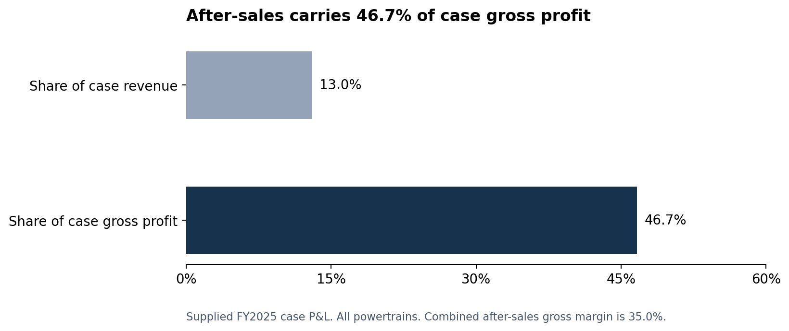
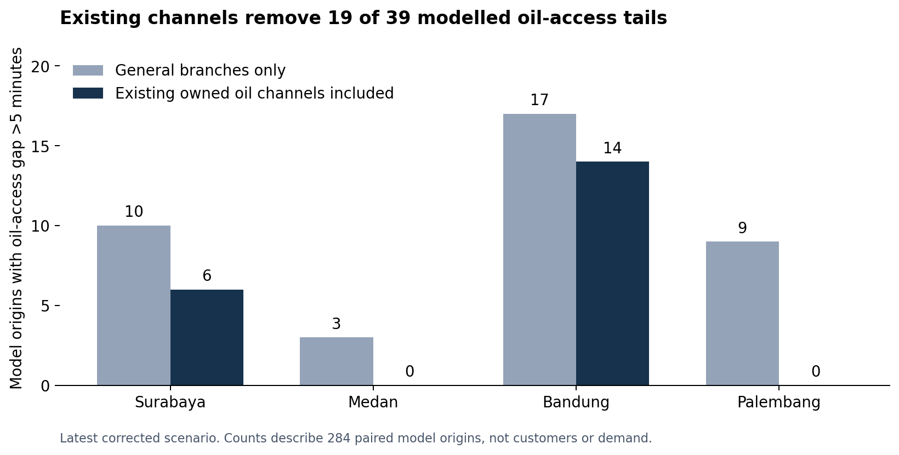

# Auto2000 Integrated Research and Decision Report

## The decision

Auto2000 should make Digiroom the place where an ownership task becomes a confirmed, executable and traceable transaction. Its distinctive digital role is to connect the customer's vehicle, need, entitlement, available destination, accepted scope and completed outcome. The business should prioritize hybrid ownership continuity and customer-paid work while maintaining a separate, concrete BEV acquisition and support journey. A larger menu of disconnected features would reproduce capabilities that already exist without addressing the point at which the transaction fails.

This recommendation follows the original case, not simply the volume of newly collected reviews. The case requires digital technology at the center, differentiated reasons for regular use, conversion into xEV sales and aftersales, a gross-profit estimate and an implementation roadmap within an incremental IDR 150 billion ceiling for 2026–2028. In this case, xEV includes HEV, PHEV and BEV. The objective is profitable transactions; active use provides an intermediate measure rather than the financial outcome. [C1, pp5–7,18]

The integrated evidence changes the geographic allocation. Within the corrected-destination scenario, once eligible Auto2000-operated OtoXpert locations are included, the four modeled markets have 20 rather than 39 origins with an oil-job access disadvantage above five minutes. Bandung contains 14 of the 20 residual origins and the Soekarno-Hatta catchment contains eight. Medan and Palembang have no residual origins above that threshold in this scenario. Auto2000 should concentrate residual-access testing in the remaining pockets, preserve general-workshop service availability elsewhere and route eligible simple work through existing channels. These are priorities within a finite geometric model, not a market-share forecast or a population-weighted capital allocation. [G1,G2]

The customer evidence also changes what must be sold. A Setiabudi reviewer explicitly describes arriving for paid Veloz service but receiving no acknowledgement. Pancing has an account of a walk-in vehicle not entering the queue. Soekarno-Hatta has accounts of unresolved or forgotten work requiring further visits. These accounts identify concrete failure mechanisms: reception, accepted work and resolution. They support a digitally coordinated service case that includes walk-ins and WhatsApp customers, rather than treating app adoption as a prerequisite for receiving reliable service. [M01,M03,M08,M09]

The three prongs should share that transaction architecture but retain different propositions. For acquisition, confirm a suitable demonstrator and a household-relevant ownership scenario. For paid aftersales, establish eligibility, exact scope, parts and destination before promising the visit. For replacement, connect accepted vehicle evidence and an executable appraisal to the actual net cash required to upgrade. A general battery certificate, national charger directory or trade-in button is not sufficient differentiation against the existing capability baseline. [R1,SX02,SY02]

## What the interviews change

Three vehicle-user interviews add two contrasts that affect the design. The Air EV driver reported routine apartment charging and no recent travel substitutions. Low charge led the Atto driver to take Gojek on one occasion and to look for nearby charging in Rungkut on a separate occasion. Build BEV fit around usable access, time and the fallback trip. The corrected Sidoarjo workshop model still measures an independent outcome. [WA-Q03,WA-Q04,BA-A01,G3]

Both service accounts describe successful routine booking on WhatsApp. The Wuling driver handles work and is reimbursed by family. The Yaris Cross Hybrid driver handles visits while the father approves additional work. That driver said they would revisit a digital record for scope, estimates or approval. The service in the Yaris example was reportedly covered. It gives a reason to test delegated approval and a useful digital return, with paid completion requiring separate eligible work. [WA-Q02,WA-Q09,WA-K1,YH-Q02,YH-Q06,YH-Q09,YH-K1]

At the replacement stage, the Yaris driver checked market and dealer prices and stopped at a range. The Atto driver had not checked resale prices and expressed confidence in a floor stated at purchase. Actual price research and a stated purchase preference suggest different tests. Start with a written, inspected net-upgrade offer and treat an upfront floor as a later buyer and financing decision. [YH-Q10,YH-K3,BA-A05,BA-A06,M19,M20]

**First pilot:** a Yaris Cross Hybrid service record and delegated approval handoff at Auto2000 Soekarno-Hatta, Bandung, subject to branch readiness, eligible case volume and authority to fulfill the steps. Auto2000 Setiabudi is the fallback under the same gates. This is a prospective site choice based on separate branch evidence. The Yaris interview does not identify its Auto2000 branch. [G2,M01,M08,M09,M15,YH-K1]

## What this release adds

This release integrates the original repository, all supplied social exports, the mentoring notes, the original recovered casebook and the newest geographic source package. It preserves previous work and its source material while separating current findings from historical prompts and superseded calculations. The repository contains structured context so a future analyst can continue without access to the originating chat.

The original casebook was initially absent from the local source set but was recovered as a 31,140,159-byte PDF and read directly. This closes an important provenance gap. The latest geographic source ZIP was downloaded and matched its advertised SHA256, 429676d061275613f0a989777b9f04b76e3b8182e0bea6e3adaf42ac86df65a8. The current release does not rely solely on summaries of those two primary artifacts.

### Evidence coverage

| Evidence family | Available analytical unit | Role in this analysis |
|---|---|---|
| X |14,892 exported rows;14,291 unique post IDs from ten exports | Needs, choices, advice, brand messages and reported episodes, with thread context retained where available |
| Google Maps |8,385 exported rows;8,119 unique review IDs across 37 places | Branch-specific reported mechanisms and positive contrasts, separated by collection cohort |
| YouTube |74 unique comment IDs across three returned videos | Contextual BEV ownership, support and resale discussion, with top-level comments and replies distinguished |
| Legacy automotive app research |358 combined unique IDs across 21 listing cohorts | App tasks, review-object confusion, recency and historical product context |
| Legacy narratives |95 annotation units from 38 URLs | Prior qualitative research and counterexamples, not 95 independently verified customers |
| Legacy structured registers |319 entries across ten registers | Searchable prior claims, alternatives and supporting material, with overlap preserved |
| Geography |284 strict paired baseline origins;29 corrected general-service endpoints | Relative access, operator scenarios, branch alternatives and destination corrections |
| Interviews |Three vehicle users across two filled guides and six Atto answer notes; one separate method guide | Episode mechanisms, working alternatives and elicited concept reactions |
| Primary casebook and mentoring |Original case PDF and supplied mentoring PDF | Binding case requirements and the standard for decision-changing insight |
| Auxiliary datasets |IGAR government-app records and one Audi telemetry subset | Preserved scope-specific research; not Toyota customer demand or battery-health validation |

These units must not be added into a customer count. The cleaned social corpus contains 22,484 platform-specific IDs, not 22,484 distinct people or transactions. The underlying exported social rows total 23,351. Cross-platform identity is deliberately not inferred. [S1,R2]

### Collection design changes interpretation

The latest Auto2000 Maps cohort contains 1,915 rows; the latest Shop&Drive cohort contains 932. The deliberate lowest-ranking diagnostic collection contains 1,562 rows and extends back to 2011. Exactly 266 review IDs overlap the diagnostic and non-diagnostic collections. They are retained once in the cleaned review table and keep both memberships. The diagnostic cohort reveals how failures are described; it cannot establish the rate at which all customers encounter them. [S1]

Of the 14,291 X posts, 6,186 are replies and 5,704 of those do not have their immediate parent in the supplied corpus. A first-person marker is not proof of ownership, and a negative sentence may be advice, a quotation or brand-authored copy. The 27 earlier pilot cases are preserved as interpretations with current parent/root coverage attached. One apparent workshop-waiting complaint is actually Auto2000 promotional copy. All 37 X posts matching the scoped Digiroom lexical check, containing 45 literal occurrences, come from the named-brand account, which makes that subset unsuitable as an independent customer feedback sample. [S2]

YouTube returned 26 comments from an M6 owner-experience video, three from a Setir Kanan M6 video and 45 from a Neta resale-loss video. The 74 records comprise 56 top-level comments and 18 replies. No Toyota-focused video appears in this returned set. The Neta discussion therefore cannot be presented as Toyota-owner resale anxiety, and the full set cannot be called 74 owner interviews. Original comments remain available, together with their video and comment IDs. [S3]

## The financial and digital starting point

The case P&L reports the following 2025 business-line structure. Figures are case facts in IDR billions, not independently audited present-day Auto2000 accounts. [C1,p10]

| Business line | Revenue | Gross profit | Gross margin |
|---|---:|---:|---:|
| Vehicle sales |60,000 |3,600 |6.0% |
| Services |2,400 |1,320 |55.0% |
| Spare parts |4,800 |1,200 |25.0% |
| Body and paint |1,800 |630 |35.0% |
| Total |69,000 |6,750 |9.8% |

Aftersales contributes 9,000 in revenue and 3,150 in gross profit: 13.0% of revenue and 46.7% of GP. Operating expenses are 4,620 and operating profit is 2,130. The aggregate aftersales margin is 35.0%, but it is not a universal per-job margin and not an xEV-specific margin. Oil, diagnosis, body repair, covered service and parts-only transactions have different economics.

The case reports more than 500,000 cumulative downloads, 20,000–22,000 MAU, about 21,000 at the midpoint, and 1.6 sessions per active user per month. Service booking accounts for 46% of the activity categories shown for monthly active users. Separately, Digiroom accounts for 16% of service bookings, WhatsApp 38%, and walk-in/phone 46%. The two 46% figures use different denominators. Downloads also do not identify a current installed, consented or vehicle-owning cohort. [C1,p11]

The case also states that Single ID exists but sales teams cannot use it easily yet. The digital design should therefore make a consented, relevant case brief usable in the next decision rather than assume a new customer-data platform is missing. [C1, p7]

The case does not require engagement disconnected from ownership. It says more active users do not create profit by themselves. Regular use should therefore be anchored to recurring, useful events: service preparation, entitlement review, confirmed appointment updates, progress approval, collection, resolution, health evidence and a later upgrade decision. A successful event should reduce uncertainty or advance a transaction. Artificial daily use would consume attention without addressing the case economics.

## Ten findings that change the strategy

### 1 Existing channels remove 19 access tails and change where access spending belongs

The corrected geography compares each strict paired origin with a job-relevant oil network, then permits routing to Auto2000-operated OtoXpert locations where the advertised scope fits. The number of origins more than five minutes behind the comparison network falls from 39 to 20. Surabaya changes 10 to 6; Medan 3 to 0; Bandung 17 to 14; Palembang 9 to 0. [G1,G2]

The new portfolio implication is concentration. Bandung accounts for 70% of the residual modeled origins, and Soekarno-Hatta alone accounts for 40%. This is a stronger basis for a geographically focused access experiment than the original general observation that independent workshops are widespread. It does not justify assigning 70% of the investment budget to Bandung because origin density, customer demand, vehicle ownership, capacity and contribution are not represented by that fraction.

**Decision:** build digital routing to the existing eligible operator network first. Focus residual-access tests on Soekarno-Hatta and the remaining Bandung pockets, with selected Surabaya pockets next. Do not start with uniform pickup subsidies or a four-city expansion assumption. Shop&Drive remains a useful competitor/job comparator, not automatically Auto2000-recognized GP.

**Why the alternative loses:** building or subsidizing access in Medan and Palembang to solve this modeled oil threshold would target a gap that the eligible owned-network scenario already removes. Actual slot, parts and job eligibility still determine whether a particular booking can use that route.

### 2 A branch can be substitutable for oil and important for general-workshop service

After the owned-network scenario, Pancing has no residual oil tail origins above five minutes. Yet removing Pancing from the general Auto2000 destination set causes eight modeled origins to lose access within 15 minutes. Tanjung Api-Api also has no residual oil tails but seven such general-service origins. Soekarno-Hatta has eight residual oil tails and zero origins that lose 15-minute general-branch access under that removal test. [G2]

These are different jobs for the branch portfolio. Pancing and Tanjung Api-Api should protect general-workshop service availability while suitable routine work can use another channel. Soekarno-Hatta requires a response to residual travel burden and job completion. A single score based on nearest-origin count would hide the distinction. The removal calculation measures network geometry; it does not establish spare capacity or support a closure decision.

**Decision:** use two separate digital routing questions: which destination can complete this job, and which general-service branch provides important local coverage? Preserve escalation and case ownership when oil work is routed elsewhere.

**Why the alternative loses:** treating oil substitution as permission to reduce general-workshop branch service would apply a narrow job comparison to a broader service obligation.

### 3 Soekarno-Hatta combines residual access burden with reported return visits

Soekarno-Hatta accounts for eight of the 20 residual oil access tails. Separately, review M09 describes complaints being forgotten and a next-day return; historical diagnostic review M08 praises hospitality and punctuality while describing repeated unresolved visits. These are separate selected accounts, not an estimate of branch failure prevalence. Their convergence with the model nevertheless identifies a precise process worth prioritizing. [G2,M08,M09]

A journey with a modest initial travel disadvantage becomes materially less attractive if completion requires another trip. Hospitality can coexist with unresolved work, so a favorable general-service impression is not a substitute for symptom resolution. Conversely, complex diagnosis cannot always be guaranteed in a single visit, and repeated visits should not automatically be classified as negligence.

**Decision:** make Digiroom hold the complaint history, previous attempted remedies, responsible adviser, parts readiness and next agreed diagnostic step before arrival. For predictable routine work, confirm a complete scope and stock. For complex work, promise a defined diagnostic stage and communication checkpoint rather than an unconditional one-visit repair.

**Why the alternative loses:** pickup alone can transport the same unresolved case through the system and increase cost without improving completion. A routing improvement is most useful when it connects to a prepared job.

### 4 Paid demand can fail at reception even after the customer has selected Auto2000

Setiabudi review M01 explicitly says the writer intended to pay for Veloz service and was not greeted. Pancing M03 reports that a walk-in vehicle was not recorded in the queue. Plaju M04 reports little perceived difference between booked and unbooked arrival. A historical Gatot Subroto account M02 describes booking and WhatsApp reconfirmation followed by an unprotected queue; its 2025 publication predates the December 2025 Digiroom relaunch and does not name the app. [M01–M04]

The common mechanism is failure to convert expressed intent into an acknowledged service case. This is commercially different from an owner being unaware of the app or unwilling to install it. The accounts do not show how frequently this occurs, but they specify what a control must prevent. The successful branch/model context observed in earlier website journeys is a counterexample to a blanket claim that all digital handoffs fail. [R1]

**Decision:** create a shared arrival and case identifier for app, WhatsApp, phone and walk-in customers. Digiroom should expose acknowledgement, confirmed scope and status to the customer, while the branch records the same case. Measure actual acknowledged arrivals and completed authorized jobs.

**Why the alternative loses:** requiring more people to book digitally before fixing arrival recognition could increase the number of disappointed requests. The case still needs a reason to use Digiroom regularly; reliable visibility and reusable vehicle context supply that reason without excluding existing channels.

### 5 The older Toyota opportunity includes restoring a car instead of replacing it

X case SX01 reports buying an older used Toyota, arranging suspension work at Auto2000 and upgrading audio, then compares the combined route with buying a younger used vehicle. The reportedRp 25 million combines workshop and audio expenditure; it is not a verified Auto2000 invoice. Kertajaya M07 describes an older Avanza owner contrasting an official repair proposal with a later independent repair. The safety equivalence and diagnosis in that account are not independently established. [SX01,M07]

Together these accounts point to a choice more substantive than where to obtain cheap oil. The owner is evaluating how much to spend to make the present car usable and acceptable, relative to another vehicle. A high nominal quote can be rejected because its scope and rationale are unclear, not solely because the customer refuses genuine parts.

**Decision:** let an eligible owner compare a staged, documented repair plan with retain, repair and replace alternatives. Explain necessary work, deferrable work, diagnosis and safety exclusions. For a customer considering xEV, show the net upgrade alternative alongside the repair option.

**Why the alternative loses:** one uniform discount or cheaper oil bundle does not answer a scope dispute. Equally, promising that an inexpensive independent repair is equivalent would overstep this evidence. Repair retention and immediate replacement also compete for the same owner decision; their modeled profit cannot be counted twice.

### 6 Charging and resale discourse must be separated from Toyota hybrid ownership economics

The case stakeholder feedback says Toyota EV growth is mostly hybrid. The archived external 2025 Toyota hybrid table is heavily concentrated in Zenix, with 79.49% of its stated total in that model and 97.03% in the top three. That external table has a different perimeter from the case's estimated Toyota EV total, so the model mix is supporting context rather than a replacement for the case denominator. [C1,pp7–9;R3]

The returned YouTube set, by contrast, concerns BYD BEVs and a Neta resale topic. It is valuable for household installation costs, support continuity and explanations offered for depreciation, but it does not measure Toyota hybrid experience. A new xEV strategy organized mainly around public charging or BEV resale anxiety would follow the collection frame rather than the client's center of gravity.

**Decision:** lead the ownership continuity design with HEV-relevant tasks and installed vehicles, while giving BEV buyers a separate household charging, demonstration and escalation path. Do not force every powertrain into the same content or maintenance calendar.

**Why the alternative loses:** the loudest topic in a deliberately selected video set is not necessarily the largest or most profitable Auto2000 customer job.

### 7 New 2026 sales do not automatically create routine paid maintenance within the case horizon

Published programme terms distinguish free parts-and-labor service, labor-only coverage, optional prepaid coverage and legacy entitlements. Warranty age alone does not establish whether a particular job is customer-paid. The earlier programme analysis shows that, on a purely time-based six-month schedule with seven covered events, an eighth event at month 42 for a January 2026 delivery falls in July 2029. Mileage-triggered visits and uncovered work can occur earlier. [R4]

The implication is a cohort decision. The 2026–2028 business case cannot treat every new vehicle sold in 2026 as an immediate recurring paid-periodic-service stream. Existing eligible vehicles, time/mileage-exhausted coverage, uncovered work and reimbursed work need distinct payer records. A zero customer payment may still involve dealer reimbursement and resources.

**Decision:** make vehicle-specific entitlement and payer status an input to Digiroom recommendations and the economic model. Build a paid-work cohort from actual eligible work rather than using a blanket age rule or assuming every maintenance event is incremental paid revenue.

**Why the alternative loses:** combining new sales and routine customer-paid service revenue without a coverage calendar overstates the near-term economics and can encourage inappropriate upsell into covered work.

### 8 Existing health checks and appraisal features make acceptance and execution the differentiator

The prior research documents Toyota health-check evidence, trade-in routes and an existing BEV selector. The new Kertajaya review material also mentions a TRIVA-branded appraisal journey, although those selected reviews are accounts rather than proof of current deployment or adoption. Capability must therefore be grounded in the archived official observations, with review mentions treated as corroborating discourse. [R1,M19,M20]

A battery-health figure creates value only when it is technically valid for the vehicle, understandable, accepted by the appraiser or warranty decision owner and linked to a consequential offer. The auxiliary Audi telemetry source has a hidden capacity reference and cannot validate a Toyota health score or a resale premium. Selected YouTube commenters also connect resale concerns to brand/support continuity; that explanation differs from battery degradation. [R5,SY03,SY06]

**Decision:** build an evidence-to-offer route. Show accepted documents, condition qualifications, valuation validity, outstanding finance, fees, a replacement quote and net cash required. Assign an accountable owner for missing evidence or a disputed result.

**Why the alternative loses:** another certificate or speculative residual-value guarantee may duplicate existing functions while placing balance-sheet risk behind an unproven premium. An executable offer answers the present transaction more directly.

### 9 A confirmed household-relevant demonstration is a stronger acquisition task than generic education

X case SX02 describes a prospective buyer unable to find a test-drive unit at Auto2000, without identifying the model or location. It does not establish network-wide xEV unavailability, but it names a conversion-stage obstruction. SX05 describes the constraint of maintaining only one car. YouTube SY02 reports declining to install a supplied wall charger because of a stated extra meter cost and using public charging instead. That cost is a self-report, not a current installation quote. [SX02,SX05,SY02]

Direct Toyota hybrid accounts add a more client-specific contrast. Maps M15 describes remote Yaris Cross HV purchase handling that suits a household working in Jakarta and returning to Bandung on weekends. M16 describes Zenix HV finance, handover and registration-document handling. Neither establishes first-time Auto2000 status, but both show that useful hybrid acquisition support can concern household logistics and execution rather than another explanation of electric propulsion. [M15,M16]

The combined acquisition question is practical: can the household try a suitable vehicle, understand the relevant installation and operating requirements, and obtain a firm next action? The older research documents working branch/model handoffs and personalized-information studies with different outcomes for hypothetical choices and actual showroom behavior. Information alone is not an established sales uplift. [R1,R6]

**Decision:** use Digiroom to confirm a model-matched demonstrator and adviser, preserve the household's relevant usage constraints with consent, and link the session to a quotation and follow-up status. For BEV, include installation-inclusive cash and usable fallback scenarios; for HEV, do not require a charging journey.

**Why the alternative loses:** more generic EV content cannot make an unavailable demonstrator attendable or resolve a household's specific operating constraint.

### 10 The GP model must distinguish channel migration, ecosystem capture and incremental Auto2000 contribution

The case has 84% of service bookings outside Digiroom. Moving an existing WhatsApp booking into Digiroom can improve process visibility without creating a new service job. Likewise, routing an oil job to a related ecosystem outlet does not guarantee that Auto2000 recognizes the resulting gross profit. Repeat repair and vehicle replacement may be alternatives for the same owner, while a recall visit is not discretionary paid upsell. [C1,p11;R7;SX08]

**Decision:** record acquisition source, all-channel baseline, payer, operator, recognized revenue/GP, variable fulfillment cost, capacity displacement and final outcome. Reward the digital programme for incremental contribution and better completion at a defensible cost. Track customer-initiated regular use at meaningful ownership events, rather than manufacturing app opens as a proxy for economics.

**Why the alternative loses:** summing app bookings, routed ecosystem jobs and hypothetical repeat purchases would inflate impact before any improvement in completed transactions is demonstrated.

## The branch and job portfolio

The following table is an action framework, not a ranking of customer demand. Origin comparisons use the corrected strict paired baseline and the same modeled job definition. Operator scope and live job readiness remain booking-level requirements. [G1–G3]

| Market or branch | Relevant model result | Preferred first action | Alternative deferred |
|---|---|---|---|
| Bandung overall |14 of 20 residual oil tail origins | Concentrate residual-access and preparation tests in named pockets | Uniform four-market subsidy |
| Soekarno-Hatta |Eight residual tails; zero loss of 15-minute general access in removal test | Prepared routine jobs, diagnostic case continuity and bounded access experiment | Pickup applied without resolving repeat work |
| Suci and Cibiru |Correcting Suci changes nearest branch for 20 origins | Correct destination and branch-context routing before reprioritizing Cibiru | Investment based on the wrong Suci location |
| Pancing |Zero residual oil tails; eight origins lose 15-minute general access if removed | Preserve general-workshop availability and arrival acknowledgement | Treating oil substitutability as general-service redundancy |
| Tanjung Api-Api |Zero residual oil tails; seven such general-service origins | Route eligible oil work while protecting escalation and broader service | New oil access capacity before eligible existing routes |
| Palembang overall |Nine oil tails fall to zero | Owned-channel routing and completion tracking | Blanket pickup for the modeled oil threshold |
| Surabaya |Ten oil tails fall to six | Use eligible existing channels; target the remaining pockets | Treat all 11-origin branches as the same investment case |
| Sidoarjo extension |Zero baseline assignments but 6/6 targeted southern extension origins | Correct destination and retain a separate southern boundary decision | Reading baseline zero as no demand or no value |

The five-minute gap and 15-minute access thresholds are analytical definitions, not measured consumer preferences or promised service levels. General-workshop availability does not establish qualification or capacity for every job or high-voltage procedure.

The exact Tanjung Api-Api/Veteran boundary includes a tie: seven unique and one shared Tanjung Api-Api tail are distinguished in the latest source. The market-level Palembang 9-to 0 result is stable. Exact ties and arbitrary single-assignment summaries should not be used to invent exclusive customer territories.

The latest source also tests selected additional origins and building footprints. These improve the stability assessment but do not turn the grid into a representative owner sample. The geographic report and tables retain snap thresholds, null route handling, corrected coordinates and objective distinctions between outbound and round-trip travel. Historical uncorrected medians are archived and should not be reused as current headline results.

## The digital proposition

Digiroom should maintain a customer-visible ownership case whose fields are reused across the three prongs. The case connects existing capabilities and accountable decisions; it does not assume a new CRM, new booking button or universal absence of Single ID.

### Customer-paid service

The customer selects or describes a job and vehicle. The system distinguishes covered, prepaid, warranty/recall, reimbursed and customer-paid work. A suitable destination is then selected using job fit, operator, vehicle support, parts readiness, appointment acceptance and relative travel. Before arrival, the customer sees the agreed scope, estimate basis, responsible adviser and next confirmation. Additional work requires recorded authorization. Handover records completion, payment and any unresolved symptom.

The adviser can create the same case from WhatsApp or a walk-in. Where the driver and decision-maker differ, the driver can send an authorized, revocable view of the relevant work scope and estimate to the person who approves added cost. Record the exact scope version that person accepted. The report of a covered Yaris visit is a useful baseline for service completion. The test requires branches to confirm paid and mixed opportunities separately. [YH-Q02,YH-Q06,YH-K1] Digiroom gives the customer continuing visibility and a reusable record, supplying a practical reason to return to the app. Privacy-sensitive information should be requested when needed for a specific action, with a clear purpose and a correction route. An exploratory showroom comparison need not require the same identifiers as a vehicle-specific entitlement check.

### xEV acquisition

The path starts with the household task and the relevant powertrain. It confirms the demonstrator, branch, adviser and session, then preserves the customer's stated constraints into the quotation. For BEV households, show installation feasibility and a practical fallback for relevant routes and times. A working apartment charging routine and a trip disrupted by low battery are different cases. Record the driver’s trip needs and the buyer’s offer decision separately. [WA-Q04,BA-A01,BA-A02,BA-A03] HEV buyers receive a maintenance, usage and ownership comparison suited to their vehicle rather than an irrelevant home-charging checklist. PHEV cases combine applicable combustion-maintenance eligibility with charging and high-voltage support using vehicle-specific terms.

The digital value is a useful next step that remains visible after the session: quotation, financing conditions, trade-in requirements and responsibility for follow-up. Capture request, confirmation, attendance, quotation, order and delivery as different states. The unavailable-unit account is a reason to validate confirmation logic, not proof of a universal fleet shortage.

### Replacement and trade-in

The owner can see which vehicle and condition evidence is accepted, obtain an appraisal with validity and conditions, understand outstanding finance settlement and compare replacement offers on net cash. A health-check document should appear in the decision where it is used, rather than as a detached content item. Keep unresolved warranty and service cases visible during the replacement decision. A marketplace range is a starting point. The first replacement test asks whether a written inspected offer and actionable settlement move a qualified customer toward a completed upgrade. A capped top-up and a full guaranteed floor entail different customer promises and funding. Price each separately only after buyer behavior and counterparty commitments can be observed. [YH-Q10,YH-K3,BA-A06,R7]

The three prongs share identifiers and state history but should not share one indiscriminate eligibility rule. A household may rationally choose to repair the present vehicle, complete a covered intervention or delay replacement. Measuring only immediate vehicle conversion would undervalue useful ownership continuity, while counting every retained owner as future incremental sales would overstate it.

## Commercial model and spending discipline

### What can be estimated now

The evidence supports the accounting structure and the direction of several priorities. It does not identify eligible customer volume, true incremental conversion, job-level GP, current capacity or programme cost. The workbook therefore exposes these inputs rather than filling them with invented operational forecasts. The following normalized calculations make the scale and break-even requirements explicit.

For each prong and year, define:

- T: completed programme-linked transactions across all channels.
- a: the share incremental to the defensible counterfactual.
- g: recognized Auto2000 GP per incremental completed transaction.
- v: variable programme cost incurred per programme-linked completion.
- d: displaced contribution per completion, if work or sales consumes constrained capacity.
- F: fixed programme expenditure assigned once, with capital cash and operating expense tracked separately.

Under an unchanged unit-GP assumption, incremental GP equals T × a × g. If the intervention changes margin on otherwise expected transactions, model that margin difference separately against the counterfactual. Set d to zero when capacity displacement is already incorporated in a or the all-channel volume comparison, so it is not deducted twice. Programme contribution before fixed expenditure equals T × (a × g − v − d). This is an accounting identity, not an estimated causal effect. If the denominator a × g − v − d is zero or negative, scaling completions cannot pay back positive fixed cost under those assumptions. Break-even completions for a stated horizon equal F divided by that denominator when it is positive.

For intuition, every additional 10,000 genuinely incremental paid jobs produces IDR 5 billion GP at an assumed IDR 500,000 recognized GP per job, before programme operating costs or displaced work. IDR 500,000 is an illustrative unit assumption, not an observed margin. If only 10% of programme-linked completions are incremental, that assumption generates IDR 50,000 GP per linked completion. An illustrative IDR 50,000 variable cost would absorb it entirely before fixed investment. This is why universal pickup and channel migration cannot be justified by gross booking volume.

The maximum IDR 150 billion programme ceiling requires IDR 50 billion annual contribution over three years for simple undiscounted recovery if the full ceiling is spent and benefits are even, before further costs and financing effects. At an illustrative IDR 500,000 contribution per truly incremental job, that is 100,000 additional jobs annually. At IDR 1 million it is 50,000. These are scale tests, not forecasts or proposed targets. A smaller staged programme can be appropriate even when the ceiling is large.

### Avoiding double counting

Services and spare parts can belong to the same job. Attribute the revenue and GP of each business line once rather than adding a whole job margin to its parts margin. A vehicle appraisal is not a delivered replacement. A routed job is not Auto2000 GP without the relevant recognized revenue perimeter. A covered service visit may produce reimbursement rather than customer payment. Safety recall work belongs in its own obligation and reimbursement ledger.

Repair-versus-replacement choices need an owner-level scenario. Do not claim an immediate incremental repair and an immediate incremental vehicle sale for the same mutually exclusive decision. Future service following a new sale needs its own timing and entitlement assumptions. Gross profit, programme contribution, operating profit, capital cash, subsidies and undiscounted payback remain separate outputs.

### Recommended release gates

Begin with a limited digital case and branch workflow on existing systems. Expand only after the programme can connect consented eligibility, accepted job, acknowledged arrival, authorized scope, completion and recognized economics. The first release should prove that these states are usable by customers and staff; a download campaign is not the acceptance criterion.

Validate Auto2000 Soekarno-Hatta for the first Yaris Cross Hybrid service-record pilot, with Setiabudi as fallback. Confirm service categories, acceptable scope, eligible customer-paid or mixed work, adviser ownership, and a measurable baseline. Compare normal WhatsApp or assisted service with the same workflow plus Digiroom status and delegated approval. Measure completed customer-paid work orders per eligible opportunity and recognized Auto2000 contribution. Monitor wholly covered visits and voluntary Digiroom return separately. Pancing and Palembang remain differentiated workshop and routing opportunities under their existing scopes. Add confirmed xEV demonstrations and evidence-to-appraisal paths after the first test establishes that the shared record works. [G2,M01,M08,M09,YH-Q06,YH-K1]

A randomized invitation or a feasible branch/week rollout can identify incremental outcomes more credibly than comparing app users with nonusers, who may already differ in loyalty, income or intent. Capacity, pre-existing campaigns, cancellations and price changes should be recorded. Where assignment is not randomized, document the comparison design and avoid a causal claim stronger than the design supports.

## Measurement and roadmap

### Measures tied to actual decisions

| Stage | Record | Decision supported |
|---|---|---|
| Eligible opportunity |Vehicle/powertrain, relevant task, entitlement, consent and payer |Whether to present a paid job, covered action or xEV offer |
| Accepted service |Branch/job/operator, slot, parts, scope and adviser acceptance |Whether to make a credible visit commitment |
| Arrival |Acknowledgement for app, WhatsApp, phone and walk-in |Whether expressed demand reaches a service case |
| Authorized work |Estimate version and customer approval |Whether work can proceed and what is chargeable |
| Completion |Work done, symptom outcome, handover and payment/reimbursement |Whether a real transaction and recognized GP occurred |
| Acquisition |Confirmed model demonstration, attendance, quote, order and delivery |Where the xEV purchase path advances or stops |
| Upgrade |Accepted evidence, appraisal, settlement and net upgrade offer |Whether an owner can execute replacement |
| Incrementality |All-channel counterfactual, operator perimeter and displaced work |Whether digital activity creates additional contribution |
| Regular use |Customer-initiated return at relevant ownership events and case progress |Whether Digiroom continues to solve useful tasks |

### Implementation sequence

**First 30 days:** reconcile vehicle, payer and job definitions with the existing Single ID and branch workflow. Confirm the minimal shared case states and privacy purpose for each field. Correct destination metadata. Establish baseline all-channel completion and scope-change records at the selected branches. These are proposed milestones, not a claim that the work has been performed.

**Days 31–90:** release the customer-visible case and staff acknowledgement flow for a limited job set. Test eligible routing, parts/scope readiness and arrival recognition. Run a model-confirmed xEV demonstration path and a small evidence-to-appraisal route. Keep variable fulfillment spending bounded while the incremental economics is measured.

**Months 4–6:** compare completed work, repeat visits, customer-initiated case use, incremental contribution and capacity effects. Retain interventions that improve the relevant outcome at an affordable cost. Correct the destination/job eligibility rules when a proposed endpoint cannot perform the work. Escalate unresolved cases rather than recording them as successful engagement.

**2027–2028:** extend validated components by powertrain, entitlement cohort and branch capability. Release further investment in stages. Use actual transaction economics and entitlement timing to update the business case; do not apply the total-company case margin to every new digital transaction.

## What to keep and what to retire from the previous strategy

Keep the three-prong structure, customer lifecycle view, branch context, evidence traceability and all-channel financial perimeter. Keep the existing capability observations as a baseline. Preserve the earlier hypotheses and solution menu as an archive of alternatives rather than treating all 27 concepts as separate programmes.

Retire current-use headlines based on uncorrected Suci coordinates, pooled lowest-rating complaint rates, large auxiliary datasets presented as client customers, 74 YouTube commenters presented as verified owners, or blanket claims that Toyota lacks health checks or trade-in functionality. Retire the old instruction that the project may not recommend a solution; the owner explicitly expanded the mandate after reviewing the plan.

Reframe broad calls for app engagement into the specific recurring tasks that justify use. Reframe workshop density into job-specific and operator-specific destinations. Reframe battery evidence into accepted decision evidence. Reframe convenience into the full burden of getting an agreed job completed. These changes connect the mentoring requirement for a distinctive insight to the actual client decision.

## How to continue from this repository

Read README.md, PROJECT_CONTEXT.md and the current executive findings before opening archived reports. The interview analysis is in [INTERVIEW_SYNTHESIS.md](../analysis/interviews/INTERVIEW_SYNTHESIS.md). It contains the pilot design and links to the answer-level evidence ledger, all ten earlier insight assessments and the legacy hypothesis bridge. Use the active insight register to find supporting tables and curated record IDs. Use the source inventory to locate immutable originals and any split-file restoration index. Historical documents retain their original claims, prompts and context, so consult the supersession record before reusing a headline.

The primary package contains available source content and current analyses. A separate source-container vault preserves exact original ZIP bytes. No tracked file exceeds the 90,000,000-byte build ceiling. The migration script is needed for an overlay of an existing checkout because Replace All does not delete old files. It defaults to a dry run and protects.git, modified files and unknown user content.

This is a private research release. The original-language source corpus can include identifiable public posts and reviews. Main reports minimize unnecessary personal identifiers. No paid actor was run, no lead or booking was submitted, no messages were sent and no GitHub push was performed as part of the integrated analysis.

## Evidence locators

WA, YH and BA identify the Wuling Air EV, Toyota Yaris Cross Hybrid and BYD Atto interviews. Q is a filled-guide question, A is a numbered Atto note and K is a concept reaction. Each identifier resolves in analysis/interviews/evidence_records.json to a source and location. IG-PROTOCOL identifies the separate, unfilled Digiroom guide. Sources and consent scope are documented under sources/interviews. Atto answers are analyzed as notes with uncertain verbatim status.

C1:Semifinal Casebook IBSC 2026.pdf, original recovered PDF. Pages 5–7 define the task and constraints; pp8–11 supply market, P&L and app exhibits; p18 defines EV. See sources/case and the source inventory.

G1:analysis/geography/tables/raw_independent_audit.json and raw_recomputed_markets.csv. Independent reconstruction uses 76,221 main outbound rows, 5,913 supplement rows and 162 corrected outbound rows. There are 284 paired baseline origins.

G2:analysis/geography/tables/branch_portfolio.csv, market_portfolio.csv and raw_branch_checks.csv. The independent check compares 290 branch fields with zero mismatches. Full methods and extension/tie boundaries are in the geography report.

G3:Latest geographic source package, Auto2000_Lanjutan, including branch_decision_table_29, corrected-coordinate, job-protocol, journey and sensitivity tables, plus raw OD inputs. Find the canonical member paths through the source inventory.

S1:analysis/social/corpus_metrics.json, source_runs.csv, record_run_membership.csv and maps_branch_cohort_summary.csv. Original exports remain immutable.

S2:analysis/social/curated_social_evidence.jsonl and social synthesis. SX and PILOT_C identifiers resolve to original X post IDs; parent/root status is explicit.

S3:analysis/social/youtube_video_summary.csv and all-comment annotations. SY identifiers identify selected interpretations, not verified ownership.

M01–M34:analysis/social/maps_deep/curated_maps_evidence.csv. Each row includes original review ID, place, publication date, cohort and source filename. These cases are purposeful mechanism selections.

R1–R7 resolve through analysis/research/master_report_reference_crosswalk.json and the namespaced legacy_evidence_union.jsonl. The crosswalk contains source-array positions and hashes, while the following summary identifies the supporting material.

R1: Existing booking/trade-in/health capability; bounded successful public routes, not all-branch fulfilled transactions.

`capabilities:FC14`, `FC31`, `FC33`, `FC34`; `market:M015`; `competition:COMP-005`,`COMP-006`. Working handoff controls: `workstreams/extension_journeys/observations.json`, observations XT08; `workstreams/journeys/friendcontext_JX_observations.json`, JX02/JX05/JX07.

Original sources: https://aftersales.toyota.astra.co.id/hybrid-health-check; https://auto2000.co.id/testdrive/new-car/bz4x?branchCode=T151; https://auto2000.co.id/testdrive/new-car/hiace?branchCode=T155; https://auto2000.co.id/services-toyota/tukar-tambah; https://r2.astra.co.id/annual-reports/documents/Astra-Annual-Report-2025.pdf

R2: Scope/counts and auxiliary-data boundaries. This label is not one empirical study.

`analysis/research/legacy_register_inventory.csv`, `legacy_app_review_metadata.jsonl`, `legacy_narrative_metadata.jsonl`; `workstreams/datasets/igar_analysis_summary.json`; `workstreams/extension_battery/BATTERY_TELEMETRY_REPORT.md`.

Original sources: https://doi.org/10.17632/7zryc6k76z.2; https://doi.org/10.17632/7vdkzpnjgj.2

R3: External brand-flow context, not the case's±33,950Toyota xEV estimate, Auto2000 sales or installed owners. No fabricated union ID should be assigned to the derived concentration.

`workstreams/datasets/gaikindo_2025_hybrid_selected_models.csv` and `market_analysis_summary.json`: `Toyota_hybrid2025_source=30110`, `Toyota_Zenix_share_of_Toyota_hybrid_computed=0.7948854201262039`, `Toyota_selected_three_models_share_of_Toyota_hybrid=0.970275655928263`. Scope distinction: `capabilities:FC23`–`FC27`.

Original sources: https://www.gaikindo.or.id/innova-zenix-pimpin-penjualan-mobil-hybrid-nasional-tahun-2025/

R4: Programme terms are published facts; month42/July2029 is a conditional legacy-derived calendar illustration, not a verified current BEV/HEV schedule or paid-demand forecast.

`market:M016`,`M017`; `stakeholders:EXT-E16`; `workstreams/extension_economics/program_distinctions.csv`, `legacy_scheduled_calendar.csv`, `ordinal_entitlement_windows.csv`, `EXTENSION_ECONOMICS_REPORT.md` calendar discussion. Source IDs EE-S01,EE-S04,EE-S11.

Original sources: https://aftersales.toyota.astra.co.id/t-care; https://pressroom.toyota.astra.co.id/toyota-perkuat-layanan-purnajual-lewat-t-care-xtra; https://toyota-website.s3.ap-southeast-1.amazonaws.com/public/pdf/Informasi-Program-Gratis-Biaya-Servis-Berkala.pdf

R5: Missing independent capacity reference and the distinction between usefulness, acceptance and transaction premium. The public dataset is not Toyota health validation.

`workstreams/extension_battery/BATTERY_TELEMETRY_REPORT.md`, sections 'What this means for the battery concept' and source README; `mechanism_study:EXT-H-S03`,`EXT-H-S04`,`EXT-H-S06`; `friend_context:FC20`,`FC21`; `legacy_solution:SOL-14`.

Original sources: https://doi.org/10.17632/7vdkzpnjgj.2; https://doi.org/10.1016/j.joule.2023.07.018; https://doi.org/10.6028/NIST.DCI.008; https://doi.org/10.6028/NIST.TN.2328

R6: Different endpoints: stated preference versus actual showroom choices. Do not transfer an effect size to Auto2000 or call the working paper peer-reviewed.

`mechanism_study:EXT-H-S01`,`EXT-H-S02`; `workstreams/extension_hypotheses/EXTERNAL_MECHANISM_EVIDENCE.json`; handoff control XT08 as R1.

Original sources: https://doi.org/10.1016/j.trd.2025.104921; https://doi.org/10.3929/ethz-b-000663125

R7: Channel substitution, operator perimeter, customer/third-party payer and non-discretionary recall work. Accounting identities remain separate from empirical uplift.

`friend_context:FC11`,`FC33`,`FC34`,`FC40`; `stakeholders:EXT-E04`,`EXT-E05`,`EXT-E12`,`EXT-E13`,`EXT-E20`; `workstreams/market/economic_calculations.json` MC02,MC03,MC05; `workstreams/extension_hypotheses/REPORT.md` accounting ledger.

Original sources: https://pressroom.toyota.astra.co.id/persiapan-mudik-lebaran-dengan-biaya-lebih-terjangkau-berkualitas-dan-bergaransi-manfaatkan-layanan; https://pressroom.toyota.astra.co.id/t-opt-hadir-di-inapa-2026-spare-parts-alternatif-dengan-kualitas-terpercaya-dan-harga-lebih; https://ssc.toyota.astra.co.id/

