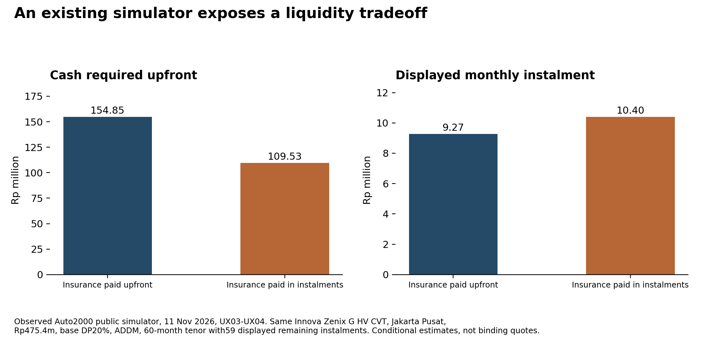
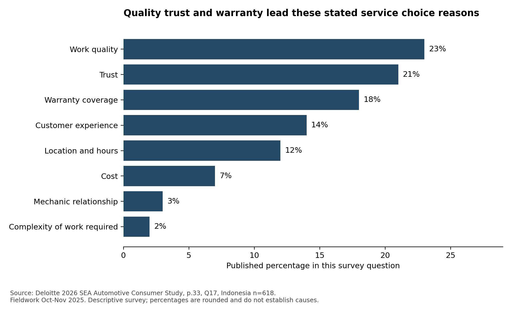
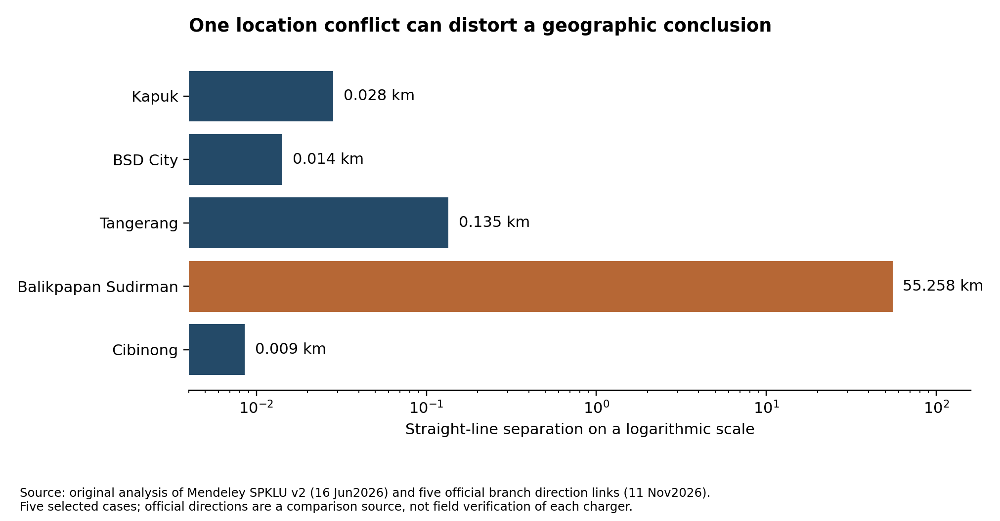

# Auto2000 Digiroom research findings and solution options

Public source research prepared 11 November 2026

## How to use this research

The evidence supports a more precise problem than simply making Digiroom busier. Auto2000 already has substantial digital functionality, partner services and dealer infrastructure. Several proposed innovations therefore need to explain what they add to an existing customer decision or handoff. The strongest public evidence concerns the clarity, eligibility, status and portability of information around valuable decisions. Whether those changes would produce additional sales or after-sales profit remains unmeasured.

Start with this report, then read SOLUTION_MENU.md and the separate friend research challenge report. The archive contains the underlying tables, licensed raw datasets, source registers, code and independent checks. It leaves solution selection to you. It contains no Auto2000 implementation or rollout plan.

The largest files are two licensed label views of the same historical Indonesian government-app review corpus. They are useful for testing research methods and are explicitly auxiliary. They are not hundreds of thousands of Digiroom customers. Direct app evidence comes from 210 separately identified review records across six apps and twelve platform or language cohorts. Forum and research annotations, website pages, survey cells, charging locations and derived calculations have their own units.

## What changes the interpretation of the case

| Finding | Evidence and implication | Important boundary |
|---|---|---|
| Useful functions already exist | Live financing, comparison, test-drive preview, digital battery certificates and model-specific service-cost guidance change the baseline for innovation | Function existence does not prove discoverability or successful fulfillment |
| Cash timing can matter independently of price | Changing only the insurance payment option materially changes upfront cash and monthly instalments in one observed simulator scenario | Conditional estimates for one vehicle and locality, not approval or binding quotes |
| Customer evidence is selected by the platform | The same BYD app and country parameter showed disjoint review sets with sharply different rating distributions across languages | This is a sampling-mechanism finding, not a brand ranking |
| Stars do not establish completed app jobs | Some high-rated records explicitly describe prospects, products or branch experiences | Reviewer reports are not independently verified outcomes |
| Service value extends beyond scheduling | Survey respondents prioritize work quality, trust, warranty and transparency in the relevant questions | Descriptive survey responses are not proof of what causes Auto2000 conversion |
| Geographic detail needs source validation | One of five Auto2000-labelled coordinates materially conflicts with current official branch directions | A map comparison is not field verification of the charger |
| A large weak-label corpus can mislead | Rating-based and source VADER labels disagree on 41.35 percent of aligned auxiliary review rows | Neither label view is human ground truth or current Digiroom evidence |
| The friend's narrower ideas survive several checks | Driving and charging fit, job-specific confirmation and accepted evidence at appraisal remain distinct from basic existing features | Their business mechanisms and incremental profit remain unresolved |

## Scope and evidence quality

The study covers vehicle sales, service, spare parts and body and paint. HEV, PHEV and BEV are separated because their ownership jobs differ. National new-car sales are not the installed vehicle stock, and Toyota brand share is not Auto2000 dealer capture. The supplied casebook supplies the competition baseline and Rp150 billion investment constraint. Its financial exhibit is not presented as audited public Auto2000 accounts.

The research used six specialist agents alongside the lead, with roles rotated across acquisition, analysis and independent challenge. All code-assisted and source-grounded coding was performed by AI agents. There were no human research participants, interviews, branch visits or independently verified customer transactions. A second agent checked selected records and calculations. That is useful quality control, not human validation or statistical independence.

The site collection was purposive, balancing URL families and topical relevance. Its saved evidence contains 345 requested URL records, including 281 successful raw-HTML responses. A network-approval cancellation interrupted the enlarged queue. The remaining queue and interruption record are preserved. A 404 in a selected sitemap-derived URL, a transport failure, and a browser-control timeout are different observations; none alone establishes customer abandonment or revenue loss.

The final website extraction was corrected through three versions. Independent checks found mobile navigation and promotion content contaminating an early extraction, then found a video embed incorrectly selected as an empty article. Version 3 isolates editorial prose where available and the substantive nested main region otherwise. All 281 successful cached pages were reprocessed without new network calls. The same 24-source check then reproduced the final selected text, field values, links, timestamps and source IDs. Contact numbers were removed from structural WhatsApp destinations. These checks establish reproducibility of the tested extraction, not perfect semantic extraction across the whole site.

## Existing functionality changes what a new idea must add

The live logged-out website allowed an Innova hybrid finance simulation without a name or telephone number. Monthly income was explicitly optional and left empty. Test-drive exploration exposed a branch, tentative dates and time windows before contact submission. The comparison could be completed after selecting the appropriate model and variant. It showed the hybrid and conventional prices, while displaying TRUE in the airbag-count row. This is evidence of a specific data-presentation problem, rather than proof the entire comparison is unusable. The study did not measure whether a customer would change a purchase because of that row. [UX03 to UX06 and comparison observation in journeys]

Workshop booking and trade-in required vehicle identification before proceeding. The evaluator stopped rather than invent a registration number. Body-and-paint discovery behaved differently: a default area first showed no result, but searching Bekasi exposed a relevant branch and calendar. The Toyota OEM service route also recognizes that someone other than the owner may deliver the vehicle. These differences argue for task-level analysis. They do not establish that every field is unnecessary or that no suitable branch exists. [UX07 to UX11]

Toyota's Hybrid Health Check site already offers a digital certificate retrieval route with a chassis-number step, personal details and download. The evaluator stopped before entering an identifier. T-CARE also provides model and variant service-cost guidance. The observed Yaris Cross Hybrid example distinguishes seven included service occasions from later paid ones; some displayed cost notes explicitly refer to March 2024. A source can be useful and still require date, entitlement and locality reconciliation. [JX02 and JX03]

The analytical distinction is between creating a capability and making the right evidence usable at a consequential moment. For example, an existing certificate does not establish that an appraiser accepts it, that its vehicle identity is consistently matched, or that the certificate changes an offer. Those are narrower questions than whether any digital certificate exists. The same reasoning applies to a service-cost table and a personalized current entitlement.

## Financing exposes a real budget tradeoff

The observed scenario used an Innova Zenix 2.0 G HV CVT, Gray Metallic, Jakarta Pusat, at a displayed price of Rp475.4 million. Base down payment was 20 percent, or Rp95.08 million, with ADDM selected. At the displayed 60-month tenor, the interface showed 59 remaining monthly instalments. With insurance paid upfront, total initial cash was Rp154,847,741 and monthly payment Rp9,271,161. Changing only the insurance payment option to instalments reduced the initial amount to Rp109,533,402 and increased the monthly amount to Rp10,403,402. [UX03 and UX04]

The difference is Rp45,314,339 less cash upfront and Rp1,132,241 more per displayed month. The interface already exposes this choice. A plausible opportunity is therefore helping buyers understand cash at delivery, ongoing budget and the meaning of a conditional estimate, rather than introducing a basic calculator that already exists. This remains a mechanism hypothesis: the research did not test buyer comprehension, credit eligibility, actual fees or approval outcomes.

Ten actual displayed tenor and insurance combinations are in journeys/finance_scenarios.csv. They are observations of a conditional calculator under recorded settings, not ten loan contracts or ten customers. Do not infer an APR by treating every upfront component as principal or interest. The source observations do not establish that all differences are concealed fees, nor that financing insurance is the better choice for every household.

## Service confidence deserves attention alongside convenience

The 2026 Deloitte Southeast Asia study provides different bases for different Indonesia questions. In the question about the latest provider, 80 percent reported an authorized or new-vehicle dealer, with n equal to 629. In the provider-choice question, n equals 618. That question reports work quality at 23 percent, trust at 21 percent, warranty coverage at 18 percent, customer experience at 14 percent, location or hours at 12 percent, and cost at 7 percent. These are published rounded shares of that question, not measurements of Auto2000's own customers. [MS03 Q16 and Q17, printed page 33]

A different question asks for the most important service element. It puts price and work transparency at 32 percent and customer treatment at 28 percent. The published online-booking category rounds to zero in that single-choice question. That does not mean no respondents want booking, or that a booking system can be removed without harm. A feature can be necessary infrastructure without being the single attribute that differentiates a provider. The survey also cannot tell us whether a particular Digiroom handoff is working. [MS03 Q21, printed page 34]

The narrative corpus contains both positive assistance and warranty-resolution accounts and reported delays, parts uncertainty, provider switching and record discrepancies. Historical usability research reports invoice and app differences, but its small task sample and older app version do not establish a current widespread defect. These accounts support investigating status, scope and explainability around service. They do not identify their prevalence or justify a particular technical solution. Full event annotations and contrary cases are retained in the narratives workstream.

## Review sampling can change the apparent story

The direct app corpus contains 210 unique review IDs across Digiroom, mToyota, BYD and matched automotive apps. Collection used publicly allowed listing pages rather than prohibited review-pagination endpoints. Some cohorts are historical, and the public page controls which records appear. An app-store country parameter is not proof of a reviewer's residence or ownership market. An English BYD account mentioning snow provides a direct reason not to assume all records shown with the Indonesia parameter describe Indonesian driving conditions.

For the same BYD app and country setting, the Indonesian-language page showed 19 five-star records out of 20, while the English-language page showed only three records rated four or five out of 20. All twenty IDs differed between those two language cohorts. Repeat uncached checks reproduced each cohort's own IDs. This is a strong observation about displayed-source selection; it is not evidence that either proportion estimates BYD satisfaction in Indonesia. [reviews cohort summaries and repeatability logs]

The coded records also include explicitly prospective high ratings, branch experiences, product comments and unclear outcomes. The final coding differentiates 132 self-reported app-job records, 17 branch records, 10 product records, five explicit prospects or non-users, and 46 unknown cases. Self-reported app-job does not necessarily mean a completed workshop or vehicle transaction. All 210 were source-inspected by an AI researcher, and another agent checked thirty targeted records. These counts are views of the same corpus and must not be added to produce a larger customer count.

For service history, the source evidence distinguishes availability from completeness. Praise for seeing history can coexist with a complaint that the record is incomplete. Date, version, account linkage and completion timing can explain divergence. The next useful analysis is not a binary feature-present verdict. This research did not access logged-in records, so the underlying cause remains unresolved.

## Geographic analysis shows both opportunity and data risk

A licensed research dataset supplies 2,454 charging-site rows and 3,767 charger-box records, with station IDs and geographical fields. Source labels identify fifteen sites as Auto2000, while name matching identifies twenty-eight Auto2000-named locations; thirteen are classified under Toyota. These are alternative classifications of the same dataset, not conflicting verified national dealer network totals. The official Astra annual report separately reports Toyota charging locations and Auto2000 EV outlets under its own period and definitions.

An original nearest-neighbour computation found another mapped non-Auto2000 site within five kilometres for twenty-seven of the twenty-eight name-matched sites. The median straight-line distance was about 0.323 km. But five selected branch checks found that the Balikpapan Sudirman source coordinate differs by 55.258 km from the current official branch direction link. The other four checks differed by less than 0.135 km. We preserved the original coordinates and calculated a separate scenario using that official direction candidate. The scenario changed the count to twenty-eight out of twenty-eight and the median to about 0.285 km. It is a sensitivity check, not a corrected national ground truth. [DS SPKLU and five_branch_coordinate_crosscheck]

This result weakens the novelty of a generic nearby-charger directory in the observed subset, but it does not prove adequate charging service. Eligibility, connector compatibility, queueing, operational status and access restrictions remain unknown. Some site names explicitly indicate Toyota or Lexus restrictions. Straight-line proximity is not driving time, and a June 2026 map snapshot is not live availability. A more specific customer question concerns whether a suitable usable option exists for the person's vehicle and circumstances.

The BPS join provides registered passenger-car stock rather than BEV stock or Auto2000 customers. Ratios combining 2026 charging locations and 2025 all-passenger-car stock are context indices, not charging sufficiency or demand estimates. Historical provincial breaks, including a large East Java jump, are flagged before interpreting growth. Millions of computed pair distances remain derived calculations, not additional observations.

## The auxiliary raw corpus tests analytical shortcuts

The IGAR raw appendix contains Rating_labeled.csv and VADER_labeled.csv, each with 617,722 rows. The views align on six shared fields, with 617,703 distinct composite keys and nineteen excess duplicate rows in each file. They do not constitute two independent samples or 1.2 million distinct people. The source records span May 2012 to March 2023, despite a 2025 dataset release, and cover Indonesian public-service apps rather than Digiroom. [IGAR source DOI and acquisition manifest]

Original row-level comparison finds 255,414 disagreements between the rating-derived labels and source VADER labels, or 41.35 percent of aligned rows. Missing translations have a much higher disagreement rate, but account for only about 2.96 percent of all disagreements. Consequently, translation missingness alone does not account for the overall difference. Even the source's high confidence field does not establish a calibrated probability or ground truth. Neither labeling rule has been evaluated against human truth in this project.

The methodological implication is concrete: do not equate a star rating, a sentiment label, a completed task and a business root cause. The actual Auto2000 analysis therefore uses event, role, task and outcome fields and retains unknown values. The auxiliary corpus supports that research-method stress test; it is not evidence of current Auto2000 customer dissatisfaction or an estimate of Digiroom's market.

The raw source files are included in full under CC BY 4.0 with their metadata and hashes. The SPKLU source files have a separate CC BY-NC 3.0 license. BPS objects are factual table extractions. Dataset rights and grain are documented individually rather than assigning a blanket license to everything. Current unlicensed app reviews are represented by attributable source metadata and derived coding; entire third-party papers and website source archives are not republished wholesale.

## The friend's research changes the questions we should ask

The friend challenge register organizes forty analytical groups and 148 scoped subclauses. It maps them to the original twenty-five hypotheses and to new capability, survey, insurance and live-journey checks. The forty groups are not forty independently confirmed mechanisms. The register deliberately avoids treating already qualified proposals as claims that a feature does not exist.

The official Astra annual report confirms that a full Auto2000 SAP S/4HANA transition was targeted for the end of 2026. It also documents SAM, MSA, Single ID, Customer 360 and other capabilities. A target is not proof of completion, and a corporate architecture description is not proof that a particular branch can expose a particular field to Digiroom. The practical research question concerns usability and continuity across real jobs, not whether the company has no digital infrastructure. [capabilities claim matrix, printed pages 124 to 126]

Toyota and Lexus xEV volumes in the report fall from 37,693 to 31,668, about 15.98 percent. Their overall volume also falls, from 291,566 to 251,954, about 13.59 percent. The within-portfolio xEV share changes from about 12.93 to 12.57 percent, roughly 0.36 percentage points. Holding the earlier mix on the later total yields about 32,572 xEV units. This accounting comparison shows why the xEV decline alone does not identify an electrification-specific or app-specific failure. It does not allocate causal responsibility to market contraction or mix. These are Toyota and Lexus portfolio figures, not Auto2000 customer data.

The survey audit confirms several numbers but materially changes their denominators. The older Deloitte charging preferences correspond to the 2025 edition and 2024 fieldwork, with question-specific intender bases rather than all 1,004 Indonesia respondents. PwC's PDF methods define the relevant passenger-car scope as BEV and PHEV, even where press-release wording is broader. Several country chart bases are not disclosed. Conflicting secondary descriptions of the Populix sample geography remain unresolved. The friend's Rakuten brand-awareness values remain supplied claims because the exact numeric chart was not independently accessible; public metadata alone does not verify those percentages.

R1's driving-pattern and charging-fit idea remains distinct from a basic instalment calculator. R2's job-specific capability and confirmed availability remain distinct from broad existing workshop filters and a request calendar. M2's possible novelty concerns permitted transfer and acceptance of health evidence at appraisal, not the first creation of a digital certificate. None of these distinctions proves adoption or incremental profit. The separate friend challenge document provides the evidence and conditions for each.

## Insurance and residual value are different promises

The insurance supplement checked the published Zurich EV product summary, official programme terms and relevant documentary frameworks. The inspected product's object is four-wheel BEV, not automatically every HEV or PHEV. Charging benefits have package-specific annual limits, flood treatment differs by package, authorized-brand workshop use is optional under specified conditions, and deductibles and wear or intrinsic-defect exclusions apply. A general product headline is not the customer's full claim entitlement. These are documentary observations, not a coverage opinion for an individual claim.

A vehicle policy, a manufacturer's resale promise, an Auto2000-funded capped benefit and an insurer's residual-value contract should not be merged into one concept. The Hyundai programme provides a local resale-guarantee example for named models and conditions, including timing, mileage and ownership requirements. It is not a blanket BEV guarantee. VinFast's headline confirms an advertised promise without independently verifying every detailed term. International bespoke RVI is documented, but an available Indonesian syariah RVI contract was not established. Lack of confirmation does not prove that no private contract exists.

The friend's illustrative arithmetic makes the distinction clear. With a target of Rp200 million, an actual offer of Rp160 million and a capped top-up of Rp10 million, the credit is Rp170 million, not a guaranteed Rp200 million. Under a separate assumed full-floor example with the dealer retaining the first Rp10 million and an insurer limit of Rp15 million, a Rp40 million gap leaves Rp25 million with the dealer before contribution and operating costs. The insurer, price, trigger and recoverability in this example are assumptions. Fifty-one deterministic scenario rows expose these payoff differences; none is an observed claim, quote or forecast.

This opens conditional options around explaining warranty versus insured risks, routing customers to the correct decision owner and clarifying trade-in evidence. More ambitious residual-value promises carry a qualitatively different economic dependency. A marketing or management fee is not automatically revenue received by Auto2000, and general contract principles do not approve a specific new product.

## Hypothesis status and commercial meaning

The initial twenty-five hypotheses retain their original wording and rivals. Six have partly corroborated observable components; nineteen remain unresolved. All causal or comparative commercial mechanisms remain unproven. Separate counterexample tests reject narrower blanket assumptions, including treating every high rating as a completed app job, treating all finance exploration as contact-gated, treating every comparison as broken, or assuming Toyota has no certificate route. A counterexample can reject a universal proposition without estimating prevalence.

Gross profit should follow a completed transaction that changes relative to a defensible baseline. Moving an existing service booking between WhatsApp and Digiroom can leave transaction gross profit unchanged. An app-assisted branch sale can still be valuable even if the app does not receive the last click. Vehicle substitution within Auto2000 calls for the margin difference, rather than counting the whole new vehicle as additional revenue. Service capture must separate installed vehicles, jobs actually due, dealer capture, payer and gross profit per completed job.

The archive supplies reproducible sensitivities and symbolic break-even relationships. It does not invent conversion uplifts, unit margins, partner fees or an eligible Auto2000 EV customer base to fill a spreadsheet. For an option, incremental contribution must exceed its additional costs over a consistent period, with substitution and displaced capacity considered. A published line-wide service margin is not a verified margin for every EV job.

## Open choices and the solution menu

The consolidated solution menu groups materially different concepts and marks their evidence status. It preserves the original candidate cards and independent review, so you can inspect which ideas were combined or narrowed. It compares customer job, existing baseline, proposed difference, evidence, counterevidence, stakeholder tradeoff, dependencies, commercial mechanism and failure condition. It does not rank a winner or provide an implementation roadmap.

The evidence makes several directions worth considering: better cash-at-delivery understanding; situation-specific powertrain and charging fit; understandable job and confirmation status; eligibility and estimate clarity; ownership-record consistency; accepted condition evidence in trade-in; and job-specific local capability discovery. These are options opened by the findings, not approved strategies or proven returns. The report also retains reasons to choose an existing capability or simpler intervention when that better fits the problem.

The largest unresolved quantities are actual eligible demand, true funnel outcomes, branch capacity, fulfilled service jobs, realized margins and causal response to a proposed change. Public secondary research can improve diagnosis and identify observable counterexamples. It cannot reconstruct those internal outcomes from comments, page counts or market totals. The source corpus is large enough to support several distinctive findings, while its limits remain part of the evidence.

## Source and file guide

Primary-source URLs, dates, ownership clusters, exact page locators and retrieval methods accompany the structured evidence in each workstream. Key public references include the following.

- Deloitte 2026 SEA study: https://www.deloitte.com/content/dam/assets-zone1/southeast-asia/en/docs/industries/consumer/2026/sea-cb-2026-sea-automotive-consumer-study.pdf
- Astra annual report 2025: https://r2.astra.co.id/annual-reports/documents/Astra-Annual-Report-2025.pdf
- Toyota Hybrid Health Check: https://aftersales.toyota.astra.co.id/hybrid-health-check
- Toyota T-CARE: https://aftersales.toyota.astra.co.id/t-care
- Observed finance route: https://auto2000.co.id/mobil-baru-toyota/p/innovahybrid
- Charging dataset: https://doi.org/10.17632/z2bvd5r574.2
- IGAR auxiliary dataset: https://doi.org/10.17632/7zryc6k76z.2
- BPS vehicle stock table: see datasets/bps_vehicle_stock_long.csv for exact year-specific URLs and original values.

For the full detail, use the market, datasets, reviews, narratives, journeys, competition and friend workstream reports; reports/hypothesis_assessment.csv; reports/INSIGHT_BOOK.md; reports/SOLUTION_MENU.md; and the source manifests in raw_licensed_data. Final file and count inventories identify distinct source units and repeated representations. The original reconnaissance ZIP and expanded plan ZIP are included unchanged under previous_releases.
