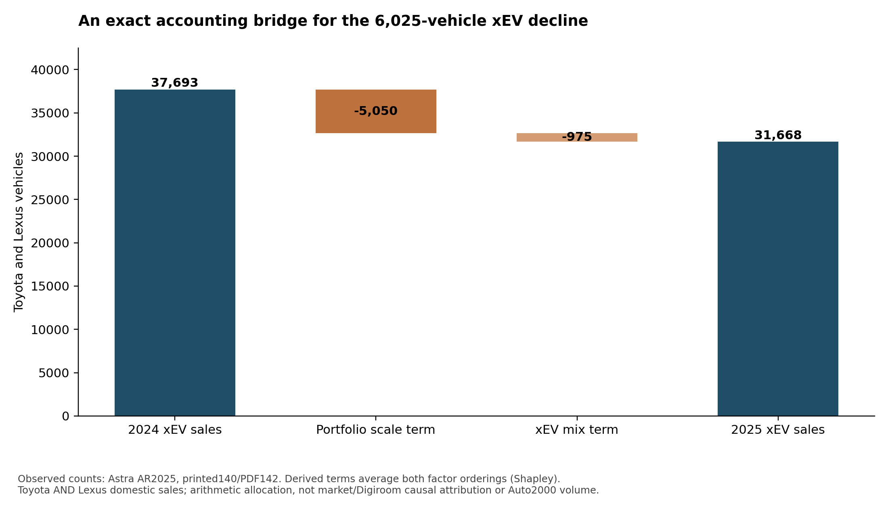
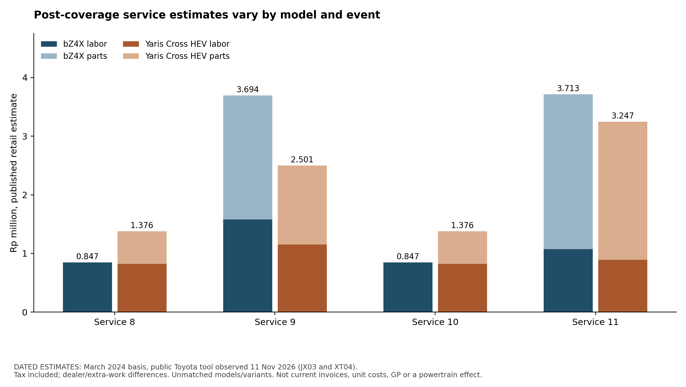

# The commercial mechanism changes with entitlement, payer and timing

The extension does not identify an Auto2000 profit uplift. It shows why several plausible shortcuts can produce the wrong diagnosis: a longer programme maximum can cover fewer scheduled events, a zero customer bill need not imply zero dealer gross profit, and a limit on insurer payment need not protect a dealer's full customer promise. These distinctions matter across vehicle sales, services, spare parts and body-and-paint work.

Seven questions and their falsifiers were recorded in `PRE_SPEC.md` before the extension calculations. The work combines the actual Astra chart counts, supplied case economics, official programme material, dated public service estimates and explicitly constructed contract stresses. It introduces no forecast conversion rate, per-job margin, customer base, insurer quote or causal effect estimate. The user retains solution selection.

## 1. A symmetric bridge removes the arbitrary ordering from the portfolio arithmetic

Astra's chart reports Toyota **and Lexus** xEV sales of 37,693 in 2024 and 31,668 in 2025, a decline of 6,025 vehicles. Total domestic portfolio sales fell from 291,566 to 251,954. The xEV share within that portfolio moved from 12.93% to 12.57%. These are brand-portfolio new-sales flows, not Auto2000 sales, owner adoption or the installed service base.

The earlier two-factor decomposition was exact but order-dependent. Changing total sales first assigns−5,120.951 vehicles to scale and−904.049 to mix. Changing mix first assigns−4,978.817 to scale and−1,046.183 to mix. Both reconcile to−6,025.

A symmetric Shapley average allocates half the interaction to each factor:

| Accounting term | Symmetric allocation |
|---|---:|
| Total portfolio scale | −5,049.884 vehicles |
| xEV share within the portfolio | −975.116 vehicles |
| Reconciled change | −6,025 vehicles |

This average removes the choice between those two orderings. It does not identify causes. The scale term is not an estimate of the effect of national market weakness, and the mix term is not an estimate of Digiroom performance. Pricing, assortment, availability, financing, geography and competition can affect both observed factors. `portfolio_decompositions.csv` preserves both orderings and their average. Source: Astra AR 2025, printed 140/PDF 142, independently retrieved in the capability workstream.

## 2. Programme years, event counts and actual payment are different variables

The current official T-CARE page distinguishes several programmes rather than one universal free-service entitlement:

| Programme | Published eligible cohort or scope | Scheduled-service benefit |
|---|---|---|
| T-CARE | Eligible purchases from July 2022, with listed model exclusions | Specified labor and parts through seven events, maximum 3 years/60,000 km |
| T-CARE Lite | Eligible LCGC purchases from January 2023 | Labor through seven events; parts are not the same automatic benefit as full T-CARE |
| T-CARE Lite+ | Optional additional package available from April 2023 for eligible LCGC | Purchased scheduled-parts coverage for events 2–7 |
| Legacy GBSB | Current page identifies eligible January 2020–June 2022 purchases; the original PDF has model rollout dates | Six events, maximum 4 years/50,000 km, for specified work |
| T-CARE XTRA | Eligible post-T-CARE servicing; the current page excludes GBSB | The 2026 announcement says events 8–11 are customer-paid and can earn conditional warranty increments |

The legacy PDF supplies a useful falsifier. Its six-event table lists recommended months 1,6,12,18,24 and 30, or the corresponding mileage thresholds, whichever comes first. Thus its four-year maximum does not mean four years of unlimited scheduled visits. Newer T-CARE has a shorter three-year maximum but seven covered events. A longer headline duration does not necessarily mean more free events or a later transition to customer payment. [EE-S01,EE-S03,EE-S04,EE-S11 PDF 1]

This comparison is structural. It does not move a particular vehicle from one programme to another or establish its eligibility. Missing services, mileage, model, delivery date, specified work and other cover still matter. `ordinal_entitlement_windows.csv` compares events inside each base programme, without inventing a customer panel or paid-demand forecast.

The economic implication is specific. A vehicle can have unchanged scheduled work while the customer's cash payment changes at a benefit boundary. The reverse is also possible: zero customer payment can coexist with technician work, parts consumption and an OEM reimbursement arrangement. The public material does not disclose the dealer's contractual reimbursement or direct cost. Neither zero customer cash nor programme expiry identifies dealer gross profit or defection.

Timing also limits a near-term acquisition argument. Under a time-only pattern with a first event at month 1 and later events at six-month multiples, the eighth event would occur at month 42. For a hypothetical January 2026 delivery that is July 2029, beyond the case's 2026–2028 investment window. This is a conditional calendar illustration, not a service forecast. Earlier mileage, older installed cohorts, uncovered work, collision repair and programme reimbursements can create different opportunities inside the window. New sales should not be treated as immediately equivalent paid-service demand.

## 3. Observable service fees do not reveal dealer margin or a uniform powertrain ranking

The public Toyota tool was observed with All New Yaris Cross Hybrid EV, variant 1.5 S HEV CVT TSS. Its cost note explicitly uses a **March 2024 estimate basis**, includes tax, and allows dealer and additional-work differences. The four later-event estimates are:

| Event | Labor estimate | Parts estimate | Combined estimate |
|---|---:|---:|---:|
| 8 | Rp 824,000 | Rp 552,000 | Rp 1,376,000 |
| 9 | Rp 1,154,000 | Rp 1,347,000 | Rp 2,501,000 |
| 10 | Rp 824,000 | Rp 552,000 | Rp 1,376,000 |
| 11 | Rp 890,000 | Rp 2,357,000 | Rp 3,247,000 |
| Four-event sum | Rp 3,692,000 | Rp 4,808,000 | **Rp 8,500,000** |

The highest event estimate is more than twice the lowest. That is bill variation in a dated model estimate, not measured bill shock, dissatisfaction, current pricing or willingness to return. Source: JX03 and the preserved `tcare_observed_costs.csv`; the current programme page and its public component were separately checked. `dated_service_estimates.csv` preserves each numerical input and limit.

The extension journey capture adds the bZ4X Panoramic View variant on the same March 2024 basis. Its events 8–11 sum to **Rp9,101,000**, compared with Rp8,500,000 for the Yaris Cross HEV. The difference is Rp601,000 across these four dated estimates. The model, size, variant and work mix are unmatched. This is a counterexample to a universal claim that a BEV's displayed bill must always be lower; it is not a powertrain treatment effect, a fleet average, actual ownership cost or a dealer-margin comparison. The same capture shows Agya 1.2 A/T event 2 with free displayed labor and Rp564,000 parts, illustrating the labor/parts distinction inside a covered-labor period. [XT04]

The tool's published component separately labels labor and parts and formats a zero amount as a free amount. A displayed zero parts fee therefore cannot be converted into zero inspection work, zero parts demand over the whole lifecycle, or an insurer/OEM reimbursement rate. Detailed model/job scope needs the correct service book. The generic Toyota xEV article states a common service interval and names additional electrification checks, but it is not a model-specific technical manual and should not be read as proof that a BEV receives engine-oil work. [EE-S06,EE-S10]

The supplied case's services 55% margin, spare-parts 25% margin and body-and-paint 35% margin are business-line averages. Multiplying these retail estimates by those percentages would invent a model-specific contribution. Retail fees are neither dealer unit costs nor realized warranty/insurance settlement values. The work therefore leaves that GP calculation unresolved.

HEV, PHEV and BEV remain separate lifecycle dimensions. Toyota's generic article explicitly names all three, while the inspected model-fee comparisons cover HEV and BEV. No model-specific PHEV service book or fee schedule was established here. Its job, entitlement and cost cells remain unresolved rather than filled by interpolation from either other powertrain.

## 4. Four business lines require separate demand and attribution logic

`commercial_mechanism_registry.csv` distinguishes fourteen mechanisms across the four lines. It keeps volume, mix, realization, payer, programme, channel, capacity, business perimeter and timing separate.

For **vehicle sales**, the outcome is a delivered vehicle with realized contribution, not a catalogue visit or a test-drive request. A finance or protection partner's income is not automatically Auto2000 gross profit.

For **services**, eligible vehicles, due work and dealer capture are different factors. Identical visits can contain different work. Lower due work and lower capture can produce the same aggregate decline. Programme coverage adds another dimension by changing who pays without necessarily changing the job.

For **spare parts**, attached parts and standalone sales must be reconciled to the work order. Adding a parts line to the same service event does not create a second independent customer visit. Included parts, retail parts and warranty-funded parts also have different realization paths.

For **body and paint**, collision or repair incidence, insurer routing, authorization, severity, parts supply and downtime are distinct from routine engine-maintenance cadence. Lower engine-maintenance needs do not identify body-repair demand. A payer change can alter rates, rejection exposure or collection timing, even with the same completed repair.

A useful exact gross-profit bridge is `change in quantity × initial unit GP + final quantity × change in unit GP`, provided scope and periods match. It is an identity, not a causal effect. If the same completed jobs merely move booking channel while price, discounts, direct cost and work mix stay fixed, incremental transaction GP is zero. Cost savings, genuinely additional demand and later retention are separate mechanisms requiring evidence.

Positive stand-alone job GP is also insufficient when relevant capacity is binding. The contribution must exceed that of displaced feasible work plus any added capacity cost. No real job duration, technician bottleneck or per-hour contribution was measured here, so the extension does not rank jobs by invented figures.

Displacement is counted once. If the dealer-wide completed-volume comparison already reflects lost alternative work, its contribution must not be subtracted a second time as a separate risk adjustment. The same rule applies to discounts, partner shares and direct costs already reflected in realized unit contribution.

Finally, incremental operating profit deducts incremental operating expenses from GP. Investment cash, depreciation, claim settlements, receivables and later recoveries need consistent treatment by period. The case's Rp 150 billion 2026–2028 cap is an investment constraint, not approval to spend it or proof that a future guarantee cannot create a later obligation.

## 5. A policy limit can leave a large retained obligation

The contract calculations are **constructed illustrations**. They use the friend's illustrative Rp 200 million floor,Rp 10 million top-up cap,Rp 10 million retention and Rp 15 million per-unit insurer layer. A separate Rp 100 million aggregate limit and two arrangements of twenty units are added stress assumptions. No such policy, pricing, eligibility or underwriting appetite is established.

For a valid offer of Rp 160 million, a capped top-up gives Rp 170 million customer credit. It does not deliver a Rp 200 million floor. A full floor creates Rp 40 million of shortfall; an eligible Rp 15 million recovery leaves Rp 25 million with the promisor before premium and running costs.

The joint-state test then holds the pooled vehicle-level offers identical while changing their arrangement. Every constructed unit has one Rp 160 million offer and one Rp 260 million offer across two labelled stress states. No probability is attached to either state.

| Constructed joint arrangement | Maximum gross floor shortfall in a state | Maximum dealer residual after the assumed aggregate insurer limit |
|---|---:|---:|
| Ten low offers in each state | Rp 400 million | Rp 300 million |
| All twenty low offers in one state | Rp 800 million | Rp 700 million |

The pooled per-unit inputs are the same. The maximum aggregate obligation differs because losses arrive together and the aggregate recovery limit binds. This does not estimate actual correlation or expected loss. It falsifies the argument that a small per-unit insurer layer or an average-looking unit case is sufficient to demonstrate full portfolio protection.

`constructed_joint_stress_states.csv` contains eighty constructed unit-state rows, not eighty customers. `constructed_aggregate_risk.csv` has four aggregate stress outcomes. `constructed_contract_tail.csv` shows the per-unit tail separately. All are labelled as illustrations. Dealer residual equals promised shortfall minus eligible recovery. An insurer limit caps that recovery, not a separate full-floor promise. No forecast, insurer selection or proposed contract is adopted.

## What the additional work establishes

The symmetric portfolio bridge is exact arithmetic. The official programme distinctions and the legacy event table support an entitlement-aware lifecycle diagnosis. The dated retail estimates demonstrate event-specific bills while leaving dealer contribution unresolved. The channel and capacity identities expose missing attribution inputs. The constructed risk states demonstrate why a capped benefit, a full floor and an insured layer cannot be used interchangeably.

The remaining identifying inputs include actual eligible cohorts, due jobs, completion and capture, reimbursement, direct costs, capacity, alternative customer behavior and signed risk-transfer terms. These limits shape the option menu. They do not select a winning solution.

## Source and reproduction notes

Eleven focused checks are logged in `source_checks.csv/json`, including public programme pages, two public page components and the legacy PDF. They belong to one Toyota/TAM ownership cluster, not eleven independent studies. One older brochure URL redirected to the homepage, the current-page GBSB PDF link returned 404, the static FAQ exposed only a default category, and no detailed model manual was retrieved. These limits are retained rather than replaced with assumed contents. A separately indexed official original GBSB PDF was successfully retrieved, rendered and inspected by AI. No human review is claimed.

Run `build_extension.py` to reproduce the tables, accounting bridge, stress calculations and both original charts. `checks.csv/json` reconciles the identities; `summary.json` records input hashes and counts. Full publisher pages/PDFs and internal page renders remain private. The deliverables contain original analysis and limited numerical observations, not redistributed full reports.
